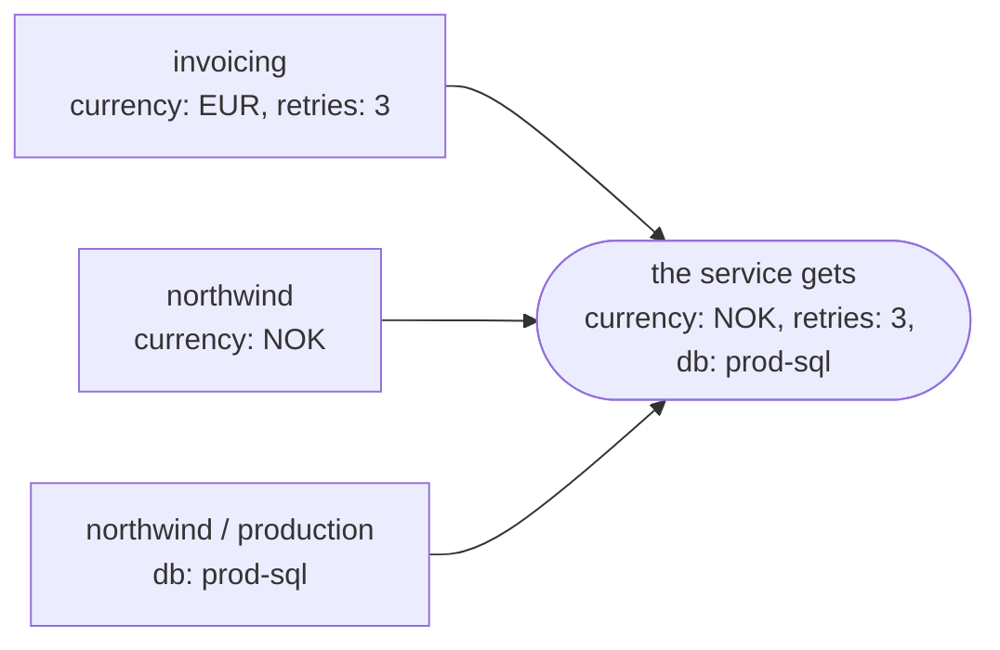
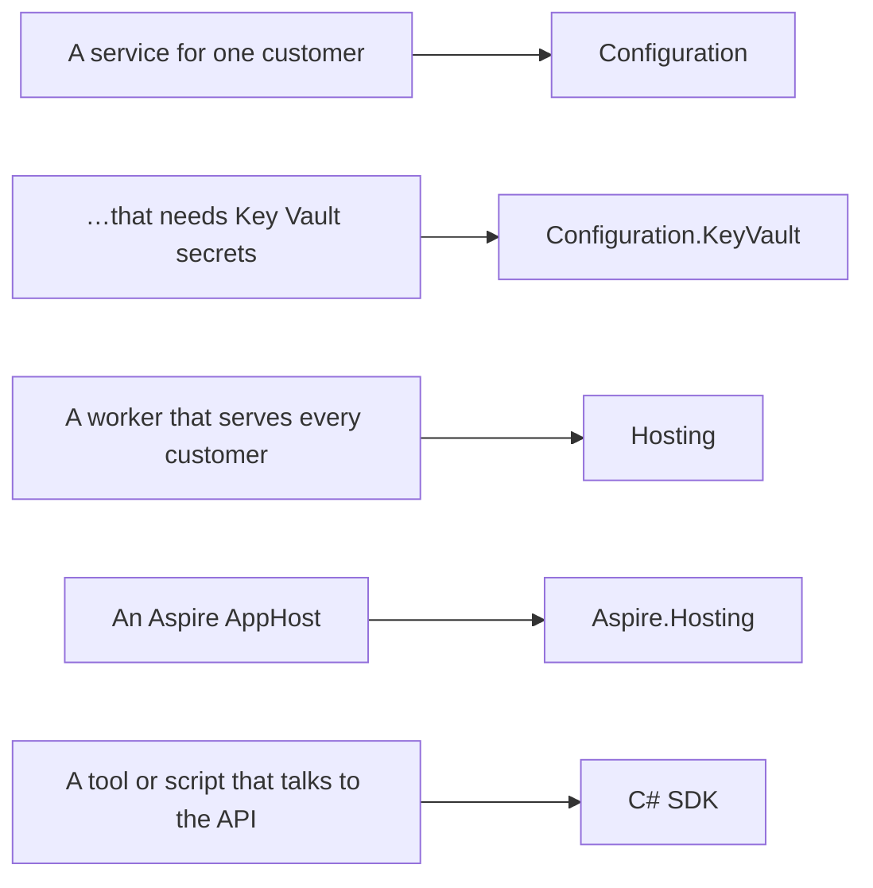
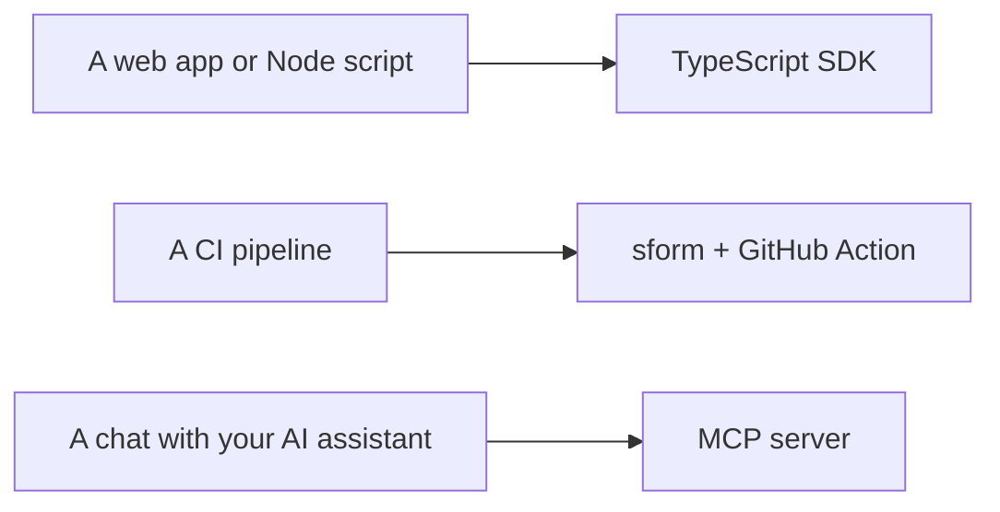

# Developer guide <Badge type="warning" text="preview" />

> One catalog of your product. Every customer, every environment, every odd little difference, written down **once**. Your code asks for its configuration and gets the merge. That's it. That's the trick.

This guide is the friendly, short version of the 2S Platform for people who write code. Each page takes one package, tells you why you'd want it, and gets you to working code in a couple of minutes. The deep, every-edge-case reference lives on GitHub, and every page links to it at the end.

::: tip In a hurry?
Jump to the [quick start](quick-start): from zero to `IOptionsMonitor<T>` in five steps.
:::

## 2S in one minute

You know this folder:

```text
appsettings.json
appsettings.Production.json
appsettings.Production.Northwind.json
appsettings.Production.Northwind.FINAL.json
appsettings.Production.Northwind.FINAL-v2-really.json
```

Every customer and every environment gets a copy, the copies drift apart, and nobody remembers why Northwind has `retries: 7`.

The 2S Platform's **Storyteller** keeps a catalog of your product instead: your customers, your modules, and where each module runs for each customer. Every record in that catalog can hold a small configuration document with **only its own difference**. When a service asks for its configuration, Storyteller merges everything from the general to the specific, and hands back one document.



Write the product default once, the customer's change once, the environment's change once. Done. No copies, and the reason for `retries: 7` has a name, an author and a history.

## Seven words to learn

That's the whole vocabulary. Three are nouns you pick, the rest are the relations between them.

| Word | Code | Think of it as | Example |
| --- | --- | --- | --- |
| **Subject** | `sbt` | Who it is for: a customer, a market, a product model | `northwind` |
| **Responsibility** | `rst` | What you ship: a module, a service, a capability | `invoicing` |
| **Context** | `cnt` | One of the subject's worlds: an environment, a region | `production` |
| **Usage** | `usg` | "This subject uses this responsibility", with its plan and seats | `northwind` uses `invoicing` |
| **Execution** | `exe` | That usage, running in one context: **the thing your service is** | `invoicing` for `northwind` in `production` |
| **Unit** | `unt` | A job or event inside a responsibility | `nightly-export` |
| **Unit of execution** | `uxe` | That job, inside one execution | `nightly-export` of Northwind's production |

The [annotations page](../annotations) tells the longer story, with pictures.

## Read a key like a sentence

Every record has a key, and the key reads left to right, from who owns it to what it is:

```text
@house.main.default.exe.northwind.invoicing.production
 │     │    │       │   │         │         └─ context
 │     │    │       │   │         └─ responsibility
 │     │    │       │   └─ subject
 │     │    │       └─ type code: an execution
 │     │    └─ view: an edition of the catalog (default is production)
 │     └─ project
 └─ organization
```

The part after the view, `exe.northwind.invoicing.production`, is the **annotation key**. With the `@organization.project.view.` in front, it is the **full key**: the one value a service needs to know who it is.

## Which package do I need?

**Writing .NET?**



**Something else?**



## The package map

Everything we serve, at a glance. You usually install **one** of the first four and the rest arrives with it.

| Package | From | In one line | Read |
| --- | --- | --- | --- |
| `42.Platform.Storyteller.`<br>`Configuration` | NuGet | Your configuration in `IConfiguration`, kept fresh, survives outages | [Configuration provider](configuration) |
| `42.Platform.Storyteller.`<br>`Configuration.KeyVault` | NuGet | Secrets resolved by your app, with your app's own identity | [Key Vault secrets](key-vault) |
| `42.Platform.Storyteller.`<br>`Hosting` | NuGet | "Who am I?", the catalog, and a worker for every customer | [Hosting](hosting) |
| `42.Platform.Storyteller.`<br>`Aspire.Hosting` | NuGet | An Aspire AppHost hands the right variables to every project | [Aspire](aspire) |
| `42.Platform.Storyteller.`<br>`ConfigurationFormats` | NuGet, comes with the provider | One document as flat JSON, `.properties`, `.env` or YAML | [Configuration formats](formats) |
| `42.Platform.Storyteller.`<br>`Sdk.NSwag` | NuGet, comes with the provider | The whole API as typed C# clients, with machine sign-in | [C# SDK](csharp-sdk) |
| `42.Platform.Storyteller.`<br>`Abstractions.Annotations` | NuGet, comes along | Keys and models: `AnnotationKey`, `FullKey`, `AnnotationType` | [C# SDK](csharp-sdk#the-packages-that-come-along) |
| `42.Platform.Storyteller.`<br>`KeyValues.ClientEncryption` | NuGet, comes along | Encrypt a secret on your side, so not even the platform can read it | [C# SDK](csharp-sdk#secrets-the-platform-cannot-read) |
| `@42for.net/2splatform.sdk` | npm | The whole API for TypeScript, with Vue Query, Zod and MSW mocks | [TypeScript SDK](typescript-sdk) |
| `42.Platform.Cli` (`sform`) | NuGet, a dotnet tool | The platform's command line, for you and for your pipelines | [sform & CI](cli) |
| The GitHub Action | `uses:` in a workflow | A resolved configuration in the environment of a GitHub Actions job | [sform & CI](cli#the-github-action) |
| The MCP server | an address of your deployment | Your AI assistant browses and edits the catalog, as you | [AI assistants](mcp) |

Hosting the platform yourself? The `2sInitDb` tool (`42.Platform.Storyteller.DbCreator`) creates and seeds the database. Everybody else can forget it exists.

## Getting the bits

Every package is on [nuget.org](https://www.nuget.org/) (and the TypeScript SDK on npm). We ship fast, so new versions arrive as prereleases first: add `--prerelease` to get the newest. Our prereleases are tested and safe to use.

Every .NET package targets .NET 10. The packages are released together, so keep their versions together too: let `Hosting` bring `Configuration`, rather than updating one of them on its own.

## Where next

- **New here?** The [quick start](quick-start) walks through everything once.
- **Just want configuration?** The [configuration provider](configuration) is two lines of code.
- **Lost?** The [cheat sheet](cheat-sheet) has every variable, every type code and the answers to "why does it say 403".
