# Annotation Lifecycle and Audit

Deleting an annotation is a soft delete. A deleted annotation can be restored, it can be deleted permanently, and it expires after a retention period. Every change of an annotation is recorded in its audit document, with the actor who made it.

The code is in `src/Platform/Storyteller/Backend.CosmosDb/src/Annotating/` (`CosmosAnnotationService`, `CosmosAnnotationService.Deletion.cs`, `AnnotationAuditStore`) and `Backend.Core/src/Annotating/` (rules, audit differences, options). The design and its decisions are in [the spec](specs/2026-10-11%20Soft-delete%20and%20audit%20of%20annotations.md).

## States

```mermaid
stateDiagram-v2
  [*] --> Active: create (also an ancestor created automatically)
  Active --> Active: update
  Active --> Deleted: delete (with all its descendants)
  Deleted --> Active: restore (also when a descendant is restored)
  Deleted --> Active: re-create (a write to the key; new content, empty configuration)
  Deleted --> Purged: permanent delete, or the retention runs out
  Purged --> Active: create the key again (a new annotation with a new audit)
  Purged --> [*]
```



- **I1.** Every descendant of a deleted annotation is deleted. A delete cascades to the whole tree of the inheritance graph ([inheritance.md](inheritance.md)). A restore restores the ancestors first, and a create creates or re-creates them.
- **I2.** Reads see only active annotations: `GetAnnotation`, `ExistAnnotation`, the list endpoints, `GetDescendants`, the `@annotation` binding and every configuration read treat a deleted annotation as missing. Only the reads of deleted annotations show it.
- **I3.** The audit lives as long as the key is known. It is created with the annotation, survives soft delete and re-create, and is removed by a permanent delete or the expiry.
- **I4.** A deleted annotation is a **root** of the deleted list (`Deletion.IsRoot`) when it was the key a delete was requested for, or when its deleted parent became active again (restored alone, or re-created).

## Items

All items of an annotation live in the annotation's partition of the organization container `org.{organization}` ([inheritance.md](inheritance.md) describes the partitions).

| Item | Id | While the annotation is deleted |
| --- | --- | --- |
| Annotation | `{view}.{key}` | `Deletion` is set, and `ttl` |
| Configuration | `{view}.cnf.{key}` | `AnnotationDeletionId` is set, and `ttl`. Hidden from every configuration read, listing, version and cache invalidation; writes answer `409 AnnotationDeleted`. |
| Configuration versions | `{view}.cfv.{key}.{version}` | Unchanged. The delete adds the current content as the version it holds, so the content survives the expiry. |
| Audit | `{view}.adt.{key}` | `ttl` |

`Deletion` holds `DeletionId` (shared by everything one delete removed), `RootKey`, `DeletedAt`, `DeletedBy`, `IsRoot`, and `DescendantCount` on the requested root. `PurgeAt` is computed on read as `_ts + ttl`, which is when Cosmos removes the item.

Every stored annotation also carries the server-owned stamps `Created` and `Modified` (`{ At, By }`); the annotations DbCreator seeds are stamped by the `System` actor. A write ignores them in its body, and so it ignores `Deletion` and the relation arrays (`UnitNames`, `ResponsibilityNames`, `ContextNames`): the server keeps those.

## Delete

`DeleteAnnotationAsync` marks the annotation and every active descendant:

1. One query per partition of the tree loads the annotations, their configurations and audits.
2. Each annotation gets `Deletion` and `ttl`, its configuration `AnnotationDeletionId` and `ttl` (and the version snapshot), and its audit a `Deleted` entry. The writes run in transactional batches with ETags, the deepest descendants first and the requested annotation last, so a failure leaves a valid state.
3. Active parents outside the deleted tree drop the names of their deleted children from their arrays (for example the context of a deleted usage's execution).

A second delete of the same key returns the existing deletion. A delete that did not finish is completed with the same `DeletionId`.

## Restore

`RestoreAnnotationsAsync` takes many keys. They are processed ancestors first, and a failure of one key does not stop the others (`Failed`).

1. Deleted ancestors are restored alone (cause `Ancestor`); missing ones are created like automatic ancestors.
2. The key itself is restored; with descendants (the default), also every descendant with the same `DeletionId` (cause `Cascade`). Descendants deleted by an earlier, separate delete stay deleted.
3. A restored item loses `Deletion` and `ttl`; its configuration loses the stamp and `ttl`, its cached calculation is cleared, and the version snapshot is removed.
4. An annotation restored alone keeps its deleted children deleted: they leave its arrays and become roots.
5. Active parents get the names of the restored children back.

## Re-create

A create of a deleted key (`SetAnnotation`, `SetAnnotations`, `SetAnnotationsSimple`) re-creates it, and so does a create below a deleted ancestor, which re-creates the ancestor. Any Contributor may do it. The API never asks; clients look up deleted keys first and offer a restore.

- The item is replaced by the new content, with empty relation arrays and a new `Created` stamp.
- The configuration is deleted after its content went to the versions. The first new configuration version continues the numbering, so the versions of the previous lifetime stay visible until they expire.
- The audit continues with a `Recreated` entry (time, actor, and the replaced `DeletionId`).
- The children deleted with the previous version stay deleted and become roots.

## Permanent delete and expiry

`PurgeAnnotationAsync` deletes a deleted annotation, all its descendants, their configurations and their audits, after moving the configuration content to the versions. An active annotation answers `409 AnnotationNotDeleted`. Only the items of the requested view are deleted, also for a responsibility, whose partition is shared by all views.

Expiry does the same without code: every deleted annotation, its configuration and its audit carry a `ttl` counted from the deletion (`Annotations:DeletedRetentionDays`, default 90, between 1 and 365). Cosmos counts `ttl` from the last write, so every later write to a deleted item recomputes the remaining seconds from `DeletedAt`. An expired item is no longer readable even before Cosmos removes it in the background. A restore or a re-create removes the `ttl`.

## Audit

The audit document of an annotation holds its entries, oldest first:

| Action | Recorded when | Content |
| --- | --- | --- |
| `Created` | create, an automatic ancestor | Cause `Ancestor` for an automatic ancestor |
| `Recreated` | a create of a deleted key | The replaced `DeletionId`; cause `Ancestor` for an ancestor |
| `Updated` | an update that changes something | `Fields`, `Labels`, `Values` |
| `Deleted` | delete | `DeletionId`; cause `Cascade` on descendants; `DescendantCount` on the root |
| `Restored` | restore | `DeletionId`; cause `Cascade` or `Ancestor`; `DescendantCount` on a restore with descendants |
| `ConfigurationChanged`, `ConfigurationDeleted` | a configuration write with an actor | `ConfigurationVersion`; best effort, after the write |

- **Fields** keep the previous and the new value of `Title`, `DocumentationLink`, `IsDisabled`, `ValidFrom`, `ExpiresAt`, `TimeZone` and, for units, `UnitType`. `Description` and `UnitDefinition` record only that they changed.
- **Labels** list the added and the removed labels.
- **Values** list the changed keys with the kind of both sides; primitive values are stored, objects and arrays only by their kind.
- Strings are cut at `Audit:MaxValueLength` (256) with `IsPreviousTruncated` or `IsValueTruncated`.
- Each entry has the actor (`Account`, `Machine` or `System`, with an id and a display name) and the time.

An annotation write and its audit entry go to one transactional batch. An update that changes nothing writes nothing.

**Size.** The audit of an active annotation has no `ttl`. Its serialized size is limited to `Audit:MaxDocumentBytes` (default 64 KiB, about 140 typical entries); above it, the oldest entries are dropped and `IsTrimmed` is set. The size is measured on the bytes written, with an allowance of 200 bytes for the system properties Cosmos adds, and stored as `SizeInBytes`. The largest audits of a view:

```sql
SELECT TOP 20 c.AnnotationKey, c.SizeInBytes FROM c WHERE STARTSWITH(c.id, 'default.adt.') ORDER BY c.SizeInBytes DESC
```

Audit entries are excluded from the index (`/Entries/*`), so a write is charged mostly by its size.

`GetAnnotationHistoryAsync` returns the entries newest first, with the state of the annotation (`Active` or `Deleted`). A purged or unknown key has no history.

## Containers

Organization containers have TTL on without a default expiry (`DefaultTimeToLive = -1`) and the indexing policy excludes `/Entries/*`. Only items with a `ttl` expire: the versions of configurations, templates and schemas (365 days after their write) and the items of deleted annotations. DbCreator applies the settings to existing organization containers on every start; the `core` container is not changed.

## Validation

Every create, re-create and update checks the content (`AnnotationRules`):

| Field | Rule |
| --- | --- |
| `Title` | at most 200 characters |
| `Description` | at most 10,000 characters |
| `DocumentationLink` | at most 2048 characters, an absolute `http` or `https` URL |

A violation answers `InvalidInputException` with `ErrorCode` `InvalidAnnotation`. A bulk create is rejected as a whole and the message lists the invalid keys. Stored annotations are not migrated.

## Error codes

| Code | Meaning |
| --- | --- |
| `InvalidAnnotation` | The content breaks a rule above. |
| `AnnotationDeleted` | A configuration write for a deleted annotation. |
| `AnnotationNotDeleted` | A permanent delete of an active annotation. |
| `NotFound` | A restore of a key that does not exist or was purged. |
| `Conflict` | The annotations changed concurrently three times in a row, or a descendant was restored during a permanent delete. |
