# Annotation Lifecycle and Audit

Deleting an annotation is a soft delete. A deleted annotation can be restored, it can be deleted permanently, and it expires after a retention period. Every change of an annotation is recorded in its audit document, with the actor who made it. An annotation that is not deleted can still be out of effect: disabled, scheduled or expired ([Active annotations](#active-annotations)).

The code is in `src/Platform/Storyteller/Backend.CosmosDb/src/Annotating/` (`CosmosAnnotationService`, `CosmosAnnotationService.Deletion.cs`, `AnnotationAuditStore`) and `Backend.Core/src/Annotating/` (rules, audit differences, options). The design and its decisions are in [the spec](specs/2026-10-11%20Soft-delete%20and%20audit%20of%20annotations.md).

## States

```mermaid
stateDiagram-v2
  [*] --> Active: create (also an ancestor created automatically)
  Active --> Active: update
  Active --> Deleted: delete (with all its descendants)
  Deleted --> Active: restore (also when a descendant is restored)
  Deleted --> Active: re-create (a write or an import of the key; new content, empty configuration)
  Deleted --> Purged: permanent delete, or the retention runs out
  Purged --> Active: create the key again (a new annotation with a new audit)
  Purged --> [*]
```



- **I1.** Every descendant of a deleted annotation is deleted. A delete cascades to the whole tree of the inheritance graph ([inheritance.md](inheritance.md)). A restore restores the ancestors first, and a create creates or re-creates them.
- **I2.** Reads see only annotations that are not deleted: `GetAnnotation`, `ExistAnnotation`, the list endpoints, `GetDescendants`, the `@annotation` binding and every configuration read treat a deleted annotation as missing. Only the reads of deleted annotations show it, and the list endpoints, `GetDescendants` and `GetAnnotation` when asked with `includeDeleted=true`.
- **I3.** The audit lives as long as the key is known. It is created with the annotation, survives soft delete and re-create, and is removed by a permanent delete or the expiry.
- **I4.** A deleted annotation is a **root** of the deleted list (`Deletion.IsRoot`) when it was the key a delete was requested for, or when its deleted parent became active again (restored alone, or re-created).

## Active annotations

An annotation that is not deleted has a **status** (`AnnotationStatus`, `Abstractions.Annotations/src/AnnotationStatusExtensions.cs`), evaluated at the time of the read in UTC:

| Status | When | Order |
| --- | --- | --- |
| `Disabled` | `IsDisabled` is `true` | wins |
| `Scheduled` | `ValidFrom` is after now | then |
| `Expired` | `ExpiresAt` is at or before now | then |
| `Active` | otherwise | |

`ValidFrom` and `ExpiresAt` are compared as instants: their offset and the annotation's `TimeZone` (which only says how to show and enter them) don't matter. The admin UI computes the same status (`annotation-status.ts`).

**The reads of annotations return only active annotations by default.** Two query flags, `false` by default, add the others:

| Flag | Adds |
| --- | --- |
| `includeInactive` | disabled, scheduled and expired annotations |
| `includeDeleted` | soft-deleted annotations, each with its `Deletion` |

Each flag removes one condition, so a deleted annotation that is also disabled needs both. They apply to `GET …/annotations`, the per-type lists (`…/responsibilities`, `…/subjects`, `…/usages`, `…/contexts`, `…/executions`, `…/units`, `…/units-of-execution`), `GET …/annotations/{key}/{descendants}` and `GET …/annotations/{key}`.

- **Lists.** Without `includeInactive`, Cosmos drops the disabled annotations (an undefined, `null` or `false` `IsDisabled` is enabled), and each page is filtered in memory by the validity window, because the dates are stored with the offset the client sent and can't be compared as strings. A page can therefore hold fewer items than the page size, or none, and still have a continuation token: follow it until it is absent. `Count` is the number of returned items.
- **One key.** Without `includeInactive`, an annotation that is not active answers `404` with `ErrorCode` `AnnotationInactive` and a message naming the status, so clients can tell it from a missing one (plain `404`). With `includeDeleted`, a deleted key is returned with its `Deletion` instead of `404`.

**Not filtered by status:** `ExistAnnotation`, every write (an update, delete, restore or purge acts on an inactive annotation as on an active one, and a delete cascades to inactive descendants), the reads of deleted annotations (`…/deleted…`), the history, the `@annotation` binding, the configuration reads and listings, and the export of a view ([Export and import](#export-and-import)). A configuration of a disabled or expired annotation still resolves.

## Items

All items of an annotation live in the annotation's partition of the organization container `org.{organization}` ([inheritance.md](inheritance.md) describes the partitions).

| Item | Id | While the annotation is deleted |
| --- | --- | --- |
| Annotation | `{view}.{key}` | `Deletion` is set, and `ttl` |
| Configuration | `{view}.cnf.{key}` | `AnnotationDeletionId` is set, and `ttl`. Hidden from every configuration read, listing, version and cache invalidation; writes answer `409 AnnotationDeleted`. |
| Configuration versions | `{view}.cfv.{key}.{version}` | Unchanged. The delete adds the current content as the version it holds, so the content survives the expiry. |
| Audit | `{view}.adt.{key}` | `ttl` |

`Deletion` holds `DeletionId` (shared by everything one delete removed), `RootKey`, `DeletedAt`, `DeletedBy`, `IsRoot`, and `DescendantCount` on the requested root. `PurgeAt` is computed on read as `_ts + ttl`, which is when Cosmos removes the item.

Every stored annotation also carries the server-owned [audit stamps](audit-stamps.md) `Created` and `Modified` (`{ At, By }`); the annotations DbCreator seeds are stamped by the `System` actor. A write ignores them in its body, and so it ignores `Deletion` and the relation arrays (`UnitNames`, `ResponsibilityNames`, `ContextNames`): the server keeps those.

## Delete

`DeleteAnnotationAsync` marks the annotation and every active descendant:

1. One query per partition of the tree loads the annotations, their configurations and audits.
2. Each annotation gets `Deletion` and `ttl`, its configuration `AnnotationDeletionId` and `ttl` (and the version snapshot), and its audit a `Deleted` entry. The writes run in transactional batches with ETags, the deepest descendants first and the requested annotation last, so a failure leaves a valid state.
3. Active parents outside the deleted tree drop the names of their deleted children from their arrays (for example the context of a deleted usage's execution).

A second delete of the same key returns the existing deletion. A delete that did not finish is completed with the same `DeletionId`.

## Restore

`RestoreAnnotationsAsync` takes many keys. They are processed ancestors first, and a failure of one key does not stop the others (`Failed`).

1. Deleted ancestors are restored alone (cause `Ancestor`); missing ones are created like automatic ancestors.
2. The key itself is restored; with descendants (the default), also every descendant with the same `DeletionId` (cause `Cascade`). Descendants deleted by an earlier, separate delete stay deleted.
3. A restored item loses `Deletion` and `ttl`; its configuration loses the stamp and `ttl`, its cached calculation is cleared, and the version snapshot is removed.
4. An annotation restored alone keeps its deleted children deleted: they leave its arrays and become roots.
5. Active parents get the names of the restored children back.

## Re-create

A create of a deleted key re-creates it, and so does a create below a deleted ancestor, which re-creates the ancestor. Four calls do it: `SetAnnotation`, `SetAnnotations`, `SetAnnotationsSimple`, and the import of an annotation file with `Existing` set to `Overwrite` ([Export and import](#export-and-import)). Any Contributor may do it. The API never asks; clients look up deleted keys first and offer a restore.

- The item is replaced by the new content, with empty relation arrays and a new `Created` stamp.
- The configuration is deleted after its content went to the versions. The first new configuration version continues the numbering, so the versions of the previous lifetime stay visible until they expire.
- The audit continues with a `Recreated` entry (time, actor, and the replaced `DeletionId`).
- The children deleted with the previous version stay deleted and become roots.

## Export and import

An [export of a view](export-import.md) holds every annotation that is not deleted, whatever its status, as a file of its editable members. Deleted annotations, the audit, `Deletion` and the relation arrays stay with the platform. The `Created` and `Modified` stamps are listed in the manifest, for information only.

An import writes an annotation file the way `SetAnnotation` does, with the usual audit entries by the importing caller:

- An active key whose content differs is updated with an `Updated` entry; with `Existing` set to `Skip`, it is kept. An equal one is left alone.
- A missing key is created with its missing ancestors (`Created`, with the cause `Ancestor` on the ancestors).
- With `Existing` set to `Overwrite` (the default), a deleted key, or a key below a deleted ancestor, is re-created as [above](#re-create) (`Recreated`). The import reports it with the warning `AnnotationRecreated`. With `Skip`, the file is skipped with `AnnotationDeleted`, and the deleted keys stay deleted.

The archive carries no audit, and the import adds no cause of its own. The rules of the content are in [export-import.md](export-import.md#annotations).

## Permanent delete and expiry

`PurgeAnnotationAsync` deletes a deleted annotation, all its descendants, their configurations and their audits, after moving the configuration content to the versions. An active annotation answers `409 AnnotationNotDeleted`. Only the items of the requested view are deleted, also for a responsibility, whose partition is shared by all views.

Expiry does the same without code: every deleted annotation, its configuration and its audit carry a `ttl` counted from the deletion (`Annotations:DeletedRetentionDays`, default 90, between 1 and 365). Cosmos counts `ttl` from the last write, so every later write to a deleted item recomputes the remaining seconds from `DeletedAt`. An expired item is no longer readable even before Cosmos removes it in the background. A restore or a re-create removes the `ttl`.

## Audit

The audit document of an annotation holds its entries, oldest first:

| Action | Recorded when | Content |
| --- | --- | --- |
| `Created` | create, an automatic ancestor | Cause `Ancestor` for an automatic ancestor |
| `Recreated` | a create or an import of a deleted key | The replaced `DeletionId`; cause `Ancestor` for an ancestor |
| `Updated` | an update that changes something | `Fields`, `Labels`, `Values` |
| `Deleted` | delete | `DeletionId`; cause `Cascade` on descendants; `DescendantCount` on the root |
| `Restored` | restore | `DeletionId`; cause `Cascade` or `Ancestor`; `DescendantCount` on a restore with descendants |
| `ConfigurationChanged`, `ConfigurationDeleted` | a configuration write or clear | `ConfigurationVersion`; best effort, after the write |

- **Fields** keep the previous and the new value of `Title`, `DocumentationLink`, `IsDisabled`, `ValidFrom`, `ExpiresAt`, `TimeZone` and, for units, `UnitType`. `Description` and `UnitDefinition` record only that they changed.
- **Labels** list the added and the removed labels.
- **Values** list the changed keys with the kind of both sides; primitive values are stored, objects and arrays only by their kind. Two numbers are the same value when their decimal values are equal. They are also the same when they are the same double and one of them has a fraction or an exponent: Cosmos DB stores such a number as a double, and writes it with 17 digits in a point read but with the fewest digits in a query (`3.1415926535897931` and `3.141592653589793`). Integers compare exactly.
- Strings are cut at `Audit:MaxValueLength` (256) with `IsPreviousTruncated` or `IsValueTruncated`.
- Each entry has the [actor](audit-stamps.md#the-actor) (`Account`, `Machine` or `System`, with an id and a display name) and the time.

An annotation write and its audit entry go to one transactional batch. An update that changes nothing writes nothing.

**Size.** The audit of an active annotation has no `ttl`. Its serialized size is limited to `Audit:MaxDocumentBytes` (default 64 KiB, about 140 typical entries); above it, the oldest entries are dropped and `IsTrimmed` is set. The size is measured on the bytes written, with an allowance of 200 bytes for the system properties Cosmos adds, and stored as `SizeInBytes`. The largest audits of a view:

```sql
SELECT TOP 20 c.AnnotationKey, c.SizeInBytes FROM c WHERE STARTSWITH(c.id, 'default.adt.') ORDER BY c.SizeInBytes DESC
```

Audit entries are excluded from the index (`/Entries/*`), so a write is charged mostly by its size.

`GetAnnotationHistoryAsync` returns the entries newest first, with the state of the annotation (`Active` or `Deleted`). A purged or unknown key has no history.

## Containers

Organization containers have TTL on without a default expiry (`DefaultTimeToLive = -1`) and the indexing policy excludes `/Entries/*`. Only items with a `ttl` expire: the versions of configurations, templates and schemas (365 days after their write) and the items of deleted annotations. DbCreator applies the settings to existing organization containers on every start; the `core` container is not changed.

## API

All routes are under `v1/{organization}/{project}/{view}/annotations` (`Api.Functions/src/V1/AnnotationsHttp.cs` and `AnnotationsHttp.Deleted.cs`). Writes record the caller as the actor (`GetAuditActor()`): an account with its id and name from the token, a machine with its id, or `System` for a request without an identity in `DEV_AUTH` builds.

| Method | Route | Role | Result |
| --- | --- | --- | --- |
| PUT, POST | `…/{key}` | Contributor | Creates, updates, or re-creates; `200` with the stored annotation, so the client receives the stamps. `400 InvalidAnnotation` or `InvalidKey`, and `400` for a body that is not a JSON object, has no known `AnnotationType` or is not UTF-8; `409` after three concurrent changes. |
| POST | `…` and `…/simple` | Contributor | Bulk create (at most 100); deleted keys and deleted ancestors are re-created. `400` for a missing list (an empty body or `null`), and on `…` for a `null` entry; an empty list answers `200 []`. |
| DELETE | `…/{key}` | Contributor | Soft delete with the descendants; `200 AnnotationDeletionResult`. A repeated delete returns the existing deletion. `404` when missing. |
| GET | `…` and the per-type lists | Reader | `AnnotationsResponse` of active annotations; `?includeInactive=true` and `?includeDeleted=true` add the others ([Active annotations](#active-annotations)); `?continuationToken=`. |
| GET | `…/{key}` | Reader | The annotation; `404` when missing or deleted, `404 AnnotationInactive` when it is not active. `?includeInactive=true` and `?includeDeleted=true` return those too. |
| GET | `…/{key}/{descendants}` | Reader | The descendants of the key that are active; the same two flags. |
| GET | `…/deleted` | Reader | `AnnotationsResponse` with `Deletion` on each item, newest deletion first. `?roots=true` (default) lists only the roots, `?roots=false` everything; `?deletionId=` what one delete removed; `?continuationToken=`. |
| GET | `…/deleted/{key}` | Reader | The deleted annotation with `Deletion`; `404` when it is not deleted. |
| POST | `…/deleted/lookup` | Reader | `AnnotationKeysRequest` (at most 100 keys) → the deleted annotations among them; active and unknown keys are left out. `400 InvalidKey` for an invalid key, no keys, too many, or a body that is not an object with `Keys`. |
| POST | `…/deleted/restore` | Contributor | `AnnotationRestoreRequest` (`Keys`, at most 100, and `Descendants`, default `true`) → `200 AnnotationRestoreResult`; a partial success lists the failed keys in `Failed`. `400 InvalidKey` as for the lookup. |
| DELETE | `…/deleted/{key}` | Administrator, users only | Permanent delete; `200 AnnotationPurgeResult`. `409 AnnotationNotDeleted` for an active key, `404` when missing. |
| GET | `…/{key}/history` | Reader | `AnnotationHistory`, for active and deleted keys; `404` for a purged or unknown key. |

The literal segments `deleted` and `history` win over `{key}` and `{descendants}`; an annotation key always starts with a type code and a dot, so it can't be `deleted`, `lookup`, or `restore`.

`GET …/{key}/{descendants}` follows the inheritance graph: the descendants of a context are its executions and their units of execution, and the descendants of a unit are its units of execution across executions.

The configuration routes of a deleted annotation answer `404` with `ErrorCode` `AnnotationDeleted` on reads (also the versions and diffs), and `409 AnnotationDeleted` on writes, so clients can tell a deleted annotation from a missing one.

**Creating in clients.** Before a create, a client looks up the keys and their ancestors (`AnnotationKeyExtensions.GetAllAncestorKeys`, `getAllAncestors` in the TypeScript SDK). When one is deleted, it shows who deleted it and when, and offers **Restore and update** (restore with `Descendants = false`, then send the content as an update), **Create new** (send the content; the API re-creates the deleted keys empty), or **Cancel**.

## CLI

The `sform story` commands (`src/Platform/Cli/src/Commands/Storyteller/`) work on the current organization, project and view, or on `-p|--projectKey` and `-v|--view`.

| Command | What it does |
| --- | --- |
| `sform story [-r\|-s\|-u\|-c\|-e\|-d\|-t] [-i\|--inactive] [--deleted] [-a\|--all]` | Lists the active annotations (or the queried types, the descendants of `-d`, or a tree). `--inactive` adds the disabled, scheduled and expired ones (`includeInactive`), `--deleted` the deleted ones (`includeDeleted`), `--all` both. Every annotation that is not active is marked `[disabled]`, `[scheduled]`, `[expired]` or `[deleted]`; the trees mark their subject or responsibility nodes and the execution leaves. `-k` continues the plain list too. `-d` is `--descendants`, so `--deleted` has no short form. |
| `sform story delete <key>` | Soft delete. It prints the number of descendants and the date of the automatic purge (`PurgeAt`). A repeated delete changes nothing and exits with `42`. |
| `sform story delete <key> --permanent [-y]` | It confirms first (`-y` skips the question), naming the number of descendants, inactive ones included. It then tries the permanent delete. An active key answers `409 AnnotationNotDeleted`; the command then deletes the key and tries again. Without the role, `403` prints "Only an Administrator or Owner can delete permanently." and nothing changes. `-p` is taken by `--projectKey`, so `--permanent` has no short form. |
| `sform story restore <key>... [--without-descendants]` | Restores many keys, in requests of at most 100. It lists the restored keys, marks the ancestors it had to create, and lists the failures. Any failure exits with `2`. |
| `sform story deleted [-a] [-k <token>]` (alias `trash`) | A table of the deleted roots: key, type, deleted, by, descendants, and purge date. `--all` lists every deleted annotation, with a Root column. |
| `sform story history <key> [-n N] [--json]` | A table of the newest entries first: when, who, action, and changes on one line, for example `Title: "Old" → "New"; +eu −us; plan: "pro" → "ent"; Description changed; config v7`. Objects and arrays show only their kind (`{…}`, `[…]`), and cut strings end with `…`. Machines print as `machine:<id>`. |
| `sform story get <key>` | Prints the annotation whatever its status (`includeInactive=true`). For a deleted key, it says who deleted it and when, the purge date, and the restore command. |
| `sform story set <key> [--restore-deleted\|--recreate]` | Before writing, it looks up the key and its ancestors. When some are deleted, it lists them and asks: **Restore and update** (restore them alone, then write), **Create new** (write, which re-creates them empty), or **Cancel**. The options answer the question in advance. When the input is redirected and neither option is given, it stops with `2` and names both. A rejected body prints the server's message (for example `InvalidAnnotation`). |

`sform story export` and `sform story import` move the documents of the view as a zip, annotations included ([export-import.md](export-import.md#cli)).

## Validation

Every create, re-create and update checks the content (`AnnotationRules`):

| Field | Rule |
| --- | --- |
| `Title` | at most 200 characters |
| `Description` | at most 10,000 characters |
| `DocumentationLink` | at most 2048 characters, an absolute `http` or `https` URL |

A violation answers `InvalidInputException` with `ErrorCode` `InvalidAnnotation`. A bulk create is rejected as a whole and the message lists the invalid keys. Stored annotations are not migrated.

## Error codes

| Code | Meaning |
| --- | --- |
| `InvalidAnnotation` | The content breaks a rule above. |
| `InvalidKey` | A key in the route or the body can't be parsed, or a lookup or restore has no keys, more than 100, or a body that is not an object with `Keys`. |
| `AnnotationDeleted` | A configuration write for a deleted annotation. |
| `AnnotationNotDeleted` | A permanent delete of an active annotation. |
| `AnnotationInactive` | `GET …/annotations/{key}` of a disabled, scheduled or expired annotation without `includeInactive=true` (`404`). |
| `NotFound` | A restore of a key that does not exist or was purged. |
| `Conflict` | The annotations changed concurrently three times in a row, or a descendant was restored during a permanent delete. |
| `BodyTooLarge` | `413`: the body of a bulk create is larger than 16 MiB, that of a single annotation larger than 4 MiB, or that of `…/simple`, a lookup or a restore larger than 1 MiB. |
