# Annotation Lifecycle and Audit

Deleting an annotation is a soft delete. A deleted annotation can be restored, it can be deleted permanently, and it expires after a retention period. Every change of an annotation is recorded in its audit document, with the actor who made it. An annotation that is not deleted can still be out of effect: disabled, scheduled or expired ([Active annotations](#active-annotations)). A read answers the version of an annotation as an `ETag`, a write can be conditioned on it ([Versions and conditional writes](#versions-and-conditional-writes)), and a `PATCH` changes single members, merged on the server ([Merge writes](#merge-writes-patch)).

The code is in `src/Platform/Storyteller/Backend.CosmosDb/src/Annotating/` (`CosmosAnnotationService`, `CosmosAnnotationService.Deletion.cs`, `AnnotationAuditStore`) and `Backend.Core/src/Annotating/` (rules, audit differences, options). The design and its decisions are in [the spec](specs/2026-10-11%20Soft-delete%20and%20audit%20of%20annotations.md).

## States

```mermaid
stateDiagram-v2
  [*] --> Active: create (also an ancestor created automatically)
  Active --> Active: update
  Active --> Deleted: delete (with all its descendants)
  Deleted --> Active: restore (also when a descendant is restored)
  Deleted --> Active: re-create (a write or an import of the key; new content, empty configuration)
  Deleted --> Purged: permanent delete, or the retention runs out
  Purged --> Active: create the key again (a new annotation with a new audit)
  Purged --> [*]
```



- **I1.** Every descendant of a deleted annotation is deleted. A delete cascades to the whole tree of the inheritance graph ([inheritance.md](inheritance.md)). A restore restores the ancestors first, and a create creates or re-creates them.
- **I2.** Reads see only annotations that are not deleted: `GetAnnotation`, `ExistAnnotation`, the list endpoints, `GetDescendants`, the `@annotation` binding and every configuration read treat a deleted annotation as missing. Only the reads of deleted annotations show it, and the list endpoints, `GetDescendants` and `GetAnnotation` when asked with `includeDeleted=true`.
- **I3.** The audit lives as long as the key is known. It is created with the annotation, survives soft delete and re-create, and is removed by a permanent delete or the expiry.
- **I4.** A deleted annotation is a **root** of the deleted list (`Deletion.IsRoot`) when it was the key a delete was requested for, or when its deleted parent became active again (restored alone, or re-created).

## Active annotations

An annotation that is not deleted has a **status** (`AnnotationStatus`, `Abstractions.Annotations/src/AnnotationStatusExtensions.cs`), evaluated at the time of the read in UTC:

| Status | When | Order |
| --- | --- | --- |
| `Disabled` | `IsDisabled` is `true` | wins |
| `Scheduled` | `ValidFrom` is after now | then |
| `Expired` | `ExpiresAt` is at or before now | then |
| `Active` | otherwise | |

`ValidFrom` and `ExpiresAt` are compared as instants: their offset and the annotation's `TimeZone` (which only says how to show and enter them) don't matter. The admin UI computes the same status (`annotation-status.ts`).

**The reads of annotations return only active annotations by default.** Two query flags, `false` by default, add the others:

| Flag | Adds |
| --- | --- |
| `includeInactive` | disabled, scheduled and expired annotations |
| `includeDeleted` | soft-deleted annotations, each with its `Deletion` |

Each flag removes one condition, so a deleted annotation that is also disabled needs both. They apply to `GET …/annotations`, the per-type lists (`…/responsibilities`, `…/subjects`, `…/usages`, `…/contexts`, `…/executions`, `…/units`, `…/units-of-execution`), `GET …/annotations/{key}/{descendants}` and `GET …/annotations/{key}`.

- **Lists.** Without `includeInactive`, Cosmos drops the disabled annotations (an undefined, `null` or `false` `IsDisabled` is enabled), and each page is filtered in memory by the validity window, because the dates are stored with the offset the client sent and can't be compared as strings. A page can therefore hold fewer items than the page size, or none, and still have a continuation token: follow it until it is absent. `Count` is the number of returned items.
- **Paging.** Every annotation list pages with its continuation token: `…/annotations` across its types, the per-type lists and `…/annotations/{key}/{descendants}`. A page reads up to 1000 annotations from Cosmos DB, and the filters in memory may leave fewer. The token is opaque base64 text that can hold `+`, `/` and `=`, so URL-encode it as a query-parameter value (`Uri.EscapeDataString`, `encodeURIComponent` or `URLSearchParams`), so that the server decodes exactly the text it returned; a raw `+` would arrive as a space. Send it back to the list and with the parameters that returned it. A token that does not decode starts the list again at its first page. The server does not check which list a token that decodes came from. A token whose Cosmos DB part Cosmos DB rejects answers `400` with `ErrorCode` `InvalidQuery`: list again without it. A token of an annotation type that the list does not read answers an empty page without a token, so the list looks ended. A token of a type that the list reads, but from another list, can continue at the wrong place.
- **Name queries.** The per-type lists filter by the names in the key: `nameQuery` (the listed annotation's own name) on `…/responsibilities`, `…/subjects` and `…/contexts`; `responsibilityNameQuery` on `…/usages`, `…/executions`, `…/units` and `…/units-of-execution`; `subjectNameQuery` on `…/usages`, `…/contexts`, `…/executions` and `…/units-of-execution`; `contextNameQuery` on `…/executions` and `…/units-of-execution`; `unitNameQuery` on `…/units-of-execution`. The text is trimmed, and several queries combine with AND. A query that starts with `^` or ends with `$` is a .NET regular expression of at most 256 characters, case-sensitive unless it turns on `(?i)` after the `^` (`^(?i)north`). It runs on the non-backtracking engine, so backreferences, lookarounds, atomic groups and conditionals are not supported, and neither is a pattern whose automaton would be too large (long counted repetitions such as `.{0,2000}`). One match has a timeout of 50 ms, and the matching of one request a budget of 250 ms. Otherwise a query that starts or ends with `%` is a text the name contains (`%voic%`, `%voic` and `voic%` are the same; `%` alone matches every name), and any other query is the exact name; both compare case-sensitively. An invalid, too long or unsupported pattern answers `400` with `ErrorCode` `InvalidQuery` before any read; a pattern that runs into the timeout or the budget answers the same `400` while a page is filtered. An exact `nameQuery` of responsibilities or subjects, an exact `responsibilityNameQuery` and an exact `subjectNameQuery` of contexts read only the partition of that responsibility or subject. Every query filters each page in memory, so a filtered page can hold fewer items than the page size, or none, and still have a continuation token.
- **One key.** Without `includeInactive`, an annotation that is not active answers `404` with `ErrorCode` `AnnotationInactive` and a message naming the status, so clients can tell it from a missing one (plain `404`). With `includeDeleted`, a deleted key is returned with its `Deletion` instead of `404`.

**Not filtered by status:** `ExistAnnotation`, every write (an update, patch, delete, restore or purge acts on an inactive annotation as on an active one, and a delete cascades to inactive descendants), the reads of deleted annotations (`…/deleted…`), the history, the `@annotation` binding, the configuration reads and listings, and the export of a view ([Export and import](#export-and-import)). A configuration of a disabled or expired annotation still resolves.

## Items

All items of an annotation live in the annotation's partition of the organization container `org.{organization}` ([inheritance.md](inheritance.md) describes the partitions).

| Item | Id | While the annotation is deleted |
| --- | --- | --- |
| Annotation | `{view}.{key}` | `Deletion` is set, and `ttl` |
| Configuration | `{view}.cnf.{key}` | `AnnotationDeletionId` is set, and `ttl`. Hidden from every configuration read, listing, version and cache invalidation; writes answer `409 AnnotationDeleted`. |
| Configuration versions | `{view}.cfv.{key}.{version}` | Unchanged. The delete adds the current content as the version it holds, so the content survives the expiry. |
| Audit | `{view}.adt.{key}` | `ttl` |

`Deletion` holds `DeletionId` (shared by everything one delete removed), `RootKey`, `DeletedAt`, `DeletedBy`, `IsRoot`, and `DescendantCount` on the requested root. `PurgeAt` is computed on read as `_ts + ttl`, which is when Cosmos removes the item.

Every stored annotation also carries the server-owned [audit stamps](audit-stamps.md) `Created` and `Modified` (`{ At, By }`); the annotations DbCreator seeds are stamped by the `System` actor. A write ignores them in its body, and so it ignores `Deletion` and the relation arrays (`UnitNames`, `ResponsibilityNames`, `ContextNames`): the server keeps those. A client can send an annotation back as it read it. `PUT`/`POST …/{key}` still checks the type of a member it sends: a relation array is an array of strings or `null` (as empty), and anything else answers `400`. The bulk create skips the relation arrays. A merge patch ignores the same members ([Merge writes](#merge-writes-patch)).

## Delete

`DeleteAnnotationAsync` marks the annotation and every active descendant:

1. One query per partition of the tree loads the annotations, their configurations and audits.
2. Each annotation gets `Deletion` and `ttl`, its configuration `AnnotationDeletionId` and `ttl` (and the version snapshot), and its audit a `Deleted` entry. The writes run in transactional batches with ETags, the deepest descendants first and the requested annotation last, so a failure leaves a valid state.
3. Active parents outside the deleted tree drop the names of their deleted children from their arrays (for example the context of a deleted usage's execution).

A second delete of the same key returns the existing deletion. A delete that did not finish is completed with the same `DeletionId`.

## Restore

`RestoreAnnotationsAsync` takes many keys. They are processed ancestors first, and a failure of one key does not stop the others (`Failed`).

1. Deleted ancestors are restored alone (cause `Ancestor`); missing ones are created like automatic ancestors.
2. The key itself is restored; with descendants (the default), also every descendant with the same `DeletionId` (cause `Cascade`). Descendants deleted by an earlier, separate delete stay deleted.
3. A restored item loses `Deletion` and `ttl`; its configuration loses the stamp and `ttl`, its cached calculation is cleared, and the version snapshot is removed.
4. An annotation restored alone keeps its deleted children deleted: they leave its arrays and become roots.
5. Active parents get the names of the restored children back.

## Re-create

A create of a deleted key re-creates it, and so does a create below a deleted ancestor, which re-creates the ancestor. Four calls do it: `SetAnnotation`, `SetAnnotations`, `SetAnnotationsSimple`, and the import of an annotation file with `Existing` set to `Overwrite` ([Export and import](#export-and-import)). Any Contributor may do it with the first three; the import needs the Administrator role ([export-import.md](export-import.md#access)). A machine needs `Annotation.Write` for the first three, and also the management scope `Annotation.Manage` for the two bulk calls, so `SetAnnotation` re-creates one key without it; the import needs `Annotation.Write` and `Annotation.Manage` too, and the management scope `Configuration.Transfer` (see [Scopes of machines](authentication.md#scopes-of-machines)). The API never asks; clients look up deleted keys first and offer a restore.

- The item is replaced by the new content, with empty relation arrays and a new `Created` stamp.
- The configuration is deleted after its content went to the versions. The first new configuration version continues the numbering, so the versions of the previous lifetime stay visible until they expire.
- The audit continues with a `Recreated` entry (time, actor, and the replaced `DeletionId`).
- The children deleted with the previous version stay deleted and become roots.

## Export and import

An [export of a view](export-import.md) holds every annotation that is not deleted, whatever its status, as a file of its editable members. Deleted annotations, the audit, `Deletion` and the relation arrays stay with the platform. The `Created` and `Modified` stamps are listed in the manifest, for information only.

An import writes an annotation file the way `SetAnnotation` does, with the usual audit entries by the importing caller:

- An active key whose content differs is updated with an `Updated` entry; with `Existing` set to `Skip`, it is kept. An equal one is left alone.
- A missing key is created with its missing ancestors (`Created`, with the cause `Ancestor` on the ancestors).
- With `Existing` set to `Overwrite` (the default), a deleted key, or a key below a deleted ancestor, is re-created as [above](#re-create) (`Recreated`). The import reports it with the warning `AnnotationRecreated`. With `Skip`, the file is skipped with `AnnotationDeleted`, and the deleted keys stay deleted.

The archive carries no audit, and the import adds no cause of its own. The rules of the content are in [export-import.md](export-import.md#annotations).

## Permanent delete and expiry

`PurgeAnnotationAsync` deletes a deleted annotation, all its descendants, their configurations and their audits, after moving the configuration content to the versions. An active annotation answers `409 AnnotationNotDeleted`. Only the items of the requested view are deleted, also for a responsibility, whose partition is shared by all views.

Expiry does the same without code: every deleted annotation, its configuration and its audit carry a `ttl` counted from the deletion (`Annotations:DeletedRetentionDays`, default 90, between 1 and 365). Cosmos counts `ttl` from the last write, so every later write to a deleted item recomputes the remaining seconds from `DeletedAt`. An expired item is no longer readable even before Cosmos removes it in the background. A restore or a re-create removes the `ttl`.

## Audit

The audit document of an annotation holds its entries, oldest first:

| Action | Recorded when | Content |
| --- | --- | --- |
| `Created` | create, an automatic ancestor | Cause `Ancestor` for an automatic ancestor |
| `Recreated` | a create or an import of a deleted key | The replaced `DeletionId`; cause `Ancestor` for an ancestor |
| `Updated` | an update that changes something | `Fields`, `Labels`, `Values` |
| `Deleted` | delete | `DeletionId`; cause `Cascade` on descendants; `DescendantCount` on the root |
| `Restored` | restore | `DeletionId`; cause `Cascade` or `Ancestor`; `DescendantCount` on a restore with descendants |
| `ConfigurationChanged`, `ConfigurationDeleted` | a configuration write or clear | `ConfigurationVersion`; best effort, after the write |

- **Fields** keep the previous and the new value of `Title`, `DocumentationLink`, `IsDisabled`, `ValidFrom`, `ExpiresAt`, `TimeZone` and, for units, `UnitType`. `Description` and `UnitDefinition` record only that they changed.
- **Labels** list the added and the removed labels.
- **Values** list the changed keys with the kind of both sides; primitive values are stored, objects and arrays only by their kind. Two numbers are the same value when their decimal values are equal. They are also the same when they are the same double and one of them has a fraction or an exponent: Cosmos DB stores such a number as a double, and writes it with 17 digits in a point read but with the fewest digits in a query (`3.1415926535897931` and `3.141592653589793`). Integers compare exactly.
- Strings are cut at `Audit:MaxValueLength` (256) with `IsPreviousTruncated` or `IsValueTruncated`.
- Each entry has the [actor](audit-stamps.md#the-actor) (`Account`, `Machine` or `System`, with an id and a display name) and the time.

An annotation write and its audit entry go to one transactional batch. An update or a patch that changes nothing writes nothing, and the annotation keeps its `ETag`.

**Size.** The audit of an active annotation has no `ttl`. Its serialized size is limited to `Audit:MaxDocumentBytes` (default 64 KiB, about 140 typical entries); above it, the oldest entries are dropped and `IsTrimmed` is set. The size is measured on the bytes written, with an allowance of 200 bytes for the system properties Cosmos adds, and stored as `SizeInBytes`. The largest audits of a view:

```sql
SELECT TOP 20 c.AnnotationKey, c.SizeInBytes FROM c WHERE STARTSWITH(c.id, 'default.adt.') ORDER BY c.SizeInBytes DESC
```

Audit entries are excluded from the index (`/Entries/*`), so a write is charged mostly by its size.

`GetAnnotationHistoryAsync` returns the entries newest first, with the state of the annotation (`Active` or `Deleted`). A purged or unknown key has no history.

## Containers

Organization containers have TTL on without a default expiry (`DefaultTimeToLive = -1`) and the indexing policy excludes `/Entries/*`. Only items with a `ttl` expire: the versions of configurations, templates and schemas (365 days after their write) and the items of deleted annotations. DbCreator applies the settings to existing organization containers on every start; the `core` container is not changed.

## API

All routes are under `v1/{organization}/{project}/{view}/annotations` (`Api.Functions/src/V1/AnnotationsHttp.cs` and `AnnotationsHttp.Deleted.cs`). Writes record the caller as the actor (`GetAuditActor()`): an account with its id and name from the token, a machine with its id, or `System` for a request without an identity in `DEV_AUTH` builds.

| Method | Route | Role | Result |
| --- | --- | --- | --- |
| PUT, POST | `…/{key}` | Contributor; machines `Annotation.Write` | Creates, updates, or re-creates. The body replaces the editable content: what it does not hold is cleared. `200` with the stored annotation, so the client receives the stamps; a `POST` also answers the `ETag` of the stored version, a `PUT` none. `If-Match` writes only a version read before and never creates or re-creates; `If-None-Match: *` only creates or re-creates ([Versions and conditional writes](#versions-and-conditional-writes)). `400 InvalidAnnotation` or `InvalidKey`, and `400` for a body that is not a JSON object, has no known `AnnotationType` or is not UTF-8; `400 "Invalid annotation object in body: …"` for a body without a type-specific member of its type (`SubjectKey`, `UnitType`, …), naming the missing members, or with a member of the wrong type, naming its JSON path (`Path: $.ContextNames`); `400 InvalidPrecondition` for a malformed `If-Match` or `If-None-Match`; `409` after three concurrent changes; `412 AnnotationPreconditionFailed` when a condition does not hold. |
| PATCH | `…/{key}` | Contributor; machines `Annotation.Write` | Changes single members, merged on the server against the stored state ([Merge writes](#merge-writes-patch)): `application/merge-patch+json` (RFC 7396) or `application/json-patch+json` (RFC 6902). `200` with the stored annotation and the `ETag` of its version. `If-Match` as for `POST`. `400 PatchInvalid` for a body that is not a patch, `400 InvalidAnnotation` for an invalid result, `400 InvalidPrecondition` for a malformed `If-Match` or any `If-None-Match`; `404 AnnotationNotFound` or `AnnotationDeleted`, as a patch never creates or re-creates; `409` after three concurrent changes; `412 AnnotationPreconditionFailed` or `PatchTestFailed`; `415 InvalidContentType` for another media type. |
| POST | `…` and `…/simple` | Contributor; machines `Annotation.Write` and `Annotation.Manage` | Bulk create (at most 100); deleted keys and deleted ancestors are re-created. `400` for a missing list (an empty body or `null`), and on `…` for a `null` entry; an empty list answers `200 []`. |
| DELETE | `…/{key}` | Contributor; machines `Annotation.Write` and `Annotation.Manage` | Soft delete with the descendants; `200 AnnotationDeletionResult`. A repeated delete returns the existing deletion. `404` when missing. |
| GET | `…` and the per-type lists | Reader; machines `Annotation.Read` | `AnnotationsResponse` of active annotations; `?includeInactive=true` and `?includeDeleted=true` add the others ([Active annotations](#active-annotations)); `?continuationToken=`. |
| GET | `…/{key}` | Reader; machines `Annotation.Read` | The annotation, with the `ETag` of its version; `404` when missing or deleted, `404 AnnotationInactive` when it is not active. `?includeInactive=true` and `?includeDeleted=true` return those too; a deleted annotation comes without an `ETag`. |
| GET | `…/{key}/{descendants}` | Reader; machines `Annotation.Read` | The descendants of the key that are active; the same two flags. |
| GET | `…/deleted` | Reader; machines `Annotation.Read` | `AnnotationsResponse` with `Deletion` on each item, newest deletion first. `?roots=true` (default) lists only the roots, `?roots=false` everything; `?deletionId=` what one delete removed; `?continuationToken=`, the token of the previous page as it came: a token that Cosmos DB rejects answers `400 InvalidQuery`, so list again without it. |
| GET | `…/deleted/{key}` | Reader; machines `Annotation.Read` | The deleted annotation with `Deletion`; `404` when it is not deleted. |
| POST | `…/deleted/lookup` | Reader; machines `Annotation.Read` | `AnnotationKeysRequest` (at most 100 keys) → the deleted annotations among them; active and unknown keys are left out. `400 InvalidKey` for an invalid key, no keys, too many, or a body that is not an object with `Keys`. |
| POST | `…/deleted/restore` | Contributor; machines `Annotation.Write` and `Annotation.Manage` | `AnnotationRestoreRequest` (`Keys`, at most 100, and `Descendants`, default `true`) → `200 AnnotationRestoreResult`; a partial success lists the failed keys in `Failed`. `400 InvalidKey` as for the lookup. |
| DELETE | `…/deleted/{key}` | Administrator, users only | Permanent delete; `200 AnnotationPurgeResult`. `409 AnnotationNotDeleted` for an active key, `404` when missing. |
| GET | `…/{key}/history` | Reader; machines `Annotation.Read` | `AnnotationHistory`, for active and deleted keys; `404` for a purged or unknown key. |

Machines have no role: their [scopes](authentication.md#scopes-of-machines) decide, each stored on the machine and carried by its credentials; without one, a route answers `403 AccessDenied`, also in Debug builds. The rows marked `Annotation.Manage` need that management scope on top of `Annotation.Write`; a single `PUT`, `POST` or `PATCH` of `…/{key}` needs `Annotation.Write` alone. The permanent delete refuses every machine with `403` ("A permanent delete needs a user with the Administrator role.").

The Functions host doesn't rank a literal segment above a parameter: it runs the first function, in the order of the function names, whose route matches. So the routes constrain their parameters (`Definitions.Routes.Constraints`), and the routes of one method never meet:

- `{key}` of `…/{key}`, `…/{key}/{descendants}` and `…/{key}/history` takes only a text with a `.`. Every annotation key has one after its type code; the literal segments beside it (`simple`, `deleted`, `history`) have none.
- `{descendants}` takes only `usages`, `contexts`, `executions`, `units`, `units-of-execution` or `all`, ignoring case (`USAGES` reaches the function, which answers `400`).
- `{key}` of `…/deleted/{key}` takes any text: it answers `GET` and `DELETE`, and its siblings `lookup` and `restore` only `POST`.

A key without a dot (`…/annotations/nope`) or another kind of descendants (`…/{key}/bogus`) matches no route and gets the host's `404` without a body. A key with a dot that doesn't parse (`…/annotations/boots.app`), and any key under `…/deleted/` that doesn't parse, reaches the function and gets `400 InvalidKey`.

`GET …/{key}/{descendants}` follows the inheritance graph: the descendants of a context are its executions and their units of execution, and the descendants of a unit are its units of execution across executions.

The configuration routes of a deleted annotation answer `404` with `ErrorCode` `AnnotationDeleted` on reads (also the versions and diffs), and `409 AnnotationDeleted` on writes, so clients can tell a deleted annotation from a missing one.

**Creating in clients.** Before a create, a client looks up the keys and their ancestors (`AnnotationKeyExtensions.GetAllAncestorKeys`, `getAllAncestors` in the TypeScript SDK). When one is deleted, it shows who deleted it and when, and offers **Restore and update** (restore with `Descendants = false`, then `PATCH` the content, so the restored record keeps what the content does not hold), **Create new** (`POST` the content with `If-None-Match: *`; the API re-creates the deleted keys empty, and a `412` tells that the key was restored or created meanwhile), or **Cancel**. The admin UI still writes the whole body after the restore, merged over the restored record, without a condition.

## Versions and conditional writes

The version of an annotation is the Cosmos DB `_etag` of its annotation item. The API sends it as a strong entity tag, `"a1.<base64url of the _etag>"` (`AnnotationEntityTags` in `Api.Functions/src/ConditionalWrites/`). A client treats it as opaque and sends it back as it came. `a1` names the representation: a change of the annotation's JSON changes the prefix, and a tag of the old prefix then matches nothing.

- **What changes it.** Every replacement of the item: an update, a patch that changes something, a delete, a restore and a re-create. A child that is created, deleted or restored changes the tag of its parent too, because the relation arrays (`UnitNames`, `ResponsibilityNames`, `ContextNames`) are part of the item and of its body. A write that changes nothing keeps the tag, and so does a configuration write, which changes the configuration and the audit, not the annotation item. So a parent with many children changing (a responsibility whose units come and go) changes its tag often, and a full write with `If-Match` to it can answer `412` although none of its own members changed: to change some of its members, prefer a `PATCH` without `If-Match`, which merges into the current state.
- **Where it is sent.** `ETag` comes with the `200` of:
  - `GET …/{key}` of an annotation that is not deleted, also an inactive one read with `includeInactive=true`. A deleted annotation read with `includeDeleted=true` gets none, and a `404` never has one;
  - `POST …/{key}` and `PATCH …/{key}`: the tag of the stored version, the current one for a write that changes nothing.

  The `200` of `PUT …/{key}` has none: RFC 9110 §9.3.4 forbids a validator after a `PUT` whose body was stored transformed, and the server normalizes it. The SDKs write with `POST`. The lists, the descendants and the reads of deleted annotations send no tag.
- **`If-Match`** (`POST`, `PUT`, `PATCH`): the write happens only when the annotation exists (is not deleted) and is at one of the listed versions, or exists at all for `*`. The comparison is strong: a weak tag (`W/"…"`), a tag of another prefix or one that does not decode never matches. A missing or deleted key fails (a `PATCH` answers `404` first), so a write with `If-Match` never creates or re-creates.
- **`If-None-Match`** (`POST`, `PUT`): `*` writes only when the annotation does not exist, as a missing or a deleted key. So `POST` with `If-None-Match: *` creates or re-creates, and never overwrites. A list of tags refuses those versions, compared weakly. A `PATCH` with `If-None-Match` answers `400 InvalidPrecondition`, because it never creates.
- **Both** are checked when both are given (RFC 9110 §13.2.2), so `If-Match` with `If-None-Match: *` never holds.
- **A malformed header** answers `400 InvalidPrecondition`: a value that is not `*` or a list of entity tags, `*` together with tags, or an empty value. The field lines of one header form one list. Unlike a conditional read, a write does not ignore it: that would turn an intended conditional write into an unconditional one.
- **`412` and `409`.** A condition that does not hold answers `412` with `ErrorCode` `AnnotationPreconditionFailed` and writes nothing. The message says what failed: the annotation changed since it was read, it does not exist or is deleted, or it already exists. Read it again and decide. A `409 Conflict` means that the server's own retries ran out: a write makes up to three attempts, each guarded by the ETag of the item, and a concurrent change starts the next attempt. Every attempt checks the condition against the tag the client sent, never a newer one, so a change between the client's read and its write becomes a `412`, not an overwrite. A change of the audit alone, which a configuration write appends to, fails only the attempt, and the next one writes.

Without a condition, `POST` and `PUT` create, update or re-create as before. A create that loses to a concurrent create of the same key updates it on the next attempt.

A create writes the key, and any ancestors it creates, before it adds their names to the relation arrays of their active parents. When a parent changes in between, that last step fails after the keys are stored: the create then adds the missing names to the parents again, each under a fresh ETag, up to three times, so a bulk create, an import and a single create report the key as created. Should that still fail, the whole write is tried again: the key is then the version this write created, so its condition is not checked again (an `If-None-Match: *` does not fail on its own create), and the attempt completes the names as well.

```text
GET  …/annotations/exe.northwind.invoicing.prod          → 200, ETag: "a1.…"
POST …/annotations/exe.northwind.invoicing.prod
     If-Match: "a1.…"                                     → 200 with the new ETag, or 412 AnnotationPreconditionFailed
POST …/annotations/exe.northwind.invoicing.prod
     If-None-Match: *                                     → 200 when it was missing or deleted, else 412
```

## Merge writes (PATCH)

`PATCH …/annotations/{key}` changes single members of an annotation in one request, merged on the server, without a read first (`AnnotationPatch` and `AnnotationPatchDocument` in `Backend.Core/src/Annotating/`). It needs what a single write needs: Contributor, or a machine with `Annotation.Write`. The body is at most 4 MiB.

**The editable document.** A patch applies to this JSON object, built from the stored annotation, with every member present:

| Member | Value |
| --- | --- |
| `IsDisabled` | boolean or null |
| `ValidFrom`, `ExpiresAt` | ISO 8601 date and time with an offset, or null |
| `TimeZone`, `Title`, `Description`, `DocumentationLink` | string or null |
| `Labels` | array of strings, `[]` when there are none |
| `Values` | object, `{}` when there are none |
| `UnitType`, `UnitDefinition` | string; units only |

**Formats**, by `Content-Type`:

- **`application/merge-patch+json`** (RFC 7396), an object. A member left out keeps its value, and `null` clears it: `Labels: null` means no labels, `Values: null` no values. `Values` merges name by name, recursively: `{"Values":{"plan":"pro"}}` changes one value, and `{"Values":{"old":null}}` removes one. An array, `Labels` or an array value, is replaced whole. Member names match case-insensitively, as the API reads bodies. The members a write ignores (`AnnotationKey`, `AnnotationType`, `Name`, `ProjectName`, `ViewName`, the keys and names of the ancestors, the relation arrays, `Created`, `Modified`, `Deletion`) are ignored here too, so a body that was read can be sent back. Any other member answers `400 InvalidAnnotation`, and so does one member given twice in different cases. A merge patch cannot set a value to JSON `null`, because `null` removes it; a JSON Patch or a full write can.
- **`application/json-patch+json`** (RFC 6902), an array of operations over the editable document, as configurations take. Paths are JSON Pointers and case-sensitive (`/Title`, not `/title`); a `/` or a `~` in a value name is written `~1` or `~0` (RFC 6901). Every member is present, so `add /Labels/-` appends a label, `add /Values/plan` sets one value, and `replace /Title` works on an unset title. A `test` operation is a precondition: when it does not match, or its path does not exist, the patch answers `412 PatchTestFailed` and writes nothing. Any other operation that fails, for example a `remove` of a value that does not exist, answers `400 PatchInvalid`.
- **`application/json`**, or no `Content-Type`: an object is a merge patch, an array a JSON Patch.
- Any other media type answers `415 InvalidContentType` with `Accept-Patch: application/merge-patch+json, application/json-patch+json` (RFC 5789).

A body that is not JSON, has a member twice, or does not fit its format (an array as a merge patch, an unknown operation, a missing path or value, a malformed pointer) answers `400 PatchInvalid` before anything is read.

**The result.** After the patch:

- the document holds only the editable members, with the types above. An unknown member, a member of another type or a label that is not a string answers `400 InvalidAnnotation`, naming the member;
- a removed or null member is unset;
- a unit keeps `UnitType` and `UnitDefinition`: they cannot be removed or set to null (`400 InvalidAnnotation`);
- labels keep their first occurrence (ordinal), so adding a label the annotation has changes nothing;
- the annotation is normalized and checked as a full write is ([Validation](#validation)).

A JSON Patch may not build a document larger than a body can be: every value an operation adds (`add`, `replace`, `copy`, `move`) is weighed before it is added, about its size in characters, and the document may not pass 4 Mi characters or nest a value deeper than 64 levels. Otherwise the operation fails with `400 PatchInvalid`, so a few `copy` operations cannot grow the document without end. An annotation that is still larger than Cosmos DB stores (2 MB) answers `400 BodyTooLarge`, for a full write too. A record that a full write stored with a `null` label, or a unit with a `null` `UnitType` or `UnitDefinition`, can still be patched: the null label is dropped, and the null member stays null until a patch sets it.

**The write.**

- A `PATCH` never creates or re-creates a key. A missing key answers `404 AnnotationNotFound` (create it with `POST`), a deleted one `404 AnnotationDeleted` (restore it, or write it whole with `POST`). Both come before the condition (RFC 9110 §13.2.1), so `If-Match` on a missing key answers `404` too.
- `If-Match` works as for `POST` ([above](#versions-and-conditional-writes)).
- The merge is atomic. Every attempt applies the patch to the annotation as it is stored then, and replaces the item under its ETag, so a concurrent change of another member is kept, not overwritten. Three lost attempts answer `409 Conflict`.
- A disabled, scheduled or expired annotation can be patched, for example re-enabled with `{"IsDisabled": false}`.
- A patch that changes nothing writes nothing, adds no audit entry and keeps the `ETag`. It answers `200` with the stored annotation and its tag, as every patch does.
- The `Updated` entry of the audit records only the members that changed.

```text
PATCH …/annotations/exe.northwind.invoicing.prod
Content-Type: application/merge-patch+json

{ "Title": "Invoicing (EU)", "Values": { "plan": "pro", "trial": null } }
```

```text
PATCH …/annotations/exe.northwind.invoicing.prod
Content-Type: application/json-patch+json
If-Match: "a1.…"

[
  { "op": "test", "path": "/Values/plan", "value": "basic" },
  { "op": "add", "path": "/Values/plan", "value": "pro" },
  { "op": "add", "path": "/Labels/-", "value": "eu" },
  { "op": "replace", "path": "/Description", "value": null }
]
```

## CLI

The `sform story` commands (`src/Platform/Cli/src/Commands/Storyteller/`) work on the current organization, project and view, or on `-p|--projectKey` and `-v|--view`.

| Command | What it does |
| --- | --- |
| `sform story [-r\|-s\|-u\|-c\|-e\|-d\|-t] [-i\|--inactive] [--deleted] [-a\|--all]` | Lists the active annotations (or the queried types, the descendants of `-d`, or a tree). `--inactive` adds the disabled, scheduled and expired ones (`includeInactive`), `--deleted` the deleted ones (`includeDeleted`), `--all` both. Every annotation that is not active is marked `[disabled]`, `[scheduled]`, `[expired]` or `[deleted]`; the trees mark their subject or responsibility nodes and the execution leaves. `-k` continues the plain list too. `-d` is `--descendants`, so `--deleted` has no short form. |
| `sform story delete <key>` | Soft delete. It prints the number of descendants and the date of the automatic purge (`PurgeAt`). A repeated delete changes nothing and exits with `42`. |
| `sform story delete <key> --permanent [-y]` | It confirms first (`-y` skips the question), naming the number of descendants, inactive ones included. It then tries the permanent delete. An active key answers `409 AnnotationNotDeleted`; the command then deletes the key and tries again. Without the role, `403` prints "Only an Administrator or Owner can delete permanently." and nothing changes. `-p` is taken by `--projectKey`, so `--permanent` has no short form. |
| `sform story restore <key>... [--without-descendants]` | Restores many keys, in requests of at most 100. It lists the restored keys, marks the ancestors it had to create, and lists the failures. Any failure exits with `2`. |
| `sform story deleted [-a] [-k <token>]` (alias `trash`) | A table of the deleted roots: key, type, deleted, by, descendants, and purge date. `--all` lists every deleted annotation, with a Root column. |
| `sform story history <key> [-n N] [--json]` | A table of the newest entries first: when, who, action, and changes on one line, for example `Title: "Old" → "New"; +eu −us; plan: "pro" → "ent"; Description changed; config v7`. Objects and arrays show only their kind (`{…}`, `[…]`), and cut strings end with `…`. Machines print as `machine:<id>`. |
| `sform story get <key>` | Prints the annotation whatever its status (`includeInactive=true`). For a deleted key, it says who deleted it and when, the purge date, and the restore command. |
| `sform story set <key> [-i <file>] [-c <name=value>] [-l <label>] [--replace] [--restore-deleted\|--recreate]` | Before writing, it looks up the key and its ancestors. When some are deleted, it lists them and asks: **Restore and update** (restore them alone, then the same merge as for an existing key), **Create new** (create the key from the input alone with `If-None-Match: *`, which re-creates the deleted keys empty), or **Cancel**. The options answer the question in advance. When the input is redirected and neither option is given, it stops with `2` and names both. The input is the content of `-i <file>`, `-c <name=value>` and `-l <label>`; the key decides the other members. A `-c` wins over the same name in the file, and a date-like string stays as written. A file that is not an annotation exits with `2`. **By default it merges**, as `sform story config set` does, in one `PATCH` without a read first: a JSON Patch (`AnnotationJsonPatch`) that sets each member the input holds (`UnitType` and `UnitDefinition` of a unit included), sets each value of the input by its name, and appends each label of the input. So a member of the input wins over the stored one, the labels are the stored ones and then the new ones, each value of the file or of `-c` replaces the stored value of the same name whole, and what the input does not hold is kept, also when another write changed it meanwhile. A member cannot be cleared in a merge. **Restore and update** keeps the restored record's content this way. A key that does not exist (`404 AnnotationNotFound`) is created from the input alone, by `POST` with `If-None-Match: *`; when it was created meanwhile (`412`), the command patches it instead. After three such rounds it says that the key changed concurrently and exits with `1`. A key deleted after the lookup (`404 AnnotationDeleted`) is not re-created: the command says so and exits with `1`, so a new run asks what to do. When **Create new** finds a key restored or created meanwhile (`412`), it patches the key instead. `--replace` writes the input alone: it reads the annotation, whatever its status, with its `ETag`, and `POST`s the full body with `If-Match` of that tag, or with `If-None-Match: *` when the key does not exist. What the input does not hold is cleared (the title, description, documentation link, validity window, time zone, disabled flag, and other values and labels), and a unit without `UnitType` or `UnitDefinition` gets `event` and `unknown`, as a unit created from the input alone does. A change between that read and the write answers `412`: the command prints the server's message and error code, and exits with `2`. A read answered without an `ETag` (an older API, or a proxy that drops the header) writes nothing and exits with `3`, as the write could not be of the version read. The read does not tell a missing key from a deleted one, so after its `404` the command looks up the key and its ancestors again: one deleted after the first lookup is not re-created, unless **Create new** was chosen; the command says so and exits with `1`. A type code in another case is written lower-case. A rejected body prints the server's message (for example `InvalidAnnotation`), and so does a `404` or `412` the command does not handle, with its error code and exit `2`. |
| `sform story edit <key>` | Opens the annotation, whatever its status, in the configured editor (the editor of `sform story config edit`), and **replaces its content** with the document you save: a member, label or value you remove is removed on the server too. The document lists every editable member, `null` when unset, in the names and order of an exported annotation: `Title`, `Description`, `DocumentationLink`, `Labels`, `Values`, `IsDisabled`, `ValidFrom`, `ExpiresAt`, `TimeZone`, and for a unit `UnitType` and `UnitDefinition` (`event` and `unknown` when you remove them). The key decides the rest: `Name`, the type, the relations and the stamps are refused, as are unknown members. Before the diff and the question, the document is checked: the types, a date with an offset (`2026-12-01T00:00:00+01:00`), the lengths of the title (200), the description (10000) and the documentation link (2048), and a documentation link that is an absolute http or https URL. A problem, or invalid JSON (a property twice included), re-opens the editor on your text. The diff shows what will be saved. A key that does not exist is created; before that, the command looks up the key and its ancestors, and when some are deleted, it asks: **Restore and edit** (edit the deleted record of the key, restored with the deleted ancestors alone when you save), **Create new** (an empty document; the write re-creates them empty), or **Cancel**. Nothing changed, or only the form (`null` for `[]`, the case of a name), exits with `42` and writes nothing; declining exits with `40`, an editor that fails with `1`. The save is a conditional write of the version the editor opened: `If-Match` with the `ETag` of the read, or `If-None-Match: *` for a key that does not exist. If the annotation changed while the editor was open (another write, a delete, or a create of the new key), the API answers `412`, nothing is saved and it exits with `2`. A change of the relation arrays alone (a child added or removed meanwhile) is not a conflict: it reads the annotation again and, when the editable members are still what it opened, writes once more with the new `ETag`. After **Restore and edit**, and against an API that answers a read without an `ETag`, it reads the annotation again right before the write instead. A rejected write prints the server's message (`400` exits with `2`, `409` with `1`, `403` with `44`). After the editor, every failure keeps your edit in a file of the temporary folder and prints `sform story set <key> -i <file> --replace` to save it anyway; when some keys were restored and the rest failed, or the write failed, the restored annotations keep the content they had when they were deleted. It needs an interactive console: with redirected input or output it exits with `43` and names `sform story get -e` and `sform story set -i … --replace`. A number in the values with more than about 15 significant digits, or trailing zeros, is shown and saved as a `double` reads it (rounded). |

A machine without the management scope `Annotation.Manage` gets `403` from `sform story delete`, `sform story restore`, the restore of `sform story set --restore-deleted` and the **Restore and edit** of `sform story edit`. The command prints the server's message, for example "This operation needs the scope Annotation.Manage, which the machine was not created with.", and `Error code: AccessDenied`, and exits with `44`. `restore` first lists what its earlier requests restored.

`sform story export` and `sform story import` move the documents of the view as a zip, annotations included, for an Administrator or an Owner of the project, or a machine with the management scope `Configuration.Transfer` and the read scopes of the included kinds for an export, the scopes of their direct writes for an import (`Annotation.Write` and `Annotation.Manage` for annotations) ([export-import.md](export-import.md#cli)).

## Validation

Every create, re-create, update and patch checks the content (`AnnotationRules`):

| Field | Rule |
| --- | --- |
| `Title` | at most 200 characters |
| `Description` | at most 10,000 characters |
| `DocumentationLink` | at most 2048 characters, an absolute `http` or `https` URL |

A violation answers `InvalidInputException` with `ErrorCode` `InvalidAnnotation`. A bulk create is rejected as a whole and the message lists the invalid keys. Stored annotations are not migrated.

## Error codes

| Code | Meaning |
| --- | --- |
| `InvalidAnnotation` | The content breaks a rule above, or a patch leaves an unknown member, a member of another type, or a unit without `UnitType` or `UnitDefinition` (`400`). |
| `InvalidKey` | A key in the route or the body can't be parsed, or a lookup or restore has no keys, more than 100, or a body that is not an object with `Keys`. |
| `AnnotationPreconditionFailed` | A condition of `POST`, `PUT` or `PATCH …/annotations/{key}` does not hold (`412`): `If-Match` names another version, or the annotation does not exist or is deleted; or `If-None-Match` matches, with `*` because the annotation exists. Nothing is written. |
| `InvalidPrecondition` | `If-Match` or `If-None-Match` is not `*` or a list of entity tags, mixes `*` with tags, or is empty, or a `PATCH` has `If-None-Match` (`400`). |
| `PatchInvalid` | The body of an annotation `PATCH` is not JSON, has a member twice or does not fit its format, or a JSON Patch operation other than `test` failed (`400`). |
| `PatchTestFailed` | A `test` operation of an annotation `PATCH` did not match, or its path does not exist (`412`). Nothing is written. |
| `AnnotationNotFound` | A `PATCH` of a key that does not exist (`404`): a patch never creates. |
| `InvalidContentType` | A `PATCH` whose `Content-Type` is not `application/merge-patch+json`, `application/json-patch+json` or `application/json` (`415`, with `Accept-Patch`). |
| `AnnotationDeleted` | A configuration write for a deleted annotation (`409`), or a `PATCH` of a deleted annotation (`404`): a patch never re-creates. |
| `AnnotationNotDeleted` | A permanent delete of an active annotation. |
| `AnnotationInactive` | `GET …/annotations/{key}` of a disabled, scheduled or expired annotation without `includeInactive=true` (`404`). |
| `NotFound` | A restore of a key that does not exist or was purged. |
| `Conflict` | The annotations changed concurrently three times in a row, a configuration write lost to concurrent changes on every retry, or a descendant was restored during a permanent delete. |
| `BodyTooLarge` | `413`: the body of a bulk create is larger than 16 MiB, that of a single annotation or a patch larger than 4 MiB, or that of `…/simple`, a lookup or a restore larger than 1 MiB. `400`: a written annotation is larger than Cosmos DB stores (2 MB). |
