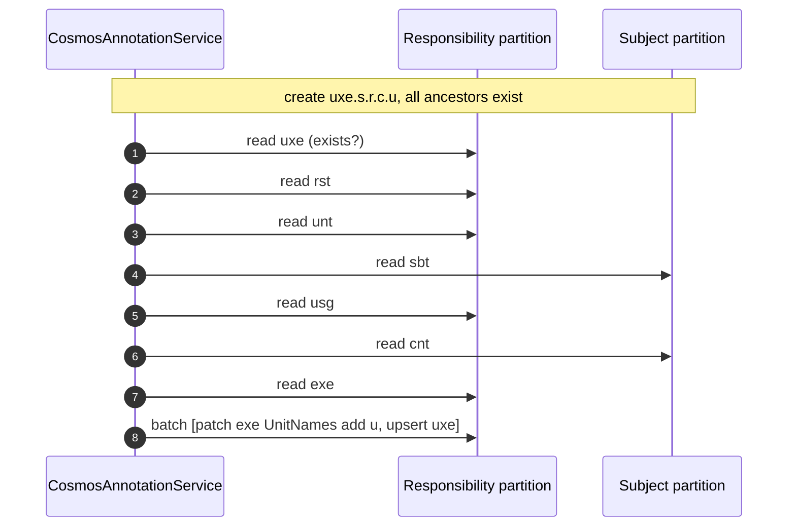
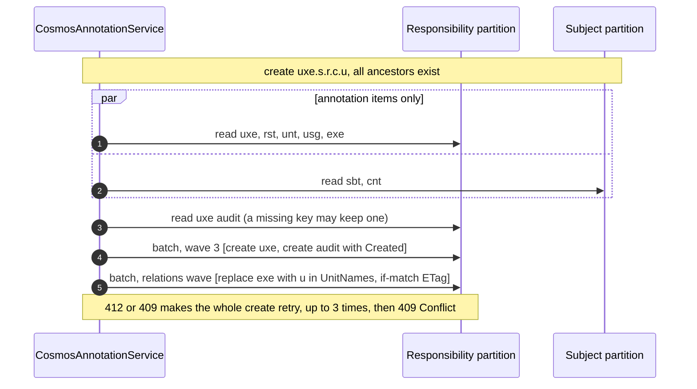
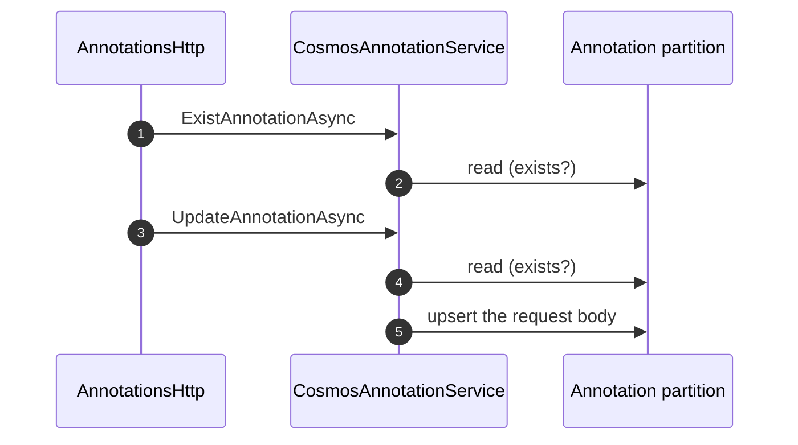
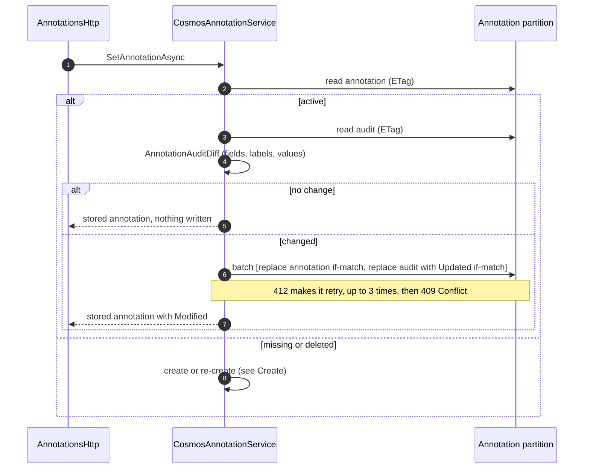
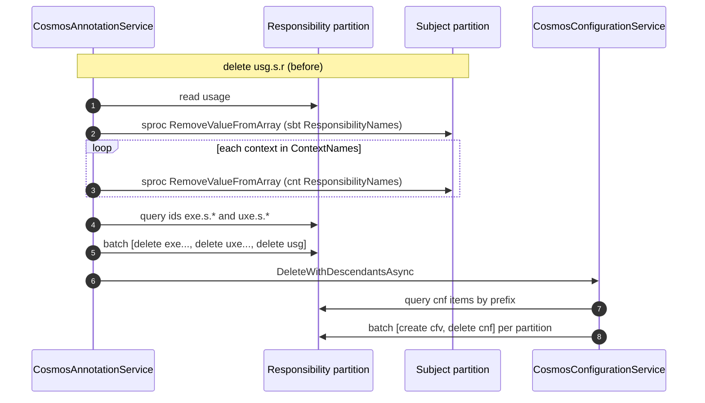
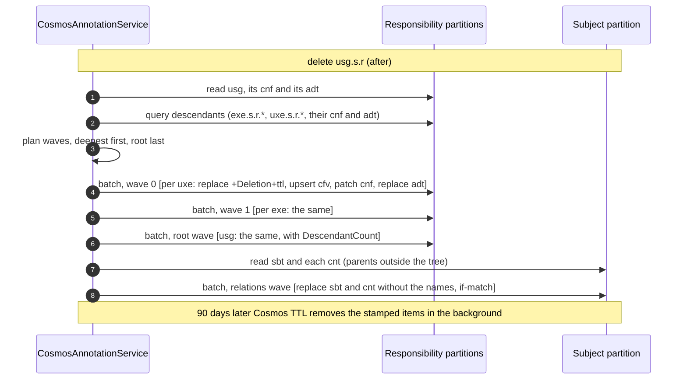
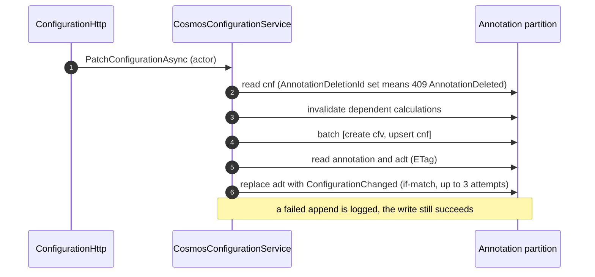

# Annotation Operations Before and After the Audit

This document compares how the annotation CRUD operations wrote to Cosmos DB before soft delete and the audit were added, and how they write now. It compares their request units (RU), their round trips, and their guarantees.

| | Code |
| --- | --- |
| **Before** | `main` at `4f191e2`: `Backend.CosmosDb/src/Annotating/CosmosAnnotationService.cs` (one per-type switch), the stored procedures in `ContainerFactory.cs`, and `CosmosConfigurationService.DeleteWithDescendantsAsync` |
| **After** | `feat/platform/audit`: `CosmosAnnotationService.cs` and `CosmosAnnotationService.Deletion.cs` on `AnnotationItemStore`, `BatchPlan`, `AnnotationAuditStore` and `DescendantScope` |

The design behind the change is in [the spec](specs/2026-10-11%20Soft-delete%20and%20audit%20of%20annotations.md), and the resulting behavior in [annotation-lifecycle.md](annotation-lifecycle.md).

## Summary

| Operation | Before | After | RU before | RU after |
| --- | --- | --- | --- | --- |
| Read, exist | 1 point read | 1 point read; a deleted item reads as missing | 1 | 1 |
| List | Query per type | Same query plus `NOT IS_DEFINED(c.Deletion)` | same | same |
| Create, ancestors exist | Sequential existence reads, then one batch per partition. The parent arrays are updated by `Patch` in the child's batch. | Parallel reads, then the child and its audit in one batch. The parent arrays are replaced with an ETag in a later batch. | 20–32 | 28–40 |
| Create, ancestors missing (unit of execution, 7 items) | 7 sequential reads, then 2 batches of upserts | 2 parallel read rounds, then 4 waves of creates, each with its audit | ≈ 56 | ≈ 112 |
| Update | Existence read, then a blind upsert of the body | Read the annotation and its audit, diff, then replace both with ETags in one batch. A change-free update writes nothing. | ≈ 11 | ≈ 23–44; no change: 2–8 |
| Delete, leaf | Hard delete. A stored procedure removes the name from the parent. The configuration is deleted with a history copy. | Soft delete: the item, its audit and its configuration are stamped with `ttl`. The parent array is replaced with an ETag. | ≈ 22 | ≈ 35–56 |
| Delete, per item of a subtree | ≈ 7, or ≈ 22 with a configuration | ≈ 21–36, or ≈ 39–54 with a configuration | — | 3–5× |
| Expiry of deleted items | — | Cosmos TTL, in the background | — | not charged to a request |
| Configuration write | Configuration only | Plus an audit append: read the annotation and audit, then replace the audit | — | +13–34 per write |

**Where the cost goes:**

- **The audit document.** It is read before every annotation write and written with it. That adds about 8 RU per created annotation and 11–34 RU per updated or deleted one. The audit cap (`Audit:MaxDocumentBytes`, 64 KiB) bounds the top of that range.
- **Soft delete writes instead of deleting.** Each item is replaced (about 10 RU) and its audit is written, where a delete cost about 7 RU.
- **Round trips.** The new create has fewer sequential round trips, because it reads all the ancestors in parallel where the old one read them one after another. A delete now writes in waves, one per depth, and then updates the parents outside the tree.

## Cost model

The RU figures are estimates for one item of about 1 KB with the container's default indexing (every path except `/Entries/*`) and Session consistency. Strong or Bounded Staleness consistency doubles read costs. Measure a real workload with `RequestCharge` in the Cosmos diagnostics.

| Operation | RU | Basis |
| --- | --- | --- |
| Point read, hit or miss, ≤ 1 KB | 1 | Cosmos baseline |
| Point read of an audit, 10 KB / 64 KB | ≈ 2 / ≈ 7 | about 1 RU per 10 KB above 1 KB |
| Create an annotation item | ≈ 7 | estimate |
| Replace or upsert an existing annotation item | ≈ 10 | estimate |
| Patch, one array operation | ≈ 10 | estimate; a patch is charged like a write of the item |
| Delete an item | ≈ 7 | estimate |
| Create an audit with one entry | ≈ 7 | estimate; the entries are not indexed |
| Replace an audit of 1 KiB / 64 KiB | 10.6 / 25.7 | measured on the emulator in this branch (128 KiB: 52.1, 256 KiB: 130.9) |
| Stored procedure `RemoveValueFromArray` | ≈ 13 | a query by id (≈ 3) and a replace (≈ 10) |
| Query in one partition | ≈ 3, and more as more data is returned | Cosmos baseline |
| Query across the responsibility partitions | ≈ 3 per physical partition | fan-out |
| Configuration version written with a delete (`cfv`) | ≈ 8 or more | grows with the content |

A transactional batch costs the sum of its operations.

## Read and list

Unchanged in cost. `GetAnnotationAsync` and `ExistAnnotationAsync` still do one point read. A deleted item has `Deletion` set and reads as missing. `GetAnnotationsAsync` adds `NOT IS_DEFINED(c.Deletion)`, which the index serves.

`GetDescendants` changed:

- **Before:** its conditions never applied, so it read every item of the requested types in the partition, or in the project for subjects and contexts.
- **After:** it queries by the key prefixes of `DescendantScope` and filters by the graph. It reads less and returns the right items.

New reads:

- `GetDeletedAnnotation`: 1 RU.
- `FindDeletedAnnotations`: one `ReadMany`, about 1 RU per key.
- `GetDeletedAnnotations`: one cross-partition query.
- `GetAnnotationHistory`: 2–8 RU, two point reads, the second of the audit.

## Create

### Before

`CreateAnnotationAsync` switched on the type:

1. It checked the key, then each ancestor (`TryCheckAndCreate…`), one point read at a time.
2. A missing ancestor was upserted into the batch of its partition.
3. An existing parent got the child's name by `PatchOperation.Add` in the same batch, so a child and a parent in the same partition were written atomically.
4. It then ran at most two batches in parallel: the responsibility partition and the subject partition.

### After

`CreateCoreAsync` works from one model of the graph:

1. It reads the key and all its ancestors in parallel, annotation items only.
2. A key that is not active also gets its audit read, and a deleted key its configuration.
3. It builds the items to write. A missing ancestor is created, and a deleted one is re-created. Parents written in the same operation get the child's name in memory.
4. `BatchPlan` writes them in waves by depth (roots first). Every item goes into the same batch as its audit entry.
5. An existing parent gets the child's name in the last wave (`RelationsWave`), by a full replace guarded by its ETag.

When nothing exists yet, the waves are: wave 0 `rst` and `sbt`, wave 1 `unt`, `usg` and `cnt`, wave 2 `exe`, and wave 3 `uxe`. The batches of one wave run in parallel. No relations wave is needed, because every parent is written in the same operation.

### Cost

| Case | Before | After |
| --- | --- | --- |
| Subject or responsibility, new key | 1 read + 1 upsert ≈ **8** | 1 read + 1 audit read + create + audit create ≈ **16** |
| Usage, parents exist | 3 reads + upsert + patch of the subject ≈ **20** | 3 reads + 1 audit read + create + audit + replace of the subject ≈ **28** |
| Execution, ancestors exist | 5 reads + upsert + 2 patches (usage, context) ≈ **32** | 5 reads + 1 + create + audit + 2 replaces ≈ **40** |
| Unit of execution, ancestors exist | 7 reads + upsert + patch of the execution ≈ **24** | 7 reads + 1 + create + audit + replace ≈ **32** |
| Unit of execution, nothing exists (7 items) | 7 reads + 7 upserts ≈ **56** | 7 reads + 7 audit reads + 7 creates + 7 audits ≈ **112** |

**Round trips** for the last case:

- **Before:** 8 sequential steps: 7 reads, then the batches.
- **After:** 6 steps: 2 parallel read rounds and 4 waves.

With existing ancestors, the old create needed 4–8 sequential steps and the new one needs 4: two read rounds, the child's wave and the relations wave.

## Update

### Before

The body was stored as sent, so it could overwrite the relation arrays the server maintains. Two concurrent updates did not see each other.

### After

### Cost

| Case | Before | After |
| --- | --- | --- |
| Update with a change, fresh audit | 2 reads + upsert ≈ **12** through the API (≈ 11 in the service) | read + audit read + replace + audit replace ≈ **23** |
| Update with a change, audit at the 64 KiB cap | ≈ 12 | 1 + 7 + 10 + 25.7 ≈ **44** |
| Update without a change | ≈ 12 | read + audit read ≈ **2–8** |

## Delete

### Before

`DeleteAnnotationAsync` was a hard delete with one case per type.

- **Parent arrays.** The parent outside the deleted tree lost the name through the `RemoveValueFromArray` stored procedure: a query by id and a replace on the server. It was called once per parent, sequentially, outside any batch. Names were added by `Patch`, but they were never removed by it.
- **The tree.** The tree was deleted in one or two operations per partition:
  - a batch of deletes, after a synchronous query for the ids;
  - or the `DeleteUsageAndExecutions` stored procedure, called again until it finished.
- **Configurations.** Afterwards, `DeleteWithDescendantsAsync` queried them by id prefix. It copied each one that had content into a `cfv` version, then deleted it, in one batch per partition.

The per-type code had gaps, which Phase 1 fixed:

- A **context** deleted its executions but not their units of execution.
- An **execution** deleted itself but not its units of execution.
- A **unit** left its name in the executions' `UnitNames`.
- A **responsibility** used `DeleteAllItemsByPartitionKeyStreamAsync`. That deleted everything in the partition: every view, every configuration, and every version. It also left the responsibility's name in subjects and contexts.

### After

`DeleteAnnotationAsync` is a soft delete of the whole tree, the same for every type:

1. It loads the root with its configuration and audit.
2. It loads every descendant with one query per `DescendantScope`: the annotation, `cnf` and `adt` items of the tree.
3. It stamps every active item. The annotation gets `Deletion` and `ttl`. The configuration gets `AnnotationDeletionId` and `ttl`, and its content is copied to a `cfv` snapshot. The audit gets a `Deleted` entry and `ttl`.
4. `BatchPlan` writes them deepest first, with the root last, so a failure leaves a valid state.
5. Active parents outside the tree get the names removed by an ETag-guarded replace in the relations wave.

Each batch holds at most 100 operations and about 1.5 MB. The waves run one after another. Within a wave, the batches of different partitions run in parallel, up to 8 at a time.

### Cost

**Per deleted item:**

| Item | Before | After |
| --- | --- | --- |
| Annotation | delete ≈ 7 | replace ≈ 10 + audit replace ≈ 11–26 |
| With configuration content | + `cfv` create ≈ 8 + delete ≈ 7 | + `cfv` upsert ≈ 8 + `cnf` patch ≈ 10 |
| Parent outside the tree | stored procedure ≈ 13 | read ≈ 1 + replace ≈ 10 |
| Finding the tree | 1 query per partition, plus one configuration query | 1 query per scope, which also returns the audits |

**Examples:**

| Delete | Before | After |
| --- | --- | --- |
| A unit of execution, no configuration | read + sproc + delete + configuration read ≈ **22** | 3 reads + replace + audit + parent read and replace ≈ **35–56** |
| The same, with configuration content | ≈ **37** | ≈ **53–74** |
| A subject with 2 contexts, 3 usages, 6 executions and 12 units of execution (24 items) | ≈ **184** | ≈ **510** with fresh audits to ≈ **880** with audits at the cap |
| A responsibility | 1 read + `DeleteAllItemsByPartitionKey`: cheap for the request, but every item of the partition is deleted in the background, also those of other views | per item as above, only the requested view |

The subject example:

- **Before:** 1 read; 3 runs of `DeleteUsageAndExecutions` (3 queries and 21 deletes); a batch with 3 deletes; and the configuration queries.
- **After:** 3–9 for the root; the descendant queries; and 24 × (10 + 10.6…25.7). Every parent is inside the tree, so no relation updates are needed.

Expiry costs no request. Deleting expired items is a background task that uses spare throughput. Until then, the deleted items are stored, and the index keeps them out of the reads.

## Operations that did not exist before

| Operation | Writes per item | RU per item |
| --- | --- | --- |
| Restore | replace without `Deletion` and `ttl`; patch of `cnf`; delete of the snapshot after a point read checks it; audit `Restored` | ≈ 21–36, or ≈ 39–54 with a configuration |
| Re-create (a write to a deleted key) | replace with the new content; upsert of the snapshot and delete of `cnf`; audit `Recreated`; its deleted children become roots | ≈ 21–36, plus ≈ 15 with a configuration, plus a descendant query |
| Purge | delete of the annotation, `cnf` and `adt`; snapshot of the configuration content | ≈ 14, or ≈ 29 with a configuration |

Each also loads its root and ancestors (point reads) and its descendants (one query per scope).

## Configuration writes

`CreateOrUpdateConfigurationAsync`, `PatchConfigurationAsync`, `ClearConfigurationAsync` and `DeleteAsync` work as before. After the write they append an audit entry, best effort and outside the configuration's batch. If the annotation has no configuration item yet, they also read it once to reject a deleted annotation.

**Cost:**

- The audit append adds ≈ 13–34 RU per configuration write: 1 + (1…7) + (10.6…25.7).
- Configuration reads that check the annotation's state add 1 RU: the version list, one version, the hierarchy view, and the raw read when no configuration item exists.
- The API's `404` with `AnnotationDeleted` costs one more point read, only on that path.

## Guarantees

| Aspect | Before | After |
| --- | --- | --- |
| New items | `Upsert`: a concurrent create was overwritten silently | `Create`: a concurrent create fails with `409`, and the operation retries |
| Adding a name to a parent | `Patch` add in the child's batch: atomic in one partition, no conflicts | ETag-guarded replace in the relations wave: a separate batch, and concurrent siblings retry |
| Removing a name from a parent | Stored procedure, sequential, outside any batch | ETag-guarded replace in the relations wave |
| Update | Blind upsert of the body, with the relation arrays as sent | ETag replace; the server keeps the arrays, `Created` and `Deletion`, and an unchanged body writes nothing |
| Cascade | Per-type, with gaps; a responsibility delete crossed views | Generic over `DescendantScope`, complete, limited to one view |
| Atomicity | One batch per partition, partitions independent | The same; waves are ordered so that a failure leaves a valid state, and a retried delete completes with the same `DeletionId` |
| History | Configuration versions only | An audit per annotation: actor, time, and previous and new values |
| Undo | None | Restore within 90 days |

## Possible savings

These ideas were not implemented. Each one changes a trade-off made in the spec.

- **Lower `Audit:MaxDocumentBytes`.** The top of every range above comes from the audit at its cap. Reading and replacing a 64 KiB audit costs about 33 RU, and a 16 KiB one about 17 RU.
- **Put a same-partition parent update into the child's batch.** Some parents live in the child's own partition: a unit's responsibility, a unit of execution's execution, and an execution's usage. Updating them in the child's batch restores the old atomicity and saves one round trip.
- **Use a conditional `Patch` (`add` with a filter predicate) for adding names.** This avoids the ETag conflicts on parents with many children created concurrently. A name can't be removed by value with `Patch`, so removals stay replaces.
- **Skip the audit read for a missing key.** A purge or an expiry removes the audit together with the annotation, so the read almost always misses. A `409` on the audit create could trigger the read instead. This saves 1 RU per created annotation.
