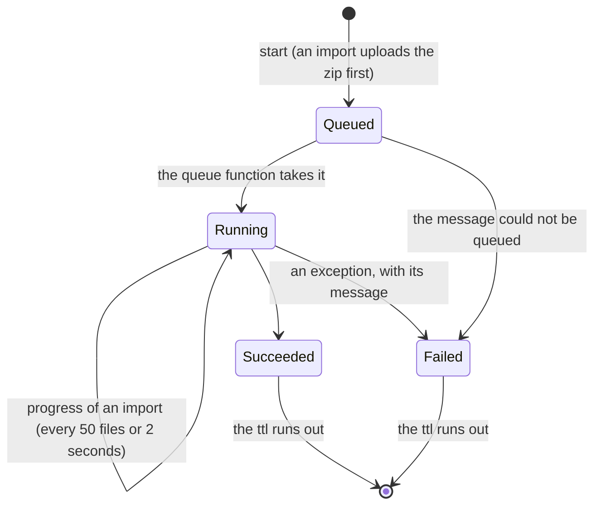

# Export and Import of Configurations

The configurations of a view can be exported as a zip, either as a folder of JSON files or as a git repository with every version as a commit, and a zip of JSON files can be imported back into a view. Both run as jobs in the background: a request stores the job and queues it, a queue-triggered function does the work, and the client polls the job.

The code is in `src/Platform/Storyteller/Backend.Core/src/Transferring/` (jobs, archive formats, the git writer), `Backend.CosmosDb/src/Transferring/` and `Configuring/CosmosConfigurationService.cs` (jobs and documents in Cosmos DB), and `Backend.AzureStorage/src/` (archives and the queue). The design and its decisions are in [the spec](specs/2026-10-14%20Export%20and%20Import%20of%20Configurations.md).

## What travels

Only the annotations' **own documents**: the `Content` of the configuration item `{view}.cnf.{key}` and of its versions `{view}.cfv.{key}.{version}` ([inheritance.md](inheritance.md)).

- The effective document (ancestors, templates and the own document merged) is not exported, nor are templates, schemas, annotations or their audit.
- Bindings stay as written ([binding.md](binding.md)). Secrets are never resolved, so they never leave the platform.
- A version with an empty document is not a version: items that only cache the effective document (`Author = "system"`) are left out.
- Configurations of soft-deleted annotations, and their versions, are left out, like every configuration read hides them ([annotation-lifecycle.md](annotation-lifecycle.md)).
- Versions expire after 365 days; an export contains what is left.

## File names

| File | Content |
| --- | --- |
| `<key>.json` | The current document, for example `usg.billing.payments.json` |
| `<key>.<version>.json` | An earlier version (folder format only), for example `usg.billing.payments.3.json` |

- Each segment of the key percent-encodes `%`, `<`, `>`, `:`, `"`, `/`, `\`, `|`, `?`, `*` and control characters as `%XX` of their UTF-8 bytes, so every name is a valid file name on Windows, macOS and Linux. Names never contain `.`.
- Each type code has a fixed number of segments (`rst` and `sbt` two, `usg`, `cnt` and `unt` three, `exe` four, `uxe` five), so one numeric segment more is the version: `rst.payments.3.json` is version 3 of `rst.payments`.
- Documents are indented by two spaces, with `\n` line ends, a final new line and no BOM.
- The zip is named `configurations-{organization}-{project}-{view}-{yyyyMMdd-HHmmss}Z.zip`, with `-git` before the time for the git format. The time is when the export was requested, in UTC.

## Folder format

```
export.json
rst.payments.json
rst.payments.1.json
rst.payments.2.json
usg.billing.payments.json
```

- A zip entry's time is the time of its version.
- `export.json` holds what the names cannot: the organization, project and view, `ExportedAt`, `ExportedBy`, and per configuration its current `File`, `Version`, `Author` and `UpdatedAt`, and the same for each earlier version. A cleared configuration (versions, but no current document) has `File` and `Version` null.

## Git format

The zip is a repository with its working tree checked out on `main`:

```
.git/HEAD                          ref: refs/heads/main
.git/config
.git/refs/heads/main
.git/objects/pack/pack-<sha>.pack
.git/objects/pack/pack-<sha>.idx
.git/index
rst.payments.json                  the current documents
```

- **One commit per version**, ordered by the version's time, then the key, then the version number. Each key's versions stay in order.
- Author and committer are the version's author and time. The name is the stored author (`account: user_01`), the e-mail is derived from it (`account.user_01@2s.platform`).
- Messages: `Add <key> (version <n>)` for the first version of a key in the export, `Update <key> to version <n>` for the next ones.
- A configuration that was cleared keeps its last version in the tree until a final commit, `Remove cleared configurations`, made at the export time by `2S Platform <system@2s.platform>`, which lists the keys in its body.
- A view without configurations gives a repository without commits.
- The version times are the stored ones: the time of the current version is the item's `_ts`, which also changes when the effective document is cached, so a time can be later than the write.

The repository is written by `GitRepositoryWriter`, without a git library:

- One packfile (version 2) with its index (version 2). A blob is a delta against the previous version of the same file and a tree a delta against the previous tree, as long as the delta is less than half the object and the chain is at most 49 deltas deep. The delta copies the common prefix and suffix and inserts the middle.
- `.git/index` lists the working tree with the blob ids, sizes and times, so `git status` of the extracted folder is clean once git has compared the content.
- `GitRepositoryTests` read the result with an independent reader (pack and index checksums, CRC-32, deltas, ids), and with the real `git` when it is installed (`fsck --full --strict`, `log`, `status`, `show`).

## Import

The import reads the **files of the working tree**: every `*.json` file whose name is a current document, in any folder. `.git` folders, `__MACOSX` and `._*` files are skipped; version files, `export.json` and other files are counted as ignored. So an export of either format, a zipped folder and a zipped repository with local commits all import the same way.

Each file is one outcome:

| Outcome | When | Error code |
| --- | --- | --- |
| `Created` | The key had no own document; it is written as version 1 or after the highest archived version | |
| `Updated` | The document differs; it **replaces** the stored one as a new version | |
| `Unchanged` | It equals the stored document; nothing is written | |
| `Skipped` | The view has no such annotation | `AnnotationNotFound` |
| | The annotation is deleted | `AnnotationDeleted` |
| | The document is `{}`; a configuration is cleared by `DELETE` | `EmptyDocument` |
| `Failed` | Not JSON, not an object, or larger than `MaxDocumentBytes` | `InvalidDocument` |
| | A second file for the same key (the first path in ordinal order wins) | `DuplicateFile` |
| | A broken `$patch` directive | `PatchInvalid` |
| | The schema rejects it (without `force`) | `SchemaViolation` |

- Documents are parsed with comments allowed and duplicate properties rejected. Dates are parsed as the configuration reads parse them, so an exported document compares equal when it is imported back, and importing an export changes nothing.
- `$remove` and `$patch` apply to the document alone, as on a create.
- The importing caller is the `Author` of the written versions, and each written annotation gets `ConfigurationChanged` in its audit by the caller.
- A **dry run** validates and compares, and reports `Created` and `Updated` without writing.
- History in the archive (version files, commits) is not replayed, and configurations missing from the archive are left alone.

`ImportConfigurationAsync` (`IConfigurationService`) does this for one document; the job calls it file by file in path order.

## Jobs

A job is an item in the organization container, in the partition `{project}.transfer`, with the id `{view}.exp.{id}` or `{view}.imp.{id}`, so it is only found through the view it was started in. It holds the public model (`ConfigurationExport` or `ConfigurationImport`), the requester's author string, and a `ttl`.



- Every write restarts the item's `ttl` (`RetentionHours`), and `ExpiresAt` tells the client when it ends.
- Writes use the item's ETag. A worker that loses a race stops; a repeated message of a finished job does nothing; a worker that crashed leaves the job `Running` until the queue delivers the message again.
- A project can have at most `MaxActiveTransfers` jobs queued or running (changed within the last hour, so an abandoned job does not block it); one more is refused with `409 TransferLimit`.
- An export writes the zip into memory and uploads it as `{organization}/{project}/{view}/exports/{id}.zip`. An import reads its upload `…/imports/{id}.zip` into memory and deletes it when it succeeds. `PurgeExpiredAsync` deletes archives an hour after the retention.

## Storage

- Archives are blobs of the container `configuration-transfers`, and jobs are messages of the queue `configuration-transfers` (Base64, as the queue trigger expects). Both are created on first use.
- Both use the connection `AzureWebJobsStorage`, which the queue trigger listens on: a connection string, or an identity-based section with `accountName`, or `blobServiceUri` and `queueServiceUri`, and `clientId` for a user-assigned identity.

## Limits

Section `ConfigurationTransfers`:

| Option | Default | |
| --- | --- | --- |
| `RetentionHours` | 24 | Jobs and archives, after their last change (1-168) |
| `MaxActiveTransfers` | 3 | Queued or running jobs per project |
| `MaxArchiveBytes` | 20 MiB | An uploaded zip |
| `MaxExtractedBytes` | 256 MiB | The declared uncompressed size of the configuration files of an upload |
| `MaxDocumentBytes` | 2 MiB | One configuration file, also when its declared size lies |
| `MaxArchiveEntries` | 50,000 | Entries of an uploaded zip |
| `MaxReportedItems` | 1,000 | Items kept in an import job; the summary counts all |

The upload limits are checked from the zip's central directory before anything is decompressed (`ConfigurationArchiveReader.Validate`). An export holds the documents of the view and the zip in memory.
