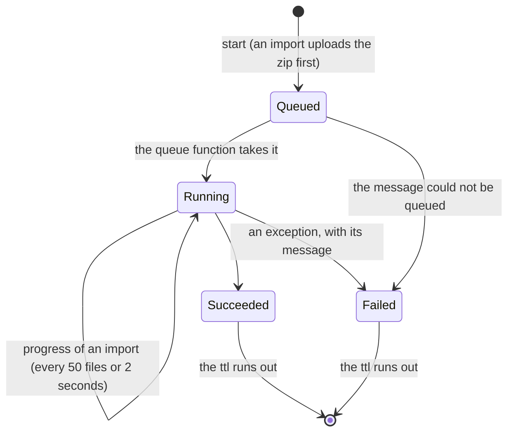

# Export and Import of a View

The documents of a view (its annotations, schemas, templates and configurations) can be exported as a zip, either as a folder of JSON files or as a git repository with every version as a commit. A zip can be imported back into any view of any project. Both run as jobs in the background: a request stores the job and queues it, a queue-triggered function does the work, and the client polls the job.

The code is in:

- `src/Platform/Storyteller/Backend.Core/src/Transferring/`: the jobs, the file names, the archive reader and writer, the git writer, the import passes and the overlay;
- `Backend.CosmosDb/src/`: the reads and imports of each kind (`Annotating/CosmosAnnotationService.Import.cs`, `Configuring/CosmosConfigurationSchemaService.Import.cs`, `CosmosConfigurationTemplateService.cs`, `CosmosConfigurationService.cs`) and the jobs (`Transferring/`);
- `Backend.AzureStorage/src/`: the archives and the queue;
- `Api.Functions/src/`: the routes (`V1/ViewTransferHttp.cs`, `V1/ViewTransferRequests.cs`), the scopes (`Security/ViewTransferScopes.cs`), and the queue and timer functions (`Transfers/ViewTransferFunctions.cs`);
- `Sdk.NSwag/` and `sdk.typescript/`: the clients generated from the OpenAPI document.

The design and its decisions are in [the spec](specs/2026-10-15%20Export%20and%20Import%20of%20a%20View.md), which extends [the first spec](specs/2026-10-14%20Export%20and%20Import%20of%20Configurations.md) (configurations only).

**State of the delivery.** Phases 1 and 2 of the spec are done:

- the backend covers all four kinds (phase 1);
- the routes are below the view, take the include and existing options, and check the scopes of each included kind (phase 2);
- the OpenAPI document, the C# SDK and the TypeScript SDK are generated from them (phase 2).

The CLI (phase 3) and the admin UI's **Export & Import** page (phase 4) still follow. Until then, `sform story config export` and `import` and the dialogs of the Configurations page call the new operations without include or existing, so they cover all four kinds and overwrite. See [API](#api), [CLI](#cli) and [Administration UI](#administration-ui).

## What travels

| Kind | Exported | Left out |
| --- | --- | --- |
| Annotations | Every annotation of the view that is not deleted, whatever its status (disabled, scheduled and expired ones too). A file holds the editable members; annotations have no versions. The `Created` and `Modified` stamps are listed in `export.json`. | Deleted annotations, the audit, `Deletion`, the relation arrays |
| Schemas | Type, descendant-type and annotation schemas: the current document and the versions still in the history | The annotation and descendant-type schemas of an annotation that is deleted or missing |
| Templates | The template of each type code: the current document and the versions still in the history | |
| Configurations | The own document of each annotation (`{view}.cnf.{key}`) and its versions (`{view}.cfv.{key}.{version}`, [inheritance.md](inheritance.md)) | The configurations of deleted annotations, and their versions |

- The effective document (ancestors, templates and the own document merged) is never exported, nor is a resolved one. Bindings stay as written ([binding.md](binding.md)). Secrets are never resolved, so they never leave the platform. Key/value pairs have their own export ([key-values.md](key-values.md#import-and-export)).
- An empty document is not a version. An empty configuration item only caches the effective document, and an empty template or schema has no effect. A template or schema whose current document is empty counts as deleted when it has earlier versions, and is left out when it has none.
- A deleted schema, template or configuration has versions but no current document. The folder format lists it in `export.json` without a file, and the git format removes it in its last commit.
- Versions expire after 365 days; an export contains what is left.
- Each version has the time and the actor of its `Modified` stamp. `Author` in `export.json` is the actor's display name, or its id without one.
- A template or schema stored under an id that no file name can hold (a type code that is not lower-case, a key that is not in its canonical form) is left out. The writes never produce such ids.
- The schema routes accept a descendant-type schema for a type that cannot descend from its key. Such a schema is exported, and an import fails it with `InvalidKey`.

**Reads.** `ViewTransferService` reads the included kinds only, each with one call:

- `GetConfigurationHistoriesAsync`;
- `GetTemplateHistoriesAsync`: one query of the partition `{project}.template`;
- `GetSchemaHistoriesAsync`: one query of the partition `{project}.schema`, and one read of the states of the annotations the schemas name;
- `GetViewAnnotationsAsync`: the pages of one query over the partitions of the project, for the annotations of the view that are not deleted, of every type and status. It reads the items with System.Text.Json, as the point reads do, so `Values` keep the text that Cosmos DB answers for their strings and numbers. The LINQ queries of `GetAnnotationsAsync` read them with the SDK's Newtonsoft serializer, which turns numbers into doubles and date strings into local dates.

The reads are not a snapshot, so they run in reverse dependency order: configurations, templates, schemas, annotations. A document read first still finds its dependency in a later read, unless the dependency was deleted in between. That is rarer than a creation during the export.

## File names

The file name tells the kind of a document, so the folders of a path play no part in an import.

| Document | Current | Earlier version |
| --- | --- | --- |
| Annotation | `<key>.json` | (none: annotations have no versions) |
| Configuration | `<key>.conf.json` | `<key>.conf.<n>.json` |
| Template | `<type>.template.json` | `<type>.template.<n>.json` |
| Type schema | `<type>.schema.json` | `<type>.schema.<n>.json` |
| Annotation schema | `<key>.schema.json` | `<key>.schema.<n>.json` |
| Descendant-type schema | `<ancestor-key>.<type>.schema.json` | `<ancestor-key>.<type>.schema.<n>.json` |

- `<type>` is the lower-case type code (`rst`, `sbt`, `unt`, `usg`, `cnt`, `exe`, `uxe`).
- Each segment of a key percent-encodes `%`, `<`, `>`, `:`, `"`, `/`, `\`, `|`, `?`, `*` and control characters as `%XX` of their UTF-8 bytes. So every name is a valid file name on Windows, macOS and Linux. Key segments never contain `.`, so the dots stay separators.
- **Reserved second segment.** When the second segment of a key is `template` or `schema` (in any case), its first character is percent-encoded. The responsibility `rst.schema` is the file `rst.%73chema.json`. Otherwise `rst.schema.json` would be both that annotation and the type schema of `rst`, and `unt.template.3.json` both a unit and version 3 of the template of `unt`.
- Documents are indented by two spaces, with `\n` line ends, a final new line and no BOM.
- The zip is named `export-{organization}-{project}-{view}-{yyyyMMdd-HHmmss}Z.zip`, with `-git` before the time for the git format. The time is when the export was requested, in UTC.

`ViewArchiveNames.TryParse` reads a file name without its folders:

1. The extension `.json` is stripped, in any case, and the rest is split at `.`. The first segment must be a type code, in any case; it is lower-cased. A name with an empty segment is not a document.
2. A second segment that is literally `template` or `schema` (in any case, not encoded) makes the file the template or the type schema of that type. A third, numeric segment is the version. A longer name of this shape is not a document.
3. Otherwise the key takes as many segments as its type has: two for `rst` and `sbt`, three for `unt`, `usg` and `cnt`, four for `exe`, five for `uxe`. The segments are decoded, and the key must parse. The rest of the name is the suffix:
   - none: an annotation;
   - `conf`: a configuration;
   - `schema`: an annotation schema;
   - `<type>.schema`: a descendant-type schema of `<type>` below the key.

   Suffixes and type codes match in any case. Every suffix except none may end with a numeric version.
4. Any other name is not a document.
5. A descendant type that cannot descend from the key (`AnnotationHierarchy.GetAncestorSchemaSources`) is still a document, so the mistake is reported. It fails with `InvalidKey`.

| File | Document |
| --- | --- |
| `rst.payments.json` | Annotation `rst.payments` |
| `rst.payments.conf.json` | Configuration of `rst.payments` |
| `rst.payments.conf.3.json` | Version 3 of that configuration |
| `rst.payments.schema.json` | Schema of `rst.payments` |
| `rst.payments.exe.schema.json` | Schema of the executions below `rst.payments` |
| `exe.template.json` | Template of `exe` |
| `exe.template.4.json` | Version 4 of that template |
| `EXE.Schema.json` | Type schema of `exe` |
| `rst.%73chema.json` | Annotation `rst.schema` |
| `exe.s.r.c.rst.schema.json` | A descendant-type schema that fails with `InvalidKey`: a responsibility never descends from an execution |
| `rst.payments.3.json` | Nothing: annotations have no versions (a version file of the first spec) |

## Folders and hidden paths

An export writes one folder per included kind that has documents: `annotations/`, `schemas/`, `templates/` and `configurations/`. Version files sit next to their current file. An import parses the file names only. So a flat zip, the export's folders, a zip that wraps them in one more folder, and a reorganized repository all import the same.

- An entry is **skipped**, and not counted, when a segment of its path starts with `.` (`.git`, `.github`, `.vscode`, `.DS_Store`, `._*`), or when its first folder is `__MACOSX`. A leading `./` is not a hidden folder. Directory entries are skipped too, and `\` is read as `/`.
- **Duplicates.** Two files of the same document are duplicates, also across folders, type-code cases and key encodings (`rst.pay%6Dents.json` is `rst.payments.json`). The first path in ordinal order wins. Each other one fails with `DuplicateFile`, for example `The file 'annotations/rst.payments.json' already holds the annotation rst.payments.`

## Folder format

```
export.json
annotations/
  rst.payments.json
  sbt.northwind.json
  usg.northwind.payments.json
  exe.northwind.payments.prod.json
schemas/
  exe.schema.json
  exe.schema.1.json
  rst.payments.schema.json
  sbt.northwind.exe.schema.json
  sbt.northwind.exe.schema.2.json
templates/
  exe.template.json
  exe.template.3.json
configurations/
  rst.payments.conf.json
  rst.payments.conf.1.json
  exe.northwind.payments.prod.conf.json
```

- Zip entry times:
  - a current or earlier version: the time of that version;
  - an annotation: its `Modified.At`, or else `Created.At`, or else the export time;
  - `export.json`: the export time.
- An annotation file holds the editable members in the API's PascalCase names, without null members, in this order:
  - `Title`, `Description`, `DocumentationLink`;
  - `Labels`, `Values`;
  - `IsDisabled`, `ValidFrom`, `ExpiresAt`, `TimeZone`;
  - for units, `UnitType` and `UnitDefinition`.

  The key, the type and the names are in the file name.

```json
{
  "Title": "Payments in production",
  "Labels": [
    "eu"
  ],
  "Values": {
    "tier": "gold"
  },
  "TimeZone": "Europe/Prague"
}
```

`export.json` is version 2 of the manifest. It holds what the names cannot. It is there for information only: an import never reads it. A shortened example:

```json
{
  "ManifestVersion": 2,
  "Organization": "acme",
  "Project": "billing",
  "View": "default",
  "ExportedAt": "2026-10-16T08:00:00+00:00",
  "ExportedBy": { "Kind": "Account", "Id": "user_01", "Name": "Ada Lovelace" },
  "Include": [ "Annotations", "Schemas", "Templates", "Configurations" ],
  "Annotations": [
    {
      "Key": "rst.payments",
      "File": "annotations/rst.payments.json",
      "Created": { "At": "2026-09-01T07:00:00+00:00", "By": { "Kind": "Account", "Id": "user_01", "Name": "Ada Lovelace" } },
      "Modified": { "At": "2026-10-02T10:15:00+00:00", "By": { "Kind": "Machine", "Id": "deploy", "Name": null } }
    }
  ],
  "Schemas": [
    {
      "Kind": "TypeSchema",
      "AnnotationType": "exe",
      "AnnotationKey": null,
      "File": "schemas/exe.schema.json",
      "Version": 2,
      "Author": "Ada Lovelace",
      "UpdatedAt": "2026-10-01T09:30:00+00:00",
      "Versions": [
        { "Version": 1, "File": "schemas/exe.schema.1.json", "Author": "Ada Lovelace", "CreatedAt": "2026-09-20T08:00:00+00:00" }
      ]
    }
  ],
  "Templates": [
    { "AnnotationType": "exe", "File": "templates/exe.template.json", "Version": 4, "Author": "Ada Lovelace", "UpdatedAt": "2026-10-03T12:00:00+00:00", "Versions": [ … ] }
  ],
  "Configurations": [
    { "AnnotationKey": "rst.cleared", "File": null, "Version": null, "Author": null, "UpdatedAt": null, "Versions": [ … ] }
  ]
}
```

- `Include` is the resolved list: distinct, in import order, and all four when the request named none. Every kind is listed; a kind left out is an empty array.
- Order: `Annotations` by key; `Schemas` by kind (type, descendant type, annotation), then type, then key; `Templates` by type; `Configurations` by key.
- A deleted schema, template or configuration has `File`, `Version`, `Author` and `UpdatedAt` null, and its earlier versions in `Versions`.
- Version 1 of the manifest, of the first spec's archives, is gone. Such archives are not supported: `<key>.json` is now an annotation.

## Git format

The zip is a repository with its working tree checked out on `main`, in the folders of the folder format:

```
.git/HEAD                          ref: refs/heads/main
.git/config
.git/refs/heads/main
.git/objects/pack/pack-<sha>.pack
.git/objects/pack/pack-<sha>.idx
.git/index
annotations/rst.payments.json      the current documents
schemas/exe.schema.json
templates/exe.template.json
configurations/rst.payments.conf.json
```

- **One history for every kind.** Each version of a schema, template or configuration is one commit, and each annotation one commit with its current content.
  - The commits are ordered by time.
  - Within one time, they follow the import order: annotations (ancestors first: depth in the graph, then type, then key), then type, descendant-type and annotation schemas (each by type and key), then templates by type, then configurations by key.
  - Each document's versions stay in their order, even when their times are equal or go backwards.

  `git log`, `git blame` and `git diff` then work on the history of a whole view, and `git log -- templates/exe.template.json` on one document.
- **Annotations** are committed at their `Created` stamp: its time, and its actor as author and committer.
  - That is when the key began to exist, so its schemas and configurations come after it.
  - A re-created annotation has a new `Created` stamp, so the configuration versions of its previous lifetime come before it.
  - An annotation without `Created` falls back to `Modified`, and then to the export time with the system signature.
- **Signatures.** An actor is named by its id, like an author string:
  - an account: `account: user_01 <account.user_01@2s.platform>`;
  - a machine: `machine: deploy <machine.deploy@2s.platform>`;
  - the system: `2S Platform <system@2s.platform>`.

  A version without an actor is signed with its author string. The time of a commit is the time of its version.
- **Messages:**

  | Document | First version in the export | Next versions |
  | --- | --- | --- |
  | Annotation | `Add annotation rst.payments` | (none) |
  | Type schema | `Add type schema exe (version 1)` | `Update type schema exe to version 2` |
  | Descendant-type schema | `Add exe schema below sbt.northwind (version 1)` | `Update exe schema below sbt.northwind to version 3` |
  | Annotation schema | `Add schema of rst.payments (version 1)` | `Update schema of rst.payments to version 2` |
  | Template | `Add template exe (version 1)` | `Update template exe to version 4` |
  | Configuration | `Add configuration of rst.payments (version 1)` | `Update configuration of rst.payments to version 3` |

  The first version in an export is not always version 1: older versions may have expired.
- **Deleted documents.** A deleted schema, template or configuration keeps its last version in the tree until the final commit, `Remove deleted documents`. That commit is made at the export time by `2S Platform <system@2s.platform>`, and lists the removed paths in its body. Deleted annotations are not exported, so they never appear. Without deleted documents there is no such commit.
- A view without documents of the included kinds gives a repository without commits.
- A file of the working tree and its index entry have the time of the commit that last wrote the file. So an annotation has its `Created` time here, while the folder format uses `Modified`.

The repository is written by `GitRepositoryWriter`, without a git library:

- **Trees.** A path with `/` lives in subtrees. A tree is ordered like git: by the bytes of the names, with a subtree compared as `name/`. A commit writes again only the trees on the paths it changes, so an unchanged folder keeps its tree id. A removal drops the folders it leaves empty.
- **Pack.** One packfile (version 2) with its index (version 2). A blob is a delta against the previous version of the same file, and a tree against the previous version of the same tree. That holds as long as the delta is less than half the object and the chain is at most 49 deltas deep. The delta copies the common prefix and suffix and inserts the middle.
- **Index.** `.git/index` lists the working tree by full path in byte order, with the blob ids, sizes and times. So `git status` of the extracted folder is clean once git has compared the content.
- **Paths** are checked before anything is packed: an empty, `.`, `..` or `.git` segment is refused, and so are a file and a folder of the same name.
- **Tests.** `GitRepositoryTests` read the result with an independent reader: pack and index checksums, CRC-32, deltas, ids, subtrees and their order. When `git` is installed, they also run `fsck --full --strict`, `status`, `ls-files`, `ls-tree`, `log` and `show`.

## Import

### Options

| Option | Default | Effect |
| --- | --- | --- |
| `include` | all four | The kinds to import. The files of the other kinds are counted as excluded and never decompressed. |
| `existing` | `Overwrite` | What happens to a document the view already has. `Overwrite` writes the file as a new version, or as an update of an annotation, and re-creates a deleted annotation. `Skip` keeps the stored document and leaves a deleted annotation deleted. An equal document is `Unchanged` either way. |
| `force` | `false` | Store schemas and configurations that break each other, with the warning `SchemaViolation`. It never stores invalid JSON, an invalid JSON Schema, an annotation that breaks its rules, or a broken directive. |
| `dryRun` | `false` | Decide every outcome and warning without writing anything. |

`IViewTransferService.StartImportAsync` takes all four, and `StartExportAsync` takes `include`. The routes pass them through (see [Request options](#request-options)).

### Reading the archive

`ViewArchiveReader.Read` takes every entry that is not skipped and parses its file name:

- A document of an included kind becomes a file of the import: its path, kind, type code and key, with its content or an error code and message.
- A document of a kind that `include` leaves out counts as **excluded**. It is not decompressed.
- Version files of any kind, `export.json` and every other name count as **ignored**. An import never replays a history.
- Comments and trailing commas are allowed, and duplicate properties rejected. Annotation files are parsed as the annotation reads parse them (System.Text.Json): strings that look like dates stay strings, and numbers keep their text. The other kinds parse dates and doubles, as their reads do (Newtonsoft). So an exported document compares equal when it is imported back, and importing an export changes nothing.
- A file fails with `InvalidDocument` when it is not a JSON object, cannot be decompressed, or is larger than `MaxDocumentBytes`.
- A descendant-type schema whose type cannot descend from its key fails with `InvalidKey` without being decompressed.

### Order

The import writes in four passes, in dependency order:

| Pass | Within the pass | Why |
| --- | --- | --- |
| 1. Annotations | By depth in the graph, then type, then key: ancestors come first | Annotations depend on nothing. A descendant imported before its ancestor would create the ancestor with defaults, and the ancestor's own file would then find it existing. |
| 2. Schemas | Type, then descendant-type, then annotation schemas, each by type and key | An annotation or descendant-type schema needs its annotation. |
| 3. Templates | By type | A template depends on no other kind. Its place before configurations is a convention: rules, then defaults, then data. |
| 4. Configurations | By key | A configuration needs its annotation, and is validated against its schemas when it is written. |

Before the first pass, the service reads what it must know of the view, with at most one read per kind:

- which annotations named by the schema and configuration files are active: `FindActiveAnnotationKeysAsync`, one read of many items;
- with `Skip` only, which schemas the view has with content: `GetSchemaKeysAsync`, one query of the schema partition;
- with `Skip` only, which configurations the view has with content: the pages of the configuration listing.

Files that failed while reading are reported in the pass of their kind, and a duplicate right after the file that holds its document.

### Overlay

A schema is checked against configurations, and a configuration against schemas. No order of the passes alone lets an archive change both together. So every import keeps a `ViewImportOverlay`, the view as the import will leave it. The checks that look beyond one document ask the overlay before the stored view.

What it holds:

- `ActiveAnnotations`: the keys the annotation pass creates or re-creates, with the ancestors it creates with defaults. `RecreatedAnnotations`: the deleted keys among them. Both are recorded in a dry run too, which writes nothing.
- `FailedAnnotations`: the annotation files that failed, while reading or importing, or that were skipped because an ancestor failed. A `DuplicateFile` never marks its key: the document is the first file's.
- `Schemas` and `Configurations`: filled once, after the annotation pass. A schema or configuration file enters when:
  - it was read without an error and is not `{}`;
  - its annotation is active, stored or in `ActiveAnnotations` (a type schema needs none);
  - `existing` allows it. With `Skip`, a document the view already has stays out, except the configuration of a re-created annotation, which the re-create emptied.
- A schema or configuration that is then `Failed` or `Skipped` leaves the overlay.

How it is used:

- An annotation in `ActiveAnnotations` counts as active for its schemas, its configuration and its descendants, which don't create it again. In a dry run, that is the only place it exists.
- **The compliance check of a schema** checks the configurations as the import leaves them:
  - an overlay configuration replaces the stored one, with its `$remove` and `$patch` applied to a copy;
  - the stored configuration of a re-created annotation is not checked;
  - the overlay configurations of keys without a stored document are checked too, for example those of new annotations;
  - the other layers of the combined schema come from the overlay where the archive brings them. An empty layer, or one that is not a valid JSON Schema, is ignored, because the import won't write it.
- **A configuration** is validated against its combined schema:
  - in a dry run, with the overlay's layers;
  - in a real run, against the stored schemas, which the schema pass has already written.

So an archive that changes a schema and its configurations together imports without `force`, and a dry run predicts the real run. A check can count on an overlay document that fails later in the run. The view can then hold a schema that a stored configuration violates, the state a forced write leaves. The configuration pass of a real run validates against what is stored, so no configuration is written against a schema that isn't there.

### Annotations

`IAnnotationService.ImportAnnotationAsync` writes the way `SetAnnotationAsync` does.

1. **Content** (`ViewAnnotationDocument.TryRead`):
   - Member names match in any case, as in the API. Two spellings of one member fail with `InvalidDocument`.
   - The other members of the key's type, which a `GET` response has, are ignored: the key and the names, the relation arrays, the stamps, `Deletion`. So a response body can be saved as a file. An `AnnotationKey` member must be the key of the file name (the type code in any case), or the file fails with `InvalidDocument`.
   - Any other member fails with `InvalidDocument`: `Unknown member 'X'.`, or `Unknown members 'a', 'b'.` That includes `UnitType` outside units and `$patch` and `$remove` (annotations have no merge). It also catches a configuration document read as an annotation.
   - Values are typed like the API's request body (System.Text.Json). A value of a wrong type fails with `InvalidDocument`.
   - A member missing from the file is cleared, because an import replaces the content. A unit without `UnitType` or `UnitDefinition` gets the defaults of a create (`event`, `unknown`). `{}` is a valid annotation: the key without content.
   - `AnnotationRules` apply ([annotation-lifecycle.md](annotation-lifecycle.md#validation)). A violation fails with `InvalidAnnotation`.
2. **A failed ancestor**, one in `FailedAnnotations`, skips the file with `DependencyFailed`. Creating the key would create that ancestor with defaults.
3. **An active key** is compared with `AnnotationAuditDiff`. Numbers that are the same double are equal ([annotation-lifecycle.md](annotation-lifecycle.md#audit)), so the shortest text that a query exports equals the 17 digits that the point read of the import returns.
   - Equal: `Unchanged`.
   - Different, with `Skip`: `Skipped` with `DocumentExists`.
   - Different, with `Overwrite`: the content is replaced with an `Updated` audit entry, and the outcome is `Updated`.
4. **A missing or deleted key, or one below a deleted ancestor.** Ancestors that an earlier file of this import made active don't count.
   - With `Skip`, a deleted key or ancestor skips the file with `AnnotationDeleted`. The message names every deleted key on the path.
   - Otherwise the key is created with its missing ancestors, and the deleted ones are re-created, as any write of the key through the API does ([annotation-lifecycle.md](annotation-lifecycle.md#re-create)):
     - the item gets the file's content, empty relation arrays and a new `Created` stamp;
     - its configuration goes to the versions and starts empty;
     - its audit continues with a `Recreated` entry;
     - the children deleted with it stay deleted and become roots, unless the archive holds them; their own files re-create them later in the pass.

     The outcome is `Created`. A missing ancestor created with defaults gives the warning `AncestorCreated`, and every re-created key the warning `AnnotationRecreated`.
5. **Audit.** Written annotations get their usual entries (`Created`, `Recreated`, `Updated`, with the cause `Ancestor` on ancestors) by the importing caller. The archive carries no audit, and the import adds no cause of its own.

The outcome and the warnings come from the states read before the write, so a dry run reports what the real run does. When the key is created concurrently, the step runs again and takes the update path.

### Schemas

`IConfigurationSchemaService.ImportSchemaAsync` checks, in this order:

1. A descendant-type schema whose type cannot descend from its key fails with `InvalidKey`.
2. An annotation or descendant-type schema needs an active annotation, stored or in the overlay. Otherwise it is `Skipped`:
   - with `DependencyFailed` when the annotation failed in this import;
   - with `AnnotationDeleted` when it is deleted;
   - with `AnnotationNotFound` when it is missing.
3. `{}` is `Skipped` with `EmptyDocument`: a schema is cleared by `DELETE`.
4. A document that is not a valid JSON Schema fails with `InvalidSchema` (`Invalid JSON Schema: …`), even with `force`.
5. An equal stored schema is `Unchanged`. With `Skip`, a different one makes the file `Skipped` with `DocumentExists`. A stored empty schema counts as none.
6. The compliance check runs as the import leaves the view (see [Overlay](#overlay)). A violation fails with `SchemaViolation`, and the message lists the keys, at most 20 in ordinal order: `The configuration of rst.a violates this schema.`, or `The configurations of a, b, … and N more violate this schema.` With `force`, the schema is written with the warning `SchemaViolation`, and the violations are logged as on a forced save ([definitions.md](definitions.md#force)).
7. A dry run stops here with `Created` or `Updated`. Otherwise the schema is saved as a new version, without repeating the checks.

### Templates

`IConfigurationTemplateService.ImportTemplateAsync` **replaces** the template; it doesn't merge into it ([templating.md](templating.md#managing-templates)).

- `$remove` and `$patch` apply to the document alone, as on a create. A broken directive fails with `PatchInvalid`, or `PatchTestFailed` for a failed `test` operation.
- `{}` is `Skipped` with `EmptyDocument`: a template is cleared by `DELETE`.
- An equal template is `Unchanged`, and a cache invalidation left pending by an earlier write is finished. With `Skip`, a different one is `Skipped` with `DocumentExists`. A stored empty template counts as none.
- Otherwise the template is written as the version after `LastVersion`. The effective documents of its type are invalidated, as on any template write.
- Templates have no schema, so `force` does not apply.

### Configurations

`IConfigurationService.ImportConfigurationAsync` replaces the annotation's own document.

- **Annotation.** An annotation in the overlay's `ActiveAnnotations` counts as active. Otherwise an annotation that is not active is `Skipped`:
  - with `DependencyFailed` when it failed in this import;
  - with `AnnotationDeleted` when it is deleted. With `Skip`, a deleted annotation stays deleted, so its configuration is skipped too;
  - with `AnnotationNotFound` when it is missing.
- **Content.** `$remove` and `$patch` apply to the document alone, as on a create. A broken directive fails with `PatchInvalid` or `PatchTestFailed`. A document that ends empty is `Skipped` with `EmptyDocument`: a configuration is cleared by `DELETE`.
- **Existing.** An equal document is `Unchanged`. With `Skip`, a different one is `Skipped` with `DocumentExists`. The configuration of a re-created annotation counts as none: the re-create emptied it, so the file is `Created` as the next version.
- **Validation.** The document is validated against its combined schema (see [Overlay](#overlay) for the layers). A violation fails with `SchemaViolation`. With `force`, it is written with the warning `SchemaViolation`, which lists the errors.
- **Write.** The version is stamped with the importing caller, and the annotation's audit gets `ConfigurationChanged`.

### Outcomes, codes and warnings

Each file of an included kind gets one outcome:

| Outcome | When | Error code |
| --- | --- | --- |
| `Created` | The view had no such document. An annotation may also have been deleted and re-created. A schema, template or configuration is written as version 1, or as the version after the ones it had before. | |
| `Updated` | The document differs and replaces the stored one: a new version, or an update of an annotation | |
| `Unchanged` | It equals the stored document; nothing is written | |
| `Skipped` | `existing` is `Skip` and the view has a different document | `DocumentExists` |
| | The annotation of the document failed in this import; for an annotation, one of its ancestors | `DependencyFailed` |
| | The annotation is deleted; for an annotation (with `Skip`), it or an ancestor is deleted | `AnnotationDeleted` |
| | The view has no such annotation (a schema or a configuration) | `AnnotationNotFound` |
| | The document is `{}` (a schema, a template, or a configuration after its directives) | `EmptyDocument` |
| `Failed` | Not a JSON object, cannot be decompressed, or larger than `MaxDocumentBytes`. For an annotation also: an unknown member, a different `AnnotationKey`, a value of a wrong type. | `InvalidDocument` |
| | A second file of the same document | `DuplicateFile` |
| | An annotation that breaks `AnnotationRules` | `InvalidAnnotation` |
| | A descendant-type schema whose type cannot descend from its key | `InvalidKey` |
| | Not a valid JSON Schema | `InvalidSchema` |
| | A broken `$patch` or `$remove` directive of a template or configuration | `PatchInvalid`, `PatchTestFailed` |
| | Without `force`: the configuration violates its schema, or configurations violate the schema | `SchemaViolation` |

A written document can carry warnings (`ViewImportItem.Warnings`, each a `Code` and a `Message`):

| Warning | On | When |
| --- | --- | --- |
| `AncestorCreated` | An annotation | Creating it also created missing ancestors that the archive doesn't hold, with defaults: `The missing ancestors rst.payments, usg.northwind.payments are created with defaults.` |
| `AnnotationRecreated` | An annotation | It or its ancestors were deleted and are re-created: their configurations go to the versions and start empty, and the children deleted with them stay deleted. |
| `SchemaViolation` | A schema or a configuration | `force` stores it although it breaks the other side. |

- The importing caller is the actor of written versions and audit entries.
- History in the archive (version files, commits) is never replayed. Documents missing from the archive are left alone: an import never deletes.
- A **dry run** decides every outcome and warning the same way and writes nothing. `Created` and `Updated` have no version; `Unchanged` has the stored one.

### Large imports and retries

- **Cost.** Each annotation takes several requests: reads of the key and its ancestors, and the writes of a create or an update. Each schema runs the compliance query of a save: one query over the configurations it affects and one validation per configuration. With `Skip`, the existence reads list the view's schemas and configurations once. An archive with thousands of annotations, or with many type schemas over many configurations, takes much longer than one with configurations only.
- **Timeout.** A job is one invocation of the queue function, bound by the Functions timeout of the hosting plan (`host.json` sets no `functionTimeout`).
- **Retries.** An import is idempotent. When an invocation is cut off, the queue delivers the message again, and the whole job runs again. The documents the first run wrote are then `Unchanged`. After three deliveries (`maxDequeueCount`), the message goes to the poison queue, and the job stays `Running` until its `ttl` runs out. Resuming where a run stopped is not supported.
- **Failures of the whole job.** Concurrent changes that outlast the retries of a write, for example of an annotation or a schema, still fail the whole job, with the exception's message, instead of the file. A `$remove` entry that is not a valid JSONPath, or that takes the whole document (`$`), fails its file with `PatchInvalid`.

## Jobs

A job is an item in the organization container, in the partition `{project}.transfer`, with the id `{view}.exp.{id}` or `{view}.imp.{id}`. So it is only found through the view it was started in. It holds the public model (`ViewExport` or `ViewImport`), a copy of its status for the count of active jobs, and a `ttl`. The queue message only names the job.



- Every write restarts the item's `ttl` (`RetentionHours`), and `ExpiresAt` tells the client when it ends.
- Writes use the item's ETag. A worker that loses a race stops. A repeated message of a finished job does nothing. A worker that crashed leaves the job `Running` until the queue delivers the message again.
- A project can have at most `MaxActiveTransfers` jobs queued or running, counting those changed within the last hour, so an abandoned job does not block it. One more is refused with `409 TransferLimit`.
- An export writes the zip into memory and uploads it as `{organization}/{project}/{view}/exports/{id}.zip`. An import reads its upload `…/imports/{id}.zip` into memory, and deletes it when it succeeds. `PurgeExpiredAsync` deletes archives an hour after the retention.

`ViewExport` reports:

- `Format`;
- `Include`, stored resolved: distinct, in import order, all four when the request named none;
- `FileName`;
- the counts of the included kinds, null for a kind left out: `AnnotationCount`, and `SchemaCount`, `TemplateCount` and `ConfigurationCount` (documents with a current version);
- `VersionCount`: every exported version of schemas, templates and configurations, the current ones included;
- `Size` and `Error`.

`ViewImport` reports:

- `FileName`, `Include` (stored resolved), `Existing`, `IsDryRun` and `IsForced`;
- `TotalCount`: the document files of the included kinds, failed ones included; `ProcessedCount`: the files processed so far;
- `Summary`: the total, with `ExcludedFiles` and `IgnoredFiles`;
- `Summaries`: one per included kind, in import order, named by `Content`;
- `Items`: every outcome except `Unchanged`, in pass order, up to `MaxReportedItems`; `AreItemsTruncated` tells when the list stops;
- `Error`.

A summary counts `Created`, `Updated`, `Unchanged`, `Skipped` and `Failed`, and `Warnings`: the documents with a warning. An item has its `Path` and `Kind`, `AnnotationType` (of a template, a type schema or a descendant-type schema), `AnnotationKey` (of an annotation or a configuration, the annotation of an annotation schema, or the ancestor of a descendant-type schema), and its `Outcome`, `Version`, `ErrorCode`, `Message` and `Warnings`. Messages are cut at 500 characters.

## API

The routes are below `v1/{organization}/{project}/{view}`, with the tag `Transfers`:

- `Api.Functions/src/V1/ViewTransferHttp.cs`: the five routes;
- `V1/ViewTransferRequests.cs`: the parsing of the options;
- `Security/ViewTransferScopes.cs`: the scopes per kind.

`exports` and `imports` are literal segments after the view, and `views` is a reserved view name, so they meet no other route. The routes of the first spec below `…/configurations/` (`StartConfigurationExport` and its siblings, with the tag `Configurations`) are removed without a redirect; they were never released.

### Routes

| Method | Route | Operation | Success |
| --- | --- | --- | --- |
| `POST` | `…/exports` with `{ "Format": "Folder" \| "Git", "Include": [ … ] }` | `StartViewExport` | `202` `ViewExport` |
| `GET` | `…/exports/{id}` | `GetViewExport` | `200` `ViewExport` |
| `GET` | `…/exports/{id}/archive` | `GetViewExportArchive` | `200` `application/zip`, with `Content-Disposition` naming the export's `FileName` |
| `POST` | `…/imports?include=&existing=&force=&dryRun=&fileName=` with the zip as the body (`application/zip`) | `StartViewImport` | `202` `ViewImport` |
| `GET` | `…/imports/{id}` | `GetViewImport` | `200` `ViewImport`, with the summaries and the items |

- A started job answers with its `Location`: the job below the collection it was posted to (`…/exports/{id}` or `…/imports/{id}`).
- The job holds `Include` resolved: distinct, in import order, and all four when the request named none. An import also holds `Existing`, `IsDryRun` and `IsForced`.
- A job is found only through the view it was started in (see [Jobs](#jobs)).
- **Upload.** The zip is copied into memory up to `MaxArchiveBytes` (a larger `Content-Length` is refused before reading) and must start with a zip signature. Then its central directory is checked (see [Limits](#limits)).

### Request options

| Option | Where | Values | Default |
| --- | --- | --- | --- |
| `Format` | export, body | `Folder` or `Git` | `Folder` |
| `Include` | export, body | a list of `Annotations`, `Schemas`, `Templates` and `Configurations` | all four |
| `include` | import, query | the same kinds, comma-separated | all four |
| `existing` | import, query | `Overwrite` or `Skip` | `Overwrite` |
| `force` | import, query | `true` or `false` | `false` |
| `dryRun` | import, query | `true` or `false` | `false` |
| `fileName` | import, query | the name of the uploaded file | none |

What the import options do is described under [Import](#import), in [Options](#options). The routes read them as follows:

- **The export body** is read by the route itself rather than bound, so a mistake answers `400` with a message that names it.
  - Member names, formats and kinds match in any case. Other members are ignored.
  - No body, `{}`, null members and an empty `Include` export a folder of all four kinds.
  - An unknown format or kind, a number in their place, an `Include` that is not a list, a body that is not a JSON object, and invalid JSON answer `400` without an error code. For example: `Include has the unknown kind "Secrets". Use Annotations, Schemas, Templates or Configurations, or an empty list for all four.`
- **`include`** is read from the query, comma-separated and in any case.
  - Spaces around a name and empty names are ignored, and a kind named twice counts once. Empty means all four.
  - A repeated parameter (`include=annotations&include=templates`) works too, since the query joins its values with commas. Both SDKs send one comma-separated value.
  - Only the names are kinds: a number, `annotation` or `Annotations|Schemas` is unknown. An unknown kind answers `400 InvalidQuery`, for example `The query parameter 'include' has the unknown kind 'secrets'. Use Annotations, Schemas, Templates or Configurations, comma-separated, or leave it empty for all four.`
- **`existing`** is `Overwrite` or `Skip`, in any case. Empty means `Overwrite`. Anything else, including a number or `Overwrite,Skip`, answers `400 InvalidQuery`.
- **`force`**, **`dryRun`** and **`fileName`** are bound as in the first spec. `fileName` is only for display: the job keeps its last path segment, without control characters, cut at 255 characters.

### Status codes

| Status | Error code | Route | When |
| --- | --- | --- | --- |
| `400` | | `StartViewExport` | The body is not valid JSON or not an object, or it names an unknown format or kind |
| `400` | `InvalidQuery` | `StartViewImport` | `include` names an unknown kind, or `existing` is neither `Overwrite` nor `Skip` |
| `400` | `InvalidArchive` | `StartViewImport` | The body is not a zip, or its central directory breaks a limit: more than `MaxArchiveEntries` entries, or document files declared larger than `MaxExtractedBytes` together (see [Limits](#limits)) |
| `401` | | every route | Missing or invalid credentials, or a machine without access to the project |
| `403` | `AccessDenied` | every route | A scope of an included kind is missing, or the caller's role is below the one the route needs (see [Access](#access)) |
| `404` | `NotFound` | the three reads | The job doesn't exist in this view, or has expired. For the archive, also an expired archive. |
| `409` | `TransferLimit` | both starts | The project already has `MaxActiveTransfers` jobs queued or running |
| `409` | `TransferNotReady` | `GetViewExportArchive` | The export is queued, running or failed. The message of a failed one holds its error. |
| `413` | `ArchiveTooLarge` | `StartViewImport` | The upload, or its declared `Content-Length`, is larger than `MaxArchiveBytes` |

The checks run in this order, and the first failure answers:

- `StartViewExport`: the body (`400`), the credentials (`401`), the scopes (`403`), the role (`403`, or `401` for a machine), the job limit (`409`).
- `StartViewImport`: `include` and `existing` (`400 InvalidQuery`), the credentials (`401`), the scopes (`403`), the role (`403`, or `401` for a machine), the size (`413`), the zip signature (`400 InvalidArchive`), the job limit (`409`), the central directory (`400 InvalidArchive`).
- The reads: the role, the job (`404`), and then the scopes of its `Include` (`403`). The download then checks the state (`409 TransferNotReady`) and opens the archive (`404`).

### Access

The roles stay as in the first spec: any role on the project to export and to read an export or download its archive, `Contributor` to import and to read an import. The scopes depend on the included kinds:

| Included kind | Export, and reading an export | Import, and reading an import |
| --- | --- | --- |
| Annotations | `Annotation.Read`, `Annotation.ReadWrite`, `Default.Read` or `Default.ReadWrite` | `Annotation.ReadWrite` or `Default.ReadWrite` |
| Schemas, Templates, Configurations | `Configuration.Read`, `Configuration.ReadWrite`, `Default.Read` or `Default.ReadWrite` | `Configuration.ReadWrite` or `Default.ReadWrite` |

- **A request** needs the scopes of every kind it includes, and without include those of all four. `Default.Read` for an export, and `Default.ReadWrite` for an import, cover any include.
- **Reading a job**, or downloading the archive of an export, needs the scopes of the job's stored `Include`, not of the request: the read scopes for an export, the write scopes for an import. A job without a stored `Include` counts as all four kinds. So polling an import needs the write scopes of its kinds too.
  - The role is checked first. Then the job is read (`404`), and its scopes are checked (`403`).
  - The archive is not opened, and the job's state not told, before the scopes pass.
- **A missing scope** throws `AccessDeniedException`, which answers `403` with the error code `AccessDenied`. `401` stays for missing or invalid credentials: a request without credentials (no claims) gets `401` before its scopes are checked, so it is never told to change `include`, and clients sign in again. (In the first spec, a missing scope answered `401`.) The message has one sentence per rule that fails, and names the kinds, the scopes that would allow them, and `include`:

  | Case | Message |
  | --- | --- |
  | A request without `include` | `Missing scope for annotations: importing them needs Annotation.ReadWrite or Default.ReadWrite. Without include, all four kinds are included; name the kinds to import in include.` |
  | A request with `include` | `Missing scope for templates in include: exporting them needs Configuration.Read, Configuration.ReadWrite, Default.Read or Default.ReadWrite.` |
  | Reading a job | `Missing scope for annotations in the include of this export: reading it needs Annotation.Read, Annotation.ReadWrite, Default.Read or Default.ReadWrite.` |

  Kinds with the same rule share a sentence: `Missing scope for schemas, templates and configurations: exporting them needs …`.
- So a machine with only `Configuration.ReadWrite` (the machine access scope `ConfigurationReadWrite`, see [authentication.md](authentication.md#the-machineaccess-object)) imports with `include=schemas,templates,configurations`, and exports with `"Include": [ "Schemas", "Templates", "Configurations" ]`.
- Machines are allowed with the same scopes. The caller's audit actor becomes the job's `CreatedBy`, and the actor of written versions and audit entries.
- **Debug builds** (`DEV_AUTH`) skip the scope and role checks, as on every route. The handler's internal `ChecksScopes` follows that by default. `ViewTransferHttpTests` turn it on, so the rules per kind and their wiring are tested in Debug too.
- The granted scopes come from `HttpRequestDataExtensions.GetScopes()`: the `scp`, `roles` and scope claims, without an `App.` prefix. `CheckScope` and `TryCheckScope` use it as well.

### OpenAPI and SDKs

The document publishes the five operations with the tag `Transfers`, each with its `401` and `403`.

- `include` is an array with `style: form` and `explode: false`, so it is sent comma-separated. `existing` has the default `Overwrite`.
- `ViewTransferSchemaDocumentFilter` makes both parameters, and the `Include` lists and `Existing` of the bodies and jobs, reference two shared schemas: `ViewArchiveContent` (without a default, since no include means all four kinds) and `ViewImportExisting`. Inline, the generators would name an enum after each list (NSwag: `Include`, `Include2`, `Include3`, `Anonymous`).
- The other enums stay inline: the format (`ViewExportCreateFormat` in the body, `ViewExportFormat` on the job), the kind of a summary (`ViewImportSummaryContent`) and the kind of an item (`ViewImportItemKind`).

The document is `open.api.v0.9.21.json`, in `Sdk.NSwag` and `sdk.typescript`:

- The C# SDK has `ITransfersApiClient` (`TransfersApiClient`, registered by `AddStorytellerSdk`): `StartViewExportAsync`, `GetViewExportAsync`, `GetViewExportArchiveAsync` (a `FileResponse`), `StartViewImportAsync(…, IEnumerable<ViewArchiveContent> include, ViewImportExisting? existing, bool? force, bool? dryRun, string fileName, Stream body)` and `GetViewImportAsync`. It sends `include` comma-separated.
- The TypeScript SDK has the `transfers` tag: `startViewExport`, `getViewExport`, `getViewExportArchive` (a `Blob`), `startViewImport(…, file, { include, existing, force, dryRun, fileName })` and `getViewImport`, with their Vue Query composables, Zod schemas and MSW handlers (`getTransfersMock()`, part of `getStorytellerMock()` in the `./msw` entry). `include` goes comma-separated (`include=Annotations%2CTemplates`).

### Background functions

The background half is `Api.Functions/src/Transfers/ViewTransferFunctions.cs`:

- `ProcessViewTransfer` is triggered by the queue `configuration-transfers` on `AzureWebJobsStorage`. `host.json` sets `batchSize` 4 and `maxDequeueCount` 3. A message that is not a valid job is logged and dropped. Any other failure fails the invocation (`ExceptionHandlingMiddleware` rethrows for invocations without an HTTP request), so the runtime delivers the message again.
- `PurgeViewTransfers` runs every hour at minute 17 and deletes archives older than the retention plus one hour.
- Both functions had the names of the first spec (`ProcessConfigurationTransfer`, `PurgeConfigurationTransfers`). The queue, the container, the partition and the options section keep theirs (see [Storage](#storage)).

Locally, the Aspire host (`Aspire.Host/src/AppHost.cs`) runs Azurite on the default ports, so `UseDevelopmentStorage=true` of `local.settings.json` works unchanged. Without Aspire, start Azurite (`npx azurite`) before the Functions host.

## CLI

Phase 3 of the spec moves the commands to `sform story export` and `sform story import`, with the kinds. Until then, two subcommands of `sform story config` work on the context's organization, project and view (`-p`, `-v` as everywhere):

```
sform story config export [-f|--format folder|git] [-o|--output <path>] [-x|--extract] [--timeout <minutes>]
sform story config import <zip-or-folder> [--dry-run] [--force] [--timeout <minutes>]
```

- `export` waits for the job (every second, then every 2 and 3 seconds) and saves the zip under the server's file name: in the current folder, in the folder `--output` names, or as the file it names. `--extract` unpacks into a new or empty folder instead (by default the file name without `.zip`), so `sform story config export -f git -x` leaves a checked-out repository with the folders of every kind. Entries outside the folder are refused.
- `import` takes a zip, or a folder whose `*.json` files (in subfolders too, without `.git`) it packs in memory, for example a clone of an exported repository. The server skips the other hidden paths. It prints the total counts and a table of every file that was not unchanged: outcome, key (the path for a template or a type schema, which have none), version and message. It shows no kinds and no warnings yet. It exits with `2` when a file failed or the server rejected the upload.
- After `--timeout` (10 minutes) both stop waiting and print the job id; the job continues on the server.

The commands are `Cli/src/Commands/Configuration/ConfigExportCommand.cs` and `ConfigImportCommand.cs`, with `Services/ConfigurationArchives.cs` (packing and unpacking through `IFileSystem`) and `Services/TransferPolling.cs`. They call `ITransfersApiClient` without include or existing, so they export and import all four kinds and overwrite.

## Administration UI

Phase 4 of the spec replaces the dialogs with an **Export & Import** page. Until then, the Configurations page has **Export** (every role) and **Import** (Contributor) in its header (`ui.admin/src/app/pages/[org]/[project]/[view]/configurations.vue`). Both now start jobs over all four kinds.

- `stores/transfers.ts` starts and polls the jobs (every second, then every 2 and 3 seconds, at most 15 minutes) independently of the page. A succeeded export is fetched with the bearer token and saved under its `FileName` (`utils/download.ts`). Running exports are kept in `sessionStorage` and resumed after a reload.
- `TransferToaster` (in the default layout) reports the end of an export, and of an import whose dialog is closed. After an import that wrote documents, it refreshes the configuration queries and the catalog only.
- `ConfigurationExportDialog` picks the format and closes when the download starts. `ConfigurationImportDialog` takes a zip (`UFileUpload`) and the dry run and force options, shows the progress and the result (`ConfigurationImportResult`), and offers **Import now** after a dry run. Opened again, it shows the view's latest import. The result lists the items without their kinds.
- The store calls the SDK's `transfers` operations without include or existing.
- The mock API (`mock/transfer-handlers.ts`, `mock/zip.ts`) serves the routes of the API, and runs both jobs over the mock database in the layout of the first spec (`<key>.json`, `<key>.<version>.json`). Its git export is that layout plus `.git/HEAD`; it writes no repository. It reads `Include`, `include` and `existing` like the API (an unknown kind or mode answers `400`, `InvalidQuery` for the query), stores them resolved on the job, and applies them to configurations, the only kind it knows: without `Configurations`, an export writes none and an import counts their files as excluded, and `Skip` keeps a different stored configuration with `DocumentExists`.

## Storage

- Archives are blobs of the container `configuration-transfers`, and jobs are messages of the queue `configuration-transfers` (Base64, as the queue trigger expects). Both are created on first use. They keep the names of the first spec, like the partition `{project}.transfer` and the options section `ConfigurationTransfers`.
- Both use the connection `AzureWebJobsStorage`, which the queue trigger listens on: a connection string, or an identity-based section with `accountName`, or `blobServiceUri` and `queueServiceUri`, and `clientId` for a user-assigned identity.

## Limits

Section `ConfigurationTransfers` (`ViewTransferOptions`):

| Option | Default | |
| --- | --- | --- |
| `RetentionHours` | 24 | Jobs and archives, after their last change (1-168) |
| `MaxActiveTransfers` | 3 | Queued or running jobs per project |
| `MaxArchiveBytes` | 20 MiB | An uploaded zip |
| `MaxExtractedBytes` | 256 MiB | The declared uncompressed size of the document files of an upload: of every kind at the upload, of the included kinds when the job reads it |
| `MaxDocumentBytes` | 2 MiB | One document file of any kind, also when its declared size lies |
| `MaxArchiveEntries` | 50,000 | Entries of an uploaded zip |
| `MaxReportedItems` | 1,000 | Items kept in an import job; the summaries count all |

The upload limits are checked from the zip's central directory before anything is decompressed (`ViewArchiveReader.Validate`). Hidden paths, ignored files and excluded files don't count toward `MaxExtractedBytes` when the job reads the archive. An export holds the documents of the view and the zip in memory.
