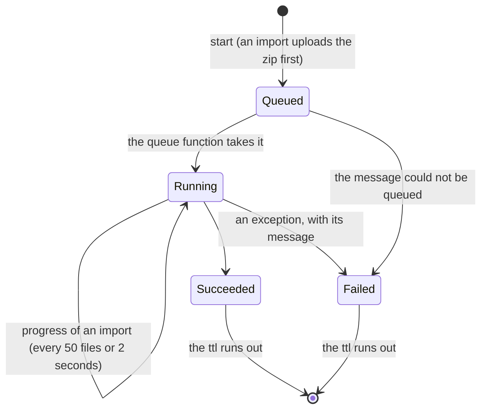

# Export and Import of a View

The documents of a view (its annotations, schemas, templates and configurations) can be exported as a zip, either as a folder of JSON files or as a git repository with every version as a commit. A zip can be imported back into any view of any project. Both run as jobs in the background: a request stores the job and queues it, a queue-triggered function does the work, and the client polls the job.

The code is in:

- `src/Platform/Storyteller/Backend.Core/src/Transferring/`: the jobs, the file names, the archive reader and writer, the git writer, the import passes and the overlay;
- `Backend.CosmosDb/src/`: the reads and imports of each kind (`Annotating/CosmosAnnotationService.Import.cs`, `Configuring/CosmosConfigurationSchemaService.Import.cs`, `CosmosConfigurationTemplateService.cs`, `CosmosConfigurationService.cs`) and the jobs (`Transferring/`);
- `Backend.AzureStorage/src/`: the archives and the queue;
- `Api.Functions/src/`: the routes (`V1/ViewTransferHttp.cs`, `V1/ViewTransferRequests.cs`), the machine scopes of each kind (`Security/ViewTransferScopes.cs`), the access check with the scope `Configuration.Transfer` of machines (`Security/HttpRequestDataExtensions.cs`), and the queue and timer functions (`Transfers/ViewTransferFunctions.cs`);
- `Sdk.NSwag/` and `sdk.typescript/`: the clients generated from the OpenAPI document;
- `src/Platform/Cli/src/`: `sform story export` and `sform story import` (see [CLI](#cli));
- `src/Platform/ui.admin/src/app/`: the **Export & Import** page of a view, its store and the mock API (see [Administration UI](#administration-ui)).

The design and its decisions are in [the spec](specs/2026-10-15%20Export%20and%20Import%20of%20a%20View.md), which extends [the first spec](specs/2026-10-14%20Export%20and%20Import%20of%20Configurations.md) (configurations only). The Administrator role of every route comes from [Administrator Role for the Export and Import of a View](specs/2026-10-19%20Administrator%20Role%20for%20the%20Export%20and%20Import%20of%20a%20View.md), and the single scopes of machines from [Replace Machine Scope Presets with a Flat Scope Set](specs/2026-10-21%20Replace%20Machine%20Scope%20Presets%20with%20a%20Flat%20Scope%20Set.md).

## What travels

| Kind | Exported | Left out |
| --- | --- | --- |
| Annotations | Every annotation of the view that is not deleted, whatever its status (disabled, scheduled and expired ones too). A file holds the editable members; annotations have no versions. The `Created` and `Modified` stamps are listed in `export.json`. | Deleted annotations, the audit, `Deletion`, the relation arrays |
| Schemas | Type, descendant-type and annotation schemas: the current document and the versions still in the history | The annotation and descendant-type schemas of an annotation that is deleted or missing |
| Templates | The template of each type code: the current document and the versions still in the history | |
| Configurations | The own document of each annotation (`{view}.cnf.{key}`) and its versions (`{view}.cfv.{key}.{version}`, [inheritance.md](inheritance.md)) | The configurations of deleted annotations, and their versions |

- The effective document (ancestors, templates and the own document merged) is never exported, nor is a resolved one. Bindings stay as written ([binding.md](binding.md)). Secrets are never resolved, so they never leave the platform. Key/value pairs have their own export ([key-values.md](key-values.md#import-and-export)).
- An empty document is not a version. An empty configuration item only caches the effective document, and an empty template or schema has no effect. A template or schema whose current document is empty counts as deleted when it has earlier versions, and is left out when it has none.
- A deleted schema, template or configuration has versions but no current document. The folder format lists it in `export.json` without a file, and the git format removes it in its last commit.
- Versions expire after 365 days; an export contains what is left.
- Each version has the time and the actor of its `Modified` stamp. `Author` in `export.json` is the actor's display name, or its id without one.
- A template or schema stored under an id that no file name can hold (a type code that is not lower-case, a key that is not in its canonical form) is left out. The writes never produce such ids.
- The schema routes reject a descendant-type schema for a type that cannot descend from its key (`400`, `InvalidKey`, see [definitions.md](definitions.md#ancestor-descendant-type-schemas)), so a view gets no such schema any more. One stored before that check is still exported, and an import fails it with `InvalidKey`. Once it is deleted, an export lists it only as a deleted schema with its earlier versions, which an import ignores.

**Reads.** `ViewTransferService` reads the included kinds only, each with one call:

- `GetConfigurationHistoriesAsync`;
- `GetTemplateHistoriesAsync`: one query of the partition `{project}.template`;
- `GetSchemaHistoriesAsync`: one query of the partition `{project}.schema`, and one read of the states of the annotations the schemas name;
- `GetViewAnnotationsAsync`: the pages of one query over the partitions of the project, for the annotations of the view that are not deleted, of every type and status. It reads the items with System.Text.Json, as the point reads do, so `Values` keep the text that Cosmos DB answers for their strings and numbers. The LINQ queries of `GetAnnotationsAsync` read them with the SDK's Newtonsoft serializer, which turns numbers into doubles and date strings into local dates.

The reads are not a snapshot, so they run in reverse dependency order: configurations, templates, schemas, annotations. A document read first still finds its dependency in a later read, unless the dependency was deleted in between. That is rarer than a creation during the export.

## File names

The file name tells the kind of a document, so the folders of a path play no part in an import.

| Document | Current | Earlier version |
| --- | --- | --- |
| Annotation | `<key>.json` | (none: annotations have no versions) |
| Configuration | `<key>.conf.json` | `<key>.conf.<n>.json` |
| Template | `<type>.template.json` | `<type>.template.<n>.json` |
| Type schema | `<type>.schema.json` | `<type>.schema.<n>.json` |
| Annotation schema | `<key>.schema.json` | `<key>.schema.<n>.json` |
| Descendant-type schema | `<ancestor-key>.<type>.schema.json` | `<ancestor-key>.<type>.schema.<n>.json` |

- `<type>` is the lower-case type code (`rst`, `sbt`, `unt`, `usg`, `cnt`, `exe`, `uxe`).
- Each segment of a key percent-encodes `%`, `<`, `>`, `:`, `"`, `/`, `\`, `|`, `?`, `*` and control characters as `%XX` of their UTF-8 bytes. So every name is a valid file name on Windows, macOS and Linux. Key segments never contain `.`, so the dots stay separators.
- **Reserved second segment.** When the second segment of a key is `template` or `schema` (in any case), its first character is percent-encoded. The responsibility `rst.schema` is the file `rst.%73chema.json`. Otherwise `rst.schema.json` would be both that annotation and the type schema of `rst`, and `unt.template.3.json` both a unit and version 3 of the template of `unt`.
- Documents are indented by two spaces, with `\n` line ends, a final new line and no BOM.
- The zip is named `export-{organization}-{project}-{view}-{yyyyMMdd-HHmmss}Z.zip`, with `-git` before the time for the git format. The time is when the export was requested, in UTC.

`ViewArchiveNames.TryParse` reads a file name without its folders:

1. The extension `.json` is stripped, in any case, and the rest is split at `.`. The first segment must be a type code, in any case; it is lower-cased. A name with an empty segment is not a document.
2. A second segment that is literally `template` or `schema` (in any case, not encoded) makes the file the template or the type schema of that type. A third, numeric segment is the version. A longer name of this shape is not a document.
3. Otherwise the key takes as many segments as its type has: two for `rst` and `sbt`, three for `unt`, `usg` and `cnt`, four for `exe`, five for `uxe`. The segments are decoded, and the key must parse. The rest of the name is the suffix:
   - none: an annotation;
   - `conf`: a configuration;
   - `schema`: an annotation schema;
   - `<type>.schema`: a descendant-type schema of `<type>` below the key.

   Suffixes and type codes match in any case. Every suffix except none may end with a numeric version.
4. Any other name is not a document.
5. A descendant type that cannot descend from the key (`DescendantTypeRules`, read from `AnnotationHierarchy.GetAncestorSchemaSources`) is still a document, so the mistake is reported. It fails with `InvalidKey`. The schema routes no longer store such a schema, so the file comes from a document stored before that check, which an export still carries, or from a hand-made archive.

| File | Document |
| --- | --- |
| `rst.payments.json` | Annotation `rst.payments` |
| `rst.payments.conf.json` | Configuration of `rst.payments` |
| `rst.payments.conf.3.json` | Version 3 of that configuration |
| `rst.payments.schema.json` | Schema of `rst.payments` |
| `rst.payments.exe.schema.json` | Schema of the executions below `rst.payments` |
| `exe.template.json` | Template of `exe` |
| `exe.template.4.json` | Version 4 of that template |
| `EXE.Schema.json` | Type schema of `exe` |
| `rst.%73chema.json` | Annotation `rst.schema` |
| `exe.s.r.c.rst.schema.json` | A descendant-type schema that fails with `InvalidKey`: a responsibility never descends from an execution |
| `rst.payments.3.json` | Nothing: annotations have no versions (a version file of the first spec) |

## Folders and hidden paths

An export writes one folder per included kind that has documents: `annotations/`, `schemas/`, `templates/` and `configurations/`. Version files sit next to their current file. An import parses the file names only. So a flat zip, the export's folders, a zip that wraps them in one more folder, and a reorganized repository all import the same.

- An entry is **skipped**, and not counted, when a segment of its path starts with `.` (`.git`, `.github`, `.vscode`, `.DS_Store`, `._*`), or when its first folder is `__MACOSX`. A leading `./` is not a hidden folder. Directory entries are skipped too, and `\` is read as `/`.
- **Duplicates.** Two files of the same document are duplicates, also across folders, type-code cases and key encodings (`rst.pay%6Dents.json` is `rst.payments.json`). The first path in ordinal order wins. Each other one fails with `DuplicateFile`, for example `The file 'annotations/rst.payments.json' already holds the annotation rst.payments.`

## Folder format

```
export.json
annotations/
  rst.payments.json
  sbt.northwind.json
  usg.northwind.payments.json
  exe.northwind.payments.prod.json
schemas/
  exe.schema.json
  exe.schema.1.json
  rst.payments.schema.json
  sbt.northwind.exe.schema.json
  sbt.northwind.exe.schema.2.json
templates/
  exe.template.json
  exe.template.3.json
configurations/
  rst.payments.conf.json
  rst.payments.conf.1.json
  exe.northwind.payments.prod.conf.json
```

- Zip entry times:
  - a current or earlier version: the time of that version;
  - an annotation: its `Modified.At`, or else `Created.At`, or else the export time;
  - `export.json`: the export time.
- An annotation file holds the editable members in the API's PascalCase names, without null members, in this order:
  - `Title`, `Description`, `DocumentationLink`;
  - `Labels`, `Values`;
  - `IsDisabled`, `ValidFrom`, `ExpiresAt`, `TimeZone`;
  - for units, `UnitType` and `UnitDefinition`.

  The key, the type and the names are in the file name.

```json
{
  "Title": "Payments in production",
  "Labels": [
    "eu"
  ],
  "Values": {
    "tier": "gold"
  },
  "TimeZone": "Europe/Prague"
}
```

`export.json` is version 2 of the manifest. It holds what the names cannot. It is there for information only: an import never reads it. A shortened example:

```json
{
  "ManifestVersion": 2,
  "Organization": "acme",
  "Project": "billing",
  "View": "default",
  "ExportedAt": "2026-10-16T08:00:00+00:00",
  "ExportedBy": { "Kind": "Account", "Id": "user_01", "Name": "Ada Lovelace" },
  "Include": [ "Annotations", "Schemas", "Templates", "Configurations" ],
  "Annotations": [
    {
      "Key": "rst.payments",
      "File": "annotations/rst.payments.json",
      "Created": { "At": "2026-09-01T07:00:00+00:00", "By": { "Kind": "Account", "Id": "user_01", "Name": "Ada Lovelace" } },
      "Modified": { "At": "2026-10-02T10:15:00+00:00", "By": { "Kind": "Machine", "Id": "deploy", "Name": null } }
    }
  ],
  "Schemas": [
    {
      "Kind": "TypeSchema",
      "AnnotationType": "exe",
      "AnnotationKey": null,
      "File": "schemas/exe.schema.json",
      "Version": 2,
      "Author": "Ada Lovelace",
      "UpdatedAt": "2026-10-01T09:30:00+00:00",
      "Versions": [
        { "Version": 1, "File": "schemas/exe.schema.1.json", "Author": "Ada Lovelace", "CreatedAt": "2026-09-20T08:00:00+00:00" }
      ]
    }
  ],
  "Templates": [
    { "AnnotationType": "exe", "File": "templates/exe.template.json", "Version": 4, "Author": "Ada Lovelace", "UpdatedAt": "2026-10-03T12:00:00+00:00", "Versions": [ … ] }
  ],
  "Configurations": [
    { "AnnotationKey": "rst.cleared", "File": null, "Version": null, "Author": null, "UpdatedAt": null, "Versions": [ … ] }
  ]
}
```

- `Include` is the resolved list: distinct, in import order, and all four when the request named none. Every kind is listed; a kind left out is an empty array.
- Order: `Annotations` by key; `Schemas` by kind (type, descendant type, annotation), then type, then key; `Templates` by type; `Configurations` by key.
- A deleted schema, template or configuration has `File`, `Version`, `Author` and `UpdatedAt` null, and its earlier versions in `Versions`.
- Version 1 of the manifest, of the first spec's archives, is gone. Such archives are not supported: `<key>.json` is now an annotation.

## Git format

The zip is a repository with its working tree checked out on `main`, in the folders of the folder format:

```
.git/HEAD                          ref: refs/heads/main
.git/config
.git/refs/heads/main
.git/objects/pack/pack-<sha>.pack
.git/objects/pack/pack-<sha>.idx
.git/index
annotations/rst.payments.json      the current documents
schemas/exe.schema.json
templates/exe.template.json
configurations/rst.payments.conf.json
```

- **One history for every kind.** Each version of a schema, template or configuration is one commit, and each annotation one commit with its current content.
  - The commits are ordered by time.
  - Within one time, they follow the import order: annotations (ancestors first: depth in the graph, then type, then key), then type, descendant-type and annotation schemas (each by type and key), then templates by type, then configurations by key.
  - Each document's versions stay in their order, even when their times are equal or go backwards.

  `git log`, `git blame` and `git diff` then work on the history of a whole view, and `git log -- templates/exe.template.json` on one document.
- **Annotations** are committed at their `Created` stamp: its time, and its actor as author and committer.
  - That is when the key began to exist, so its schemas and configurations come after it.
  - A re-created annotation has a new `Created` stamp, so the configuration versions of its previous lifetime come before it.
  - An annotation without `Created` falls back to `Modified`, and then to the export time with the system signature.
- **Signatures.** An actor is named by its id, like an author string:
  - an account: `account: user_01 <account.user_01@2s.platform>`;
  - a machine: `machine: deploy <machine.deploy@2s.platform>`;
  - the system: `2S Platform <system@2s.platform>`.

  A version without an actor is signed with its author string. The time of a commit is the time of its version.
- **Messages:**

  | Document | First version in the export | Next versions |
  | --- | --- | --- |
  | Annotation | `Add annotation rst.payments` | (none) |
  | Type schema | `Add type schema exe (version 1)` | `Update type schema exe to version 2` |
  | Descendant-type schema | `Add exe schema below sbt.northwind (version 1)` | `Update exe schema below sbt.northwind to version 3` |
  | Annotation schema | `Add schema of rst.payments (version 1)` | `Update schema of rst.payments to version 2` |
  | Template | `Add template exe (version 1)` | `Update template exe to version 4` |
  | Configuration | `Add configuration of rst.payments (version 1)` | `Update configuration of rst.payments to version 3` |

  The first version in an export is not always version 1: older versions may have expired.
- **Deleted documents.** A deleted schema, template or configuration keeps its last version in the tree until the final commit, `Remove deleted documents`. That commit is made at the export time by `2S Platform <system@2s.platform>`, and lists the removed paths in its body. Deleted annotations are not exported, so they never appear. Without deleted documents there is no such commit.
- A view without documents of the included kinds gives a repository without commits.
- A file of the working tree and its index entry have the time of the commit that last wrote the file. So an annotation has its `Created` time here, while the folder format uses `Modified`.

The repository is written by `GitRepositoryWriter`, without a git library:

- **Trees.** A path with `/` lives in subtrees. A tree is ordered like git: by the bytes of the names, with a subtree compared as `name/`. A commit writes again only the trees on the paths it changes, so an unchanged folder keeps its tree id. A removal drops the folders it leaves empty.
- **Pack.** One packfile (version 2) with its index (version 2). A blob is a delta against the previous version of the same file, and a tree against the previous version of the same tree. That holds as long as the delta is less than half the object and the chain is at most 49 deltas deep. The delta copies the common prefix and suffix and inserts the middle.
- **Index.** `.git/index` lists the working tree by full path in byte order, with the blob ids, sizes and times. So `git status` of the extracted folder is clean once git has compared the content.
- **Paths** are checked before anything is packed: an empty, `.`, `..` or `.git` segment is refused, and so are a file and a folder of the same name.
- **Tests.** `GitRepositoryTests` read the result with an independent reader: pack and index checksums, CRC-32, deltas, ids, subtrees and their order. When `git` is installed, they also run `fsck --full --strict`, `status`, `ls-files`, `ls-tree`, `log` and `show`.

## Import

### Options

| Option | Default | Effect |
| --- | --- | --- |
| `include` | all four | The kinds to import. The files of the other kinds are counted as excluded and never decompressed. |
| `existing` | `Overwrite` | What happens to a document the view already has. `Overwrite` writes the file as a new version, or as an update of an annotation, and re-creates a deleted annotation. `Skip` keeps the stored document and leaves a deleted annotation deleted. An equal document is `Unchanged` either way. |
| `force` | `false` | Store schemas and configurations that break each other, with the warning `SchemaViolation`. It never stores invalid JSON, an invalid JSON Schema, an annotation that breaks its rules, or a broken directive. |
| `dryRun` | `false` | Decide every outcome and warning without writing anything. |

`IViewTransferService.StartImportAsync` takes all four, and `StartExportAsync` takes `include`. The routes pass them through (see [Request options](#request-options)).

### Reading the archive

`ViewArchiveReader.Read` takes every entry that is not skipped and parses its file name:

- A document of an included kind becomes a file of the import: its path, kind, type code and key, with its content or an error code and message.
- A document of a kind that `include` leaves out counts as **excluded**. It is not decompressed.
- Version files of any kind, `export.json` and every other name count as **ignored**. An import never replays a history.
- Comments and trailing commas are allowed, and duplicate properties rejected. Annotation files are parsed as the annotation reads parse them (System.Text.Json): strings that look like dates stay strings, and numbers keep their text. The other kinds parse dates and doubles, as their reads do (Newtonsoft). So an exported document compares equal when it is imported back, and importing an export changes nothing.
- A file fails with `InvalidDocument` when it is not a JSON object, cannot be decompressed, or is larger than `MaxDocumentBytes`.
- A descendant-type schema whose type cannot descend from its key fails with `InvalidKey` without being decompressed.

### Order

The import writes in four passes, in dependency order:

| Pass | Within the pass | Why |
| --- | --- | --- |
| 1. Annotations | By depth in the graph, then type, then key: ancestors come first | Annotations depend on nothing. A descendant imported before its ancestor would create the ancestor with defaults, and the ancestor's own file would then find it existing. |
| 2. Schemas | Type, then descendant-type, then annotation schemas, each by type and key | An annotation or descendant-type schema needs its annotation. |
| 3. Templates | By type | A template depends on no other kind. Its place before configurations is a convention: rules, then defaults, then data. |
| 4. Configurations | By key | A configuration needs its annotation, and is validated against its schemas when it is written. |

Before the first pass, the service reads what it must know of the view, with at most one read per kind:

- which annotations named by the schema and configuration files are active: `FindActiveAnnotationKeysAsync`, one read of many items;
- with `Skip` only, which schemas the view has with content: `GetSchemaKeysAsync`, one query of the schema partition;
- with `Skip` only, which configurations the view has with content: the pages of the configuration listing.

Files that failed while reading are reported in the pass of their kind, and a duplicate right after the file that holds its document.

### Overlay

A schema is checked against configurations, and a configuration against schemas. No order of the passes alone lets an archive change both together. So every import keeps a `ViewImportOverlay`, the view as the import will leave it. The checks that look beyond one document ask the overlay before the stored view.

What it holds:

- `ActiveAnnotations`: the keys the annotation pass creates or re-creates, with the ancestors it creates with defaults. `RecreatedAnnotations`: the deleted keys among them. Both are recorded in a dry run too, which writes nothing.
- `FailedAnnotations`: the annotation files that failed, while reading or importing, or that were skipped because an ancestor failed. A `DuplicateFile` never marks its key: the document is the first file's.
- `Schemas` and `Configurations`: filled once, after the annotation pass. A schema or configuration file enters when:
  - it was read without an error and is not `{}`;
  - its annotation is active, stored or in `ActiveAnnotations` (a type schema needs none);
  - `existing` allows it. With `Skip`, a document the view already has stays out, except the configuration of a re-created annotation, which the re-create emptied.
- A schema or configuration that is then `Failed` or `Skipped` leaves the overlay.

How it is used:

- An annotation in `ActiveAnnotations` counts as active for its schemas, its configuration and its descendants, which don't create it again. In a dry run, that is the only place it exists.
- **The compliance check of a schema** checks the configurations as the import leaves them:
  - an overlay configuration replaces the stored one, with its `$remove` and `$patch` applied to a copy;
  - the stored configuration of a re-created annotation is not checked;
  - the overlay configurations of keys without a stored document are checked too, for example those of new annotations;
  - the other layers of the combined schema come from the overlay where the archive brings them. An empty layer, or one that is not a valid JSON Schema, is ignored, because the import won't write it.
- **A configuration** is validated against its combined schema:
  - in a dry run, with the overlay's layers;
  - in a real run, against the stored schemas, which the schema pass has already written.

So an archive that changes a schema and its configurations together imports without `force`, and a dry run predicts the real run. A check can count on an overlay document that fails later in the run. The view can then hold a schema that a stored configuration violates, the state a forced write leaves. The configuration pass of a real run validates against what is stored, so no configuration is written against a schema that isn't there.

### Annotations

`IAnnotationService.ImportAnnotationAsync` writes the way `SetAnnotationAsync` does.

1. **Content** (`ViewAnnotationDocument.TryRead`):
   - Member names match in any case, as in the API. Two spellings of one member fail with `InvalidDocument`.
   - The other members of the key's type, which a `GET` response has, are ignored: the key and the names, the relation arrays, the stamps, `Deletion`. So a response body can be saved as a file. An `AnnotationKey` member must be the key of the file name (the type code in any case), or the file fails with `InvalidDocument`.
   - Any other member fails with `InvalidDocument`: `Unknown member 'X'.`, or `Unknown members 'a', 'b'.` That includes `UnitType` outside units and `$patch` and `$remove` (annotations have no merge). It also catches a configuration document read as an annotation.
   - Values are typed like the API's request body (System.Text.Json). A value of a wrong type fails with `InvalidDocument`.
   - A member missing from the file is cleared, because an import replaces the content. A unit without `UnitType` or `UnitDefinition` gets the defaults of a create (`event`, `unknown`). `{}` is a valid annotation: the key without content.
   - `AnnotationRules` apply ([annotation-lifecycle.md](annotation-lifecycle.md#validation)). A violation fails with `InvalidAnnotation`.
2. **A failed ancestor**, one in `FailedAnnotations`, skips the file with `DependencyFailed`. Creating the key would create that ancestor with defaults.
3. **An active key** is compared with `AnnotationAuditDiff`. Numbers that are the same double are equal ([annotation-lifecycle.md](annotation-lifecycle.md#audit)), so the shortest text that a query exports equals the 17 digits that the point read of the import returns.
   - Equal: `Unchanged`.
   - Different, with `Skip`: `Skipped` with `DocumentExists`.
   - Different, with `Overwrite`: the content is replaced with an `Updated` audit entry, and the outcome is `Updated`.
4. **A missing or deleted key, or one below a deleted ancestor.** Ancestors that an earlier file of this import made active don't count.
   - With `Skip`, a deleted key or ancestor skips the file with `AnnotationDeleted`. The message names every deleted key on the path.
   - Otherwise the key is created with its missing ancestors, and the deleted ones are re-created, as any write of the key through the API does ([annotation-lifecycle.md](annotation-lifecycle.md#re-create)):
     - the item gets the file's content, empty relation arrays and a new `Created` stamp;
     - its configuration goes to the versions and starts empty;
     - its audit continues with a `Recreated` entry;
     - the children deleted with it stay deleted and become roots, unless the archive holds them; their own files re-create them later in the pass.

     The outcome is `Created`. A missing ancestor created with defaults gives the warning `AncestorCreated`, and every re-created key the warning `AnnotationRecreated`.
5. **Audit.** Written annotations get their usual entries (`Created`, `Recreated`, `Updated`, with the cause `Ancestor` on ancestors) by the importing caller. The archive carries no audit, and the import adds no cause of its own.

The outcome and the warnings come from the states read before the write, so a dry run reports what the real run does. When the key is created concurrently, the step runs again and takes the update path.

### Schemas

`IConfigurationSchemaService.ImportSchemaAsync` checks, in this order:

1. A descendant-type schema whose type cannot descend from its key fails with `InvalidKey`, with the message of the schema routes (`DescendantTypeRules`). The import reports it instead of throwing, so the other files of the archive still import.
2. An annotation or descendant-type schema needs an active annotation, stored or in the overlay. Otherwise it is `Skipped`:
   - with `DependencyFailed` when the annotation failed in this import;
   - with `AnnotationDeleted` when it is deleted;
   - with `AnnotationNotFound` when it is missing.
3. `{}` is `Skipped` with `EmptyDocument`: a schema is cleared by `DELETE`.
4. A document that is not a valid JSON Schema fails with `InvalidSchema` (`Invalid JSON Schema: …`), even with `force`.
5. An equal stored schema is `Unchanged`. With `Skip`, a different one makes the file `Skipped` with `DocumentExists`. A stored empty schema counts as none.
6. The compliance check runs as the import leaves the view (see [Overlay](#overlay)). A violation fails with `SchemaViolation`, and the message lists the keys, at most 20 in ordinal order: `The configuration of rst.a violates this schema.`, or `The configurations of a, b, … and N more violate this schema.` With `force`, the schema is written with the warning `SchemaViolation`, and the violations are logged as on a forced save ([definitions.md](definitions.md#force)).
7. A dry run stops here with `Created` or `Updated`. Otherwise the schema is saved as a new version, without repeating the checks.

### Templates

`IConfigurationTemplateService.ImportTemplateAsync` **replaces** the template; it doesn't merge into it ([templating.md](templating.md#managing-templates)).

- `$remove` and `$patch` apply to the document alone, as on a create. A broken directive fails with `PatchInvalid`, or `PatchTestFailed` for a failed `test` operation.
- `{}` is `Skipped` with `EmptyDocument`: a template is cleared by `DELETE`.
- An equal template is `Unchanged`, and a cache invalidation left pending by an earlier write is finished. With `Skip`, a different one is `Skipped` with `DocumentExists`. A stored empty template counts as none.
- Otherwise the template is written as the version after `LastVersion`. The effective documents of its type are invalidated, as on any template write.
- Templates have no schema, so `force` does not apply.

### Configurations

`IConfigurationService.ImportConfigurationAsync` replaces the annotation's own document.

- **Annotation.** An annotation in the overlay's `ActiveAnnotations` counts as active. Otherwise an annotation that is not active is `Skipped`:
  - with `DependencyFailed` when it failed in this import;
  - with `AnnotationDeleted` when it is deleted. With `Skip`, a deleted annotation stays deleted, so its configuration is skipped too;
  - with `AnnotationNotFound` when it is missing.
- **Content.** `$remove` and `$patch` apply to the document alone, as on a create. A broken directive fails with `PatchInvalid` or `PatchTestFailed`. A document that ends empty is `Skipped` with `EmptyDocument`: a configuration is cleared by `DELETE`.
- **Existing.** An equal document is `Unchanged`. With `Skip`, a different one is `Skipped` with `DocumentExists`. The configuration of a re-created annotation counts as none: the re-create emptied it, so the file is `Created` as the next version.
- **Validation.** The document is validated against its combined schema (see [Overlay](#overlay) for the layers). A violation fails with `SchemaViolation`. With `force`, it is written with the warning `SchemaViolation`, which lists the errors.
- **Write.** The version is stamped with the importing caller, and the annotation's audit gets `ConfigurationChanged`.

### Outcomes, codes and warnings

Each file of an included kind gets one outcome:

| Outcome | When | Error code |
| --- | --- | --- |
| `Created` | The view had no such document. An annotation may also have been deleted and re-created. A schema, template or configuration is written as version 1, or as the version after the ones it had before. | |
| `Updated` | The document differs and replaces the stored one: a new version, or an update of an annotation | |
| `Unchanged` | It equals the stored document; nothing is written | |
| `Skipped` | `existing` is `Skip` and the view has a different document | `DocumentExists` |
| | The annotation of the document failed in this import; for an annotation, one of its ancestors | `DependencyFailed` |
| | The annotation is deleted; for an annotation (with `Skip`), it or an ancestor is deleted | `AnnotationDeleted` |
| | The view has no such annotation (a schema or a configuration) | `AnnotationNotFound` |
| | The document is `{}` (a schema, a template, or a configuration after its directives) | `EmptyDocument` |
| `Failed` | Not a JSON object, cannot be decompressed, or larger than `MaxDocumentBytes`. For an annotation also: an unknown member, a different `AnnotationKey`, a value of a wrong type. | `InvalidDocument` |
| | A second file of the same document | `DuplicateFile` |
| | An annotation that breaks `AnnotationRules` | `InvalidAnnotation` |
| | A descendant-type schema whose type cannot descend from its key | `InvalidKey` |
| | Not a valid JSON Schema | `InvalidSchema` |
| | A broken `$patch` or `$remove` directive of a template or configuration | `PatchInvalid`, `PatchTestFailed` |
| | Without `force`: the configuration violates its schema, or configurations violate the schema | `SchemaViolation` |
| | The document kept changing concurrently: its write ran out of retries. The rest of the import goes on, and for an annotation the documents that depend on it are skipped with `DependencyFailed`; importing the file again writes it. | `Conflict` |

A written document can carry warnings (`ViewImportItem.Warnings`, each a `Code` and a `Message`):

| Warning | On | When |
| --- | --- | --- |
| `AncestorCreated` | An annotation | Creating it also created missing ancestors that the archive doesn't hold, with defaults: `The missing ancestors rst.payments, usg.northwind.payments are created with defaults.` |
| `AnnotationRecreated` | An annotation | It or its ancestors were deleted and are re-created: their configurations go to the versions and start empty, and the children deleted with them stay deleted. |
| `SchemaViolation` | A schema or a configuration | `force` stores it although it breaks the other side. |

- The importing caller is the actor of written versions and audit entries.
- History in the archive (version files, commits) is never replayed. Documents missing from the archive are left alone: an import never deletes.
- A **dry run** decides every outcome and warning the same way and writes nothing. `Created` and `Updated` have no version; `Unchanged` has the stored one.

### Large imports and retries

- **Cost.** Each annotation takes several requests: reads of the key and its ancestors, and the writes of a create or an update. Each schema runs the compliance query of a save: one query over the configurations it affects and one validation per configuration. With `Skip`, the existence reads list the view's schemas and configurations once. An archive with thousands of annotations, or with many type schemas over many configurations, takes much longer than one with configurations only.
- **Timeout.** A job is one invocation of the queue function, bound by the Functions timeout of the hosting plan (`host.json` sets no `functionTimeout`).
- **Retries.** An import is idempotent. When an invocation is cut off, the queue delivers the message again, and the whole job runs again. The documents the first run wrote are then `Unchanged`. After three deliveries (`maxDequeueCount`), the message goes to the poison queue `configuration-transfers-poison`, where `AbandonViewTransfer` fails the job ("stopped on every attempt, for example because its worker ran out of memory"), so it no longer takes a slot of the project. A job that ended before stays as it is. Resuming where a run stopped is not supported.
- **Failures of single files.** Concurrent changes that outlast the retries of a write fail that file with `Conflict`, not the whole job. A `$remove` entry that is not a valid JSONPath, or that takes the whole document (`$`), fails its file with `PatchInvalid`.

## Jobs

A job is an item in the organization container, in the partition `{project}.transfer`, with the id `{view}.exp.{id}` or `{view}.imp.{id}`. So it is only found through the view it was started in. It holds the public model (`ViewExport` or `ViewImport`), a copy of its status for the count of active jobs, and a `ttl`. The queue message only names the job.



- Every write restarts the item's `ttl` (`RetentionHours`), and `ExpiresAt` tells the client when it ends.
- Writes use the item's ETag. A worker that loses a race stops. A repeated message of a finished job does nothing. A worker that crashed leaves the job `Running` until the queue delivers the message again.
- A project can have at most `MaxActiveTransfers` jobs queued or running. A queued job counts for an hour after its last change; a running one, which saves its progress every few seconds, for 15 minutes. So an abandoned job does not block the project, even before the poison queue fails it. One more is refused with `409 TransferLimit`.
- An export writes the zip into memory and uploads it as `{organization}/{project}/{view}/exports/{id}.zip`. An import reads its upload `…/imports/{id}.zip` into memory, and deletes it when it succeeds. `PurgeExpiredAsync` deletes archives an hour after the retention.

`ViewExport` reports:

- `Format`;
- `Include`, stored resolved: distinct, in import order, all four when the request named none;
- `FileName`;
- the counts of the included kinds, null for a kind left out: `AnnotationCount`, and `SchemaCount`, `TemplateCount` and `ConfigurationCount` (documents with a current version);
- `VersionCount`: every exported version of schemas, templates and configurations, the current ones included;
- `Size` and `Error`.

`ViewImport` reports:

- `FileName`, `Include` (stored resolved), `Existing`, `IsDryRun` and `IsForced`;
- `TotalCount`: the document files of the included kinds, failed ones included; `ProcessedCount`: the files processed so far;
- `Summary`: the total, with `ExcludedFiles` and `IgnoredFiles`;
- `Summaries`: one per included kind, in import order, named by `Content`;
- `Items`: every outcome except `Unchanged`, in pass order, up to `MaxReportedItems`; `AreItemsTruncated` tells when the list stops;
- `Error`.

A summary counts `Created`, `Updated`, `Unchanged`, `Skipped` and `Failed`, and `Warnings`: the documents with a warning. An item has its `Path` and `Kind`, `AnnotationType` (of a template, a type schema or a descendant-type schema), `AnnotationKey` (of an annotation or a configuration, the annotation of an annotation schema, or the ancestor of a descendant-type schema), and its `Outcome`, `Version`, `ErrorCode`, `Message` and `Warnings`. Messages are cut at 500 characters.

## API

The routes are below `v1/{organization}/{project}/{view}`, with the tag `Transfers`:

- `Api.Functions/src/V1/ViewTransferHttp.cs`: the five routes;
- `V1/ViewTransferRequests.cs`: the parsing of the options;
- `Security/ViewTransferScopes.cs`: the machine scopes per kind and direction;
- `Security/HttpRequestDataExtensions.cs`: the project access, with the scope `Configuration.Transfer` of machines, and the scopes a machine may use in the request (`GetGrantedMachineScopes`).

`exports` and `imports` are literal segments after the view, and `views` is a reserved view name, so they meet no other route. The routes of the first spec below `…/configurations/` (`StartConfigurationExport` and its siblings, with the tag `Configurations`) are removed without a redirect; they were never released.

### Routes

| Method | Route | Operation | Success |
| --- | --- | --- | --- |
| `POST` | `…/exports` with `{ "Format": "Folder" \| "Git", "Include": [ … ] }` | `StartViewExport` | `202` `ViewExport` |
| `GET` | `…/exports/{id}` | `GetViewExport` | `200` `ViewExport` |
| `GET` | `…/exports/{id}/archive` | `GetViewExportArchive` | `200` `application/zip`, with `Content-Disposition` naming the export's `FileName` |
| `POST` | `…/imports?include=&existing=&force=&dryRun=&fileName=` with the zip as the body (`application/zip`) | `StartViewImport` | `202` `ViewImport` |
| `GET` | `…/imports/{id}` | `GetViewImport` | `200` `ViewImport`, with the summaries and the items |

- A started job answers with its `Location`: the job below the collection it was posted to (`…/exports/{id}` or `…/imports/{id}`).
- The job holds `Include` resolved: distinct, in import order, and all four when the request named none. An import also holds `Existing`, `IsDryRun` and `IsForced`.
- A job is found only through the view it was started in (see [Jobs](#jobs)).
- **Upload.** The zip is copied into memory up to `MaxArchiveBytes` (a larger `Content-Length` is refused before reading) and must start with a zip signature. Then its central directory is checked (see [Limits](#limits)).

### Request options

| Option | Where | Values | Default |
| --- | --- | --- | --- |
| `Format` | export, body | `Folder` or `Git` | `Folder` |
| `Include` | export, body | a list of `Annotations`, `Schemas`, `Templates` and `Configurations` | all four |
| `include` | import, query | the same kinds, comma-separated | all four |
| `existing` | import, query | `Overwrite` or `Skip` | `Overwrite` |
| `force` | import, query | `true` or `false` | `false` |
| `dryRun` | import, query | `true` or `false` | `false` |
| `fileName` | import, query | the name of the uploaded file | none |

What the import options do is described under [Import](#import), in [Options](#options). The routes read them as follows:

- **The export body** is read by the route itself rather than bound, so a mistake answers `400` with a message that names it.
  - Member names, formats and kinds match in any case. Other members are ignored.
  - No body, `{}`, null members and an empty `Include` export a folder of all four kinds.
  - An unknown format or kind, a number in their place, an `Include` that is not a list, a body that is not a JSON object, and invalid JSON answer `400` without an error code. For example: `Include has the unknown kind "Secrets". Use Annotations, Schemas, Templates or Configurations, or an empty list for all four.`
- **`include`** is read from the query, comma-separated and in any case.
  - Spaces around a name and empty names are ignored, and a kind named twice counts once. Empty means all four.
  - A repeated parameter (`include=annotations&include=templates`) works too, since the query joins its values with commas. Both SDKs send one comma-separated value.
  - Only the names are kinds: a number, `annotation` or `Annotations|Schemas` is unknown. An unknown kind answers `400 InvalidQuery`, for example `The query parameter 'include' has the unknown kind 'secrets'. Use Annotations, Schemas, Templates or Configurations, comma-separated, or leave it empty for all four.`
- **`existing`** is `Overwrite` or `Skip`, in any case. Empty means `Overwrite`. Anything else, including a number or `Overwrite,Skip`, answers `400 InvalidQuery`.
- **`force`**, **`dryRun`** and **`fileName`** are bound as in the first spec. `fileName` is only for display: the job keeps its last path segment, without control characters, cut at 255 characters.

### Status codes

| Status | Error code | Route | When |
| --- | --- | --- | --- |
| `400` | | `StartViewExport` | The body is not valid JSON or not an object, or it names an unknown format or kind |
| `400` | `InvalidQuery` | `StartViewImport` | `include` names an unknown kind, or `existing` is neither `Overwrite` nor `Skip` |
| `400` | `InvalidArchive` | `StartViewImport` | The body is not a zip, or its central directory breaks a limit: more than `MaxArchiveEntries` entries, or document files declared larger than `MaxExtractedBytes` together (see [Limits](#limits)) |
| `401` | | every route | Missing or invalid credentials, a user token without `User.Impersonation`, or a machine the project does not know or whose credential kind it does not enable |
| `403` | `AccessDenied` | every route | The user's role on the project is below `Administrator`, or a machine lacks `Configuration.Transfer` or a scope of an included kind (see [Access](#access)) |
| `403` | `AnnotationRestricted` | every route | The caller is a machine restricted to an annotation; an export or import spans the whole view |
| `404` | `NotFound` | the three reads | The job doesn't exist in this view, or has expired. For the archive, also an expired archive. |
| `409` | `TransferLimit` | both starts | The project already has `MaxActiveTransfers` jobs queued or running |
| `409` | `TransferNotReady` | `GetViewExportArchive` | The export is queued, running or failed. The message of a failed one holds its error. |
| `413` | `ArchiveTooLarge` | `StartViewImport` | The upload, or its declared `Content-Length`, is larger than `MaxArchiveBytes` |

The checks run in this order, and the first failure answers. The credentials come first: a request without them gets `401` on every route, in every build. Then the project access: for a user `User.Impersonation` (`401`) and the role (`403 AccessDenied`); for a machine its membership of the project and its credential policy (`401`), then its annotation restriction (`403 AnnotationRestricted`), then the scope `Configuration.Transfer` (`403 AccessDenied`). Then, for machines only, the scopes of the kinds (`403 AccessDenied`):

- `StartViewExport`: the body (`400`), the credentials (`401`), the project access, the scopes of the kinds, the job limit (`409`).
- `StartViewImport`: `include` and `existing` (`400 InvalidQuery`), the credentials (`401`), the project access, the scopes of the kinds, the size (`413`), the zip signature (`400 InvalidArchive`), the job limit (`409`), the central directory (`400 InvalidArchive`).
- The reads: the credentials (`401`), the project access, the job (`404`), and then the scopes of the kinds of its `Include`. So a user below `Administrator`, or a machine without `Configuration.Transfer`, gets `403` for any id, also for a job that does not exist. The download then checks the state (`409 TransferNotReady`) and opens the archive (`404`).

### Access

**Users** need the `Administrator` role on the project, so `Administrator` or `Owner`, on every route: to start an export, to read it and download its archive, to start an import and to read it. Below it, the route answers `403` with the error code `AccessDenied` and the message that every role check of the API gives, for example `No Administrator access to 'acme.billing'.` The role is read again on every request, so a user who loses it while a job runs gets `403` at the next read or at the download. The job itself still ends: the queue functions check no access. Users need no data scopes: the role decides, and the scopes in a user token change nothing.

**Machines** have no role: they need the scope `Configuration.Transfer` and the scopes of every included kind ([authentication.md](authentication.md#scopes-of-machines)). This differs on purpose from the other Administrator operations, such as the permanent delete of an annotation, which refuse machines ([access.md](access.md#roles)): a backup or a copy between projects from a pipeline exports and imports as a machine, and the scopes of the included kinds tell a reading machine from a writing one. `Configuration.Transfer` is a management scope. Only an Administrator gives it to a machine, and only an Administrator creates, resets, deletes or changes the federation rules of a machine that has it, so a Contributor cannot create, take over or remove a machine that exports or imports: the role decides what a user does with their own sign-in, the scopes what a machine does.

The scopes depend on the included kinds and the direction. An export needs the read scope of each kind. An import writes what the direct routes write, so it needs their scopes, the management scope of schemas, templates and annotations included: an import is no way around `Schema.Write`, `Template.Write` or `Annotation.Manage`. Every scope of a cell is required:

| Included kind | Export, and reading an export | Import, and reading an import |
| --- | --- | --- |
| Annotations | `Annotation.Read` | `Annotation.Write` and `Annotation.Manage` |
| Schemas | `Configuration.Read` | `Configuration.Write` and `Schema.Write` |
| Templates | `Configuration.Read` | `Configuration.Write` and `Template.Write` |
| Configurations | `Configuration.Read` | `Configuration.Write` |

An import of annotations creates them in bulk and re-creates deleted ones, which `SetAnnotations` and `RestoreAnnotations` allow only with `Annotation.Manage`; an import of schemas or templates writes them as `SetConfigurationSchema` or `SetTemplate` would, with `Schema.Write` or `Template.Write` ([authentication.md](authentication.md#scopes-of-machines)).

- **A request** needs every scope of every kind it includes, and without include those of all four. Creating a machine with `Annotation.Write` or `Configuration.Write` adds the matching read scope, so a machine that imports a kind also exports it.
- **Reading a job**, or downloading the archive of an export, needs the scopes of the job's stored `Include`, not of the request: the read scopes for an export, the scopes of the import for an import. A job without a stored `Include` counts as all four kinds. So polling an import needs the scopes of importing its kinds too.
  - The project access, with `Configuration.Transfer`, is checked first. Then the job is read (`404`), and the scopes of its kinds are checked (`403`).
  - The archive is not opened, and the job's state not told, before the scopes pass.
- **A missing scope of a kind** throws `AccessDeniedException`, which answers `403` with the error code `AccessDenied`. `401` stays for missing or invalid credentials: a request without credentials (no claims) gets `401` before any scope is checked, so it is never told to change `include`, and clients sign in again. (In the first spec, a missing scope answered `401`.) The message has one sentence for each kind that misses a scope, and names the kinds, every scope that would allow them (also those the machine has, so the sentence does not change with the machine), and `include`:

  | Case | Message |
  | --- | --- |
  | A request without `include` | `Missing scope for annotations: importing them needs Annotation.Write and Annotation.Manage. Without include, all four kinds are included; name the kinds to import in include.` |
  | A request with `include` | `Missing scope for schemas in include: importing them needs Configuration.Write and Schema.Write.` |
  | Reading a job | `Missing scope for annotations in the include of this export: reading it needs Annotation.Read.` |

  Kinds that need the same scopes share a sentence: `Missing scope for schemas, templates and configurations: exporting them needs Configuration.Read.` On an import, each kind needs its own scopes, so a machine with only `Configuration.Write` gets a sentence for annotations, one for schemas and one for templates.
- So a machine with the scopes `Configuration.Read`, `Configuration.Write` and `Configuration.Transfer` (see [authentication.md](authentication.md#the-machineaccess-object)) imports with `include=configurations`, and exports with `"Include": [ "Schemas", "Templates", "Configurations" ]`. With `Schema.Write` and `Template.Write` as well, it imports with `include=schemas,templates,configurations`. One transfer scope covers both directions; the scopes of the kinds decide whether a machine exports, imports or both.
- **The scope** `Configuration.Transfer` is checked on every route, the three reads included, after the annotation restriction and before the scopes of the kinds. Without it, the route answers `403 AccessDenied`, with "This operation needs the scope Configuration.Transfer, which the machine was not created with." or "…, which the credentials of the machine do not carry." (a Storyteller token that asked for a subset without it, or a provider token without its permission or app role). The other management scopes do not stand in for it. `Schema.Write`, `Template.Write` and `Annotation.Manage` are scopes of the kinds of an import, checked after it; `KeyValue.Manage` plays no part.
- **Stored and carried.** Every scope of a machine, `Configuration.Transfer` and the scopes of the kinds alike, counts only when it is stored on the machine and carried by its credentials. The check of the kinds takes them from `HttpRequestDataExtensions.GetGrantedMachineScopes()`: the scopes of the machine that the access check read, whose scope strings the credentials carry (`GetScopes()`: the `scp`, `roles` and scope claims, without an `App.` prefix).
- Machines are allowed with these scopes and without a role, except a machine restricted to an annotation: export and import span the whole view, so it gets `403 AnnotationRestricted` (see [Annotation restriction of machines](authentication.md#annotation-restriction-of-machines)), with or without the transfer scope. The caller's audit actor becomes the job's `CreatedBy`, and the actor of written versions and audit entries.
- **Debug builds** (`DEV_AUTH`) skip only the checks of users, `User.Impersonation` and the role, as on every route, so there a user of any role exports and imports, also under Aspire. A request without credentials still gets `401` on these routes: unlike other routes, they never serve an anonymous request as `System`. The checks of machines (their document, the credential policy, the annotation restriction, `Configuration.Transfer` and the scopes of the kinds) run in every build, so `ViewTransferHttpTests` test the rules per kind and their wiring in Debug too. The role is tested in Release only (`-c Release`): the tests of the roles below `Administrator` return early under `DEV_AUTH`, and in Debug the tests of `Administrator` and `Owner` would pass with any role.

### OpenAPI and SDKs

The document publishes the five operations with the tag `Transfers`, each with its `401` and `403`. The `403` of the export operations and that of the import operations each have their own description (`ResponseTransferForbiddenExport` and `ResponseTransferForbiddenImport` in `Definitions.cs`). Both start with "The user's role on the project is below Administrator, or a scope of the machine is missing (AccessDenied), or the machine is restricted to an annotation (AnnotationRestricted).", then say what a machine needs, for the export "A machine needs no role but the scope Configuration.Transfer and the read scope of every included kind (Annotation.Read for annotations, Configuration.Read for schemas, templates and configurations); reading an export needs the scopes of the kinds it includes." and for the import "A machine needs no role but the scope Configuration.Transfer and the scopes of the direct writes of every included kind (Annotation.Write and Annotation.Manage for annotations, Configuration.Write and Schema.Write for schemas, Configuration.Write and Template.Write for templates and Configuration.Write for configurations); reading an import needs the scopes of the kinds it includes.", and end with "Users need no data scopes, only the Administrator role. The message names the missing role or scope." The `401` is the shared description of the data routes (`ResponseUnauthorized`), which names no data scope: a machine without a scope is authenticated and gets `403`. The operations themselves name no role.

- `include` is an array with `style: form` and `explode: false`, so it is sent comma-separated. `existing` has the default `Overwrite`.
- `ViewTransferSchemaDocumentFilter` makes both parameters, and the `Include` lists and `Existing` of the bodies and jobs, reference two shared schemas: `ViewArchiveContent` (without a default, since no include means all four kinds) and `ViewImportExisting`. Inline, the generators would name an enum after each list (NSwag: `Include`, `Include2`, `Include3`, `Anonymous`).
- The other enums stay inline: the format (`ViewExportCreateFormat` in the body, `ViewExportFormat` on the job), the kind of a summary (`ViewImportSummaryContent`) and the kind of an item (`ViewImportItemKind`).

The operations are in the OpenAPI document since `open.api.v0.9.48.json` (`Sdk.NSwag` keeps every version, `sdk.typescript` the newest):

- The C# SDK has `ITransfersApiClient` (`TransfersApiClient`, registered by `AddStorytellerSdk`): `StartViewExportAsync`, `GetViewExportAsync`, `GetViewExportArchiveAsync` (a `FileResponse`), `StartViewImportAsync(…, IEnumerable<ViewArchiveContent> include, ViewImportExisting? existing, bool? force, bool? dryRun, string fileName, Stream body)` and `GetViewImportAsync`. It sends `include` comma-separated. The description of each `403` is the message of its `ApiException<ErrorResponse>`, which `sform` prints, with the status and the response, when the answer has no message of its own.
- The TypeScript SDK has the `transfers` tag: `startViewExport`, `getViewExport`, `getViewExportArchive` (a `Blob`), `startViewImport(…, file, { include, existing, force, dryRun, fileName })` and `getViewImport`, with their Vue Query composables, Zod schemas and MSW handlers (`getTransfersMock()`, part of `getStorytellerMock()` in the `./msw` entry). `include` goes comma-separated (`include=Annotations%2CTemplates`).

### Background functions

The background half is `Api.Functions/src/Transfers/ViewTransferFunctions.cs`:

- `ProcessViewTransfer` is triggered by the queue `configuration-transfers` on `AzureWebJobsStorage`. `host.json` sets `batchSize` 1, so a worker runs one job at a time, and `maxDequeueCount` 3. A message that is not a valid job is logged and dropped. Any other failure fails the invocation (`ExceptionHandlingMiddleware` rethrows for invocations without an HTTP request), so the runtime delivers the message again.
- `AbandonViewTransfer` is triggered by the poison queue `configuration-transfers-poison`, where the runtime moves a message after its last failed delivery. A crashed worker, for example out of memory, never ran the job's failure handling, so this function fails the job and deletes the partial archive of an export. A job that already ended is left alone.
- `PurgeViewTransfers` runs every hour at minute 17 and deletes archives older than the retention plus one hour.
- Both functions had the names of the first spec (`ProcessConfigurationTransfer`, `PurgeConfigurationTransfers`). The queue, the container, the partition and the options section keep theirs (see [Storage](#storage)).

Locally, the Aspire host (`Aspire.Host/src/AppHost.cs`) runs Azurite on the default ports, so `UseDevelopmentStorage=true` of `local.settings.json` works unchanged. Without Aspire, start Azurite (`npx azurite`) before the Functions host.

## CLI

Two subcommands of `sform story` export and import the view of the context: the current organization, project and view, or the ones of `-p|--projectKey <organization>.<project>` and `-v|--view`, as for every `sform story` command ([annotation-lifecycle.md](annotation-lifecycle.md#cli)).

```
sform story export [-f|--format folder|git] [-i|--include <kinds>] [-o|--output <path>] [-x|--extract] [--timeout <minutes>]
sform story import <zip-or-folder> [-i|--include <kinds>] [-e|--existing overwrite|skip] [--dry-run] [--force] [--timeout <minutes>]
```

A user needs the `Administrator` role on the project, and a machine `Configuration.Transfer` and the scopes of every included kind (see [Access](#access)). The help of both commands says so: `(Administrator)` after what the command does, and at the end "A machine needs the read scopes of the included kinds and Configuration.Transfer instead of a role." for `export`, and "A machine needs the write scopes of the included kinds, with Annotation.Manage for annotations, Schema.Write for schemas and Template.Write for templates, and Configuration.Transfer instead of a role." for `import`. `sform` checks no role of its own, because a `403` can also be a missing scope or `AnnotationRestricted`; it prints the server's message instead (see [Exit codes](#exit-codes)).

An Administrator creates such a machine with `sform account machine create`:

```bash
sform account machine create -m configuration-transfer       # Annotation.Read, Configuration.Read, Configuration.Transfer: exports
sform account machine create -w -m configuration-transfer,schema-write,template-write,annotation-manage   # exports and imports every kind
sform account machine create --scope configuration-write --scope configuration-transfer   # imports configurations only
```

`-m` takes management scopes, and `--scope` any scope, as the enum name, the scope string or kebab case. Without a runtime scope, `sform` adds the `-r` set, `Annotation.Read` and `Configuration.Read`. The server adds `Configuration.Read` for `Configuration.Write`, so the last machine exports those kinds too.

The code is in `src/Platform/Cli/src/`:

- `Commands/Storyteller/StorytellerExportCommand.cs` and `StorytellerImportCommand.cs`, subcommands of `StorytellerListCommand` (`sform story`);
- `Commands/Storyteller/ViewTransferArguments.cs`: the checks of the options;
- `Services/ViewArchives.cs`: packing a folder and unpacking an export, through `IFileSystem`;
- `Services/TransferPolling.cs`: waiting for a job;
- `Output/TransferConsoleExtensions.cs`: the tables, the export summary, and `WriteRefusal`, which prints the server's message of a refused step and returns its exit code.

The commands call `ITransfersApiClient`. The `sform story config export` and `sform story config import` of the first spec are removed; they were never released.

### Command options

| Option | Command | Values | Default |
| --- | --- | --- | --- |
| `-f\|--format` | export | `folder` or `git` | `folder` |
| `-i\|--include` | both | `annotations`, `schemas`, `templates` and `configurations`, comma-separated (`-i annotations,templates`) or repeated (`-i annotations -i templates`) | all four |
| `-o\|--output` | export | The file of the zip, or a folder for it. With `--extract`, the folder to unpack into. | the server's file name in the current folder |
| `-x\|--extract` | export | | off |
| `-e\|--existing` | import | `overwrite` or `skip` | `overwrite` |
| `--dry-run` | import | | off |
| `--force` | import | | off |
| `--timeout` | both | minutes | 10 |

What the import options do is described in [Options](#options). `ViewTransferArguments` checks the values before anything is read from disk or sent:

- Names match in any case, as in the API. A number is not a name.
- A kind named twice counts once. The kinds are sent in import order, whatever their order on the command line.
- An unknown format, kind or mode prints an error and exits with `2`, for example `Unknown kind 'secrets' in --include; use annotations, schemas, templates or configurations, comma-separated.`
- **An `--include` that names no kind** (`-i ""`, `-i ","`) is refused the same way, although the API takes an empty include as all four kinds. On a command line, an empty value is more likely an empty shell variable than a request for everything. Leave the option out for all four.
- A missing `--include` or `--existing` is not sent, and neither are `--force` and `--dry-run` when they are not given. The server then applies its defaults: all four kinds, `Overwrite`, no force, a real run.

### sform story export

1. The command always sends a `ViewExportCreate` body with the format and the include. The C# SDK would send `null` for a missing body, which the API answers with `400`.
2. It prints `Exporting the annotations and templates of acme.billing.default (git)…` and waits for the job. It reads the job every second, then every 2 and 3 seconds (`TransferPolling`). Every read checks the access again, so a `403` can come at the first read or at a later one, for example `No Administrator access to 'acme.billing'.` for a user who lost the role while the job runs. The command then prints the server's message and exits with `44`.
3. It downloads the archive and saves it under the server's file name: in the current folder, or in the folder `--output` names (an existing folder, or a path that ends with a separator). Any other `--output` is the file itself. Missing folders are created. A `403` of the download prints the server's message and exits with `44`, and nothing is written: the file, its folders and the folder of `--extract` are created only for a served archive.
4. `--extract` unpacks the archive into a new or empty folder instead: the one `--output` names, or by default the file name without `.zip`. So `sform story export -f git -x` leaves a checked-out repository with the folders of every kind. A file in place of the folder, a folder that is not empty, and an entry that would land outside the folder are refused with `2`.
5. It ends with the counts of the exported kinds, without the kinds left out, then the versions and the size: `Exported 4 annotations and 2 templates (9 versions, 2 KB) to export-acme-billing-default-git-20261017-081500Z.zip.` With `--extract`, it says `into` the folder. The versions are not mentioned when only annotations were exported, since annotations have none.

### sform story import

1. **The archive.** A file is sent as it is. A folder is packed in memory (`ViewArchives.PackFolder`):
   - It takes every `*.json` file below the folder, with the extension in any case, and names each entry by its path relative to the folder.
   - It leaves out what the server would skip, by the same rule (`ViewArchives.IsSkippedPath`, a copy of `ViewArchiveNames.IsSkippedPath`): any path segment that starts with `.` (`.git`, `.github`, `.vscode`, `._*`), and a first folder `__MACOSX`. It does not walk into such folders at all, so a large `.git` costs nothing.
   - The upload is named `<folder>.zip`.

   So a clone of an exported repository, or an extracted and edited export, imports as it is. A folder without such files, and a path that does not exist, exit with `2`.
2. It prints `Importing acme.zip into acme.billing.default (annotations and templates, skip existing, forced, dry run)…`. The brackets list only the options that differ from the defaults. Then it waits for the job, as the export does, and a `403` at a read of the job ends it the same way, with the server's message and `44`.
3. At the end, under the header `Import of <file>`, it writes:
   - a table of the documents the job lists, every outcome except `Unchanged` (none when every document was unchanged);
   - when the job cut that list (`AreItemsTruncated`): `Only the first N files are listed; the counts include all.`;
   - a summary table: one row per entry of `Summaries`, named by its kind (`Annotations`, `Schemas`, `Templates`, `Configurations`, in import order), then `Total`. The columns are `Kind`, `Created`, `Updated`, `Unchanged`, `Skipped`, `Failed` and `Warnings` (the documents with a warning). After a dry run, `Created` and `Updated` read `Would create` and `Would update`;
   - `N files excluded, M other files ignored.`: the files of kinds left out by `--include`, then the version files, `export.json` and other names;
   - after a dry run, `Nothing was written (dry run).`

The table of documents has five columns:

| Column | Holds |
| --- | --- |
| `Kind` | `Annotation`, `Type schema`, `Descendant-type schema`, `Annotation schema`, `Template` or `Configuration` |
| `Document` | The key of an annotation, a configuration or an annotation schema; the type code of a template or a type schema; `exe below sbt.northwind` for a descendant-type schema. The path when the item names neither. |
| `Outcome` | `Created`, `Updated`, `Skipped` or `Failed` |
| `Code` | The error code, for example `DocumentExists` or `SchemaViolation` |
| `Message` | The message of the outcome |

Each warning is a row of its own under its document, with `!` in the `Outcome` column and the warning's code and message, for example `AncestorCreated` and `The missing ancestors … are created with defaults.` The table shows no versions.

### Exit codes

| Code | When |
| --- | --- |
| `0` | The job succeeded and no file failed. Warnings don't change it. |
| `1` | The job failed on the server; its error is printed. Any other error of the API, for example a `404` or a `500` while waiting, goes to the general error handler of `sform`, which exits with `1` too. A `401` or `403` never ends here (see `44`). |
| `2` | An option, the path or the folder to extract into is wrong. Or the server refused the start with `400` (for example `InvalidArchive`), `409` (`TransferLimit`) or `413` (`ArchiveTooLarge`); its message is printed. Or a file of the import failed, also in a dry run. |
| `40` | `--timeout` ran out. The command prints the job id and its status, with the processed files of an import. The job continues on the server. |
| `44` | The server answered `403` at the start, at a read of the job or at the download of the archive, for example for a user below `Administrator`, a machine without `Configuration.Transfer`, or a machine without a scope of an included kind. The server's message is printed: `No Administrator access to 'acme.billing'.` for the role, `This operation needs the scope Configuration.Transfer, which the machine was not created with.` for the transfer scope, and for the scopes of a kind a message that names `include` (see [Access](#access)). Or the API answered `401` at any step: missing or expired credentials, or a machine without access to the project. A `401` has no message of the server, so the commands leave it to `Program.Main`, which prints "You are not authorized to execute the command or you don't have access to requested resources.", adds a hint when `sform` signed in as a machine, and exits with `44`. |

**Tests.** `Cli/test` covers the options and their defaults (`ViewTransferArgumentsTests`), the requests, the files, the output and the exit codes of both commands (`StorytellerTransferCommandTests`), the packing and unpacking (`ViewArchivesTests`), and the tables and `WriteRefusal` (`TransferConsoleExtensionsTests`). The refusals are covered at each step: a `403` at the start, at the first and at a later read of the job, and at the download, without a file or a folder; a `401` at the start, while waiting and at the download, which leaves the command; and the help, which names the role and the scopes of a machine. `RecordingConsole` records each table as the text of its cells (`RecordedTable`).

## Administration UI

The **Export & Import** page of a view, a tab of **Modeling** (`ui.admin/src/app/pages/[org]/[project]/[view]/modeling/export-import.vue`), exports and imports the view. It replaced the **Export** and **Import** buttons of the Configurations page and their dialogs (`ConfigurationExportDialog`, `ConfigurationImportDialog`, `ConfigurationImportResult`), which are removed.

- **Navigation.** The page is the third tab of **Modeling** (icon `i-lucide-arrow-down-up`), at `…/{view}/modeling/export-import` (`utils/modeling.ts`). The sidebar entry **Modeling** (icon `i-lucide-puzzle`) follows **Graph** in the view section (`utils/navigation.ts`). It has `editRole: 'Contributor'` and `lockedHint: 'Contributors only'`, so a Reader sees it with a lock, and its tooltip in the collapsed sidebar says "Contributors only". `modeling.vue` locks the whole page below `Contributor`. The tab itself has `minRole: 'Administrator'`, so `modelingTabsFor` leaves it out below `Administrator`: the header of Modeling (`components/modeling/ModelingHeader.vue`) shows a Contributor the four other tabs, and the command palette lists the tab after the Modeling entry only for Administrators and Owners (`components/shell/CommandPalette.vue`). `g e` opens the page for every role (the shortcut help lists it, `composables/useShortcutsHelp.ts`): a Reader gets the Modeling lock, and a Contributor the lock of the page (see **Who** below). `modeling` is one of the view sections of `utils/context-paths.ts`, and switching the view or the project keeps the tab. The old address `…/{view}/export-import` redirects to the tab, with its query and hash.
- **Who.** The export and the import need the Administrator role, as in the [API](#access): `useCan('transfer')`, with `transfer: 'Administrator'` in `capabilityRoles` (`composables/useRole.ts`). Below it, the page keeps `ModelingHeader`, with the four other tabs and none of them selected, and its body is the lock "Administrators only" (icon `i-lucide-lock`) with "The export and the import of the view are available to the project's Administrators." It mounts no section and no result, so it requests nothing. The Modeling lock of a Reader names both rules: "The schemas, the templates, the deleted annotations and the comparison of views are available to the project's Contributors, the export and the import to its Administrators." The Contributor lock of the other tabs is a choice of the admin UI only; the API reads them with `Reader` ([access.md](access.md#roles)).
- **Layout.** The **Export** and **Import** sections sit side by side from the `lg` breakpoint and are stacked below it. Below them, full width, the section **Latest import** shows the result of the view's latest import (`latestImport`) once it has succeeded. While a newer import or check runs, and after one fails, the section is hidden; the Import section shows the progress or the error.
- While the page is open, it marks that import as shown (`showInPage`), so `TransferToaster` does not report its end. The mark is set synchronously, as soon as the import becomes the latest one: an import restored after a reload that ended meanwhile is tracked and finished in one step, and gets no toast either. Behind the lock the page shows no import and marks none, so the toaster still reports it.

### The Export section

`components/transfer/ExportPanel.vue`:

- **Kinds:** four checkboxes, **Annotations**, **Schemas**, **Templates** and **Configurations**, all checked, each with a line on what it holds. With none checked, the field says "Pick at least one kind." and **Export** is disabled.
- **Format:** radio cards. **Folder of JSON files** has one folder per kind with the current documents, earlier versions as version files, and `export.json`. **Git repository** has the current documents checked out, and every version of a schema, template or configuration is a commit by its author.
- A line says what is never included: secrets, effective documents, the audit, the version history of annotations, and deleted annotations.
- **Export** starts the job with the checked kinds in import order. The progress shows in place: "Waiting for the server…", "Building the archive…", then "Downloading the archive…". The store downloads the zip when it is ready, also after you have left the page, and the section then says "`<file name>` was downloaded." A failure shows "The export failed" with the server's error, or with why the client stopped waiting.
- Back on the page, the section shows the latest export of the view (`latestExport`), running or finished, also one that the store follows again after a reload. It reads it through a computed, as `TransferToaster` resumes the pending exports only after the page is set up.

### The Import section

`components/transfer/ImportPanel.vue`:

- **Who.** Only Administrators and Owners reach the section: below `Administrator` the page shows its lock instead. As a fallback, the section itself still shows "Importing needs the Administrator role" with "Ask an Administrator or an Owner of the project to import an archive." instead of the form below `Administrator` (`useCan('transfer')`).
- **The file:** `UFileUpload` takes a zip. Its hint: "Folders don't matter: files are recognized by their names. Version files, export.json and hidden folders are ignored."
- **Kinds:** the same four checkboxes, all checked. They say what the import may write; at least one is needed.
- **Existing documents:** radio cards.
  - **Overwrite** (the default): "The archive's content replaces them as a new version. Annotations are updated, and deleted ones are re-created with an empty configuration."
  - **Skip**: "They stay as they are; only new documents are written."
- **Force:** the checkbox "Store schemas and configurations that break each other", described as "Without it, they fail and the rest is imported."
- **Check** starts a dry run and **Import** a real one, with the checked kinds in import order, the mode and force.
- The progress shows in place: "N of M files checked…" or "… imported…" once the job counts its files. A failure shows "The import failed". Leaving the page doesn't stop the job, and `TransferToaster` reports its end.
- **Import now.** After a check, the banner of the result offers **Import now**. It runs the checked file again for real, with the check's `Include`, `Existing` and `IsForced`. The page calls `importNow()` of the section, so the progress and the errors show in the Import section. An import restored after a reload has no file, so it offers no **Import now**: pick the zip again.

### Result of an import

`components/transfer/ImportResult.vue`:

- **Banner:** "Checked: nothing was written" after a dry run, or "Imported", with the file name and the counts. It is a warning when a file failed.
- **Summary:** a table with one row per entry of `Summaries` and a **Total** row. The columns are Created, Updated, Unchanged, Skipped, Failed and Warnings, and on the total also Excluded files and Ignored files. After a dry run, the headers and the badges say To create, To update, To skip and Fails. Phones get a list of lines instead.
- **Filters:** chips by kind (Annotations, Schemas, Templates, Configurations) and by outcome (Failed, Skipped, Warnings), each with its count. Only the chips that match documents are shown. Chips of one group combine with *or*, and the two groups with *and*. **Clear the filter** removes them.
- **Documents:** the items of the job, every outcome except `Unchanged`, in pass order.
  - Desktop has a table: the kind badge, the document (its name, with the path below it), the outcome, the version, the code and the message. The warnings are listed under the message.
  - Phones get a list with the same content.
  - The first 200 documents are rendered, and **Show all N** renders the rest. When the job cut the list, a note says so.
- **Names:** the key, the type code, or `<type> below <key>` for a descendant-type schema; the path when the item names neither.
- **Links** go to the document when the view has it: written by a real run (`Created`, `Updated`), kept by `Skip` (`DocumentExists`), or about to be updated by a dry run. A failed document, one skipped for another reason, and one that a dry run would create have no link.

  | Document | Link |
  | --- | --- |
  | Annotation | `…/annotations/{key}` |
  | Configuration | `…/configurations/{key}` |
  | Template | `…/modeling/templates/{type}` |
  | Type schema | `…/modeling/schemas/type/{type}` |
  | Annotation schema | `…/modeling/schemas/annotation/{key}` |
  | Descendant-type schema | `…/modeling/schemas/annotation/{key}/type/{type}` |

- Without items, the result says that every document equals the stored one, or that the archive holds no document of the included kinds.

### Store, toaster and caches

**`stores/transfers.ts`** starts and follows the jobs, independently of the page:

- `startExport(scope, { format, include })` and `startImport(scope, file, { include, existing, force, dryRun })` call `startViewExport` and `startViewImport` of the TypeScript SDK. Options that are left out are not sent, so the API's defaults apply. An empty include means all four kinds.
- It reads a job every second, then every 2 and 3 seconds, for at most 15 minutes. A `404` ends the job as expired, and so do three failed reads in a row, with their error. A `403`, for a user who lost the Administrator role while the job runs, is such a failed read, so the job ends after three with the server's message.
- A succeeded export is fetched with the bearer token and saved under its `FileName` (`utils/download.ts`).
- `latestExport(scope)` and `latestImport(scope)` give the newest job of a view; `showInPage(id)` marks the one a page shows.
- **After a reload:**
  - Running exports are kept in `sessionStorage` (`2s-admin:pending-exports`) and followed again. One started more than 15 minutes earlier is dropped.
  - The latest import of each view is kept there too (`2s-admin:latest-imports`) and read again from the server. An import that had finished is shown on the page without a toast. One that was still running is followed, and its end is reported unless the page shows it, also when it ended during the reload; it keeps its original start, so after 15 minutes it ends at once with "The job did not end within 15 minutes; it may still end on the server." One that has expired (the server keeps jobs for 24 hours) or was replaced by a newer import of the view in the meantime is forgotten. One that cannot be read for another reason, a `403` included, is kept and read again at the next reload, until 24 hours after its start.

**`components/transfer/TransferToaster.vue`** sits in the default layout. It calls `resume()` when it is mounted and reports the ends of the jobs, wherever the user is by then:

- an export: "Exported 12 annotations and 2 templates", the counts of the included kinds, with the file name; or "The export failed";
- an import that no page shows: "Imported `<file>`" or "Checked `<file>`" with the counts, in the warning color when a file failed; or "The import failed". Both have **Show the result**, which opens the page of the import's view.

**Caches.** After a real import that wrote documents, the toaster calls `invalidateImport` (`queries/invalidation.ts`). It refreshes the queries of the kinds the import wrote, as the summaries per kind and the items tell:

| Written | Refreshed |
| --- | --- |
| Annotations | Every annotation query of the view (`invalidateAnnotations`), histories and deleted annotations included. The catalog is reloaded when it shows that view, which refreshes its configurations too. |
| Schemas | Every schema query, the combined schemas included (`invalidateSchemas`), and every configuration query of the view, since validation changes |
| Templates | Every template query (`invalidateTemplates`), and every configuration query, which holds the effective documents |
| Configurations | The written keys, as after a save (`invalidateConfiguration`). Every configuration query when the job cut its items, or when annotations were re-created (`AnnotationRecreated`), which empties their configurations. The catalog refreshes its configurations when it shows that view. |

A dry run refreshes nothing.

### Mock API

`npm run dev:mock` and the tests serve the five routes from `mock/transfer-handlers.ts`, over the mock database: annotations, the `template:` and `schema:` documents, and configurations.

- **File names** come from `mock/archive-names.ts`, a TypeScript port of `ViewArchiveNames`: the names of every kind and version, the reserved second segment, the parser, the descendant-type check (`canDescend`, which lives in `utils/annotation-key.ts` and serves the **New schema** dialog too), the identities that find duplicates, hidden paths and the zip name. `test/unit/transfers/archive-names.test.ts` runs the cases of `ViewArchiveNamesTests`, and `test/unit/utils/annotations.test.ts` the pairs of `DescendantTypeRulesTests`.
- **Jobs.** A job is `Running` on its first read and ends on the second, so the UI shows its progress.
  - Every route needs the Administrator role on the project, as in the API. Below it, the route answers `403` `AccessDenied` with the shared message of the mock, for example `The Administrator role on acme.shipping is required.` The seed has no Administrator project, so in the e2e tests the Owner of `acme.billing` stands in for an Administrator. The scopes and the job limit are not checked.
  - The options are read like the API's: an unknown kind or mode answers `400` (`InvalidQuery` for the query).
  - The last ten finished imports are kept in `sessionStorage` (`2s-admin:mock-finished-imports`), so the page shows a result again after a reload, as the API keeps its jobs.
- **Export.**
  - The folder format writes one folder per included kind, version files next to their current file with the time of their version, and `export.json` version 2.
  - The git format writes the same folders with the current documents and `.git/HEAD`, without `export.json`. It writes no repository.
  - The job has the counts of the included kinds and `VersionCount`. The counts of the others are left out, as the API's JSON leaves out nulls.
- **Import.**
  - Files are recognized by their names, in any folder. Hidden paths and `__MACOSX` are skipped without being counted. Version files, `export.json` and other names count as ignored, and the kinds left out by `include` as excluded. Duplicates fail with `DuplicateFile`. Comments and trailing commas are allowed.
  - The passes, the overlay, the outcomes, codes, messages and warnings, and the summaries per kind and in total are the API's. So a dry run predicts the real run.
  - Annotation files take the editable members and ignore the server-owned ones. An unknown member or a different `AnnotationKey` fails with `InvalidDocument`, and a broken annotation rule with `InvalidAnnotation`.
  - Only the seeded annotations have a generated configuration, so an annotation that an import creates starts without one, as on the server.
- **Simplifications:**
  - `$remove` and `$patch` of templates and configurations are not applied, and duplicate JSON properties are not detected (the last one wins).
  - The archive and document limits are not enforced, and the items are never cut.
  - The mock drops the versions of a deleted document. So its exports never list a deleted schema, template or configuration, and its git export has no remove step. The configuration of a re-created annotation starts again at version 1.
  - The message of `InvalidSchema` comes from the client-side meta-schema check, and the message of a member of a wrong type is the mock's own.
  - `?mock-scenario=` and `window.storytellerMock.reset()` reset the data, but not the saved imports (`2s-admin:mock-finished-imports`, `2s-admin:latest-imports`). So the page can show a result from before the reset. The e2e tests are not affected: each gets a fresh browser context.

### Tests of the page

- **Vitest** (`test/unit/transfers/`):
  - the archive names;
  - the mock's exports and imports, and its roles: the five routes refuse the Contributor of `acme.shipping` and the Reader of `northwind.portal`, also for jobs started while the mock user was the Administrator there, and serve an Owner and an Administrator (`mock-transfers.test.ts`);
  - the store's options, polling and restore after a reload (`transfers.test.ts`);
  - the names, links and invalidation of a result (`transfer-utils.test.ts`);
  - the sections, the result and the toaster, and the page after a reload: a resumed export in the Export section, and an import that ended during the reload shown without a toast (`transfer-page.test.ts`);
  - the role on the page: the fallback of the Import section for a Contributor, and the lock of a Contributor under four tabs, without sections and without marking the import, which mounts the sections once the role becomes Administrator (`transfer-page.test.ts`);
  - the Modeling entry with the tabs of each role, Export & Import from Administrator up, and the shortcut (`test/unit/utils/navigation.test.ts`);
  - the tabs of `ModelingHeader` per role, and no selected tab on the lock of a Contributor (`test/unit/modeling/modeling.test.ts`).
- **Playwright** (`test/e2e/transfers.spec.ts`), on desktop and mobile:
  - the page from the sidebar (**Modeling**, then the **Export & Import** tab) and with `g e`, and a Configurations page without transfer buttons;
  - an export of annotations and templates, a git export, and the need for one kind;
  - a check of an edited archive per kind, with a warning, then **Import now** (desktop only);
  - an import with **Skip** that reports `DocumentExists` and shows again after a reload;
  - the Modeling lock of a Reader;
  - the lock of a Contributor (`acme/shipping`): "Administrators only" under the four other tabs, none of them selected, without sections, and **Schemas** still opens;
  - a file that is not a zip (desktop only).
- **Playwright** (`test/e2e/navigation.spec.ts`): the four tabs of a Contributor, and the command palette, which lists Export & Import for the Owner and not for the Contributor.
- **axe** (`accessibility.spec.ts`), in both themes, runs on the page for an Owner (`acme/billing`), on the locked Modeling page of a Reader, on the lock of a Contributor, and on the result of a check.
- **Visual baselines** (`visual.spec.ts`) capture the page as it opens, in both themes, on desktop and mobile.

## Storage

- Archives are blobs of the container `configuration-transfers`, and jobs are messages of the queue `configuration-transfers` (Base64, as the queue trigger expects). Both are created on first use. They keep the names of the first spec, like the partition `{project}.transfer` and the options section `ConfigurationTransfers`.
- Both use the connection `AzureWebJobsStorage`, which the queue trigger listens on: a connection string, or an identity-based section with `accountName`, or `blobServiceUri` and `queueServiceUri`, and `clientId` for a user-assigned identity.

## Limits

Section `ConfigurationTransfers` (`ViewTransferOptions`):

| Option | Default | |
| --- | --- | --- |
| `RetentionHours` | 24 | Jobs and archives, after their last change (1-168) |
| `MaxActiveTransfers` | 3 | Queued or running jobs per project |
| `MaxArchiveBytes` | 20 MiB | An uploaded zip |
| `MaxExtractedBytes` | 64 MiB | The declared uncompressed size of the document files of an upload: of every kind at the upload, of the included kinds when the job reads it |
| `MaxDocumentBytes` | 2 MiB | One document file of any kind, also when its declared size lies |
| `MaxArchiveEntries` | 50,000 | Entries of an uploaded zip |
| `MaxReportedItems` | 1,000 | Items kept in an import job; the summaries count all |

The upload limits are checked from the zip's central directory before anything is decompressed (`ViewArchiveReader.Validate`). Hidden paths, ignored files and excluded files don't count toward `MaxExtractedBytes` when the job reads the archive. An import parses every included file before its first write, and parsed JSON takes several times the memory of its text, so `MaxExtractedBytes` bounds the memory of the worker: raise it only on a plan with the memory for it. An export holds the documents of the view and the zip in memory.
