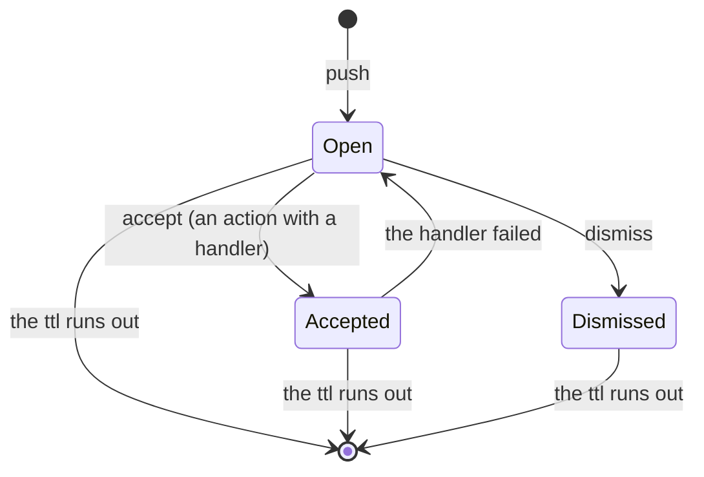

# Inbox of a View

Every view has an **inbox**: the place where the platform leaves things for the people of the project. An item is a stored document that a producer of the back end pushes. It is the result of work that ran in the background (a notification), something the platform suggests (an action, to accept or dismiss), or a plain text (a message).

The inbox is there for two things. The result of background work gets a place where it stays, for everybody with the role, and not only for the browser tab that started the job. And the platform gets a way to ask people for a decision. The first producer is the [export and import of a view](export-import.md): every job that ends pushes a notification.

This page describes what exists today, the back end: the model, the publisher for producers, the service for readers, and the Cosmos DB store. No HTTP route, no SDK client and no page of the administration UI reads the inbox yet (see [Not there yet](#not-there-yet)). The design and its decisions are in [the spec](specs/2026-11-22%20Inbox%20of%20a%20View.md).

The code is in:

- `src/Platform/Storyteller/Abstractions.Access/src/Model/ViewInbox.cs`: the public model (`ViewInboxItem`, `ViewInboxJob`, `ViewInboxResponse` and their enums);
- `Backend.Core/src/Notifying/`: the publisher (`IViewInboxPublisher`, `ViewInboxPublisher`, `ViewInboxPush`), the service (`IViewInboxService`, `ViewInboxService`, `ViewInboxQuery`, `ViewInboxFilter`), the handlers of actions (`IViewInboxActionHandler`, `ViewInboxActionContext`, `ViewInboxActionResult`), the ids (`ViewInboxIds`), the topics (`ViewInboxTopics`), the options (`ViewInboxOptions`), the contract of the store (`IViewInboxStore`, `ViewInboxRecord`) and the registration (`ViewInboxEntryPoint`);
- `Backend.Core/src/Transferring/`: the notifications of exports and imports (`ViewTransferNotifications`, pushed by `ViewTransferService`);
- `Backend.CosmosDb/src/`: the store (`Notifying/CosmosViewInboxStore.cs`), the entity (`Entities/Inbox/ViewInboxEntity.cs`) and the partition (`PartitionKeys.cs`).

## Items

An item has a kind, a state and a level.

| Kind | Meaning | Closed by |
| --- | --- | --- |
| `Notification` | The result of work that ran in the background | dismiss |
| `Action` | Something the platform suggests | accept or dismiss |
| `Message` | A plain text of the platform | dismiss |

| State | Meaning |
| --- | --- |
| `Open` | Nobody has handled the item. Every pushed item starts here. |
| `Accepted` | Somebody accepted the action. Only an `Action` gets here. |
| `Dismissed` | Somebody dismissed the item. |



The level is `Info` (the default), `Success`, `Warning` or `Error`. The producer sets it, and the back end does not branch on it.

### The model

`ViewInboxItem`:

| Member | Content |
| --- | --- |
| `Id` | 53 characters whose order is the time order (see [Ids](#ids)) |
| `Kind`, `State`, `Level` | As above |
| `Topic` | The stable code of what the item is about: `ViewExport` or `ViewImport` today (`ViewInboxTopics`). Clients may branch on it, so an existing value never changes. |
| `Title` | Written by the producer, in English as the messages of the API are; at most 200 characters |
| `Text` | Optional, at most 2000 characters |
| `MinimalRole` | The lowest role of the project that sees the item and may accept or dismiss it |
| `CreatedAt` | The time of the event the item reports, or the time of the push |
| `CreatedBy` | An [`AuditActor`](audit-stamps.md#the-actor): who caused the item. The actor that started the job, or `System`. |
| `ExpiresAt` | The item is removed after this time |
| `Closed` | An `AuditStamp`: who accepted or dismissed the item, and when. Null while the item is open. |
| `Action` | Of an `Action`: the code of what the acceptance runs |
| `Job` | A `ViewInboxJob`: the background job the item reports, or the one its acceptance started. `Kind` (`ViewExport` or `ViewImport`), `Id`, and `FileName` (the archive of an export, or the uploaded file of an import). |

The model is flat. The producer writes the title and the text, so a new producer needs no change of a reader. `Topic`, `Level`, `Action` and `Job` are what a reader branches on.

The notification of an export that finished, as an Administrator reads it (members that are null are left out):

```json
{
  "Id": "20261122091407000000079aab47ca406989d11506daca106041b",
  "Kind": "Notification",
  "Topic": "ViewExport",
  "Level": "Success",
  "Title": "Export finished",
  "Text": "12 annotations, 3 schemas, 2 templates, 40 configurations, 58 versions, 1.2 MB",
  "MinimalRole": "Administrator",
  "State": "Open",
  "CreatedAt": "2026-11-22T09:14:07+00:00",
  "CreatedBy": { "Kind": "Account", "Id": "user_01", "Name": "Ada Lovelace" },
  "ExpiresAt": "2026-11-23T09:14:07+00:00",
  "Job": {
    "Kind": "ViewExport",
    "Id": "5f0c2d7e9a414b6c8e3d1f2a4b6c8d0e",
    "FileName": "export-acme-billing-default-20261122-091358Z.zip"
  }
}
```

An open action. No producer pushes one today; the topic and the action code are the ones the tests use:

```json
{
  "Id": "2026112208000000000003f2b8c1d4e5f4a6b9c0d1e2f3a4b5c6d",
  "Kind": "Action",
  "Topic": "SchemaSuggestion",
  "Level": "Info",
  "Title": "Generate a schema for 4 similar configurations",
  "MinimalRole": "Contributor",
  "State": "Open",
  "CreatedAt": "2026-11-22T08:00:00+00:00",
  "CreatedBy": { "Kind": "System", "Id": "system" },
  "ExpiresAt": "2026-12-22T08:00:00+00:00",
  "Action": "GenerateSchema"
}
```

A list is a `ViewInboxResponse`: `Items`, `ContinuationToken`, `Count` (the items of this page) and `OpenCount` (see [Listing](#listing)).

### One state for everybody

An item has one state. It is open for everybody who sees it, and closed for everybody once one of them accepts or dismisses it; `Closed` names that person. There is no read mark per person: the inbox is a shared work list.

## Roles and visibility

Roles are granted on a project, never on a view ([access.md](access.md#roles)). An item belongs to a view, and the caller's role on the project decides who sees it.

- **The minimal role of an item** is set by its producer. `Contributor` is the lowest: the publisher refuses a push below it. So a Reader has no inbox.
- **A caller with the role R** sees the items whose `MinimalRole` is between `Contributor` and R:

  | Role of the caller | Sees items for |
  | --- | --- |
  | `None`, `Reader` | nothing |
  | `Contributor` | `Contributor` |
  | `ContributorWithSecrets` | `Contributor`, `ContributorWithSecrets` |
  | `Administrator` | those, and `Administrator` |
  | `Owner` | all four |

- **An item above the role is not found.** Accept and dismiss answer `NotFoundException` with "The inbox item '{id}' does not exist or has expired.", which is also the answer for an unknown id, an id of another shape, an item of another view and an expired item. The role is looked at before the kind and the state, so a Contributor who accepts or dismisses an Administrator's item never gets a conflict that would tell that the item exists.
- **The list and the count** apply the same rule: they ask the store only for the roles the caller sees.
- **The service does not look the role up.** It takes it as a parameter (`ViewInboxQuery.Role`, the `role` of accept and dismiss); whoever calls the service gives the caller's role on the project.

## Ids

An id is `{yyyyMMddHHmmssfffffff}{32 hex}`: the 21 digits of a time in UTC and 32 lower-case hexadecimal characters, 53 characters in all (`ViewInboxIds`).

- **`NewId(time)`** ends with a new GUID (format `N`).
- **`ForKey(time, key)`** ends with the first 32 characters of the SHA-256 of the UTF-8 bytes of the key, so the same key and time give the same id.
- **The time** is the item's `CreatedAt`. It is formatted in UTC with the invariant culture, so one instant has one text, whatever its offset and the culture of the thread.
- **The order of the ids is the order of the times**, so the list pages on the id, and an id is a clean path segment.
- **`IsValid`** is `^[0-9]{21}[0-9a-f]{32}\z`. Accept and dismiss answer "not found" for any other id without asking the store.

The time comes from a clock of the back end: the time of the event for a push that names it, else the clock of the publisher. Items of one tick are ordered by their second half, and items written by instances whose clocks differ can come in another order than they happened.

## Pushing an item

A producer takes `IViewInboxPublisher` and calls `PushAsync(ViewInboxPush push, CancellationToken cancellationToken = default)`. The answer is the stored `ViewInboxItem`.

| Member of `ViewInboxPush` | |
| --- | --- |
| `Organization`, `Project`, `View` | Required: the inbox |
| `Kind` | Required |
| `Topic` | Required: a code |
| `Level` | `Info` when left out |
| `Title` | Required |
| `Text` | Optional |
| `MinimalRole` | Required, without a default: a producer that forgets it does not compile, so it never shows its item to Contributors by accident |
| `CreatedBy` | Required |
| `ExpiresAt` | Optional: when left out, now plus the retention of the [configuration](#configuration) |
| `Action` | Of an `Action`: the code of its [handler](#action-handlers) |
| `Job` | Optional |
| `Key` | Optional: makes the push idempotent |
| `CreatedAt` | The time of the event. Required with a `Key`; when left out, now. |

- **Validation.** A wrong push is an error of its producer, not of a request: it throws `ArgumentException` and stores nothing. That is a blank organization, project, view or title; a `Topic` or an `Action` that is not a code (`^[A-Za-z][A-Za-z0-9]{0,63}\z`: a letter, then up to 63 letters or digits); an `Action` kind without an `Action` code, or another kind with one; a `MinimalRole` below `Contributor`; a `Key` without `CreatedAt`.
- **Cuts.** A `Title` longer than 200 characters is cut to 199 and `…`, a `Text` longer than 2000 to 1999 and `…`, as the jobs cut their messages.
- **Lifetime.** Without `ExpiresAt` the item lives for `ViewInbox:RetentionDays` from the push, also when `CreatedAt` is in the past. A given `ExpiresAt` is kept when it is between one minute and 365 days from now; a time outside is moved to the nearer limit. The store gets the time the item still has (`ExpiresAt` minus now) as the time to live of the write.
- **Without a `Key`** every push stores a new item.
- **With a `Key`** the id comes from the key and `CreatedAt`, so a second push of the same event meets the stored item. That item is returned as it is, also when somebody closed it meanwhile; nothing is written, and the title, the text and the expiry of the second push are neither compared nor applied. When the create conflicts and the read finds nothing (the stored item expired in between), the create is repeated once; a second conflict throws `InvalidOperationException`.
- **The token** of the caller stops the push.

The push of a finished export, as `ViewTransferNotifications` builds it, with the text of one export written out:

```csharp
var item = await inbox.PushAsync(new ViewInboxPush
{
    Organization = record.Organization,
    Project = record.Project,
    View = record.View,
    Kind = ViewInboxItemKind.Notification,
    Topic = ViewInboxTopics.ViewExport,
    Level = ViewInboxItemLevel.Success,
    Title = "Export finished",
    Text = "12 annotations, 512 B",
    MinimalRole = AccountRole.Administrator,
    CreatedBy = export.CreatedBy,
    ExpiresAt = export.ExpiresAt,
    Job = new ViewInboxJob { Kind = ViewInboxJobKind.ViewExport, Id = record.Id, FileName = export.FileName },
    Key = $"{ViewInboxTopics.ViewExport}.{record.Id}",
    CreatedAt = export.CompletedAt,
});
```

## Listing

`IViewInboxService.GetItemsAsync(organization, project, view, query)` reads one page. `ViewInboxQuery` has the `Filter`, the `Role` of the caller and the `ContinuationToken`.

- **Filter.** `Open` (the default) or `Done`: the accepted and the dismissed items.
- **Order.** Newest first, by the id. The `Done` list has the same order: by the time the items arrived, not by the time they were closed.
- **Pages.** 50 items (`ViewInboxQuery.PageSize`). The service reads one item more to know whether a page follows, and then answers with a `ContinuationToken`.
- **The token** is the base64url text, without padding, of `1:` and the id of the last item of the page. The next page holds the items just below that id, so nothing is repeated. An item whose id is above it (a new item, or one pushed later with the time of an earlier event) shows when the list is read again from the start. The token is not tied to the filter or the role: send the same ones with it.
- **A token this inbox did not issue** is `InvalidInputException` with `InvalidQuery` and "The continuation token is not one of the inbox; start again without it." It is checked first, for every role. A blank token is the first page.
- **`Count`** is the number of items of the page. **`OpenCount`** is every open item the caller sees, whatever the page and the filter. It is a count query of its own, run next to the list.
- **A role below `Contributor`** gets an empty answer with `OpenCount` 0; the store is not asked.
- **The view is not checked.** The inbox of a view that does not exist is empty.
- **Expiry.** The list and the count do not compare `ExpiresAt` with the clock. They rely on the `ttl` of the store (see [Storage](#storage)).

## Dismiss

`DismissAsync(organization, project, view, id, role, actor)` closes an item of any kind while it is `Open`. The state becomes `Dismissed` and `Closed` is the actor and the time (`AuditStamp.Of(actor, now)`), saved under the ETag of the item. The answer is the item. `ExpiresAt` stays: the write gets the time the item still has.

An item that is not open is `ConflictException` with `InboxItemClosed` and "The inbox item was already accepted." or "The inbox item was already dismissed."

## Accept

`AcceptAsync(organization, project, view, id, role, actor)` accepts an open `Action` and runs its handler. The checks come in this order, and the first failure answers:

1. **Visible.** An item the caller does not see, or one that is gone or expired, is not found.
2. **An action.** Another kind is `ConflictException` with `InboxItemNotAction`: "The inbox item is not an action; only an action can be accepted."
3. **Open.** An accepted or dismissed item is `InboxItemClosed`, as for dismiss.
4. **A handler.** An action whose code has no registered handler is `FeatureNotConfiguredException` with `InboxActionNotAvailable`: "The action '{code}' of the inbox item is not available in this deployment." The item stays open.

Then the work starts:

5. **The claim.** The item is saved as `Accepted` with the `Closed` stamp, under its ETag, before the handler runs. So two people cannot start the work twice.
6. **The point of no return.** The cancellation token of the caller is listened to up to and including the claim; a token cancelled before it starts nothing. From the claim on, the handler, the reopening after a failure and the save of the job run with `CancellationToken.None`. A caller that goes away leaves no accepted item without its work.
7. **The handler** runs with the accepted item and the actor (`ViewInboxActionContext`).
8. **A handler that throws** reopens the item: it is saved as `Open` with `Closed` cleared, and the exception goes on to the caller as it is. A `ConflictException` with `TransferLimit` of a job that could not start arrives as such. The reopening is best effort: when it fails, the item stays accepted without its work, and the failure is logged.
9. **A job the handler returns** is saved on the item as `Job`, best effort. The answer carries the job whether or not the save succeeded.

The answer is the accepted item. A crash of the host between the claim and the start of the work leaves an accepted item whose work never ran; nothing repairs that.

### A lost replace

The save of a dismiss or of a claim is guarded by the ETag. The store answers nothing for a changed ETag and for a removed item, and the service then reads the item again:

| The item is now | Answer |
| --- | --- |
| gone, expired or no longer visible | `NotFoundException` |
| accepted or dismissed by somebody else | `ConflictException` with `InboxItemClosed` and the message of that state |
| open again (the handler of another caller's acceptance failed) | the replace is repeated, three times at most; then `ConflictException` with `Conflict` and "The inbox item changed; try again." |

### Action handlers

What an accepted action runs is an `IViewInboxActionHandler`:

```csharp
public interface IViewInboxActionHandler
{
    // The code of the actions it runs (ViewInboxItem.Action).
    string Action { get; }

    Task<ViewInboxActionResult> RunAsync(ViewInboxActionContext context, CancellationToken cancellationToken);
}

public sealed record ViewInboxActionContext(string Organization, string Project, string View, ViewInboxItem Item, AuditActor Actor);

public sealed record ViewInboxActionResult
{
    public static ViewInboxActionResult None { get; } = new();

    // The job the acceptance started.
    public ViewInboxJob? Job { get; init; }
}
```

- **The code** of `Action` is compared exactly, case included, with the `Action` of the item.
- **`RunAsync`** is called after the item is accepted, and its token is never the caller's: the work runs to its end. A typical handler starts a background job, whose result arrives later as a notification, and returns the job.
- **Throw only when nothing was started.** The item is then open again and can be accepted once more.
- **Registration.** A handler is a registered `IViewInboxActionHandler` service; `ViewInboxService` takes all of them. Two handlers with one code fail the construction of the service ("The inbox action '{code}' has two handlers: …"), which stops the readers of the inbox and nothing else (see [Two services](#two-services)).

A handler that starts an export, in the shape `ViewInboxRegistrationTests` uses:

```csharp
public sealed class ExportViewHandler(IViewTransferService transfers) : IViewInboxActionHandler
{
    public string Action => "ExportView";

    public async Task<ViewInboxActionResult> RunAsync(ViewInboxActionContext context, CancellationToken cancellationToken)
    {
        var export = await transfers.StartExportAsync(
            context.Organization,
            context.Project,
            context.View,
            ViewArchiveFormat.Folder,
            include: null,
            context.Actor,
            cancellationToken);

        return new ViewInboxActionResult
        {
            Job = new ViewInboxJob { Kind = ViewInboxJobKind.ViewExport, Id = export.Id, FileName = export.FileName },
        };
    }
}

services.AddSingleton<IViewInboxActionHandler, ExportViewHandler>();
```

**No handler is registered today**, and no producer pushes an action. An action without a handler answers `InboxActionNotAvailable`. The first handler comes with 424-8, which also decides what an action carries for its handler besides the members of the item.

## Two services

Pushing and reading are two services on purpose:

- `IViewInboxPublisher` is for producers. It needs the store, the options and the clock.
- `IViewInboxService` is for readers: the list, accept and dismiss. It needs the store, the clock and every registered handler.

A handler starts a job through the service of the jobs, and that service pushes the end of the job. With one inbox service, the job service would need the inbox, the inbox its handlers, and a handler the job service: a circle the container refuses. With two, the job service takes the publisher only, and nothing that pushes depends on what an acceptance runs. A wrong handler therefore stops the readers of the inbox and never an export.

## Errors

| Exception | `ErrorCode` | When |
| --- | --- | --- |
| `NotFoundException` | `NotFound` | Accept or dismiss of an item that does not exist in this view, has an id of another shape, has expired, or is above the caller's role |
| `ConflictException` | `InboxItemNotAction` | Accept of a notification or a message |
| `ConflictException` | `InboxItemClosed` | Accept or dismiss of an item that is already accepted or dismissed |
| `ConflictException` | `Conflict` | The item kept changing: a replace was lost four times in a row |
| `FeatureNotConfiguredException` | `InboxActionNotAvailable` | Accept of an action whose code has no handler |
| `InvalidInputException` | `InvalidQuery` | A continuation token this inbox did not issue |
| the handler's own | | Accept, when the handler throws; the item is open again |

`InboxItemClosed`, `InboxItemNotAction` and `InboxActionNotAvailable` are new in `Backend.Core/src/ErrorCodes.cs`. The API maps these exceptions to `404`, `409`, `501` and `400` (`ErrorResponseMapping`); no route throws them yet.

The publisher throws `ArgumentException` for a wrong push, and `InvalidOperationException` when an item can be neither created nor read. Both are errors of a producer or of the store, not answers to a reader.

## Notifications of exports and imports

An [export or an import](export-import.md#jobs) that ends pushes one notification into the inbox of its view. `ViewTransferNotifications.Create` builds the push from the stored job:

| Job | Level | Title | Title of a dry run | Text | Expires |
| --- | --- | --- | --- | --- | --- |
| Export succeeded | `Success` | `Export finished` | | the counts and the size | with the job |
| Export failed | `Error` | `Export failed` | | the job's `Error` | after the inbox's retention |
| Import succeeded, no file failed | `Success` | `Import finished` | `Check finished` | the file and the counts | with the job |
| Import succeeded, files failed | `Warning` | `Import finished with failures` | `Check found problems` | the file and the counts | with the job |
| Import failed | `Error` | `Import failed` | `Check failed` | the job's `Error` | after the inbox's retention |

Every one of them has `Kind` `Notification`, the `Topic` `ViewExport` or `ViewImport`, and:

- **`MinimalRole` `Administrator`**: the role of the job routes. Who may not read a job does not see its end.
- **`CreatedBy`**: the job's `CreatedBy`, so an account (with `Via` through an actor) or a machine.
- **`Job`**: the kind, the id and the file name of the job.
- **`Key`** `ViewExport.{id}` or `ViewImport.{id}` and **`CreatedAt`** the job's `CompletedAt`. Every writer of an end sets `CompletedAt`; a record without it is still reported, at its `StartedAt` or else its `CreatedAt`.

**The text of an export** is the counts of the exported kinds, then the versions, then the size: `12 annotations, 3 schemas, 2 templates, 40 configurations, 58 versions, 1.2 MB`.

- A kind that was left out has no count and is not named. A kind that was exported and found nothing reads `0 templates`. One document is singular: `1 annotation`.
- **Versions** are named only when schemas, templates or configurations were exported. The job always counts versions, so an export of annotations alone would read `0 versions`; it reads `12 annotations, 512 B`.
- **The size** is in bytes below 1024 (`512 B`), and above it in `KB`, `MB` or `GB` with one decimal, in steps of 1024. The value is rounded before the unit is chosen, so 1,048,575 bytes read `1.0 MB`, never `1024.0 KB`. `GB` is the largest unit.
- An export without counts and without a size has no text.

**The text of an import** is the file name and the five counts of the job's `Summary`, all five always: `acme.zip: 3 created, 2 updated, 10 unchanged, 1 skipped, 0 failed`.

- **A dry run** wrote nothing, so it reads `acme.zip: 3 to create, 2 to update, 10 unchanged, 1 skipped, 0 failed`, as the administration UI words a check.
- Without a file name the text is only the counts. Without a `Summary` it is only the file name, or nothing.

Every number is written with the invariant culture and without a thousands separator. The text of a failed job is its `Error`, which the job cut at 500 characters.

**Lifetime.**

- **A result lives as long as its job.** Its `ExpiresAt` is the job's (`ConfigurationTransfers:RetentionHours` after the end, 24 hours by default): when the job and its archive or report are gone, so is the item that leads to them.
- **A failure lives as long as any other item**: it names no `ExpiresAt`, so it gets `ViewInbox:RetentionDays` from its first push, 30 days by default. Its whole content is the error text. It outlives its job, so its `Job` then names a job that no longer exists.

**Where an end is pushed.** `ViewTransferService.NotifyAsync` is called in five places:

1. in `ExportAsync`, after the save of `Succeeded`;
2. in `ImportAsync`, after the save of `Succeeded` and before the delete of the upload;
3. in `FailAsync`, when its replace saved `Failed`: an exception of the job, the poison queue, and a job that could not be queued, which fails inside the start request;
4. in `FailAsync`, when the job it reads has already ended: the poison queue after the last delivery, and an end whose save reached the store while its answer was lost;
5. in `ProcessAsync`, for a message of a job that is already `Succeeded` or `Failed`: a message delivered again after a crash between the save and the push.

A worker that lost the job to another worker, a failure that could not be saved and a job that no longer exists push nothing. A job in progress has no item: the inbox shows a job when it ends.

**One item per job.** The key and the time of the end are the same in every call, so a call for a job that was already reported (places 4 and 5) meets the stored item and writes nothing. A notification that somebody dismissed stays dismissed.

**The push never fails the job.** `NotifyAsync` builds the push and sends it inside one `try`, and logs a failure as a warning ("The end of the … job … was not pushed to the inbox."). A broken inbox costs a notification, never an export or an import, and never the archive of an export. The push does not listen to the token of the invocation: a host that shuts down still completes the invocation, and nothing would push again. Nothing retries a failed push by itself; only a later message of the same job (a redelivery, the poison queue) pushes again.

`ViewTransferNotifications.Create` throws `ArgumentException` for a job that has not ended and for a record without the model of its kind. `NotifyAsync` catches it like any other failure.

**Without the inbox.** The publisher is the last, optional constructor parameter of `ViewTransferService` (`IViewInboxPublisher? inbox = null`). A host that does not call `AddViewInbox` gets no publisher, and its jobs report their ends nowhere.

## Storage

An item is a document of the container `organizations`, in the logical partition (organization, `{project}.inbox.{view}`): `PartitionKeys.GetInbox(project, view)` and `GetCosmosInbox(organization, project, view)`. One view's inbox is one logical partition, so the list and the count name the full key and need no predicate on the organization.

`ViewInboxEntity`, as stored:

```json
{
  "id": "inb.20261122091407000000079aab47ca406989d11506daca106041b",
  "PartitionKey": "billing.inbox.default",
  "Organization": "acme",
  "Project": "billing",
  "View": "default",
  "ItemId": "20261122091407000000079aab47ca406989d11506daca106041b",
  "Kind": "Notification",
  "Topic": "ViewExport",
  "Level": "Success",
  "Title": "Export finished",
  "Text": "12 annotations, 3 schemas, 2 templates, 40 configurations, 58 versions, 1.2 MB",
  "MinimalRole": "Administrator",
  "State": "Open",
  "CreatedAt": "2026-11-22T09:14:07+00:00",
  "CreatedBy": { "Kind": "Account", "Id": "user_01", "Name": "Ada Lovelace" },
  "ExpiresAt": "2026-11-23T09:14:07+00:00",
  "Job": {
    "Kind": "ViewExport",
    "Id": "5f0c2d7e9a414b6c8e3d1f2a4b6c8d0e",
    "FileName": "export-acme-billing-default-20261122-091358Z.zip"
  },
  "ttl": 86400
}
```

- **The id** is `inb.` and the id of the item (`ViewInboxEntity.IdPrefix`), so the order of the stored ids is the time order too.
- **The members of the item are flat** on the document. The minimal role and the state are stored as their names, which the queries compare.
- **No `ViewName` and no `ProjectName`.** View discovery lists every `ViewName` it finds in the partitions of a project (`CosmosViewService`), and a job of an export or import carries one. An inbox item must not make an empty view a discovered one, so its properties are `Project` and `View`. It has no `AnnotationType` either, so the annotation queries never read it.

`CosmosViewInboxStore` implements `IViewInboxStore`:

| Method | On Cosmos DB | Answer |
| --- | --- | --- |
| `TryCreateAsync` | `CreateItemAsync` | The record with its ETag; null on `409`, when the id is taken |
| `GetAsync` | A point read | The record with its ETag; null when it is missing, or when its `Project` or `View` is not the one asked for |
| `TryReplaceAsync` | `ReplaceItemAsync` with `IfMatchEtag` | The record with its new ETag; null on `412` and `404`. A record without an ETag is refused with `ArgumentException`: it would overwrite whatever another caller saved. |
| `QueryAsync` | The list query | At most `take` records, newest first, without ETags |
| `CountOpenAsync` | The count query | The number of open items of the roles |

The list, with the filter and the continuation:

```sql
SELECT TOP @take * FROM c
WHERE c.PartitionKey = @partition AND STARTSWITH(c.id, @prefix)
  AND c.Project = @project AND c.View = @view
  AND ARRAY_CONTAINS(@roles, c.MinimalRole)
  AND c.State = 'Open'        -- Done: c.State != 'Open'
  AND c.id < @before          -- only for a next page: 'inb.' and the id of the token
ORDER BY c.id DESC
```

The count:

```sql
SELECT VALUE COUNT(1) FROM c
WHERE c.PartitionKey = @partition AND STARTSWITH(c.id, @prefix)
  AND c.Project = @project AND c.View = @view
  AND ARRAY_CONTAINS(@roles, c.MinimalRole)
  AND c.State = 'Open'
```

- **`c.Project` and `c.View`.** The partition value already holds both names. A name with a dot, older than the rules of names, can still make two pairs of a project and a view share one partition: the project `a.inbox.b` with the view `c`, and the project `a` with the view `b.inbox.c`. The point read, the list and the count compare the stored names, so neither pair sees the items of the other.
- **The page.** The list asks for `take` items (`TOP` and the page size of the query), reads on until it has them, because a page of the store may hold fewer, and cuts the result at `take`.
- **Indexes.** The queries filter on `PartitionKey`, `id`, `Project`, `View`, `MinimalRole` and `State` and sort on the id. None of these paths, and no other path of the entity, is excluded from the index of the container, and one `ORDER BY` on the id needs no composite index. The settings of the container did not change.
- **The cost of the count** grows with the items of the inbox: it is a query on every list call, and its request charge was not measured.

**The `ttl`** of a write is `Math.Max(1, (int)Math.Ceiling(timeToLive.TotalSeconds))`: rounded up, so an item never expires before its time, and at least a second, because Cosmos DB refuses a `ttl` of zero. Cosmos DB counts a `ttl` from the last write of the document. So every write of an item (the create, a dismiss, a claim, a reopening, the save of a job) stores the time the item still has, and no write moves the expiry. This differs from a job, whose every write restarts its retention. The container has TTL on without a default expiry (`DefaultTimeToLive = -1`), so only documents with a `ttl` expire ([annotation-lifecycle.md](annotation-lifecycle.md#containers)).

**Expiry.** Accept and dismiss treat an item whose `ExpiresAt` is not after now as missing, so their answer does not depend on when the store removes it. The list and the count leave it to the store.

**Nothing cascades.** No code deletes an inbox item, and an item and the job it names are not linked in storage. The notification of a result gets the job's `ExpiresAt`, so the two expire together, each by its own `ttl`. The back end has no operation that deletes a view, a project or an organization, so there is nothing that would have to remove their items.

## Configuration

Section `ViewInbox` (`ViewInboxOptions`):

| Setting | Default | Meaning |
| --- | --- | --- |
| `ViewInbox:RetentionDays` | `30` | Days an item lives when its producer names no `ExpiresAt`; between 1 and 365 |

The range is checked when the setting is first read, and the publisher reads it in the push that needs it, not when it is built and not at the start of the host. A value outside the range fails every push that names no `ExpiresAt` with "ViewInbox:RetentionDays must be between 1 and 365."; a push with its own expiry, such as the result of a job, still works. The service of exports and imports takes the publisher and is built all the same: a wrong setting costs the notifications of failed jobs (each logged as a warning), never an export. The limits of one minute and 365 days of an item's life are constants of the publisher.

## Registration

- **`AddViewInbox(configuration)`** (`ViewInboxEntryPoint`, `Backend.Core`) registers the options with their validation, `TimeProvider.System`, `IViewInboxPublisher` and `IViewInboxService`, each as a singleton and only when nothing else registered it (`TryAddSingleton`). `Api.Functions/src/Program.cs` calls it after `AddViewTransfers`. It is the only host that does.
- **`AddCosmosDbAnnotations`** (`Backend.CosmosDb/src/EntryPoint.cs`) registers `CosmosViewInboxStore` as `IViewInboxStore`, a singleton. It needs only the repository provider and the serializer settings, so every host of the Cosmos DB services has the store: the API, DbCreator and the test fixtures.
- **Handlers** are added by the host: `services.AddSingleton<IViewInboxActionHandler, …>()`.

## Tests

| Project | Class | Covers |
| --- | --- | --- |
| `Backend.Core/test/Notifying/` | `ViewInboxIdsTests` | The shape of an id, the order, a time with another offset, the culture of the thread, `ForKey`, `IsValid` |
| | `ViewInboxPublisherTests` | The validation, the cuts, the default and the moved expiry, the time to live of a write, pushes with and without a key, a closed item returned as it is, a conflict whose read finds nothing, the token of the caller |
| | `ViewInboxServiceTests` | Visibility per role and "not found" instead of a conflict, paging and tokens, the filters, `OpenCount`, dismiss and its conflicts, an expired item, accept (the claim, the job, no handler, another kind, a failing handler, a token cancelled before and after the claim), the outcomes of a lost replace, two handlers of one code |
| | `ViewInboxRegistrationTests` | A container with `AddViewTransfers`, `AddViewInbox` and fakes, validated on build: a handler that takes `IViewTransferService` starts an export whose end comes back as a notification; without `AddViewInbox` the transfers push nothing; two handlers of one action stop the inbox service and not the transfers |
| `Backend.Core/test/Transferring/` | `ViewTransferNotificationsTests` | Every row of the table, the texts (kinds, singular and plural, versions, sizes, a dry run, the invariant culture), the keys, an end without its time, the refusals, and one item per job with its lifetime through the real publisher |
| | `ViewTransferServiceTests` | Each end pushes once; a job that cannot be queued; a message delivered again and the poison queue of an ended job give the same item; an end whose push or whose answer was lost, where an export keeps its archive; nothing for a job another worker took, a failure that was not saved and a missing job; a throwing inbox neither fails a job nor deletes an archive; a cancelled invocation still pushes; no inbox |
| `Backend.CosmosDb/test/` | `CosmosViewInboxStoreTests` | The create and its conflict, the point read through the view only, two pairs in one partition, the replace with the ETag, the list per filter and role in id order, a next page, the count, the stored `ttl` of every write read from the raw document, view discovery, and a list of 52 items through the service with its token |
| | `ViewInboxIsolationTests` | Two organizations with the same project, view and ids, in the store and through a push with a key |
| | `EntityOrganizationTests` | `ViewInboxEntity` among the stored entities that carry `Organization` |

The tests of `Backend.Core` use fakes (`InMemoryViewInboxStore`, `RecordingActionHandler`, `RecordingViewInboxPublisher`) and need nothing else:

```bash
dotnet test --project src/Platform/Storyteller/Backend.Core/test --filter-class "*ViewInbox*"
dotnet test --project src/Platform/Storyteller/Backend.Core/test --filter-class "*ViewTransfer*"
```

The store tests need a Cosmos DB emulator. Without `STORYTELLER_TESTS_USE_CONTAINER=true` the suite uses the local Windows emulator and deletes its database `42.Platform.2S`:

```bash
STORYTELLER_TESTS_USE_CONTAINER=true dotnet test --project src/Platform/Storyteller/Backend.CosmosDb/test --filter-class "*ViewInbox*"
STORYTELLER_TESTS_USE_CONTAINER=true STORYTELLER_TESTS_EMULATOR=classic dotnet test --project src/Platform/Storyteller/Backend.CosmosDb/test --filter-class "*ViewInbox*"
```

- The inbox tests carry no trait, so a pull request runs them on the vNext emulator, which has no range indexes. They run on the classic emulator, with the indexes of the service, only by hand: locally, or in the workflow `Platform.Storyteller.CosmosDb` started by hand, which runs the whole suites on it.
- No test waits for an expiry: the vNext emulator expires no item within a test's wait. The tests read the stored `ttl` instead.

## Not there yet

- **The HTTP routes and the SDK clients** of the inbox, and the documentation of who may call them, come with phase 2 of 424-31.
- **The page of the administration UI** and its mock API come with phase 3 of 424-31.
- **The first suggested action**, its handler and what an action carries for its handler come with 424-8.
