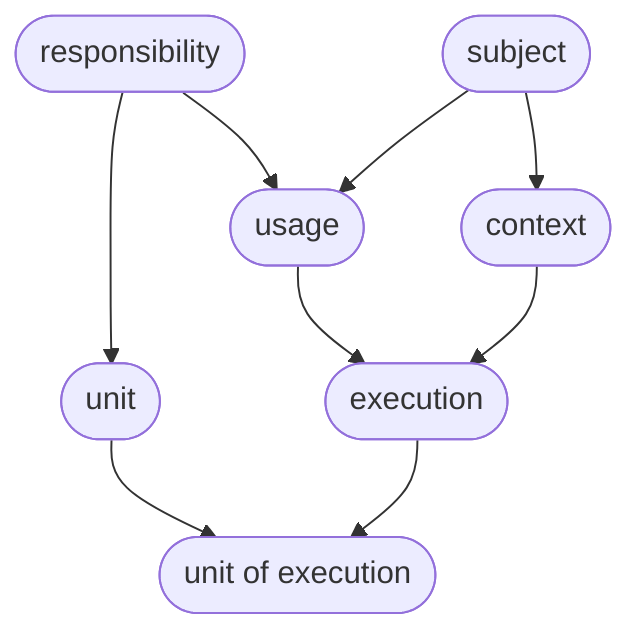

# Configuration Inheritance

This document describes how Storyteller builds the effective configuration JSON for one annotation, and how ancestor annotations change that JSON.

The read path is `CosmosConfigurationService.GetRawConfigurationAsync`. The merge itself is `CalculateAndCacheConfigurationAsync`. The ancestor graph is `BuildInheritanceGraph`. All three live in `src/Platform/Storyteller/Backend.CosmosDb/src/Configuring/CosmosConfigurationService.cs`.

A product-level walkthrough of the same model is in [Configuration](../../42for.net/platform/configuration.md). Type templates, which are merged during the same calculation, are specified in [templating.md](templating.md). `@` expressions are evaluated later, on the resolved read, and are specified in [binding.md](binding.md).

## Two JSON documents

Each annotation may have one configuration item in the organization container.

| Field | Meaning |
| --- | --- |
| `Content` | The document written at this annotation. Version history stores this object. |
| `CalculatedContent` | The effective document: ancestors, this annotation's type template, and `Content`, merged. |
| `CalculatedContentHash` | Identity of `CalculatedContent`. Eight lowercase hex digits, MurmurHash3 32-bit, seed `42`, of the calculated JSON serialized with `JsonSettingNames.Unique`. |

`GetRawConfigurationAsync` returns a `Configuration` whose `Content` property is the effective document. `Version` and `Modified` come from the target annotation's configuration item. `Hash` is `CalculatedContentHash`.

The item id is `{viewName}.cnf.{annotationKey}`. Subject and context items use the subject partition `{project}.sbt.{subject}`. Every other annotation type uses the responsibility partition `{project}.rst.{responsibility}`. Ancestor keys are read from their own partitions. The walk crosses partitions.

## The ancestor graph

Seven annotation types form one graph. Responsibility and subject are roots. Deeper keys embed the names of their ancestors, so `BuildInheritanceGraph` derives every ancestor key from the key being read. It uses the same organization, project, and view. A second view is a separate catalog: `default` and `rollout` never inherit from each other.



| Annotation | Key | Direct ancestors, in merge order |
| --- | --- | --- |
| Responsibility | `rst.{responsibility}` | — |
| Subject | `sbt.{subject}` | — |
| Unit | `unt.{responsibility}.{unit}` | Responsibility |
| Context | `cnt.{subject}.{context}` | Subject |
| Usage | `usg.{subject}.{responsibility}` | Responsibility, then subject |
| Execution | `exe.{subject}.{responsibility}.{context}` | Usage, then context |
| Unit of execution | `uxe.{subject}.{responsibility}.{context}.{unit}` | Unit, then execution |

Merge order is `AnnotationType`: Responsibility (0), Unit (1), Subject (2), Usage (3), Context (4), Execution (5), Unit of execution (6). `InheritanceGraphNode.GetAncestors` sorts the direct parents by that value. The enum order only sorts one node's parents. It does not flatten the whole graph into a single list.

Two nodes are shared:

- On an execution, the usage branch and the context branch point at one subject node.
- On a unit of execution, the unit branch and the usage branch point at one responsibility node.

`InheritanceGraphNode.Descendant` is maintained while the graph is built and is unused by the calculation. The walk is from the requested annotation toward the roots.

## How a read is assembled

`GetRawConfigurationAsync` does the following.

1. Load `{view}.cnf.{annotationKey}` from the annotation's partition. An item stamped with `AnnotationDeletionId` belongs to a soft-deleted annotation and returns `null` ([annotation-lifecycle.md](annotation-lifecycle.md)).
2. When that item is missing, require an active annotation record (`{view}.{annotationKey}` in the same partition, without `Deletion`). A missing or deleted annotation and a missing configuration item return `null`. An empty effective document is returned when the annotation exists and nothing contributes JSON.
3. When the item already has `CalculatedContent`, return it. Ancestors and templates are left unread.
4. Otherwise build the graph and run `CalculateAndCacheConfigurationAsync` on the requested node.
5. Reload the configuration item so the response carries the hash just written.
6. Return that item with the calculated object as `Content`. When no item exists after calculation, return the calculated object with version `0`, stamped as the calculation by `System`.

`CalculateAndCacheConfigurationAsync` runs for the requested node and, recursively, for every ancestor:

1. Load this node's configuration item.
2. When `CalculatedContent` is already stored, return it.
3. Start from an empty object.
4. For each direct ancestor in `AnnotationType` order, calculate that ancestor and `MergeInto` its calculated document.
5. `MergeInto` the view template of this node's type (`{view}.gen.{typeCode}` in partition `{project}.template`), when that item exists. The template is read on every calculation of a node, after step 1, also when the node is calculated twice in one read. See [templating.md](templating.md).
6. `MergeInto` this node's stored `Content`, when the configuration item exists.
7. When the merged object has at least one property, persist it. An existing item is replaced with `CalculatedContent` and `CalculatedContentHash`, conditionally on the ETag read in step 1; stored `Content`, `Version`, and `Modified` stay as they were. A missing item is first created without a cache, with empty `Content` and `Modified` stamped by `System`; then steps 3 to 6 run again, and their merge is stored conditionally on the ETag of the creation. An empty merge is returned and left unstored, and no item is created for it, so the next read calculates it again.

Every cache is therefore written under an ETag the item had before every read its calculation made. "Cache and descendant freshness" explains why that matters.

The value merged from an ancestor is that ancestor's full calculated document. It already contains the ancestor's own ancestors, the ancestor's template, and the ancestor's stored content. A node that has no configuration item contributes an empty object, plus anything its ancestors and its template produced.

Because a shared ancestor is reached through more than one parent, its calculated document is merged once on each branch. The second merge writes those properties again. The second branch reuses the cache row written by the first branch only when that write is visible to its read, which requires the Cosmos account to provide session consistency (or stronger). `CosmosClientProvider` does not set a consistency level, so the client uses the account default. Under a weaker level the second branch may recalculate the shared ancestor, which produces the same document.

## Merge rules

`JObject.MergeInto` (`Backend.CosmosDb/src/JsonExtensions.cs`) calls Newtonsoft `JObject.Merge` with:

- `MergeArrayHandling.Union` — array items are appended. An item that is already present, compared by deep equality, is skipped.
- `MergeNullValueHandling.Ignore` — a null in the incoming object leaves the current value in place.

Objects merge property by property, including nested objects. A later scalar replaces an earlier scalar. A later object overlays the earlier object and keeps earlier properties that the later object does not mention. Arrays grow by union along the whole sequence. A later document cannot drop an inherited property, and it cannot replace an inherited array; it can add items and it can replace scalars.

`$remove` and `$patch` are applied when a document is written, inside `CreateOrUpdateConfigurationAsync`, before `Content` is stored. Calculation only calls `MergeInto`, so those properties are ordinary JSON if they appear in an already stored document or in a template.

Schema documents are checked against stored `Content` at write time. They are assembled separately by `CosmosConfigurationSchemaService` and stay out of the calculated configuration.

## What an ancestor changes

Inside one node's calculation the sequence is fixed: ancestor documents, then this node's template, then this node's stored `Content`. For a property that appears on only one path, the later step wins. The requested annotation's stored scalars therefore win against its own template and against the documents of its direct ancestors.

A shared ancestor breaks that reading as soon as a second branch is merged. The later branch carries the shared ancestor again, and that second copy is applied after the earlier branch's overrides.

### Execution

Direct parents are the usage document, then the context document. Each is already calculated:

- Usage = responsibility, then subject, then the usage template, then the usage content.
- Context = subject, then the context template, then the context content.

The execution template and the execution content are merged after both parents.

Responsibility values flow only through the usage. A usage scalar that replaced a responsibility scalar is still in the usage document, and the context document does not carry the responsibility, so that usage scalar survives unless the context or the execution sets the same property.

Subject values flow through both parents. The context document contains the subject again. Merging the context after the usage writes the subject's scalars back over the usage wherever the context left them untouched.

Subject `sbt.northwind`:

```json
{ "currency": "NOK", "residency": "norway" }
```

Usage `usg.northwind.invoicing`:

```json
{ "currency": "USD", "plan": "enterprise" }
```

Context `cnt.northwind.production`:

```json
{ "endpoint": "https://northwind.example/invoices" }
```

The usage calculation produces `{ "currency": "USD", "residency": "norway", "plan": "enterprise" }`. The context calculation produces `{ "currency": "NOK", "residency": "norway", "endpoint": "https://northwind.example/invoices" }`. Merging the context after the usage restores `currency` to `NOK`. `plan` stays, because the context document has no `plan`. The effective execution document is:

```json
{
  "currency": "NOK",
  "residency": "norway",
  "plan": "enterprise",
  "endpoint": "https://northwind.example/invoices"
}
```

A scalar the context itself sets still wins over the usage, and a scalar the execution stores wins over both. In the public guide's invoicing example, `retries` moves from `3` on the responsibility to `5` on the context for that reason, and the usage never set `currency`, so the subject's `NOK` is the only currency either branch contributes.

Arrays do not show this reversal. Union of the same items is idempotent, and a usage that added an item keeps it when the context is merged, because the context's copy of the subject array has no extra item that would remove it. Nothing in the merge removes an item.

### Unit of execution

Direct parents are the unit document, then the execution document:

- Unit = responsibility, then the unit template, then the unit content.
- Execution = the execution calculation from the previous section.

The unit-of-execution template and stored content are merged last, so they win against both parents.

The execution document contains the responsibility again, through the usage. A unit scalar that replaced a responsibility scalar is overwritten by that responsibility value, unless the usage, the context, or the execution also set the property. A unit property the execution path never mentions is kept. The execution path's scalars win over the unit for every property both documents contain.

Responsibility `rst.invoicing` stored `{ "retries": 1 }`. Unit `unt.invoicing.export` stored `{ "retries": 9, "schedule": "0 * * * *" }`. No usage, context, or execution document sets `retries`. The unit of execution stores `{ "schedule": "0 2 * * *" }`.

The unit calculation holds `retries: 9`. The execution calculation holds `retries: 1` from the responsibility. Merging the execution after the unit restores `retries` to `1`. The unit-of-execution document then replaces `schedule` and leaves `retries` alone:

```json
{ "retries": 1, "schedule": "0 2 * * *" }
```

A usage that stored `retries: 4` would put `4` into the execution document, and `4` would replace the unit's `9`. The unit-of-execution document can set `retries` itself and then win.

### Nested objects

A nested object follows the same property merge. Ancestor fields inside it remain when a later document sets only some of the fields.

Responsibility `{ "address": { "city": "Oslo", "zip": "0001" } }` and execution `{ "address": { "city": "Bergen" } }` calculate to:

```json
{ "address": { "city": "Bergen", "zip": "0001" } }
```

## Cache and descendant freshness

A later read of an item whose `CalculatedContent` is present returns that object and skips the walk. `ConfigurationEntity.IsCachingDisabled` is stored on the item and is unread by this path, so the flag leaves caching on.

These writes clear the target item's `CalculatedContent` and `CalculatedContentHash` with the write itself, and then clear the same fields on the descendants whose effective document includes this annotation. The patch also increments `AffectedCounter`.

| Written annotation | Descendants whose cache is cleared |
| --- | --- |
| Responsibility | The unit and usage items (level 1), the execution items (level 2) and the unit-of-execution items (level 3) in that responsibility partition and view |
| Unit | Unit-of-execution items in that partition and view whose id ends with `.{unit}` (level 3) |
| Usage | Execution items (level 2) and unit-of-execution items (level 3) in that partition and view for that subject |
| Subject | Context items in the subject partition and view, and usage items of that subject in the same project and view (level 1); execution items (level 2) and unit-of-execution items (level 3) of that subject in the same project and view |
| Context | Execution items of that subject ending in `.{context}` (level 2), and unit-of-execution items of that subject whose id contains `.{context}.` (level 3), in the same project and view |
| Execution | Unit-of-execution items in that partition and view under that subject, responsibility, and context (level 3) |
| Unit of execution | None |

The levels follow the ancestor graph: responsibilities and subjects are level 0, units, usages and contexts level 1, executions level 2, units of execution level 3, and every ancestor of an item is on a lower level. `ConfigurationCacheInvalidator` queries and patches one level at a time, in that order: a level is queried only after every patch of the levels above it has finished. Within a level, the patches go out in transactional batches of at most 100 items per partition, several at a time. A failure stops before the next level.

**Writes.** Every write commits first, then appends its audit entry, then invalidates the descendants. Each write reads the item with its ETag and is guarded by it:

- `CreateOrUpdateConfigurationAsync` and `PatchConfigurationAsync` on an existing item write the archive of the stored version (`{view}.cfv.{key}.{version}`) and the new version in one transactional batch, the new version as a replace with `IfMatchEtag`. The new version has no cache. When the two documents together are larger than about 1.5 MB, the archive is written first and the guarded replace after it. `ImportConfigurationAsync` writes the same way.
- The first insert, when no configuration item exists yet, creates the item in a batch of its own. A system cache row counts as an existing item; a calculation that created one in the meantime turns the insert into an update.
- `ClearConfigurationAsync` and `DeleteAsync` archive the stored version and delete the item in one guarded batch. `DeleteAsync` deletes a system cache row (version 0) directly, guarded by its ETag.
- A concurrent change of the item (another write, a calculation caching its result, an invalidation, a soft delete) fails the guarded write with `412`, a deleted item with `404`, a version archived meanwhile with `409`. The write reads again and retries, up to three times, and then throws `ConflictException` with `ErrorCode` `Conflict` (`409`). A soft delete in between answers `409 AnnotationDeleted`.

The invalidation follows the write. A calculation caches its result on an existing item only while the item still has the ETag that was read before the walk, and the invalidation patch changes that ETag. A descendant calculation that read the descendant before its patch therefore fails to cache, or its cache is cleared by the patch. A descendant calculation that reads the descendant after its patch reads the written ancestor too, which was committed before the invalidation started.

**Archives.** A system cache row has version 0 and no content; every other item is a written version (every write gives version 1 or more, and a version 0 with content was written before versions were counted). A write archives every written version, also an empty one, and a document equal to a written version's content, also `{}` over an emptied version, writes nothing. An archive of the same version that exists already with the same `Content` and `Modified` counts as archived; a write that failed after its archive, or a lifecycle snapshot, leaves one. An archive of the same version with other content belongs to an earlier lifetime of the configuration and is kept; the current content is then archived after the highest archived version. The version list skips empty archives of version 0, archives of the current or a later version, and a system cache row, and `GetConfigurationVersionContentAsync` prefers the current item.

**Pending invalidation.** The batch that writes a version also stores a token, `PendingInvalidationId`, on the item; a clear and a delete store it on the archive they write. The token is removed after the invalidation by a patch filtered on that token, so a newer write keeps its own, and on an item of a soft-deleted annotation it stays until a restore. When the invalidation fails, the request answers `500` with the change committed, and the token stays. The next write, patch or clear of the same configuration finishes it before it looks at its input: a repeated or a different write or patch, also a patch whose `test` operation now fails or a write that its schema now rejects, and a clear, also one that finds nothing to clear (the `DELETE` route then answers `404`). An import finishes it when it writes, and when its document is `Unchanged` or `Skipped` with `DocumentExists`, outside a dry run; an import that fails or is skipped for another reason leaves it pending. A unit of execution has no descendants, so its writes and clears store no token. Reads never finish a pending invalidation: until a request does, the descendants keep serving their caches.

**Why no stale cache survives a completed write.** Every cache is written under an ETag that its item had before every read of its calculation (see "How a read is assembled", step 7), and the write is committed before its invalidation starts. Then, for every descendant:

- A calculation that read the descendant before its patch cannot cache: the patch changed the ETag. A cache it wrote before the patch is cleared by the patch.
- A calculation that read the descendant after its patch reads the ancestors and the template after that too. The ancestors are on lower levels, so they were written or patched before, and each cache they hold was calculated from reads after their own patch, by the same rule one level up. The template was written before the invalidation started.
- A descendant item that a calculation created after its level was queried was created after every lower level was patched. Its cache is calculated again after the creation, from reads after it.
- An item created before its level was queried is found and patched like any other.

Limits that remain:

- Reads serve a stale cache while an invalidation runs, and while it stays pending after a failure. A pending invalidation is finished by the next write request on the configuration, never by a read.
- Writes made directly in Cosmos bypass the invalidation.
- An older build that writes whole items during a deployment overlap drops a `PendingInvalidationId` it does not know.
- The argument assumes that every read of a calculation (the point reads of the item, its ancestors and the templates) and every query of the invalidation sees the writes committed before it. Session consistency guarantees that within one client only; another instance with its own client can read a replica that is behind.

A type-template write through the service invalidates every configuration that merges the template. A template item written directly into Cosmos leaves existing `CalculatedContent` in place. [templating.md](templating.md#cache) covers both cases.

The invalidation skips configuration items of soft-deleted annotations (`AnnotationDeletionId` set), so it never rewrites them and never pushes back their expiry. A restore clears `CalculatedContent` and `CalculatedContentHash` of every configuration it brings back, because templates or ancestors may have changed while the annotation was deleted.

## Other reads

| Read | JSON it returns |
| --- | --- |
| `GetRawConfigurationAsync` | The effective document, including ancestors and templates. |
| `GetResolvedConfigurationAsync`, with or without secrets | That same document, then `@` bindings evaluated in place. |
| `GetConfigurationHierarchyViewAsync` | One property per visited annotation key. The value is that annotation's stored `Content`. Ancestors are walked with the same graph, and a shared node is recorded once. A key is omitted when it has no configuration item. A system cache row from an earlier calculation has empty stored `Content`, so that key appears as `{}`. |
| `GetConfigurationVersionContentAsync` | The stored document of that version. |
| `GetConfigurationViewChangesAsync` | A diff of the effective document of one annotation in two views. |
| `GetConfigurationCompositionAsync` | The effective document composed again from the stored documents, with every merged document, the calculations, the merges in order and the merge that set each value. See "Composition read". |

`GetConfigurationHierarchyViewAsync` is the per-level breakdown. `GetRawConfigurationAsync` is the single merged object.

The API's effective and resolved reads also answer in a flat format: with `?format=flat`, `properties`, `env` or `yaml` the body is `Content` alone, without the envelope, as `IConfiguration` keys, Spring Boot properties, a `.env` file or YAML. Without the parameter, empty or `json`, they answer the `Configuration` model. A document the format cannot represent answers `422` with `ErrorCode` `format.<rule>`. The formats, their rules and errors are in [configuration-formats.md](configuration-formats.md#the-api).

## Composition read

`GET v1/{organization}/{project}/{view}/configuration/{key}/composition` explains the effective document: which documents are merged, in which order, and which one set each value. The service method is `GetConfigurationCompositionAsync` (`Backend.CosmosDb/src/Configuring/CosmosConfigurationService.Composition.cs`), the model is `ConfigurationComposition` (`Abstractions.Annotations/src/Model/ConfigurationComposition.cs`). The admin UI shows it in the Composition view of the Effective tab, and `sform story config composition <key>` prints it.

### What it does

It walks the same graph as the calculation, node by node: the finished document of each direct ancestor in enum order, then the template of the node's type, then the node's stored `Content`. It reads the stored documents only. It never reads `CalculatedContent`, never writes, and creates no cache item. Each configuration item and each template is read once per request, and a shared node reuses the read, but the merges are repeated per branch, as in the calculation. Deleted ancestors are not filtered, as in the calculation.

The root follows the effective read: a soft-deleted annotation answers `404 AnnotationDeleted`, an annotation without an item answers `404` unless it is active, and an existing item is composed without a state check.

### The response

| Field | Content |
| --- | --- |
| `Content` | The effective document, composed again. |
| `Hash` | The hash of `Content`, calculated as `CalculatedContentHash`; null for an empty document. |
| `Sources` | Every merged document once: `Kind` (`Configuration` or `Template`), `AnnotationType`, `AnnotationKey` (configurations), `Presence`, `Version`, `Modified` and the stored `Content`. Ids are `configuration:{annotationKey}` and `template:{typeCode}`. |
| `Nodes` | The calculations, unfolded into a tree: `Index`, `AnnotationKey`, `Depth` (0 for the target) and `MergedInto`, the node whose calculation merges this one (null for the target). A shared ancestor has one node per branch. Nodes are listed in the order they finish, so the target is last. |
| `Steps` | The merges of stored documents in the order of application: `Order` (from 1), `SourceId` and `Node`. Each node applies its template, when the view has one for the type, and then its configuration. |
| `Origins` | `Path`, an RFC 6901 JSON Pointer into `Content`, and `Step`, the merge that set the value. One per value and container, the root left out, in document order. |

Every node has a configuration step, so the whole lineage shows. A configuration without an item is `Missing` and applies nothing. So is an item with version 0 and empty `Content`: the calculation writes such an item only to cache an effective document (see "How a read is assembled"), and every write gives version 1 or more. The composition therefore stays the same after the first effective read. `Empty` is a stored document without properties. A template exists as a step only when the view has it.

On an execution with a template for every type the nodes are `rst` (via `usg`), `sbt` (via `usg`), `usg`, `sbt` (via `cnt`), `cnt`, `exe`, and the twelve steps are each node's template and then its configuration. On a unit of execution the nine nodes are `rst` (via `unt`), `unt`, `rst` (via `usg`), `sbt` (via `usg`), `usg`, `sbt` (via `cnt`), `cnt`, `exe`, `uxe`.

### Origins

The origins come from the merge itself. Each applied document is cloned and every value in it is marked with its step (a Newtonsoft annotation). `MergeInto` clones the values it takes, and a clone keeps the mark; the values it keeps keep theirs. `ConfigurationCompositionOrigins` reads the marks after the target.

So the rules are the merge rules:

- a value added to a missing property, or replacing another value, keeps the step it had in the incoming document;
- a scalar equal to the existing one (same type and value) is not replaced, so the value keeps the step that first set it; `1` and `1.0` differ;
- an object merged into an object keeps its step, and its properties are attributed one by one;
- an incoming `null` on an existing property changes nothing;
- an array merged into an array keeps its step and its items; incoming items already present are skipped, and the appended ones keep their steps.

In the execution example of "What an ancestor changes", `currency` comes from the subject's configuration merged through the context, `residency` from the subject's configuration merged through the usage (the second merge repeats the same value), `plan` from the usage and `endpoint` from the context. A step can set no value at all.

### Replaying

A client can rebuild `Content` from the response. For each node in order: start from `{}`, merge the result of every node whose `MergedInto` is this node, in order, then merge the `Content` of this node's steps, in order, skipping `Missing`. The result of the last node is `Content`.

A flat replay of the steps is not the same. Merging a finished document is not the same as merging its parts one after the other. On an execution, if the usage branch has already put `a: {x: 1}` into the execution's document, and the context is composed of a template `a: 5` and its own `a: {y: 2}`, the context's document is `a: {y: 2}`, and merging it gives `a: {x: 1, y: 2}`. Merging the context's template and then its own document gives `a: {y: 2}`, because `5` replaces the object first.

### Access and tags

Like the effective read, the read needs the Reader role, or the scope `Configuration.Read` for a machine. Like the templates, it needs access to the whole project (`CheckAccessToProjectAsync`). The response shows ancestor documents in full, including values the annotation overrides, and the templates. A machine restricted to one annotation therefore gets `403 AnnotationRestricted`, also for its own annotation; it gets its effective configuration from the effective read. Bindings are not evaluated.

The read answers with a weak `ETag` of kind `c` (see "Conditional reads").

### Consistency

The composition reads up to seven configuration items in two partitions and up to seven templates, one after the other, without a snapshot. A write between two reads can give a composition that no single moment had. The effective read can also serve a stale cache (see "Cache and descendant freshness"). In both cases the composition's `Hash` differs from the effective `Hash`. The admin UI then reads the effective document again and warns if they still differ.

## Conditional reads

The effective read (`GET .../configuration/{key}`), the resolved read (`.../resolved`) and the composition read (`.../composition`) answer with a weak `ETag`. A client sends it back in `If-None-Match`. When the configuration is the same, the API answers `304 Not Modified` without a body. `If-None-Match: *` matches any configuration that exists, and a header that is not a valid list of entity tags is ignored. The code is in `Api.Functions/src/ConditionalReads` and `ConfigurationHttp`.

### The tags

A tag is `W/"<kind>.<digest>"`. The digest is 16 bytes of SHA-256, base64url, over length-prefixed inputs. For `e`, `r` and `b` the inputs are the full key (organization, project, view, annotation key), `Version`, `Hash` and the JSON of `Content`, and for a read with `?format=` the representation (see below).

| Kind | Read | Also hashed |
| --- | --- | --- |
| `e` | Effective | – |
| `r` | Resolved, document without bindings | The secret rights |
| `b` | Resolved, document with volatile bindings | The secret rights; `Content` is the resolved one, and the digest is HMAC-SHA256 |
| `d` | Resolved, document with recorded bindings | Instead of the fields: the `r` tag of the read, the runtime version and the inputs the resolve read, each with its storage marker (see "The dependency manifest") |
| `c` | Composition | Instead of `Version`, `Hash` and `Content`: the whole composition as JSON, so a change of any merged document changes the tag, even one that leaves the effective document as it was |

- **`Hash`.** `Hash` (`CalculatedContentHash`) is part of every tag, but it is not the tag:
  - it is null for an empty document;
  - after a lost cache race it can come from another write than `Content`;
  - it has 32 bits;
  - it stays the same when an own write bumps `Version` without changing the merge.

  With `Version`, `Hash` and `Content` hashed together, the tag follows every field of the body that can change.
- **`Modified`.** Not hashed in `e`, `r`, `b` and `d`. Past version 0 it changes only with `Version`. A configuration without an item gets `Modified` set to the time of the read, which would defeat every revalidation. The `c` tag hashes the stamps of the merged documents: a stored document's stamp changes only with its version, and a `Missing` one has none.
- **The full key.** The same document under another key gets another tag, so nobody can make the server compute someone else's tag in their own configuration.
- **The secret rights.** There are four values:
  - the caller may read secrets;
  - secrets are withheld from a machine with `Secrets.Read` that has no mTLS, which also gets `X-2S-Secrets-Withheld: mtls-required`;
  - secrets that the role gives are withheld from a user by the [actor](access.md#actors) the token acts through (`NoSecretReveal`); the user also gets `X-2S-Secrets-Withheld: actor-restricted`;
  - none of these.

  Callers with different rights never share a resolved tag.
- **The representation.** A read with `?format=flat`, `properties`, `env` or `yaml` ([configuration-formats.md](configuration-formats.md#the-api)) hashes one more input after `Content`: the canonical name of the format and `ConfigurationFormatter.Version`, for example `env/1`. Never the raw query value, so `?format=ENV` and `?format=env` share a tag. Each format therefore has its own `e`, `r` and `b` tags, and through the `r` tag its own `d` tags; a tag of one format never answers another, or the envelope, with 304. A release that changes the bytes of a format bumps `Version` and changes every tag of the formatted reads, so a poller never gets a stale 304 after a deploy. The envelope (no `format`, an empty one or `json`) hashes no representation, so its tags are the ones it had before the formats.

### The resolved read

`IConfigurationService.HasBindings` asks the registered binding resolver whether resolving could change the effective document. `ConfigurationBindingResolver.ContainsBindings` looks for a string that starts with `@` and for an object with a string `$binding`. A resolver that does not override the check is always run.

| Document | What the read does | What a 304 saves |
| --- | --- | --- |
| No bindings | The effective document is the resolved one. It is tagged `r` and answered without calling the resolver. | Everything but the configuration point read and the access checks |
| Bindings whose inputs were recorded | The first read resolves and records the inputs (key/value pairs, annotations) with their storage markers. The body is tagged `d`, and the manifest is kept. A later read that sends the tag revalidates the markers in one ReadMany. | Everything but the configuration point read, the access checks and the ReadMany: no lookup, decryption, usage meter, audit entry or evaluation |
| Volatile bindings | `ResolveConfigurationAsync` evaluates it on every read, and the resolved body is tagged `b`. | The transfer only |

With `?format=`, the read formats the document before it compares the tag, so a 304 without bindings or with volatile bindings still formats it, and so does a 304 of the effective read; a 304 from a manifest does not.

### The dependency manifest

A resolve gets a `BindingDependencies` collector on its `BindingScope`. Every binding on the way records what it reads: `(kind, source, key, marker)`, see [binding.md](binding.md#dependency-manifests).

- **Markers.** The marker of a key/value pair or an annotation is the `_etag` of its item in any state (active, soft-deleted, a secret hidden from the caller), or `absent` when there is no item. A write, a soft delete, a restore and a protection change change the `_etag`; a purge or the expiry of a deleted item makes it `absent`. A write that changes nothing keeps it. `Version` is not used: a delete and a restore keep it, and a pair created again after a purge starts at version 1.
- **Volatile.** The manifest is volatile when the body can change while the markers do not:
  - JSON-e, which can read the clock (`now`, `$fromNow`);
  - a Key Vault secret read for a caller that may read secrets: a vault has no version check cheaper than reading the secret;
  - a source, function, executor or resolver that does not implement `IRecordingBinding`;
  - two different markers of one input in one resolve;
  - a collector that no scope carried.

  A volatile read is tagged `b` and nothing is kept. JSON Logic, `@config`, an unregistered binding and a Key Vault source without secret rights read nothing outside the effective document and the registry, so they are not volatile.
- **The `d` tag** hashes the `r` tag of the read (the full key, the secret rights, the effective document and, with `?format=`, the representation), the runtime version and the recorded inputs. The runtime version is the module version ids of the assemblies that take part in a resolve, the informational version of the API and the names of the registered sources and functions. A new build of that code changes every `d` tag once.
- **The cache.** `DependencyManifests` keeps a manifest per caller (actor and channel; a user through an [actor](access.md#actors), with `Via`, is another caller than the same user directly) and tag, in its own cache of `ConditionalReads:ManifestCacheSizeLimit` (100,000: one per manifest plus one per input), for `ConditionalReads:ManifestLifetime` (5 minutes) after the resolve that recorded it. The lifetime is absolute: a polled manifest is not kept longer.
- **A conditional read** with bindings looks at the first four distinct `d` tags of `If-None-Match`. A tag is a candidate when the caller has a manifest under it that was recorded under the same `r` tag and runtime version. The candidates are revalidated in order with `AreDependenciesUnchangedAsync`: one ReadMany per candidate of the items over the partitions of the organization container, reading only `id`, `PartitionKey` and `_etag`. When every marker of one is the same, the read answers 304 with its tag. A candidate that changed is dropped; when none is left, the read resolves.
- **A cache miss** (another instance, an eviction, the lifetime) resolves. A `d` tag is the same on every instance, so the read still answers 304 when nothing changed, after evaluating. `If-None-Match: *` always resolves.
- **The order rule.** The effective document is read before the resolve, and each marker comes from the read that produced the value. A write that races the read can only make the tag older than the data; the next poll's revalidation then answers 200.
- **Per format.** A manifest is a candidate only under the `r` tag it was recorded under, and that tag is per format, so the manifests of two formats, or of a format and the envelope, never meet; `DependencyManifest` has no format of its own. Each format a caller polls holds its own manifest in the same cache. A formatted read records its manifest only after the resolved document was formatted, so a 304 from a manifest is answered without evaluating or formatting: the formatter is deterministic for a given `ConfigurationFormatter.Version`, which the tag hashes.
- **Billing and audit.** A 304 from a manifest is not a billed read: it records no `reads.binding` and no `reveals`, and writes no `BindingRead` count, because nothing is looked up or revealed. Only the RUs of the ReadMany are spent. Each caller is resolved at least once per lifetime on an instance, so the hourly `BindingRead` counts still name every machine that receives secrets, with lower counts. A `422` of a format after a resolve (`format.<rule>`) is a billed and audited read: the document was evaluated, and because the 422 carries no tag and records no manifest, every repeat is evaluated, metered and audited again.

The `b` tags are keyed because a resolved body can carry secret values, and a plain hash in a header could be brute-forced for a weak secret. The key comes from `ConditionalReads:EntityTagKey`: base64 of at least 32 bytes, validated on start.
- Set it as an app setting or a Key Vault reference, never in a committed settings file.
- Without it, each process draws a random key. Tags stay correct but differ between instances, so a poller that lands on another instance gets a 200.

The `e`, `r` and `d` tags are not keyed. `e` and `r` hash the stored document, which every reader of the project gets from the effective read anyway; `d` adds storage versions, never a value. Secrets belong in key/value pairs or Key Vault.

### Headers

The headers are the same on a 200 and a 304, and are never sent on a 400, 404 or 422. The scope check, the access check and the `404` run before the tag is compared, so a caller without access learns nothing from it. With `?format=`, an unknown format is a 400 before anything is read, and the document is formatted before any header is written, so a format error (`422`, `format.<rule>`) carries none of them either; a formatted 200 has the `Content-Type` of its format.

| Header | Value |
| --- | --- |
| `ETag` | The tag; a 304 from a manifest sends its weak tag also when the client sent the strong form |
| `Cache-Control` | `no-store` when the caller may read secrets (resolved read). Otherwise `private, no-cache`: shared caches do not store the response, and a browser revalidates its copy before each use. |
| `X-2S-Secrets-Withheld` | When secrets were withheld (resolved read): `mtls-required` from a machine without mTLS, `actor-restricted` from a user by the actor the token acts through (`NoSecretReveal`, see [Actors](access.md#actors)) |

The admin UI calls the API cross-origin. It cannot read the `ETag`, but the browser revalidates on its own and turns a 304 back into the stored 200.

### Limits

- **Writes ignore `If-Match`.** The tags are weak, and `If-Match` needs a strong tag. A JSON Patch `test` operation guards a write instead.
- **The `e`, `r`, `b` and `d` tags follow the effective cache.** A descendant whose `CalculatedContent` is stale (see "Cache and descendant freshness") keeps its tag until the cache is cleared. The `c` tag follows the stored documents, so it changes at once, and the composition's `Hash` can then differ from the effective `Hash` (see "Consistency").
- **Manifests are kept per instance.** A poller that lands on another instance resolves once there.
- **Manifests are kept per format.** A caller that polls several formats of one configuration holds a manifest for each, all within `ConditionalReads:ManifestCacheSizeLimit`.
- **A format error is evaluated on every request.** A `422` of `?format=` after a resolve has no tag and no manifest, so a poller that repeats it is resolved, metered and audited each time.
- **A revoked customer key.** The `_etag` of a pair does not change when its BYOK key is revoked, and a 304 from a manifest decrypts nothing. After a revocation a poller can get 304s for up to `KeyValues:Protection:Byok:CacheDuration` plus `ManifestLifetime` (10 minutes by default); the next full resolve fails with `424`. A 304 reveals nothing the client does not hold already.
- **Write times of inputs the caller cannot read.** The markers of a secret hidden from the caller and of an ancestor annotation are part of the `d` tag, so such a caller gets a 200 with the same body when one of them is written. It learns that an input changed, never its value.
- **Key Vault and JSON-e are always evaluated** for a caller that reads them (see "The dependency manifest").
- **The generated SDK reads return only the body.** The document declares `If-None-Match` as an optional header parameter of the three reads (last, after the optional `format` query parameter of the effective and resolved reads), and `ETag`, `Cache-Control` and, on the resolved read, `X-2S-Secrets-Withheld` as headers of their `200` and `304`. The generated C# reads take the tag (`if_None_Match`) as an optional parameter, the TypeScript ones do not; both drop the response headers and throw on a 304. A polling client uses the conditional methods instead, which return the status, the `ETag`, `Cache-Control` and `X-2S-Secrets-Withheld`, with the body on a 200 only; on a 304 they do not throw, `ConditionalResponse<Configuration>.Result` (the TypeScript `value`) is empty, and the caller reuses its cached content: `GetConfigurationConditionalAsync` and `GetResolvedConfigurationConditionalAsync` of the C# SDK ([readme](../../../src/Platform/Storyteller/Sdk.NSwag/README.md#conditional-reads)), and `getConfigurationConditional` and `getResolvedConfigurationConditional` of the TypeScript SDK ([readme](../../../src/Platform/Storyteller/sdk.typescript/README.md#conditional-reads)). The [.NET configuration provider](configuration-provider.md) polls with them.
- **Not covered:** `HEAD`, `If-Modified-Since` and the listings.
