# Soft-delete and Audit of Annotations

Linear: [424-6 Add soft-delete to annotations with audit](https://linear.app/424fun/issue/424-6/add-soft-delete-to-annotations-with-audit)

> **Updated 2026-10-11, after review and before implementation.**
>
> - TTL is switched on in the organization containers, so configuration, template and schema versions expire as their entities intend (1.3).
> - The audit document of an active annotation has **no TTL**. Only a size limit applies, measured on the serialized document; when the document is too big, the oldest entries are dropped (1.9).
> - A write to a deleted key does **not** restore it. It **re-creates** the annotation with the new content and an empty configuration, and appends `Recreated` to the existing audit. The configuration versions of the previous lifetime stay visible until their TTL (1.5).
> - Any Contributor may re-create. Descendants deleted with the replaced version stay in Deleted. A deleted ancestor that a create needs is re-created empty, like any create (1.5).
> - A permanent delete also deletes the audit document (1.8).
> - Clients ask before re-creating. Two new endpoints support that: one finds which of a list of keys are deleted, and one restores many keys in one request (2.1, 3, 4.5).
> - Deleted annotations are **purged automatically** after a retention period of **90 days**. A soft delete sets an item `ttl` on the annotation, its configuration item and its audit document. A restore or a re-create removes it (1.6a).
> - `Description` is limited to 10,000 characters. Its value is never stored in the audit, only the fact that it changed (1.4, 1.9).
> - The audit stores the **previous and the new value** of every recorded property, with strings cut at 256 characters. The history read no longer derives values. The audit limit stays at 128 KiB (1.9, 1.10).

The work is split into four phases. Each phase gets its own review:

1. Backend and the new data model.
2. API.
3. CLI.
4. Administration UI.

## Problem

1. **Delete is final.** `DeleteAnnotation` removes the annotation, its descendants and their configurations in one call. A wrong click in the Administration UI, or a wrong key in `sform story delete`, cannot be undone. Only the configuration content survives, in the configuration history.
2. **The cascade is inconsistent.** Some types delete their whole subtree. Others leave orphaned units of execution behind. Deleting a responsibility wipes that responsibility in **every view** of the project (Current State, Delete).
3. **Nobody knows who changed an annotation.** Configuration versions carry an `Author`. Annotations carry nothing: no creator, no last editor, no history.
4. **No limits.** The server validates nothing on an annotation (`TODO: [P1] set system properties and validate the annotation`, `AnnotationsHttp.cs:433`). `Title` and `DocumentationLink` accept any length. Only the Administration UI limits the title to 200 characters.
5. **The annotation detail is crowded.** It embeds the configuration editor (the Configuration tab with a `vN` badge), the configuration Versions and the combined Schema. All three duplicate the configuration detail. The one thing that belongs to the annotation, its history, is missing.

| Requirement (424-6) | Section |
| --- | --- |
| Record all changes, with a link to the editor | 1.1, 1.9, 2.6, 4.3 |
| Deleting is a soft delete of the whole tree | 1.6 |
| Restoring restores or creates every needed ancestor | 1.7 |
| Administrators and Owners delete permanently | 1.8, 2.5 |
| Detail without version, versions and schema; a link to the configuration that shows whether one exists, and whether it is explicit or inherited | 4.1, 4.2 |
| A history tab | 4.3 |
| Audit document in Cosmos, trimmed when too big (decided 2026-10-11: no TTL on an active annotation's audit; TTL on the container for versions) | 1.3, 1.9 |
| Re-creating a deleted key starts a new lifetime with an empty configuration (decided 2026-10-11) | 1.5 |
| Previous value of the default properties (not for the description); labels added and removed; values only for primitives (decided 2026-10-11: the new value is stored too) | 1.9 |
| Deleted annotations are purged automatically after a retention period (decided 2026-10-11) | 1.6a |
| Maximum length of `Title` and `DocumentationLink` (decided 2026-10-11: also `Description`) | 1.4, 2.7 |
| A history endpoint | 2.6 |

## Current State

### Storage

- Annotations are items in the organization container `org.{organization}`, with id `{view}.{annotationKey}` (`Backend.CosmosDb/src/Entities/Annotations/AnnotationEntity.cs`).
  - `rst`, `unt`, `usg`, `exe` and `uxe` live in partition `{project}.rst.{responsibility}`.
  - `sbt` and `cnt` live in `{project}.sbt.{subject}` (`PartitionKeys.cs`).
  - **The partition key has no view.** All views of a project share the partition, and only the id prefix separates them.
- Configuration items `{view}.cnf.{key}`, and their history `{view}.cfv.{key}.{version}`, live in the annotation's partition ([inheritance.md](../inheritance.md)).
- Ancestors keep denormalized arrays with the names of their children:

  | Array | Holds |
  | --- | --- |
  | `Responsibility.UnitNames` | units |
  | `Subject.ResponsibilityNames` | usages |
  | `Subject.ContextNames` | contexts |
  | `Usage.ContextNames` | executions |
  | `Context.ResponsibilityNames` | executions |
  | `Execution.UnitNames` | units of execution |

  A create adds the name with `PatchOperation.Add("/…/-")`. A delete removes it with the stored procedure `removeValueFromArray` (`ContainerFactory.cs`), which throws `Value not found in array` when the name is already gone.
- Entities are written with `DefaultIgnoreCondition = WhenWritingNull` (`EntryPoint.cs:54`). A null property is absent from the item. A Cosmos filter `c.X = null` therefore does not match old items, and `NOT IS_DEFINED(c.X)` does.
- **TTL is not active.** The history entities set `ttl` to 365 days (`ConfigurationHistoryEntity.cs:18-20`, `GenerateTemplateHistoryEntity.cs`, `ConfigurationSchemaHistoryEntity.cs`). `ContainerFactory.CreateContainerIfNotExistsAsync` (line 24) creates containers without `DefaultTimeToLive`, and Cosmos ignores an item's `ttl` while TTL is off on the container. No history has ever expired.

### Writes

- `SetAnnotation` (`Api.Functions/src/V1/AnnotationsHttp.cs:385`):
  1. Deserializes the body into the runtime type of its `AnnotationType`.
  2. Calls `ExistAnnotationAsync`, then `UpdateAnnotationAsync` or `CreateAnnotationAsync`.
  3. Returns the request body, not the stored annotation.
- `UpdateAnnotationAsync` (`CosmosAnnotationService.cs:292`) checks that the annotation exists, then upserts the whole entity without an ETag (`UpsertAnnotationEntityAsync`, line 745).
- `CreateAnnotationAsync` (lines 111-290) creates the missing ancestors in one transactional batch per partition. An auto-created ancestor copies `ValidFrom`, `ExpiresAt`, `TimeZone`, `IsDisabled` and `Labels` from the new annotation.
- `SetAnnotations` and `SetAnnotationsSimple` only create. They skip keys that already exist.
- The API knows the caller. `GetAuthor()` (`Security/HttpRequestDataExtensions.cs:79`) returns `account: {sub}` or `application: {machineId}`. Configuration writes store that string as `Author`.

### Delete

`DeleteAnnotationAsync` (`CosmosAnnotationService.cs:473-682`) deletes by type, then calls `IConfigurationService.DeleteWithDescendantsAsync`. That call moves the content of each deleted configuration into a `cfv` history item and deletes the `cnf` item.

| Deleted type | Also deleted today | Gap against "the whole tree" |
| --- | --- | --- |
| Responsibility | Everything in `{project}.rst.{name}`, through `DeleteAllItemsByPartitionKeyStreamAsync` (line 518) | Wipes that responsibility, its configurations and their history **in every view**. |
| Subject | Usages, executions and units of execution (stored procedure `deleteUsageAndExecutions`), and contexts | — |
| Usage | Executions and units of execution | — |
| Context | Executions | The units of execution under those executions stay, orphaned. |
| Unit | Units of execution | `Execution.UnitNames` keeps the unit's name. |
| Execution | Nothing | Its units of execution stay, orphaned, although their configurations are deleted. |
| Unit of execution | — | — |

The Administration UI copies this rule in `deletedWith` (`ui.admin/src/app/utils/annotation-key.ts:144`).

### Access and errors

- `SetAnnotation` and `DeleteAnnotation` require `Contributor`.
- For machine identities, `CheckAccessToAsync` checks project access and ignores the role (`HttpRequestDataExtensions.cs:90-117`). Operations that need an Administrator reject machines with `403` ([access.md](../access.md)).
- `ErrorResponseMapping` maps `InvalidInputException` → 400, `AccessDeniedException` → 403, `NotFoundException` → 404 and `ConflictException` → 409. Error codes come from `ErrorCodes`.

### Clients

- **`sform`:** `story list|get|set|delete` (`Cli/src/Commands/Storyteller/`) call `Sdk.NSwag`. `ConfigPatchCommand` already asks for confirmation through `Console.Confirm` with `-y|--yes`.
- **Annotation detail (`ui.admin`):**
  - `AnnotationDetail.vue:62-79` defines four tabs: Annotation, Configuration (with a `vN` badge from `catalog.configurations`), Versions and Schema. They are child routes under both `annotations/[key]/` and `graph/[key]/`.
  - Delete asks to type the key and says the delete "cannot be undone".
  - `forms/annotation.schema.ts` limits `Title` to 200 characters and requires an absolute http(s) `DocumentationLink`.
- **Data the UI already loads:** the catalog store keeps a `ConfigurationSummary` per key, with `HasContent`. `useGetTemplates` lists the templates of the view.

## Design

```mermaid
stateDiagram-v2
  [*] --> Active: create (also an ancestor created automatically)
  Active --> Active: update
  Active --> Deleted: delete (with all its descendants)
  Deleted --> Active: restore (also when a descendant is restored)
  Deleted --> Active: re-create (a write to the key; new content, empty configuration)
  Deleted --> Purged: permanent delete (Administrator)
  Purged --> Active: create the key again (a new annotation with a new audit)
  Purged --> [*]
```



**Invariants:**

- **I1.** Every descendant of a deleted annotation is deleted. A delete cascades. A restore restores the ancestors first, and a create creates or re-creates them (1.5).
- **I2.** Reads see only active annotations. A deleted annotation, its configuration and its name in the ancestors' relation arrays are invisible to the existing endpoints and to bindings. Only the new deleted-annotation endpoints show them.
- **I3.** The audit lives as long as the key is known. It is created with the annotation, survives soft delete and re-create (both append to it), and is deleted by a permanent delete. While the annotation is active it has no TTL: only its size is limited. While the annotation is deleted it expires with it (1.6a).
- **I4.** A deleted annotation is a **root of Deleted** (`Deletion.IsRoot`) exactly when none of its parents is deleted. That is the annotation a delete was requested for, and every deleted child whose deleted parent became active again: restored alone, or re-created.

Soft delete **stamps** the item in place: `Deletion` is set on the annotation, and `AnnotationDeletionId` on its configuration item. Nothing is moved, so a restore removes the stamps and the configuration, its versions and the annotation's id come back unchanged. A re-create overwrites the item, because the id is the same. The rejected alternatives are listed in Decisions.

## Proposed Changes

### Phase 1 — Backend and data model

#### 1.1 Public model (`Abstractions.Annotations`)

```csharp
[JsonConverter(typeof(StringEnumConverter))]
public enum AuditActorKind { Account, Machine, System }

// Who made a change. Id is the account's subject (sub) or the machine id; Name is a display snapshot from the token.
public record class AuditActor
{
    public required AuditActorKind Kind { get; init; }
    public required string Id { get; init; }
    public string? Name { get; init; }

    public static AuditActor System { get; } = new() { Kind = AuditActorKind.System, Id = "system" };
}

public record class AuditStamp
{
    public required DateTimeOffset At { get; init; }
    public required AuditActor By { get; init; }
}

// Present only on a soft-deleted annotation.
public record class AnnotationDeletion
{
    public required string DeletionId { get; init; }        // Guid v7 ("N"), shared by everything one delete removed
    public required string RootKey { get; init; }           // the key the delete was requested for
    public required DateTimeOffset DeletedAt { get; init; }
    public required AuditActor DeletedBy { get; init; }

    // Listed as a root of Deleted: none of its parents is deleted (invariant I4).
    public bool IsRoot { get; init; }

    public int? DescendantCount { get; init; }              // on the requested root only

    // When the automatic purge removes it (1.6a): the item's _ts + ttl, which is what Cosmos applies. Computed on read.
    public DateTimeOffset? PurgeAt { get; init; }
}

public static class AnnotationLimits
{
    public const int TitleMaxLength = 200;
    public const int DescriptionMaxLength = 10_000;
    public const int DocumentationLinkMaxLength = 2048;
}
```

`Annotation` and `IAnnotation` change as follows:

```csharp
[MaxLength(AnnotationLimits.TitleMaxLength)]
public string? Title { get; init; }

[MaxLength(AnnotationLimits.DescriptionMaxLength)]
public string? Description { get; init; }

[MaxLength(AnnotationLimits.DocumentationLinkMaxLength)]
public string? DocumentationLink { get; init; }

// Server-owned. The body of a write ignores them. Null for annotations stored before this change.
public AuditStamp? Created { get; init; }
public AuditStamp? Modified { get; init; }
public AnnotationDeletion? Deletion { get; init; }   // set only by the deleted-annotation reads
```

`Created` and `Modified` give every annotation its creator and last editor without a history call. The grid and the detail header use them.

Audit models (meaning in section 1.9) and operation results:

```csharp
public enum AnnotationAuditAction { Created, Recreated, Updated, Deleted, Restored, ConfigurationChanged, ConfigurationDeleted }

// Why an entry happened without being requested for this key.
public enum AnnotationAuditCauseKind
{
    Cascade,   // deleted or restored together with Key (the root)
    Ancestor,  // created, re-created or restored because the descendant Key needed it
}

public record class AnnotationAuditCause
{
    public required AnnotationAuditCauseKind Kind { get; init; }
    public string? Key { get; init; }
}

// Previous and Value are both stored (decided 2026-10-11). Neither is ever stored for Description and UnitDefinition.
public record class AnnotationFieldChange
{
    public required string Field { get; init; }     // Title, DocumentationLink, IsDisabled, ValidFrom, ExpiresAt, TimeZone, UnitType, Description, UnitDefinition
    public object? Previous { get; init; }          // JSON primitive, the value before the change
    public bool IsPreviousTruncated { get; init; }  // a string longer than Audit:MaxValueLength (256)
    public object? Value { get; init; }             // JSON primitive, the value after the change
    public bool IsValueTruncated { get; init; }
}

public record class AnnotationLabelChanges
{
    public IReadOnlyList<string> Added { get; init; } = [];
    public IReadOnlyList<string> Removed { get; init; } = [];
}

public enum AnnotationValueChangeKind { Added, Removed, Changed }
public enum AnnotationValueKind { Null, String, Number, Boolean, Object, Array }

public record class AnnotationValueChange
{
    public required string Key { get; init; }
    public required AnnotationValueChangeKind Change { get; init; }
    public AnnotationValueKind? PreviousKind { get; init; }
    public object? Previous { get; init; }          // only when PreviousKind is a primitive
    public bool IsPreviousTruncated { get; init; }  // a string longer than Audit:MaxValueLength
    public AnnotationValueKind? ValueKind { get; init; }
    public object? Value { get; init; }             // only when ValueKind is a primitive
    public bool IsValueTruncated { get; init; }
}

public record class AnnotationAuditEntry
{
    public required string Id { get; init; }                 // Guid v7 ("N"), time-ordered
    public required DateTimeOffset At { get; init; }
    public required AnnotationAuditAction Action { get; init; }
    public required AuditActor Actor { get; init; }
    public AnnotationAuditCause? Cause { get; init; }
    public string? DeletionId { get; init; }                 // Deleted, Restored; on Recreated, the replaced deletion
    public int? DescendantCount { get; init; }               // Deleted and Restored on the root
    public IReadOnlyList<AnnotationFieldChange>? Fields { get; init; }
    public AnnotationLabelChanges? Labels { get; init; }
    public IReadOnlyList<AnnotationValueChange>? Values { get; init; }
    public ulong? ConfigurationVersion { get; init; }        // ConfigurationChanged
}

public enum AnnotationState { Active, Deleted }

public record class AnnotationHistory
{
    public required string AnnotationKey { get; init; }
    public required AnnotationState State { get; init; }
    public required IReadOnlyList<AnnotationAuditEntry> Entries { get; init; }   // newest first
    public bool IsTrimmed { get; init; }                     // older entries were dropped to keep the document small
}

public record class AnnotationDeletionResult
{
    public required AnnotationDeletion Deletion { get; init; }
    public required IReadOnlyList<string> DeletedKeys { get; init; }   // descendants first, the root last
}

// Body of the deleted-key lookup (2.1).
public record class AnnotationKeysRequest
{
    public required IReadOnlyList<string> Keys { get; init; }   // at most ApiConstants.MaxInputItems (100)
}

// Body of the restore (2.1): many keys in one request.
public record class AnnotationRestoreRequest
{
    public required IReadOnlyList<string> Keys { get; init; }   // at most 100
    public bool Descendants { get; init; } = true;              // also restore what each key's deletion removed below it
}

public record class AnnotationKeyFailure
{
    public required string Key { get; init; }
    public required string ErrorCode { get; init; }             // NotFound, InvalidKey, Conflict
    public required string Message { get; init; }
}

public record class AnnotationRestoreResult
{
    public required IReadOnlyList<Annotation> Annotations { get; init; }   // ancestors first; restored and created
    public IReadOnlyList<string> CreatedKeys { get; init; } = [];          // ancestors that had to be created
    public IReadOnlyList<AnnotationKeyFailure> Failed { get; init; } = [];
}

public record class AnnotationPurgeResult
{
    public required IReadOnlyList<string> PurgedKeys { get; init; }
}
```

#### 1.2 Entities (`Backend.CosmosDb`)

- `AnnotationEntity` gets `Created`, `Modified` and `Deletion`, with the same shapes as the model. `AnnotationMappings` maps them in both directions. `ToEntity` takes them from the stored entity, never from the request. `PurgeAt` is not stored. It is computed on read as `_ts + ttl`, so it stays exact even if the retention setting changes later.
- `ConfigurationEntity` gets `string? AnnotationDeletionId`. It is set while the annotation is deleted.
- `AnnotationEntity`, `ConfigurationEntity` and `AnnotationAuditEntity` get a nullable `ttl`, set only while the annotation is deleted (1.6a). Null values are not written (`WhenWritingNull`), so active items have no `ttl` property and never expire.

  ```csharp
  [JsonProperty("ttl")]
  [JsonPropertyName("ttl")]
  public int? TimeToLiveInSeconds { get; init; }
  ```
- `EntityIdPrefixTypes.AnnotationAudit = "adt"`.
- New `Entities/Annotations/AnnotationAuditEntity.cs`. There is one audit item per annotation, with id `{view}.adt.{annotationKey}`, in **the annotation's partition**. The annotation and its audit can therefore be written in one transactional batch.

```csharp
public record class AnnotationAuditEntity : Entity
{
    // Not named AnnotationType: annotation queries filter on AnnotationType (CosmosAnnotationService.cs:718),
    // so an audit item never reads as an annotation.
    public required AnnotationType AuditedType { get; init; }

    public required IReadOnlyList<AnnotationAuditEntry> Entries { get; init; }   // oldest first, appended

    public bool IsTrimmed { get; init; }

    // UTF-8 size of the serialized item as last written (1.9), kept for monitoring queries.
    public int SizeInBytes { get; init; }

    // Only while the annotation is deleted (1.6a). An active annotation's audit never expires; only its size is limited.
    [JsonProperty("ttl")]
    [JsonPropertyName("ttl")]
    public int? TimeToLiveInSeconds { get; init; }
}
```

- The id prefix `{view}.adt.` does not collide with the prefixes the existing deletes and listings use (`{view}.exe.`, `{view}.cnf.`, …).
- View discovery (`SELECT DISTINCT VALUE c.ViewName`) also counts audit items. A view whose annotations were all purged therefore stays discoverable while their audits exist. That is acceptable.

#### 1.3 Container settings: TTL and indexing

`ContainerFactory.CreateContainerIfNotExistsAsync` creates organization containers with:

- `DefaultTimeToLive = -1`: TTL on, no default expiry. Only items with a `ttl` property expire. An item's `ttl` can be set, changed or removed by any write, including a patch (`Set /ttl`, `Remove /ttl`). Cosmos counts it from the item's last write (`_ts`). An expired item is no longer returned by reads or queries, even before the background deletion, which uses spare RUs, has removed it.
- An indexing policy that keeps the default (`/*` included) and excludes `/Entries/*`. Audit entries are never queried, so they cost no index writes.

A new `EnsureContainerSettingsAsync(Container)` reads the container properties and, when needed, replaces them with the TTL and the excluded path. It runs:

- in DbCreator, for every existing `org.*` container. The `2sInitDb` command lists the containers of the database. Aspire runs DbCreator, so local environments upgrade on their next start.
- after `CreateContainerIfNotExistsAsync` in `CosmosAccessService` (organization creation, line 185).

**Consequence (accepted 2026-10-11):** turning TTL on activates the dormant 365-day `ttl` of configuration, template and schema history items. Versions created more than one year ago disappear shortly after the upgrade, as their entities always intended ("default to 12 months"). Audit items of active annotations carry no `ttl`, so the container setting does not affect them. The `core` container is not changed.

#### 1.4 Validation (`Backend.Core/src/Annotating/AnnotationRules.cs`)

```csharp
public static class AnnotationRules
{
    // Throws InvalidInputException(ErrorCodes.InvalidAnnotation) naming the field and the limit.
    public static void Validate(Annotation annotation);
}
```

| Field | Rule |
| --- | --- |
| `Title` | at most `AnnotationLimits.TitleMaxLength` (200) characters |
| `Description` | at most `AnnotationLimits.DescriptionMaxLength` (10,000) characters (decided 2026-10-11) |
| `DocumentationLink` | at most 2048 characters, and an absolute `http` or `https` URI (the rule the UI already applies) |

- Runs on every create, re-create and update. That includes bulk creates, where one invalid item rejects the whole request and the message lists the invalid keys.
- Stored annotations are not migrated. A legacy annotation with a longer title stays readable, and its next update must shorten the title.
- The audit never stores the `Description` value, only the fact that it changed (1.9).

#### 1.5 Service contract (`Backend.Core/src/Annotating`)

```csharp
public enum AnnotationDeletedFilter { Exclude, Only, Include }

public class AnnotationsRequest
{
    // … existing members …
    public AnnotationDeletedFilter Deleted { get; set; } = AnnotationDeletedFilter.Exclude;
    public bool DeletionRootsOnly { get; set; }          // with Only: the roots of deletions
    public string? DeletionId { get; set; }
}

public interface IAnnotationService
{
    Task<bool> ExistAnnotationAsync(FullKey fullKey);                       // active only
    Task<Annotation?> GetAnnotationAsync(FullKey fullKey);                  // active only
    Task<Annotation?> GetDeletedAnnotationAsync(FullKey fullKey);           // deleted only, with Deletion

    // The deleted annotations among the keys (lookup before a create, 2.1). One ReadMany, no query.
    Task<IReadOnlyList<Annotation>> FindDeletedAnnotationsAsync(
        string organization, string project, string view, IReadOnlyCollection<AnnotationKey> keys);

    Task<AnnotationsResponse> GetAnnotationsAsync(AnnotationsRequest request);

    // Create, update, or re-create a deleted key. A body equal to the stored active annotation writes nothing.
    Task<Annotation> SetAnnotationAsync(string organization, Annotation annotation, AuditActor actor);
    Task<IEnumerable<Annotation>> CreateAnnotationAsync(string organization, Annotation annotation, AuditActor actor);
    Task UpdateAnnotationAsync(string organization, Annotation annotation, AuditActor actor);
    Task<IEnumerable<Annotation>> CreateAnnotationsAsync(string organization, IEnumerable<Annotation> annotations, AuditActor actor);
    Task<IEnumerable<Annotation>> CreateAnnotationsFromStringAsync(string organization, IEnumerable<string> annotations, AuditActor actor);

    Task<AnnotationDeletionResult> DeleteAnnotationAsync(FullKey fullKey, AuditActor actor);   // soft
    Task<AnnotationRestoreResult> RestoreAnnotationsAsync(
        string organization, string project, string view, IReadOnlyCollection<AnnotationKey> keys,
        AuditActor actor, bool includeDescendants = true);
    Task<AnnotationPurgeResult> PurgeAnnotationAsync(FullKey fullKey, AuditActor actor);

    Task<AnnotationHistory?> GetAnnotationHistoryAsync(FullKey fullKey);
}
```

- The descendant conditions in `AnnotationsHttp.GetDescendants` (lines 133-383) move to `Backend.Core/src/Annotating/AnnotationDescendants.cs`. The endpoint and the service then share one definition of "the whole tree": every annotation that has the key among its ancestors in the inheritance graph ([inheritance.md](../inheritance.md)).
- `GetAnnotationsAsync` applies `Deleted` centrally with `!r.Deletion.IsDefined()` or `r.Deletion.IsDefined()` (`Microsoft.Azure.Cosmos.Linq`), never with `== null`. Every list endpoint and `GetDescendants` therefore hide deleted annotations without further changes.
- Updates keep last-writer-wins, but every write reads the stored entity with its ETag, computes the audit entry against it, and replaces it with `IfMatchEtag` in the same batch as the audit item. On `412`, the whole step is retried (at most 3 times). Each audit entry therefore describes exactly the state it replaced.
- **A write to a deleted key re-creates it** (Decisions 3). For every endpoint a deleted key is missing, so `SetAnnotationAsync`, `CreateAnnotationsAsync` and `CreateAnnotationsFromStringAsync` create it. The API never asks. The clients ask before they write (Phases 3 and 4). Any Contributor may re-create. Because the id is the same, the create replaces the deleted version:
  1. **Configuration.** The deleted version's `cnf` item goes through the purge path: its content moves to a `cfv` history item, and the `cnf` item is deleted. The new annotation therefore starts without a configuration. Its first configuration version continues the numbering (`CreateOrUpdateConfigurationAsync` already starts at the highest history version + 1), so the versions of the previous lifetime stay visible until their TTL.
  2. **Annotation.** The item is replaced by the new content, with no `Deletion`, a new `Created` stamp and `Modified`. The previous fields, labels and values are gone. Only their audit entries remain.
  3. **Audit.** A `Recreated` entry is appended to the existing audit item: time, actor, and the `DeletionId` it replaced. It has no field changes. The audit item loses its `ttl`, and the replaced annotation item had one that the new item does not carry (1.6a).
  4. **Descendants deleted with the previous version** stay in Deleted (decided 2026-10-11). Each deleted direct child of the re-created key gets `Deletion.IsRoot = true`, unless another of its parents is still deleted (I4), so it shows up as a root of Deleted. A later restore of it finds an active parent.
  5. **Relation arrays.** The re-created item's own arrays start empty, whatever the body says, because all its children are deleted. The active ancestors get its name back, as for any create.
- **A create below a deleted ancestor re-creates the ancestor** (decided 2026-10-11), like an explicit create. It is created like an automatic ancestor today, copying `ValidFrom`, `ExpiresAt`, `TimeZone`, `IsDisabled` and `Labels` from the new annotation. Steps 1-5 above apply, and the audit entry is `Recreated` with cause `Ancestor`. The ancestor's deleted data is replaced. To keep it, a client restores the ancestor first (Phases 3 and 4). A missing ancestor is created as today.
- `Created` is set when an annotation is created or re-created. `Modified` is set on every write that changes the annotation, including restore. Auto-created ancestors get both, with the actor of the request.
- Every create writes the audit item with a `Created` entry, in the same batch as the annotation. Annotations stored before this change get their audit item on their first change.
- Callers to update: `AnnotationsHttp` (Phase 2), `Api.Web/src/Controllers/AnnotationsController.cs:624` (passes an `AuditActor` built from its `ClaimsPrincipal`), and the test doubles in `Api.Functions/test/AnnotationsHttpTests.cs` and `Backend.CosmosDb/test/AnnotationBindingFunctionTests.cs`.

#### 1.6 Soft delete (`DeleteAnnotationAsync`)

1. Read the item. When it is missing, throw `NotFoundException`. When it is already deleted, return its existing deletion and `DeletedKeys = []` (idempotent).
2. **Collect** the active descendants with `AnnotationDescendants`. Run one query per affected partition, by id prefixes, that returns the annotation, `cnf` and `adt` items of the subtree with their ETags. Descendants that were deleted earlier keep their own deletion.
3. **Deletion id.** When a descendant already carries a `Deletion` whose `RootKey` is this key (a previous attempt that did not finish), reuse its `DeletionId`. Otherwise create a new one with `Guid.CreateVersion7()`.
4. **Write** per partition, in transactional batches of at most 100 operations, deepest type first (`uxe`, `exe`, `cnt`/`usg`/`unt`, then the root):
   - `Patch Set /Deletion` and `Set /ttl` on the annotation, with `IfMatchEtag`. Only the root gets `IsRoot = true`.
   - `Patch Set /AnnotationDeletionId` and `Set /ttl` on its `cnf` item, when there is one.
   - When that configuration has content, upsert a snapshot of it as the history item of its current version (`cfv.{key}.{Version}`), with the usual 365-day `ttl`. If the deleted annotation expires, its last configuration then survives in the versions, like after a manual purge (1.6a).
   - Replace or create its `adt` item with a `Deleted` entry and the `ttl`. A descendant's entry gets cause `Cascade` with the root key. The root's entry gets `DescendantCount`, and is written last.

   If a step fails, the state stays valid: active ancestors can have deleted descendants (I1 holds). Calling delete again finishes the job (step 3).
5. **Relation arrays.** For every deleted annotation, remove its name from the arrays of each direct ancestor that stays active. This is the same table as today, applied to every type. It fixes two gaps: units of execution are now deleted with an execution or a context, and a deleted unit is removed from `Execution.UnitNames`. `removeValueFromArray` returns instead of throwing when the value is missing. Deleted ancestors keep their arrays, and restore relies on that.
6. No configuration cache needs invalidating. By I1, no active configuration inherits from the deleted subtree.
7. Return `AnnotationDeletionResult`.

#### 1.6a Automatic purge (TTL on deleted annotations)

Deleted annotations are purged automatically after a retention period (decided 2026-10-11). Cosmos does the purge through the per-item `ttl` (1.3), so no timer function is needed.

- **Option:** `Annotations:DeletedRetentionDays`, default **90** (decided 2026-10-11), validated between 1 and 365.
- **Soft delete** sets `ttl` on three items of every deleted annotation: the annotation, its `cnf` item and its `adt` item (1.6, step 4).
- **The countdown starts at the deletion.** Cosmos counts `ttl` from the item's last write (`_ts`). Every write to a deleted item, for example an `IsRoot` patch (1.7) or a retried delete, therefore recomputes the remaining seconds: `ttl = max(1, DeletedAt + retention - now)`. Everything one delete removed expires at the same time, whatever was written to it later.
- **Restore** removes the `ttl` from the annotation, its `cnf` item and its `adt` item (`Patch Remove /ttl`) (1.7).
- **Re-create** replaces the annotation item with one that has no `ttl`, deletes the `cnf` item and removes the `adt` item's `ttl` (1.5).
- **When the TTL expires**, Cosmos removes the annotation, the `cnf` item and the audit, as a manual purge does (1.8):
  - the last configuration content stays in the versions, thanks to the snapshot taken at the deletion;
  - the relation arrays need nothing, because active ancestors lost the name at the deletion, and deleted ancestors expire with it;
  - no audit entry is written, because the audit expires too.
- **Ordering.** The descendants of a deleted annotation were deleted at the same moment or earlier, so they never outlive it. A child that was re-rooted (I4) has an active parent, so nothing is orphaned.
- **Restoring a key whose ancestor already expired** creates the ancestor, as for any missing ancestor (1.7, step 2).
- **Changing the retention** affects deletions made after the change and items written later. `PurgeAt` always shows the real expiry (`_ts + ttl`).
- **Manual purge** (1.8) stays available to Administrators for an immediate removal.

#### 1.7 Restore (`RestoreAnnotationsAsync`)

The restore takes many keys in one request (at most 100). It sorts them ancestors first (by depth in the inheritance graph, then by key), and runs the following steps per key:

1. Read the item, active or deleted. When it is missing (never existed, or purged), record a failure `NotFound` for the key and continue with the next one.
2. **Ancestors, top-down** (`AnnotationKeyExtensions.GetAllAncestorKeys()`, new, roots first). Restore still restores ancestors (424-6); only a create re-creates them (1.5).
   - an active ancestor stays as it is;
   - a deleted ancestor is restored alone, as in step 3, and gets a `Restored` entry with cause `Ancestor`;
   - a missing ancestor is created like an automatic ancestor today (`TryCheckAndCreate…Async`, copying `ValidFrom`, `ExpiresAt`, `TimeZone`, `IsDisabled` and `Labels`) and gets a `Created` entry with cause `Ancestor`.
3. **The annotation:**
   - `Patch Remove /Deletion` and `Remove /ttl`, and set `Modified`;
   - `Patch Remove /AnnotationDeletionId` and `Remove /ttl` on its `cnf` item;
   - delete the snapshot history item of the current configuration version, written at the deletion (1.6). The `cnf` item holds that version again, and the version list would otherwise show it twice;
   - a `Restored` entry with its `DeletionId` in the audit, whose `ttl` is removed.
4. **Descendants** (when `includeDescendants`, the default): query the deleted descendants whose `Deletion.DeletionId` equals the annotation's `DeletionId`. Restore them shallowest first, each with cause `Cascade`. Descendants deleted by an earlier, separate delete stay deleted.
5. **New roots (I4).** Every annotation restored alone (an ancestor in step 2, or the key with `includeDescendants = false`) marks its deleted direct children `IsRoot = true` when no other parent of theirs is still deleted. The same patch recomputes their `ttl` (1.6a). They stay restorable from the Deleted screen.
6. **Relation arrays:** add every restored or created name to the arrays of its active direct ancestors, when the name is missing. The model mapping already builds `HashSet`s, so a duplicate written by a concurrent create is harmless.
7. Invalidate the configuration caches of the restored keys. This is the same call as a configuration write (`InvalidateConfigurationsAsync`), because templates or ancestor configurations may have changed while they were deleted.
8. An already-active annotation is not an error. Steps 2, 4, 5 and 6 still run, so a restore that failed halfway can be repeated.

- A key restored by an earlier key of the same request, as its ancestor or descendant, counts as restored and is not processed twice.
- The result lists the restored and created annotations once each, ancestors first, plus the failures. Keys are independent: a failure does not undo the others.

#### 1.8 Purge (`PurgeAnnotationAsync`)

1. Read the item. When it is missing, throw `NotFoundException`. When it is active, throw `ConflictException(ErrorCodes.AnnotationNotDeleted)`. Only deleted annotations can be purged.
2. Collect all descendants, active or deleted. By I1 they are all deleted. If a concurrent write restored one of them, abort with `ConflictException(ErrorCodes.Conflict)`.
3. **Configurations:** for every purged key, move the content into a `cfv` history item and delete the `cnf` item. This is `DeleteWithDescendantsAsync` restricted to the collected keys of this view. The soft delete already wrote that history item as a snapshot (1.6), so this write is an upsert of the same content. History items keep their 365-day `ttl`.
   - Every history write in `CosmosConfigurationService` becomes an upsert instead of a create (`CreateOrUpdateConfigurationAsync`, `PatchConfigurationAsync`, `ClearConfigurationAsync`, `ForceDeleteConfigurationAsync`, `DeleteConfigurationsAsync`). An existing snapshot of the same version then never causes a `409`.
4. **Annotations and audits:** delete the annotation and its `adt` item in per-partition batches, deepest first and the root last. The audit goes with the annotation (decided 2026-10-11), so the history of a purged key is gone, and creating the key again starts a new audit. **`DeleteAllItemsByPartitionKeyStreamAsync` is no longer used.** Purging a responsibility in one view leaves the other views of that partition untouched.
5. The configuration versions (`cfv`) are not audit items. They stay until their TTL, so a key created again still shows the versions of its previous lifetime.
6. Relation arrays need nothing: the names were removed when the annotations were soft-deleted (1.6).
7. Schema documents written for the annotation (`cfs.a.{key}`, `cfs.d.{key}.…`) stay, as they do on today's delete (Out of scope).

#### 1.9 Audit document

**Entries by action:**

| Action | Written by | Content |
| --- | --- | --- |
| `Created` | create (the audit item is created with it), an ancestor created automatically, a restore that creates an ancestor | Cause `Ancestor` when automatic. No field changes. The initial value of a field appears as `Previous` in its first later change. |
| `Recreated` | a create of a deleted key, or of a deleted ancestor that a create needs (1.5) | Time, actor, and the replaced `DeletionId`. Cause `Ancestor` for an ancestor. No field changes. |
| `Updated` | update | `Fields`, `Labels`, `Values` that changed. A write that changes nothing writes nothing. |
| `Deleted` | soft delete | `DeletionId`, cause `Cascade` on descendants, `DescendantCount` on the root |
| `Restored` | restore, a restore or create of a descendant | `DeletionId`, cause `Cascade` or `Ancestor` |
| `ConfigurationChanged` | `SetConfiguration`, `PatchConfiguration` | `ConfigurationVersion`, the new version. The content stays in configuration versions. |
| `ConfigurationDeleted` | `DeleteConfiguration` | the version that went to history |

The actor of cascaded and automatic entries is the actor of the request that caused them.

**Change detection** (`Backend.Core/src/Annotating/AnnotationAuditDiff.cs`, a pure function `Compute(Annotation? before, Annotation after)` with unit tests):

- **Default properties** with their **previous and new value** (decided 2026-10-11): `Title`, `DocumentationLink`, `IsDisabled`, `ValidFrom`, `ExpiresAt` and `TimeZone`. For units, also `UnitType`.
  - Values are compared after the same normalization the stored model applies: `IsDisabled` null equals `false`, and an empty string equals absent.
  - Strings longer than `Audit:MaxValueLength` (256) are cut, with `IsPreviousTruncated` or `IsValueTruncated`. A `Title` (at most 200) is never cut. A `DocumentationLink` can be.
- **`Description`, and `UnitDefinition` for units:** only the fact of the change (`Field`, no `Previous`, no `Value`). The description's value is never stored in the audit.
- **`Labels`:** case-sensitive set difference into `Added` and `Removed`.
- **`Values`:** a per-key difference.
  - `PreviousKind` and `ValueKind` are always stored for a changed key. `Previous` and `Value` are stored when their kind is a primitive (string, number, boolean or null), with strings cut to 256 characters.
  - For an object or an array, only the kind is stored, not the content.
  - An added key has only the `Value` side, a removed key only the `Previous` side.
  - A key whose object value changed internally gets `Change = Changed` with both kinds `Object`.
- Key fields (`AnnotationKey`, `Name`, `AnnotationType`), the relation members (`SubjectKey`, `*Names`, …) and the server-owned stamps are never recorded.

**Append** (`Backend.CosmosDb/src/Annotating/AnnotationAuditStore.cs`, internal): add the entry to the item read in the same step, trim it, and put a `ReplaceItemStream` (with `IfMatchEtag`) or a `CreateItemStream` into the batch of the annotation write. The audit of an active annotation has **no TTL**. Only its size is limited.

**Measuring the size.** Cosmos has no query function or response header for an item's size, so the store measures the bytes it sends:

1. Serialize the item once with System.Text.Json into a pooled buffer (`ArrayBufferWriter<byte>`). The buffer is needed for the stream write anyway, the same way `UpsertAnnotationEntityAsync` serializes into a `MemoryStream` (`CosmosAnnotationService.cs:757-765`). Its length is the exact UTF-8 size of the JSON.
2. Cosmos stores that JSON plus its system properties (`_rid`, `_self`, `_etag`, `_attachments`, `_ts`), about 150-200 bytes. The limit accounts for them with a fixed allowance. There is no extra request and no extra RU.
3. When the size is above `Audit:MaxDocumentBytes`, compute the serialized length of each entry (`JsonSerializer.SerializeToUtf8Bytes(entry).Length`, plus one byte for the comma). Drop the **oldest** entries until the total fits, set `IsTrimmed = true`, and serialize once more. The work is linear in the size of the item, so at most two serializations of the item per write.
4. Store the measured length in `SizeInBytes`. The largest audits of a view can then be checked with one cheap query that reads no entries: `SELECT TOP 20 c.AnnotationKey, c.SizeInBytes FROM c WHERE STARTSWITH(c.id, 'default.adt.') ORDER BY c.SizeInBytes DESC`.
5. Tests and diagnostics can also read the stored size of any item as the length of `ReadItemStreamAsync(...).Content`. That includes the system properties.

**Limits** (`AnnotationAuditOptions`, bound from the `Audit` configuration section in `Backend.CosmosDb/src/EntryPoint.cs`):

| Option | Default | Note |
| --- | --- | --- |
| `MaxDocumentBytes` | 131072 (128 KiB, decided 2026-10-11) | About 285 typical entries with both values (see below). Every append rewrites the whole item, so the RU charge of a write grows with this limit. Entries are excluded from indexing (1.3), so the charge is mostly size. Validated to be at most 1.5 MiB, below the 2 MB item limit. |
| `MaxValueLength` | 256 | Longest stored string, previous or new, of a field or a primitive value |

**Entry sizes**, measured on 2026-10-11 by serializing sample entries in the stored shape: PascalCase names, nulls omitted, enums as strings, a Guid v7 id, an ISO timestamp, and an account actor with an id and a name:

| Entry | Previous only | Previous and new | Growth | Entries in 128 KiB (previous only / both) |
| --- | --- | --- | --- | --- |
| Typical update: title, one label added, one short value | 378 B | 459 B | 1.21× | 345 / 284 |
| `IsDisabled` switched | 238 B | 251 B | 1.05× | 548 / 519 |
| Description changed (no value stored) | 222 B | 222 B | 1.00× | 587 / 587 |
| Large: title of 200, link of 256, three values of 256, labels | 1,874 B | 3,288 B | 1.75× | 69 / 39 |
| Deleted with its parent (cascade) | 284 B | 284 B | 1.00× | 459 / 459 |

- About 220 bytes of every entry are fixed: the id, the time, the action and the actor. Storing the new value adds only the new strings, so typical entries grow by about a fifth.
- The limit stays at **128 KiB** (decided 2026-10-11). With both values stored it holds about 285 typical entries, instead of about 345 with the previous value only.
- 160 KiB would have kept the earlier depth for typical entries, and about 224 KiB the depth of entries with long strings everywhere (1.75×). Such entries are rare, because only changed fields are stored.
- Phase 1 records the RU charge of replacing a full 128 KiB item (`RequestCharge` of the batch, on the emulator and on a real account) in its review.

**Configuration events.** `CreateOrUpdateConfigurationAsync`, `PatchConfigurationAsync`, `ClearConfigurationAsync` and `DeleteAsync` get an optional `AuditActor? actor`. When it is given, they append the entry after their own write, as a separate operation. The configuration code already writes history and configuration in separate calls. An append that fails is logged and does not fail the request. Calculated-cache writes and invalidations never write audit entries.

#### 1.10 History read (`GetAnnotationHistoryAsync`)

1. Read the `adt` item and the annotation item, active or deleted, from the key's partition.
2. **State:** an active item gives `Active`, a deleted one gives `Deleted`. No annotation item, which includes a purged key, gives `null`, which becomes a 404.
3. Return the entries newest first, as stored. Every change carries its previous and its new value, so nothing is derived on read. That also holds across a re-create and after trimming.
4. Annotations that existed before this change have no `adt` item until their first write. Their history is empty, with `State = Active`.
5. A deleted annotation's history is readable until it expires (1.6a).

#### 1.11 Reads and configurations of deleted annotations

| Reader | Behavior for a deleted annotation |
| --- | --- |
| `ExistAnnotationAsync`, `GetAnnotationAsync` | `false` and `null` (they read the item and check `Deletion`) |
| `GetAnnotationsAsync`: all list endpoints, `GetDescendants` | excluded (1.5) |
| `@annotation(...)` binding (`Binding.Core/src/AnnotationBindingFunction.cs`) | behaves as for a missing annotation, through `GetAnnotationAsync` |
| `GetRawConfigurationAsync` and the reads built on it: resolved, effective, versions, version diffs, view diff | `ConfigurationNotFoundException`, raised as `NotFoundException` with `ErrorCodes.AnnotationDeleted` when the `cnf` item carries `AnnotationDeletionId` or the annotation is deleted. No extra read when the `cnf` item exists. |
| `HasConfigurationContentAsync` | `false` |
| `ListConfigurationsAsync` | excluded with `NOT IS_DEFINED(c.AnnotationDeletionId)` |
| `CreateOrUpdateConfigurationAsync`, `PatchConfigurationAsync`, `ClearConfigurationAsync`, `DeleteAsync` | `ConflictException(ErrorCodes.AnnotationDeleted)`. The annotation is read only on the path that creates a `cnf` item. |

New error codes in `ErrorCodes`: `InvalidAnnotation`, `AnnotationDeleted` and `AnnotationNotDeleted`.

#### 1.12 Tests (Phase 1)

- **`Backend.Core` unit tests (new `Backend.Core/test`, xUnit and Shouldly):**
  - `AnnotationRules`: the three limits and URI schemes.
  - `AnnotationAuditDiff`:
    - every default field, with previous and new value;
    - normalization (null and `false`, empty and absent);
    - description only flagged, never a value;
    - labels;
    - values: primitive, string truncation on both sides, object, array, kind change, added and removed keys;
    - no change produces no entry.
  - The remaining-`ttl` calculation (1.6a): at the deletion, later, and past the retention (minimum 1).
- **`Backend.CosmosDb/test` (Testcontainers Cosmos):**
  - soft delete of each of the seven types: subtree, relation arrays, `cnf` stamps, audit entries with causes, invisibility in every list;
  - `ttl` on the annotation, `cnf` and `adt` items of every deleted annotation; the configuration snapshot in history; `ttl` recomputed by a later write (`IsRoot` patch);
  - idempotent repeat, and finishing an unfinished delete;
  - restore: with and without descendants, deleted and missing ancestors, separate deletions stay deleted, configuration back with its versions (no duplicate version from the snapshot), `ttl` removed from all three items, cache invalidated;
  - history writes are upserts: an update after a restore does not fail on the snapshot;
  - re-create of a deleted key: new content, empty relation arrays, no configuration, the next configuration version continues the numbering, `Recreated` in the existing audit, no `ttl` left, deleted children become roots of Deleted and can be restored;
  - a create under a deleted ancestor re-creates the ancestor (`Recreated`, cause `Ancestor`, its other deleted children become roots);
  - restore of many keys: ordering, keys restored by an earlier key, failures per key, roots after a restore without descendants;
  - `FindDeletedAnnotationsAsync`: deleted, active and missing keys across partitions;
  - purge: only deleted keys; configuration content in history; the audit item deleted; **other views of the same responsibility partition untouched** (regression test for the old partition delete);
  - audit created with the annotation; trimming by size drops the oldest entries; `SizeInBytes` matches the stored item length minus the system properties; no `ttl` on the audit of an active annotation;
  - history with previous and new values across updates, trimming and re-create; `404` after a purge;
  - concurrent update retry on `412`;
  - configuration reads and writes of a deleted annotation;
  - configuration listing.
- Tests assert the container settings and the `ttl` values, not actual expiry, because the emulator's TTL timing is not reliable in tests. One optional test, skipped by default, deletes with a retention of a few seconds and waits until the items are no longer readable.

### Phase 2 — API

#### 2.1 Routes

All routes are under `v1/{organization}/{project}/{view}/annotations`.

| Method | Route | Role | Result |
| --- | --- | --- | --- |
| DELETE | `…/annotations/{key}` (changed) | Contributor; machines with annotation write | `200 AnnotationDeletionResult`. Soft delete. `404` when missing. A repeated delete returns the existing deletion. |
| GET | `…/annotations/deleted` (new) | Reader | `AnnotationsResponse` with `Deletion` on each item. `?roots=true` (default) lists only the roots of deletions. Also `?deletionId=` and `?continuationToken=`. Newest deletion first. `Deletion.PurgeAt` tells when each one is purged automatically. |
| GET | `…/annotations/deleted/{key}` (new) | Reader | `Annotation` with `Deletion`. `404` when not deleted. |
| POST | `…/annotations/deleted/lookup` (new) | Reader | Body `AnnotationKeysRequest` (at most 100 keys) → `200 Annotation[]`: the deleted annotations among the keys, with `Deletion`. Active and unknown keys are left out. `400` for an invalid key or too many keys. |
| POST | `…/annotations/deleted/restore` (new) | Contributor; machines with annotation write | Body `AnnotationRestoreRequest` (at most 100 keys, `Descendants` default `true`) → `200 AnnotationRestoreResult`, with failures per key. `400` for invalid keys or too many keys. |
| DELETE | `…/annotations/deleted/{key}` (new) | **Administrator, users only** | `200 AnnotationPurgeResult`. `409 AnnotationNotDeleted` for an active key. |
| GET | `…/annotations/{key}/history` (new) | Reader | `AnnotationHistory`. Works for active and deleted keys. `404` for a purged or unknown key. |

- Route ids (`Definitions.RouteIds.Annotations`): `GetDeletedAnnotations`, `GetDeletedAnnotation`, `FindDeletedAnnotations`, `RestoreAnnotations`, `PurgeAnnotation`, `GetAnnotationHistory`. All are in the `Annotations` tag.
- There is no single-key restore route. One key is a list of one.
- **Route precedence.**
  - The literal segments `deleted` and `history` win over `{key}` and `{descendants}`, as the existing `annotations/simple` already wins over `annotations/{key}`.
  - `deleted/lookup` and `deleted/restore` are POST-only and have no POST route with a parameter in the same position.
  - An annotation key always starts with a type code and a dot, so `deleted`, `lookup` and `restore` can never be keys.
  - `RouteTableTests` gets cases for each pair.
- Scopes: the reads accept `Annotation.Read|Write` and `Default.Read|Write`. The writes accept `Annotation.Write` and `Default.Write`.

#### 2.2 The caller as `AuditActor`

`HttpRequestDataExtensions.GetAuditActor()`:

- A machine identity gives `Machine` with the machine id.
- Otherwise it gives `Account` with `sub` and `Name` from the token's name claim, falling back to the unique-name claim. It does not call the profile resolver, so it adds no latency.
- `DEV_AUTH` builds give `System`.

Every write endpoint passes the actor to the service. The configuration write endpoints pass it next to `GetAuthor()`.

#### 2.3 Delete

- `DeleteAnnotation` keeps its route and role, and now soft-deletes.
- The body changes from the annotation (undocumented) to `AnnotationDeletionResult`. The OpenAPI response is documented.
- The description states the cascade: "Deletes the annotation and all its descendants; they can be restored until an administrator deletes them permanently."

#### 2.4 Deleted annotations and restore

- The listing runs a cross-partition query in the organization container with `STARTSWITH(c.PartitionKey, '{project}.') AND c.ViewName = @view AND IS_DEFINED(c.Deletion)`. With `roots=true`, it adds `c.Deletion.IsRoot = true`. It orders by `c.Deletion.DeletedAt DESC`, returns 1000 per page, and deserializes by `AnnotationType`, like `GetAnnotationAsync`.
- **Lookup** builds the item ids and partitions from the keys and reads them with one `ReadManyItemsStreamAsync`. That costs about as much as point reads, and there is no cross-partition query. It keeps the items that carry `Deletion`. Clients call it with the keys they are about to create **and their ancestors** (`getAllAncestors`), because a create re-creates deleted ancestors too (1.5).
- **Restore** returns the restored and created annotations, so clients update their caches without reloading. A partial success is still `200`: the failed keys are listed in `Failed`, like the UI's bulk actions report them today.
- **The client flow for creating** (Phases 3 and 4):
  1. Look up the keys to create and their ancestors.
  2. When none is deleted, create as usual.
  3. Otherwise, show the deleted keys (with who deleted them and when) and ask:
     - **Restore and update:** restore the deleted keys with `Descendants = false`, which keeps their configuration and history, then send the new content as an update.
     - **Create new:** send the content as usual, so the API re-creates the deleted keys empty.
     - **Cancel.**

#### 2.5 Permanent delete

- Requires `Administrator` on `{organization}.{project}`. `Owner` is higher, so it is included.
- Machine credentials get `403 AccessDenied`, the same rule as the other administrator operations (`access.md`).

#### 2.6 History

- Returns `AnnotationHistory`, newest first, with `Value` filled (section 1.10).
- Readers see everything in it. Annotation values are already readable by Readers, configuration content is not part of the history, and the description is only flagged.

#### 2.7 Writes

- `SetAnnotation`:
  - calls `SetAnnotationAsync`;
  - validates (`400 InvalidAnnotation`);
  - ignores `Created`, `Modified` and `Deletion` in the body;
  - returns the **stored** annotation, so clients receive the stamps.

  The `TODO: [P1]` comment goes away.
- `SetAnnotations` and `SetAnnotationsSimple` validate every item (`400 InvalidAnnotation` lists the invalid keys) and pass the actor. Deleted keys, and deleted ancestors they need, are re-created (1.5). The API does not warn. Clients use the lookup first.
- The configuration write endpoints return `409 AnnotationDeleted` for a deleted annotation. The configuration reads return `404` with `ErrorCode = AnnotationDeleted` (1.11). Clients can therefore tell a deleted annotation from a missing one.

#### 2.8 OpenAPI and SDKs

- `Title` and `DocumentationLink` publish `maxLength`. Verify that the OpenAPI extension emits it for `[MaxLength]`. If it does not, `AnnotationDocumentFilter` sets it.
- Add `400`, `403` (purge), `404` and `409` responses to the new and changed operations.
- Bump the Platform version to **0.9** (`src/Platform/version.json`). The new operations and the changed `DELETE` justify a minor bump.
- Export `open.api.v0.9.<n>.json` into `Sdk.NSwag/` and `sdk.typescript/`.
- Regenerate `Sdk.NSwag/src/ApiSdk.g.cs` with the command in `Sdk.NSwag/README.md`.
- Regenerate the TypeScript SDK with `SPEC=../open.api.v0.9.<n>.json npm run generate`, and commit `generated/`. Phases 3 and 4 build on these clients.

#### 2.9 Tests (Phase 2)

- `Api.Functions/test`:
  - `AnnotationsHttpTests`: soft delete result, idempotency, lookup (limits, invalid keys), restore of many keys with partial failures, purge role matrix (Contributor `403`, Administrator and Owner `200`, machine `403`), history `404` (also after a purge) and `200`, validation `400`, stored annotation returned;
  - `RouteTableTests`: the precedence cases in 2.1;
  - `ErrorResponseMappingTests`: the new codes;
  - `OpenApiDocumentTests`: `maxLength` and the new operations.
- `sdk.typescript`: the existing MSW and Zod round-trip test covers the new operations once they are regenerated.

### Phase 3 — CLI (`src/Platform/Cli`)

| Command | Behavior |
| --- | --- |
| `sform story delete <key> [-p\|--permanent] [-y\|--yes]` | Soft delete. Prints "Deleted `<key>` and N descendants. Restore it with `sform story restore <key>` before 2027-01-09; it is purged automatically after that." The date is `PurgeAt`. With `--permanent`, it asks for confirmation (`Console.Confirm`) unless `-y` is given. The prompt names the descendant count. It then soft-deletes when the key is active, and purges. A `403` prints "Only an Administrator or Owner can delete permanently." and returns `ERROR_WRONG_INPUT`. |
| `sform story restore <key>... [--without-descendants]` | `RestoreAnnotations` with all the given keys, in chunks of 100. Lists the restored keys, marks the created ancestors, and lists the failures. Returns `ERROR_WRONG_INPUT` when any key failed. |
| `sform story deleted [-a\|--all] [-k\|--continuation-token]` | Table: Key, Type, Deleted, By, Descendants and Purged on (`PurgeAt`), for the roots. With `--all`, every deleted annotation, with a Root column. |
| `sform story history <key> [-n\|--top N] [--json]` | Table: When, Who, Action and Changes, newest first. Changes are one line, for example `Title: "Old" → "New"; +eu −us; plan: "pro" → "ent"; Description changed; config v7`. `--json` writes `AnnotationHistory`. |
| `sform story get <key>` (changed) | On `404`, asks `GetDeletedAnnotation`. When the key is deleted, prints "The annotation `<key>` is deleted (2026-10-11 14:02 by Ales Kobr) and will be purged on 2027-01-09. Restore it with `sform story restore <key>`." |
| `sform story set <key> [--restore-deleted\|--recreate]` (changed) | Before writing, asks `FindDeletedAnnotations` with the key and its ancestors. When some are deleted, it lists them and asks "Restore and update" or "Create new" (2.4). `--restore-deleted` and `--recreate` answer the question in advance. When the question cannot be asked (input redirected) and neither option is given, it stops with `ERROR_WRONG_INPUT` and names both options. Without any deleted key nothing changes. Prints the `400 InvalidAnnotation` message. |

- The ancestors come from a new `AnnotationKeyExtensions.GetAllAncestorKeys()` in `Abstractions.Annotations`, roots first. The CLI already references that project, and the backend restore uses the same method (1.7).
- `CommandNames`: add `RESTORE = "restore"`, `HISTORY = "history"` and `DELETED = "deleted"` (alias `trash`).
- The new commands are registered on `StorytellerListCommand`'s `[Subcommand]` list.
- `Output/AuditConsoleExtensions.cs` holds the history table and the change summaries, next to `VersionsConsoleExtensions`. Actors print as `Name` (or the id) and `machine:<id>` for machines.
- **Tests (`Cli/test`):**
  - change-summary formatting: fields, labels, values, truncated, object, cause;
  - delete `--permanent` flows with a fake `IAnnotationsApiClient`: active, already deleted, declined confirmation, `403`;
  - `set` with deleted keys: the key itself or only an ancestor deleted, both choices, both options, input redirected without an option.

### Phase 4 — Administration UI (`src/Platform/ui.admin`)

#### 4.1 Detail tabs

- The annotation detail has two tabs: **Annotation** and **History**. Configuration, Versions and Schema are removed. The configuration detail (`configurations/[key]`) keeps all its tabs and stays the one place to edit configurations.
- `AnnotationDetail.vue` drops the `vN` badge and the three tabs. The header gets the configuration link (4.2) and a "Created … · Updated … by …" line from `Created` and `Modified`, which links to History.
- Routes:
  - Remove `annotations/[key]/configuration.vue`, `versions.vue` and `schema.vue`, and the same files under `graph/[key]/`.
  - Add `annotations/[key]/history.vue` and `graph/[key]/history.vue`.
  - The removed paths redirect (`definePage` `redirect`) to `configurations/[key]`, `configurations/[key]/versions` and `configurations/[key]/schema`, so saved links keep working.
- The "Open configuration" menu item becomes redundant and is removed.

#### 4.2 Configuration link: explicit, inherited or none

`utils/configuration-origin.ts`:

```ts
export type ConfigurationOrigin =
  | { kind: 'own'; version: number; inheritsFrom: string[]; templates: AnnotationTypeCode[] }
  | { kind: 'inherited'; inheritsFrom: string[]; templates: AnnotationTypeCode[] }
  | { kind: 'none' }
  | { kind: 'unknown' }   // configuration summaries not loaded yet

export function configurationOrigin(
  key: string,
  configurations: ReadonlyMap<string, ConfigurationSummary> | null,
  templateTypes: ReadonlySet<AnnotationTypeCode> | undefined,
): ConfigurationOrigin
```

- **own:** `configurations.get(key)?.HasContent`.
- **inheritsFrom:** the ancestors (`getAllAncestors`, merge order) whose summary has `HasContent`.
- **templates:** the type codes of the key and of its ancestors that have a template in the view (`useGetTemplates`). A template merges into every annotation of its type, and through the calculated ancestors into their descendants ([templating.md](../templating.md)).
- **inherited:** no own content, but `inheritsFrom` or `templates` is not empty.

`ConfigurationLink.vue` in the detail header shows a `UButton` link to `configurations/{key}`:

| Origin | Look | Tooltip |
| --- | --- | --- |
| own | solid, "Configuration · v7" | "Own configuration, also inherits from rst.invoicing and the Usage template" |
| inherited | outline, "Inherited configuration" | "No own values; inherits from …" |
| none | ghost, muted, "No configuration" | Contributors: "Create a configuration" (the configuration page's existing empty state) |
| unknown | ghost, "Configuration" | — |

The data is already loaded, so this needs no API call. The `has:config` filter keeps its meaning (own content).

#### 4.3 History tab (`components/annotations/AnnotationHistory.vue`)

- Data comes from `useGetAnnotationHistory(org, project, view, key)`. The history query is invalidated with the annotation's path prefix after every save, delete and restore.
- A `UTimeline` shows the entries newest first:
  - **Actor:** `AuditActorLink`. An account shows `Name` (or the id), linking to `/{org}/{project}/members?highlight={id}` for Administrators and plain text with the id in a tooltip for others. The members page gets `?highlight=`: it scrolls to the row and marks it. A machine links to `/{org}/{project}/machines/{id}` for Contributors. `System` is plain text.
  - **Time:** relative, with the absolute time in a tooltip.
  - **Action:** a badge.
  - **Cause:** "with `sbt.northwind`" for `Cascade`, "for `exe.…`" for `Ancestor`.
  - **Re-created:** a divider "Re-created by …" separates the lifetimes of the key.
  - **Changes:**
    - `Title: "Old" → "New"`, with long values clamped;
    - `Description changed`;
    - label chips `+eu` and `−us`;
    - `plan: "pro" → "enterprise"` for primitives, `settings: object changed` for objects;
    - "Configuration saved as v7", linking to `configurations/{key}/versions?v=7`.
- **Footer:** when `IsTrimmed`, "Older changes were removed to keep the history small."
- **Deleted state:** a banner "Deleted on … by … with N descendants. Purged automatically on …", with **Restore** for Contributors.

#### 4.4 Delete

- `deletedWith(key, keys)` becomes "every key that has `key` among its ancestors", for all seven types, matching 1.6.
- The confirmation no longer asks to type the key, because the delete can be undone. It reads: "`<key>` and its N descendants move to Deleted, with their configuration. You can restore them from Deleted for 90 days." The confirmation states the default retention, because the API does not publish the setting. The toast after the delete shows the exact date from the returned `PurgeAt`.
- After a delete, a toast offers **Undo**, which calls `restoreAnnotations` with the key and puts the returned annotations back into the catalog (`catalog.upsert`).
- The bulk bar does the same. Undo restores every root of the batch in one `restoreAnnotations` request (chunks of 100).
- `useAnnotationActions.removeMany` drops the returned `DeletedKeys` from the catalog. `deletedWith` is only used for the confirmation text.

#### 4.5 Deleted screen (`pages/[org]/[project]/[view]/deleted.vue`)

- Sidebar (`utils/navigation.ts`): view section, "Deleted", icon `i-lucide-archive-restore`, `editRole: 'Contributor'`. Command palette entry "Go to Deleted".
- **Table** (`UTable`) of deletion roots, newest first: Key (type badge), Title, Deleted (relative), By (`AuditActorLink`), Descendants and Purged (`PurgeAt`, relative: "in 23 days", highlighted when under 3 days). A toggle "Show cascaded" lists every deleted annotation, with its root. The list is loaded with `paginate` over `getDeletedAnnotations`.
- **Row actions:**
  - **Restore** (Contributor) and **Restore without descendants**, in the menu;
  - **Delete permanently**, visible only with `useCan('Administrator')`. A `ConfirmDialog` asks to type the key and says: "The annotation, its N descendants and their change history are removed for good. Their configuration versions stay until they expire."
- Bulk selection:
  - **Restore** sends one `restoreAnnotations` request per 100 keys and reports `Failed`.
  - **Delete permanently** runs per key, with progress, using `runLimited` like the existing bulk actions.
- **Row detail:** a slide-over with the read-only annotation (the JSON view) and its History.
- `AnnotationDetailPanel.vue`: when `GetAnnotation` returns `404`, it asks `getDeletedAnnotation`. A deleted key shows "Deleted on … by …, purged on …", with **Restore** and **History**, instead of "Annotation not found".
- **Creating over deleted keys** (`AnnotationCreateDialog.vue`, through a new `useDeletedKeyCheck` composable):
  1. On submit, call `findDeletedAnnotations` with the new key and `getAllAncestors(key)`.
  2. When none is deleted, create as today.
  3. Otherwise open `DeletedKeysDialog`. It lists the deleted keys with type, title, deleted at and by, and the descendant count. It says: "These annotations were deleted. Restore them to keep their configuration and history, or create new ones, which replaces them."
  4. The actions are **Restore and update** (`restoreAnnotations` with `Descendants: false`, then `setAnnotation` with the dialog's content), **Create new** (`setAnnotation`, re-creating them) and **Cancel** (back to the form, nothing written).
  5. Afterwards, the catalog takes the restored and saved annotations.

  The same dialog serves every future flow that creates many keys.

#### 4.6 Validation

- `forms/annotation.schema.ts` takes the limits from the generated `SetAnnotationBody`, which now carries `maxLength`. It keeps the explicit messages and adds `.max(2048, 'At most 2048 characters.')` to `DocumentationLink` and `.max(10000, 'At most 10,000 characters.')` to `Description`. The description editor shows a character counter near the limit.
- A `400 InvalidAnnotation` from the server is shown at the field named in the message, through the form's existing error mapping.

#### 4.7 Mocks and tests

- **MSW** (`mock/annotation-handlers.ts`, `mock/db.ts`):
  - deleted state per key, with cascade, lookup, restore of many keys with ancestors, purge (`requireRole('Administrator')`, which also drops the audit), and writes that re-create deleted keys and deleted ancestors;
  - an audit log per key with the same entry shapes;
  - so `npm run dev:mock` and e2e work offline.
- **Vitest:**
  - `configuration-origin.test.ts`: own, inherited from ancestors, from templates, none, unknown;
  - `deletedWith` for all seven types;
  - `useDeletedKeyCheck` and `DeletedKeysDialog`: no deleted key, the key deleted, only an ancestor deleted, each action;
  - `AnnotationHistory` rendering of every action and cause;
  - `ConfigurationLink`;
  - route redirects of the removed tabs.
- **Playwright** (`test/e2e/annotations.spec.ts`):
  - delete, then Undo;
  - delete, Deleted screen, restore;
  - restore without descendants;
  - create over a deleted key and over a deleted ancestor: **Restore and update** keeps the configuration and the history; **Create new** starts empty, with `Recreated` in History;
  - purge visible only to Administrators;
  - History shows Created and Updated with the actor;
  - the configuration link in its three states;
  - axe on the Deleted screen.
- **Visual:** update the annotation detail screenshots and add the Deleted screen (`npm run test:visual:docker`).

### Documentation

- New `docs/Platform/Storyteller/annotation-lifecycle.md`: states and invariants, soft delete, restore, purge, re-create, the automatic purge (retention, `ttl` on deleted items), the audit document (shape, previous and new values, size limit and trimming), the container TTL for versions, the endpoints, the error codes and the CLI commands.
- `docs/Platform/Storyteller/access.md`: purge needs an Administrator; machines get `403`.
- `docs/Platform/Storyteller/inheritance.md`: deleted annotations are invisible to configuration reads, and a restore invalidates the cache.
- `docs/42for.net/platform/admin-ui.md`: the detail now has the Annotation and History tabs and the configuration link; describe the Deleted screen and Undo.
- `docs/42for.net/platform/annotations.md`: deleting, restoring and permanent deletion, in product terms.
- `src/Platform/Storyteller/Sdk.NSwag/README.md` and `sdk.typescript/README.md`: the spec file name for 0.9.

## Delivery phases

| Phase | Content | Depends on | Review |
| --- | --- | --- | --- |
| **1** | Backend and data model: sections 1.1-1.12 | — | `docs/Platform/Storyteller/specs/reviews/YYYY-MM-DD Phase 1 of Soft-delete and audit of annotations.md` |
| **2** | API, OpenAPI 0.9, both SDKs regenerated: 2.1-2.9 | 1 | `… Phase 2 of Soft-delete and audit of annotations.md` (same folder) |
| **3** | CLI | 2 | `… Phase 3 of Soft-delete and audit of annotations.md` (same folder, like the earlier CLI specs) |
| **4** | Administration UI | 2 (can run in parallel with 3) | `docs/Platform/ui.admin/specs/reviews/YYYY-MM-DD Phase 4 of Soft-delete and audit of annotations.md` |

Documentation is updated in the phase that changes the behavior it describes.

## Files to create / change

| Path | Phase | Change |
| --- | --- | --- |
| `Storyteller/Abstractions.Annotations/src/Model/Annotation.cs`, `IAnnotation.cs` | 1 | `Created`, `Modified`, `Deletion`, `[MaxLength]` |
| `Storyteller/Abstractions.Annotations/src/Model/AuditActor.cs`, `AuditStamp.cs`, `AnnotationDeletion.cs`, `AnnotationAudit.cs`, `AnnotationHistory.cs`, `AnnotationOperationResults.cs` (results and request bodies), `AnnotationLimits.cs` | 1 | new |
| `Storyteller/Abstractions.Annotations/src/AnnotationKeyExtensions.cs` | 1 | `GetAllAncestorKeys()` |
| `Storyteller/Backend.Core/src/ErrorCodes.cs` | 1 | `InvalidAnnotation`, `AnnotationDeleted`, `AnnotationNotDeleted` |
| `Storyteller/Backend.Core/src/Annotating/IAnnotationService.cs`, `AnnotationsRequest.cs` | 1 | contract (1.5) |
| `Storyteller/Backend.Core/src/Annotating/AnnotationRules.cs`, `AnnotationAuditDiff.cs`, `AnnotationDescendants.cs`, `AnnotationAuditOptions.cs` | 1 | new |
| `Storyteller/Backend.Core/src/Configuring/IConfigurationService.cs` | 1 | optional `AuditActor` on writes |
| `Storyteller/Backend.Core/test/**` | 1 | new test project (rules, diff) |
| `Storyteller/Backend.CosmosDb/src/Entities/Annotations/AnnotationEntity.cs`, `AnnotationAuditEntity.cs` | 1 | stamps, new audit entity |
| `Storyteller/Backend.CosmosDb/src/Entities/Configurations/ConfigurationEntity.cs`, `Entities/EntityIdPrefixTypes.cs` | 1 | `AnnotationDeletionId`, `adt` |
| `Storyteller/Backend.CosmosDb/src/AnnotationMappings.cs` | 1 | new members |
| `Storyteller/Backend.CosmosDb/src/Annotating/CosmosAnnotationService.cs`, `AnnotationAuditStore.cs` | 1 | soft delete, restore, purge, audit, filters |
| `Storyteller/Backend.CosmosDb/src/Configuring/CosmosConfigurationService.cs`, `Configuring/ListingRows.cs` | 1 | deleted checks, listing filter, configuration events |
| `Storyteller/Backend.CosmosDb/src/ContainerFactory.cs`, `IContainerFactory.cs`, `ContainerExtensions.cs` | 1 | TTL and indexing, `EnsureContainerSettingsAsync`, tolerant `removeValueFromArray` |
| `Storyteller/Backend.CosmosDb/src/Accessing/CosmosAccessService.cs`, `EntryPoint.cs` | 1 | ensure settings on organization creation; options |
| `Storyteller/DbCreator/src/Logic/CoreDbStructureBuilder.cs` | 1 | upgrade existing `org.*` containers |
| `Storyteller/Backend.CosmosDb/test/CosmosAnnotationServiceTests.cs`, `CosmosAnnotationAuditTests.cs` (new), `CosmosConfigurationServiceTests.cs`, `CosmosListingTests.cs` | 1 | tests (1.12) |
| `Storyteller/Api.Web/src/Controllers/AnnotationsController.cs` | 1 | actor parameter |
| `Storyteller/Api.Functions/src/Definitions.cs` | 2 | routes, route ids, descriptions |
| `Storyteller/Api.Functions/src/V1/AnnotationsHttp.cs`, `V1/AnnotationsHttp.Deleted.cs` (new), `V1/ConfigurationHttp.cs` | 2 | endpoints (2.1-2.7) |
| `Storyteller/Api.Functions/src/Security/HttpRequestDataExtensions.cs` | 2 | `GetAuditActor()` |
| `Storyteller/Api.Functions/src/OpenApi/Filters/AnnotationDocumentFilter.cs` | 2 | `maxLength` if needed |
| `Storyteller/Api.Functions/test/*` | 2 | tests (2.9) |
| `src/Platform/version.json`, `Storyteller/Sdk.NSwag/**`, `Storyteller/sdk.typescript/**` | 2 | 0.9, regenerated SDKs |
| `Cli/src/Commands/CommandNames.cs`, `Commands/Storyteller/*` (`StorytellerRestoreCommand.cs`, `StorytellerDeletedCommand.cs`, `StorytellerHistoryCommand.cs` new; `StorytellerSetCommand.cs` deleted-key check), `Output/AuditConsoleExtensions.cs` (new) | 3 | commands |
| `Cli/test/Commands/*` | 3 | tests |
| `ui.admin/src/app/components/annotations/AnnotationDetail.vue`, `AnnotationDetailPanel.vue`, `AnnotationCreateDialog.vue`, `AnnotationBulkBar.vue` | 4 | tabs, header, deleted state |
| `ui.admin/src/app/components/annotations/AnnotationHistory.vue`, `ConfigurationLink.vue`, `AuditActorLink.vue`, `DeletedKeysDialog.vue` (new); `composables/useDeletedKeyCheck.ts` (new) | 4 | new |
| `ui.admin/src/app/pages/[org]/[project]/[view]/annotations/[key]/*`, `graph/[key]/*`, `deleted.vue` (new) | 4 | routes |
| `ui.admin/src/app/pages/[org]/[project]/members.vue` | 4 | `?highlight=` |
| `ui.admin/src/app/composables/useAnnotationActions.ts`, `utils/annotation-key.ts`, `utils/configuration-origin.ts` (new), `utils/navigation.ts`, `forms/annotation.schema.ts` | 4 | logic |
| `ui.admin/src/app/mock/*`, `ui.admin/src/test/**` | 4 | mocks, tests |
| `docs/Platform/Storyteller/*.md`, `docs/42for.net/platform/*.md` | 1-4 | documentation |

## Decisions

1. **The soft delete stamps the item in place** (`Deletion` on the annotation, `AnnotationDeletionId` on its configuration). These alternatives were rejected:
   - moving the item to a trash id, which needs a copy and a delete per item and makes the key occupied twice during restore;
   - a separate trash container, which loses the same-partition batches.

   The price is a filter on every annotation query, which `GetAnnotationsAsync` applies centrally.
2. **One deletion id per delete request.** Restoring the root restores what that request removed, not what was deleted separately before.
3. **A write to a deleted key re-creates it** (decided 2026-10-11).
   - A deleted key behaves as missing for every existing endpoint, so a create simply creates. That includes a deleted ancestor that a create needs.
   - The new lifetime starts with the given content and no configuration.
   - The audit continues with `Recreated`, and the configuration versions of the previous lifetime stay until their TTL.
   - Descendants deleted with the replaced version stay in Deleted.
   - Any Contributor may re-create. The API never asks. The clients do, through the lookup and the restore of many keys (2.4).

   Restoring automatically (the first draft) and rejecting with `409` were the alternatives.
4. **Purge only from Deleted, by an Administrator or Owner who is a user.** The purge removes the audit too (decided 2026-10-11). The CLI's `--permanent` chains the soft delete and the purge.
5. **The CLI never re-creates silently** (decided 2026-10-11). `sform story set` with deleted keys asks, or takes `--restore-deleted` or `--recreate`. Without a way to ask, it stops instead of choosing for the user. A script that never meets a deleted key behaves as before.
6. **The whole tree means the inheritance graph** for every type. This fixes the units of execution orphaned by deleting an execution or a context, and the responsibility delete that crossed views.
7. **The audit is one document per annotation, in its partition**, as the issue asks. It is written in the same transactional batch as the annotation, so an annotation change without its entry is impossible. One audit item per change (cheaper appends) was the alternative.
8. **An active annotation's audit has no TTL; only its size is limited** (decided 2026-10-11). The size is the length of the serialized item, measured where it is written, and stored as `SizeInBytes`. When the item is too big, the oldest entries go. The audit of a deleted annotation expires with it (decision 14).
9. **Previous and new values are both stored** (decided 2026-10-11), for the default properties and primitive values, with strings cut at 256 characters. The description's value is never stored. The history read derives nothing. The limit stays at 128 KiB, which holds about 285 typical entries instead of about 345.
10. **Configuration changes appear in the annotation history as version references.** The content stays in the configuration versions, which expire on their own TTL. These entries are best-effort, not transactional.
11. **`Created` and `Modified` stamps** on the annotation give the creator and the last editor without reading the history.
12. **Container TTL is switched on** (decided 2026-10-11), so configuration, template and schema versions expire after 365 days as their entities intend.
13. **The annotation detail keeps only the Annotation and History tabs.** The configuration is one click away, and the link shows whether it is own, inherited or absent. That is computed in the UI from data it already loads.
14. **Deleted annotations expire through Cosmos TTL** (decided 2026-10-11). A soft delete sets `ttl` on the annotation, its configuration item and its audit, counted from the deletion. A restore or a re-create removes it. Cosmos removes expired items in the background, so no timer function, queue or extra RU budget of our own is needed. A timer function that purges through the API code (with configuration snapshots and audit entries) was the alternative. The snapshot at deletion keeps the last configuration content without it.
15. **`Description` is limited to 10,000 characters** (decided 2026-10-11), next to `Title` (200) and `DocumentationLink` (2048).

## Open questions

Answered on 2026-10-11:

- trimming drops the oldest entries;
- container TTL is on for versions, and the audit of an active annotation has no TTL;
- a write to a deleted key re-creates it, by any Contributor, and clients ask first;
- descendants of a re-created key stay in Deleted;
- a create below a deleted ancestor re-creates the ancestor;
- a purge deletes the audit;
- deleted annotations are purged automatically after a retention period, through `ttl` on the annotation, its configuration item and its audit;
- `Description` is limited to 10,000 characters, and its value never enters the audit;
- the audit stores previous and new values, with strings cut at 256 characters;
- deleted annotations are kept for 90 days before the automatic purge;
- the audit limit stays at 128 KiB;
- `sform story set` in a script stops and asks for `--restore-deleted` or `--recreate` when the key or an ancestor is deleted.

No questions are open.

## Out of scope

- Soft delete of configurations, templates, schemas and views. Configurations, templates and schemas already have versions.
- Schema documents written for an annotation (`cfs.a.*`, `cfs.d.*`). They stay after a purge or an expiry, as after today's delete.
- Notifying anyone before a deleted annotation expires. The Deleted screen and `sform story deleted` show `PurgeAt`.
- Re-applying a changed retention to annotations that are already deleted. They keep the `ttl` they were given until their next write.
- Moving very large cascades (thousands of descendants) to a queue-triggered function. They run inside the request, like today's delete.
- Restoring a purged or expired annotation. Both remove its audit too.
- Auditing reads, access changes, templates and schemas.
- Back-filling `Created`, `Modified` or audit history for annotations stored before this change.
