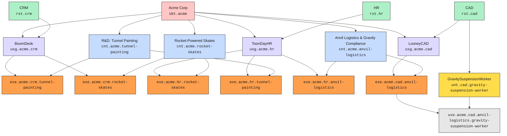
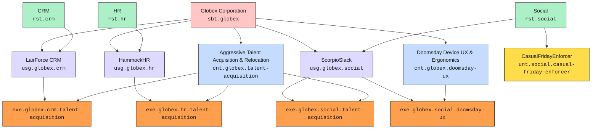

# Demo Data Set of Acme Corp and Globex

## Problem

The 2S Platform has no example project that shows what the configuration model can do when it is used in full. The playground data (`src/Platform/Storyteller/Playground/data/`) is ten small files without schemas, templates, key/value pairs, labels or values worth reading. The admin UI showcase (`src/Platform/ui.admin/src/app/mock/showcase/`) is rich, but it is TypeScript for the mock API, not something `sform story import` can load into a real platform, and its fourteen projects are realistic rather than memorable.

A demo needs one project that:

- uses its own names for the annotation types;
- has labels and values that are worth filtering and binding to;
- has templates, schemas of all three kinds, and key/value pairs;
- has configurations that inherit through the whole hierarchy and bind to annotation values, to public key/value pairs, to the configuration itself and to JSON Logic and JSON-e;
- is fun to read, so that people remember it after the demo.

The model of the annotations is drawn on the Miro board `2S Platform examples`, frame `Demo data set` (legend in the frame `Legend`). This spec turns that drawing into a complete data set: every annotation, configuration, template, schema and key/value pair, ready to be written as import files.

## Current State

- **Annotation types and keys** (`Abstractions.Annotations/src/AnnotationTypeCodes.cs`, `docs/42for.net/platform/annotations.md`): `rst.{responsibility}`, `unt.{responsibility}.{unit}`, `sbt.{subject}`, `usg.{subject}.{responsibility}`, `cnt.{subject}.{context}`, `exe.{subject}.{responsibility}.{context}`, `uxe.{subject}.{responsibility}.{context}.{unit}`. A name has no dots; the convention is lower case with hyphens.
- **Type names** (Subject → Company, and so on) exist only in the admin UI: `ui.admin/src/app/stores/project-settings.ts` keeps them in the browser's localStorage (`2s-admin:project-settings`), because the API has no project document for them. An import or export never carries them.
- **Labels** are free strings on an annotation; **values** are a free JSON object on an annotation (`Model/Annotation.cs`). `@annotation("<expr>"[, "<type>"])` reads values from a configuration ([binding.md](../binding.md)).
- **Inheritance** ([inheritance.md](../inheritance.md)): every node merges the calculated documents of its direct parents in the order Responsibility, Unit, Subject, Usage, Context, Execution, then its type's template, then its own content. Objects merge by property, scalars are replaced, arrays are unioned, nulls are ignored. A subject reaches an execution twice (through the usage and through the context), so the context's copy writes the subject's scalars back over the usage.
- **Templates** ([templating.md](../templating.md)): one JSON object per type code per view (`{view}.gen.{type}`), merged into every configuration of that type in the view. There is no template for a single annotation or for the descendants of one annotation. Templates are not validated against schemas.
- **Schemas** ([definitions.md](../definitions.md)): a type schema (`<type>.schema.json`), an annotation schema (`<key>.schema.json`) and a descendant-type schema on an ancestor (`<ancestor-key>.<type>.schema.json`), deep-merged into one combined schema. Only the stored own content is validated, on write and on import, never the calculated or resolved document. `$ref` must be local.
- **Bindings** ([binding.md](../binding.md)): `@key` (the native key/value store), `@(key, source)`, `@public(key)`, `@secret(key)`, `@[interpolation]`, `@{math}`, `@config("<expr>")`, `@annotation("<expr>"[, "<type>"])`, and the object envelopes `{"$binding": "jlogic"|"jsone", "$definition": …, "$context": …}`. They are evaluated only on the resolved read, at the node being read, and a key/value pair always binds as a string.
- **Key/value pairs** ([key-values.md](../key-values.md)): per organization, project and view; keys match `^[A-Za-z_][A-Za-z0-9_]*(\.[A-Za-z_][A-Za-z0-9_]*)*$`; imported with `sform story kv import <file>` in the format `2s.key-values.v1`.
- **Import** ([export-import.md](../export-import.md)): `sform story import <folder>` recognises files by name (`<key>.json`, `<key>.conf.json`, `<type>.template.json`, `<type>.schema.json`, `<key>.schema.json`, `<ancestor-key>.<type>.schema.json`), ignores every other name, and imports annotations, then schemas, then templates, then configurations.

## Proposed Changes

### 1. The story and the names

**Fourth Wall Software** is a small software house that builds and runs complex B2B solutions ("We break the fourth wall so your users don't have to"). Its two biggest customers are:

- **Acme Corp**: cartoon physics, chaotic inventions, rocket-powered everything, and a single loyal customer who is a coyote.
- **Globex Corporation**: the friendliest employer in Cypress Creek, run by Hank Scorpio, with hammocks for everyone, generous relocation packages and a doomsday device in the basement.

Fourth Wall Software delivers four solutions (CRM, HR, CAD, Social) as six branded applications, used by five departments of the two companies.

| Platform name | Value |
| --- | --- |
| Organization | `fourth-wall` |
| Project | `toons-and-tyrants` |
| View | `default` (the whole data set lives in this one view) |
| Example full key | `@fourth-wall.toons-and-tyrants.default.exe.acme.hr.rocket-skates` |

All URLs use the reserved `.example` top-level domain, and all phone numbers the fictional `555-01xx` range.

### 2. Type names of the project

| Type code | Platform type | Name in this project | Plural | Color | Icon |
| --- | --- | --- | --- | --- | --- |
| `sbt` | subject | Company | Companies | `pink` | `i-lucide-building-2` |
| `cnt` | context | Department | Departments | `blue` | `i-lucide-users` |
| `rst` | responsibility | Solution | Solutions | `green` | `i-lucide-puzzle` |
| `usg` | usage | Application | Applications | `violet` | `i-lucide-monitor` |
| `exe` | execution | AppUsage | AppUsages | `orange` | `i-lucide-rocket` |
| `unt` | unit | Job | Jobs | `yellow` | `i-lucide-cog` |
| `uxe` | unit of execution | JobInstance | JobInstances | `gray` | `i-lucide-zap` |

The colors follow the legend of the Miro board. The names are set in the admin UI (Project settings → Type names), which keeps them in the browser. The same object is the `settings` of a showcase project in the admin UI mock:

**`project-settings.json`** (not read by `sform`)

```json
{
  "types": {
    "sbt": { "label": "Company", "plural": "Companies", "color": "pink", "icon": "i-lucide-building-2" },
    "cnt": { "label": "Department", "plural": "Departments", "color": "blue", "icon": "i-lucide-users" },
    "rst": { "label": "Solution", "plural": "Solutions", "color": "green", "icon": "i-lucide-puzzle" },
    "usg": { "label": "Application", "plural": "Applications", "color": "violet", "icon": "i-lucide-monitor" },
    "exe": { "label": "AppUsage", "plural": "AppUsages", "color": "orange", "icon": "i-lucide-rocket" },
    "unt": { "label": "Job", "plural": "Jobs", "color": "yellow", "icon": "i-lucide-cog" },
    "uxe": { "label": "JobInstance", "plural": "JobInstances", "color": "gray", "icon": "i-lucide-zap" }
  },
  "defaultTimeZone": "America/Phoenix",
  "dateFormat": "yyyy-mm-dd"
}
```

### 3. The annotation tree

The tree is exactly the one on the Miro board: 2 Companies, 5 Departments, 4 Solutions, 6 Applications, 10 AppUsages, 2 Jobs and 1 JobInstance, 30 annotations in total. On the board the Jobs hang below the Applications LooneyCAD and ScorpioSlack. In the platform a Job belongs to a Solution (`unt.{responsibility}.{unit}`), so GravitySuspensionWorker is a Job of CAD and CasualFridayEnforcer a Job of Social; the only JobInstance joins GravitySuspensionWorker with the AppUsage LooneyCAD × Anvil Logistics, as drawn.





| Type | Key | Title |
| --- | --- | --- |
| Company | `sbt.acme` | Acme Corp |
| Company | `sbt.globex` | Globex Corporation |
| Department | `cnt.acme.anvil-logistics` | Department of Anvil Logistics & Gravity Compliance |
| Department | `cnt.acme.tunnel-painting` | R&D: Tunnel Painting & Trompe-l'œil Illusion |
| Department | `cnt.acme.rocket-skates` | Rocket-Powered Skates & Uncontrolled Propulsion |
| Department | `cnt.globex.talent-acquisition` | Department of Aggressive Talent Acquisition & Relocation |
| Department | `cnt.globex.doomsday-ux` | Doomsday Device UX & Ergonomics |
| Solution | `rst.crm` | CRM |
| Solution | `rst.hr` | HR |
| Solution | `rst.cad` | CAD |
| Solution | `rst.social` | Social |
| Application | `usg.acme.crm` | BoomDesk |
| Application | `usg.acme.hr` | ToonDayHR |
| Application | `usg.acme.cad` | LooneyCAD |
| Application | `usg.globex.crm` | LairForce CRM |
| Application | `usg.globex.hr` | HammockHR |
| Application | `usg.globex.social` | ScorpioSlack |
| AppUsage | `exe.acme.crm.tunnel-painting` | BoomDesk for Tunnel Painting R&D |
| AppUsage | `exe.acme.crm.rocket-skates` | BoomDesk for Rocket Skates |
| AppUsage | `exe.acme.hr.rocket-skates` | ToonDayHR for Rocket Skates |
| AppUsage | `exe.acme.hr.tunnel-painting` | ToonDayHR for Tunnel Painting R&D |
| AppUsage | `exe.acme.hr.anvil-logistics` | ToonDayHR for Anvil Logistics |
| AppUsage | `exe.acme.cad.anvil-logistics` | LooneyCAD for Anvil Logistics |
| AppUsage | `exe.globex.crm.talent-acquisition` | LairForce CRM for Talent Acquisition |
| AppUsage | `exe.globex.hr.talent-acquisition` | HammockHR for Talent Acquisition |
| AppUsage | `exe.globex.social.talent-acquisition` | ScorpioSlack for Talent Acquisition |
| AppUsage | `exe.globex.social.doomsday-ux` | ScorpioSlack for Doomsday Device UX |
| Job | `unt.cad.gravity-suspension-worker` | GravitySuspensionWorker |
| Job | `unt.social.casual-friday-enforcer` | CasualFridayEnforcer |
| JobInstance | `uxe.acme.cad.anvil-logistics.gravity-suspension-worker` | GravitySuspensionWorker at Anvil Logistics |

### 4. Annotations

Each block below is the content of one import file, `annotations/<key>.json`, with the members in the order of [export-import.md](../export-import.md#annotations). The titles drawn on the Miro board are used as they are. The descriptions drawn there (Departments, Applications, CasualFridayEnforcer and the JobInstance) are used as they are or open a longer description; the descriptions of the Companies, the AppUsages and GravitySuspensionWorker are new. The descriptions of the Solutions are short definitions of the acronyms.

#### 4.1 Companies

Both Companies carry the values that the configurations and templates bind to (§8, §6): `code` decides which Company a template serves, `insurance` feeds Acme's AppUsage template, `ceo`, `ransomCurrency` and `friendlinessIndex` feed Globex's.

**`annotations/sbt.acme.json`**

```json
{
  "Title": "Acme Corp",
  "Description": "A Company Making Everything. Acme supplies rocket skates, giant magnets, dehydrated boulders and portable holes to a small but extremely loyal customer base of one. Every product is delivered within minutes by rocket mail, works exactly as advertised right up to the worst possible moment, and comes with a warranty that expires on first use.\n\nAcme hired Fourth Wall Software after its in-house IT department was flattened by an anvil it had ordered from itself.",
  "DocumentationLink": "https://acme.example/catalog",
  "Labels": ["customer", "key-account", "cartoon-physics", "high-risk"],
  "Values": {
    "code": "ACME",
    "legalName": "Acme Corporation",
    "founded": 1949,
    "headquarters": { "address": "1 Mesa Drive, Mile Marker 42", "city": "Painted Desert", "state": "AZ" },
    "accountManager": "Penelope Plummet",
    "primaryCustomer": "A. Coyote, Super Genius",
    "contractTier": "platinum",
    "currency": "USD",
    "brandColor": "#E8412C",
    "deliveryMethod": "rocket-mail",
    "deliverySlaMinutes": 4,
    "annualAnvilQuota": 12000,
    "insurance": { "carrier": "Mutual of Mesa", "policy": "KABOOM-1949-0001", "coversGravity": false }
  },
  "ValidFrom": "2019-04-01T00:00:00-07:00",
  "TimeZone": "America/Phoenix"
}
```

**`annotations/sbt.globex.json`**

```json
{
  "Title": "Globex Corporation",
  "Description": "The friendliest multinational on the planet, and soon the only one. Globex gives every employee a hammock, a monorail pass and a boss who remembers their kids' birthdays, and keeps a cobalt-thorium G doomsday device in the basement in case the United Nations does not answer its demands within 72 hours.\n\nGlobex is headquartered in Cypress Creek, a lovingly planned community where nobody asks what's inside the volcano. It hired Fourth Wall Software because, in the words of its CEO, \"you can't run a global empire on spreadsheets. Well, you can, but you shouldn't.\"",
  "DocumentationLink": "https://globex.example/careers",
  "Labels": ["customer", "key-account", "supervillain", "employee-friendly"],
  "Values": {
    "code": "GLOBEX",
    "legalName": "Globex Corporation",
    "ceo": "Hank Scorpio",
    "headquarters": { "address": "1 Volcano Plaza", "city": "Cypress Creek", "lairLevel": -7 },
    "accountManager": "Sunny Ultimatum",
    "contractTier": "diamond",
    "currency": "USD",
    "ransomCurrency": "XAU",
    "brandColor": "#7A2BD1",
    "employeeBenefits": ["hammock", "monorail pass", "free cookies", "henchman dental plan"],
    "friendlinessIndex": 11,
    "doomsdayReadiness": "DEFCON 2",
    "takeoverTarget": "East Coast"
  },
  "ValidFrom": "2021-06-01T09:00:00-05:00",
  "TimeZone": "America/Chicago"
}
```

#### 4.2 Departments

The Departments of one Company share the value names that the templates of §6 read: every Acme Department has `costCenter`, `headOfDepartment`, `headcount`, `hazardLevel`, `maxReconstitutionsPerShift` and `slackChannel`; every Globex Department has `costCenter`, `headOfDepartment`, `headcount`, `building`, `monorailStop` and `hammocksPerEngineer`. The other values are specific to the Department.

**`annotations/cnt.acme.anvil-logistics.json`**

```json
{
  "Title": "Department of Anvil Logistics & Gravity Compliance",
  "Description": "Responsible for ensuring heavy objects hang motionless in mid-air until a victim looks down. The department also keeps the official register of every anvil, piano and safe currently suspended above a canyon, and signs the quarterly Gravity Compliance Report (\"gravity: mostly complied\").",
  "Labels": ["logistics", "heavy-objects", "hazardous"],
  "Values": {
    "costCenter": "AC-ANV-100",
    "headOfDepartment": "Ivana Dropp",
    "headcount": 42,
    "hazardLevel": "extreme",
    "maxReconstitutionsPerShift": 3,
    "slackChannel": "#anvils-overhead",
    "floor": "B3 (reinforced ceiling)",
    "anvilStockTons": 980
  }
}
```

**`annotations/cnt.acme.tunnel-painting.json`**

```json
{
  "Title": "R&D: Tunnel Painting & Trompe-l'œil Illusion",
  "Description": "Specializes in hyper-realistic cliff paintings that only solidify for roadrunners. Current research focuses on painted tunnels that also let trains through, and on the long-standing mystery of why the paint is always dry before the brush leaves the wall.",
  "Labels": ["r-and-d", "art", "illusion"],
  "Values": {
    "costCenter": "AC-RND-220",
    "headOfDepartment": "Vincent van Gopher",
    "headcount": 17,
    "hazardLevel": "medium",
    "maxReconstitutionsPerShift": 1,
    "slackChannel": "#trompe-loeil",
    "paintStockLiters": 4200,
    "solidifiesFor": ["roadrunners", "trains"]
  }
}
```

**`annotations/cnt.acme.rocket-skates.json`**

```json
{
  "Title": "Rocket-Powered Skates & Uncontrolled Propulsion",
  "Description": "Focuses on personal mobility devices with no steering, no brakes, and an ignition switch that always sticks. The department's test track ends at a cliff by design, and its test pilots end there by tradition.",
  "Labels": ["propulsion", "mobility", "hazardous"],
  "Values": {
    "costCenter": "AC-PRP-310",
    "headOfDepartment": "Rhoda Rocket",
    "headcount": 23,
    "hazardLevel": "extreme",
    "maxReconstitutionsPerShift": 5,
    "slackChannel": "#skates-launch-log",
    "testTrack": "Canyon Road 66 (ends abruptly)",
    "topSpeedKmh": 1200
  }
}
```

**`annotations/cnt.globex.talent-acquisition.json`**

```json
{
  "Title": "Department of Aggressive Talent Acquisition & Relocation",
  "Description": "Kidnaps top engineers and provides them with lovely split-level homes in Cypress Creek. Candidates are approached with a warm smile, a generous offer and a moving truck that is already parked outside. 100% of offers have been accepted, most of them on the way to the airport.",
  "Labels": ["hr", "relocation", "persuasive"],
  "Values": {
    "costCenter": "GX-TAL-001",
    "headOfDepartment": "Abby Duction",
    "headcount": 64,
    "building": "Lair Tower A, floor 3 (the one with the ball pit)",
    "monorailStop": "Talent Terminal",
    "hammocksPerEngineer": 2,
    "relocationsThisQuarter": 128,
    "hiringStyle": "aggressively friendly",
    "welcomeBasket": "fruit, cookies and a non-disclosure agreement"
  }
}
```

**`annotations/cnt.globex.doomsday-ux.json`**

```json
{
  "Title": "Doomsday Device UX & Ergonomics",
  "Description": "Ensures cobalt-thorium G bombs have intuitive interfaces and cupholders. The team runs weekly usability tests on launch consoles, maintains the Doomsday Design System (friendly-red buttons, rounded corners, a confirmation dialog nobody reads) and insists that every apocalypse be accessible.",
  "Labels": ["ux", "r-and-d", "doomsday"],
  "Values": {
    "costCenter": "GX-DUX-666",
    "headOfDepartment": "Dr. Ada Ergon",
    "headcount": 12,
    "building": "Volcano Annex, level -7",
    "monorailStop": "Crater Rim",
    "hammocksPerEngineer": 1,
    "cupholdersPerDevice": 4,
    "accessibility": "WCAG AAA (Apocalypse Accessible Always)"
  }
}
```

#### 4.3 Solutions

The Solutions are the products of Fourth Wall Software itself, shared by both Companies. Their values give the acronym that their configurations and Globex's Application template bind to.

**`annotations/rst.crm.json`**

```json
{
  "Title": "CRM",
  "Description": "**Customer Relationship Management.** Software that keeps every account, contact, deal and support ticket of a company in one place, so that the whole company knows who its customers are and what they were promised.",
  "DocumentationLink": "https://en.wikipedia.org/wiki/Customer_relationship_management",
  "Labels": ["solution", "sales"],
  "Values": { "acronym": "CRM", "fullName": "Customer Relationship Management", "productOwner": "Dale Closer" }
}
```

**`annotations/rst.hr.json`**

```json
{
  "Title": "HR",
  "Description": "**Human Resources Management System.** Software that runs the employee lifecycle (hiring, onboarding, payroll, leave, performance reviews and offboarding) and keeps the employee records that go with it.",
  "DocumentationLink": "https://en.wikipedia.org/wiki/Human_resource_management_system",
  "Labels": ["solution", "people"],
  "Values": { "acronym": "HR", "fullName": "Human Resources Management System", "productOwner": "Iris Onboard" }
}
```

**`annotations/rst.cad.json`**

```json
{
  "Title": "CAD",
  "Description": "**Computer-Aided Design.** Software for creating, changing and analysing precise 2D drawings and 3D models of physical things, and for simulating how they behave before anybody builds them.",
  "DocumentationLink": "https://en.wikipedia.org/wiki/Computer-aided_design",
  "Labels": ["solution", "engineering"],
  "Values": { "acronym": "CAD", "fullName": "Computer-Aided Design", "productOwner": "Polly Gon" }
}
```

**`annotations/rst.social.json`**

```json
{
  "Title": "Social",
  "Description": "**Enterprise Social Network (ESN).** Internal messaging and collaboration software (channels, direct messages, presence and announcements) that keeps the people of a company talking to each other instead of to their inboxes.",
  "DocumentationLink": "https://en.wikipedia.org/wiki/Enterprise_social_networking",
  "Labels": ["solution", "collaboration"],
  "Values": { "acronym": "ESN", "fullName": "Enterprise Social Network", "productOwner": "Kat Channels" }
}
```

#### 4.4 Applications

**`annotations/usg.acme.crm.json`**

```json
{
  "Title": "BoomDesk",
  "Description": "Automatically generates soot-stained incident reports and processes one-star reviews from a single recurring coyote customer.",
  "DocumentationLink": "https://boomdesk.acme.example/docs",
  "Labels": ["helpdesk", "incident-management"],
  "Values": { "version": "3.14.0", "codename": "Smoldering Crater", "goLive": "2021-04-01" }
}
```

**`annotations/usg.acme.hr.json`**

```json
{
  "Title": "ToonDayHR",
  "Description": "It replaces standard corporate talent management with survival tracking, cartoon physics compliance, and rapid employee reconstitution.",
  "DocumentationLink": "https://toonday.acme.example/help",
  "Labels": ["hr", "reconstitution", "schema-validated"],
  "Values": { "version": "2.0.0-flattened", "codename": "Accordion", "goLive": "2022-09-17" }
}
```

**`annotations/usg.acme.cad.json`**

```json
{
  "Title": "LooneyCAD",
  "Description": "A 3D modeling suite that ignores basic laws of physics, gravity, and structural integrity during product design.",
  "DocumentationLink": "https://acme.example/looneycad",
  "Labels": ["cad", "physics-optional", "desktop"],
  "Values": { "version": "11.2", "codename": "Thin Air", "goLive": "2020-01-15", "physicsEngine": "Rubber Band 3D" }
}
```

**`annotations/usg.globex.crm.json`**

```json
{
  "Title": "LairForce CRM",
  "Description": "Tracks world leaders, ransom payment statuses, and automated threats of tectonic plate disruption.",
  "DocumentationLink": "https://lairforce.globex.example/docs",
  "Labels": ["crm", "world-domination"],
  "Values": { "version": "2026.10", "codename": "Tectonic", "goLive": "2023-03-15" }
}
```

**`annotations/usg.globex.hr.json`**

```json
{
  "Title": "HammockHR",
  "Description": "Manages Cypress Creek relocation packages, casual dress code policies, and local hammock district vendor perks.",
  "DocumentationLink": "https://lair.globex.example/hammock/help",
  "Labels": ["hr", "relocation", "perks"],
  "Values": { "version": "4.2.0", "codename": "Siesta", "goLive": "2022-06-01" }
}
```

**`annotations/usg.globex.social.json`**

```json
{
  "Title": "ScorpioSlack",
  "Description": "An upbeat internal messaging app where team-building GIFs sit right next to East Coast takeover countdowns.",
  "DocumentationLink": "https://scorpio.globex.example/help",
  "Labels": ["chat", "schema-validated", "countdown"],
  "Values": { "version": "7.0.1", "codename": "Stinger", "goLive": "2024-02-29" }
}
```

#### 4.5 AppUsages

**`annotations/exe.acme.crm.tunnel-painting.json`**

```json
{
  "Title": "BoomDesk for Tunnel Painting R&D",
  "Description": "Handles complaints from customers who ran face-first into a painted tunnel, and the far rarer complaints from trains that came out of one. Every ticket arrives with a paint sample and a slightly flattened screenshot.",
  "Labels": ["production"]
}
```

**`annotations/exe.acme.crm.rocket-skates.json`**

```json
{
  "Title": "BoomDesk for Rocket Skates",
  "Description": "Tracks every launch, every crater and every cliff the skates failed to stop at. Tickets close themselves when the dust cloud settles. The contract is up for renewal on April Fools' Day, which nobody at Acme finds suspicious.",
  "Labels": ["production", "renewal-due"],
  "ExpiresAt": "2027-04-01T00:00:00-07:00",
  "TimeZone": "America/Phoenix"
}
```

**`annotations/exe.acme.hr.rocket-skates.json`**

```json
{
  "Title": "ToonDayHR for Rocket Skates",
  "Description": "Survival tracking for test pilots: counts launches, landings and the difference between the two. Extra leave is granted for every successful landing, which keeps the leave budget remarkably stable.",
  "Labels": ["production", "high-risk", "schema-validated"]
}
```

**`annotations/exe.acme.hr.tunnel-painting.json`**

```json
{
  "Title": "ToonDayHR for Tunnel Painting R&D",
  "Description": "Tracks the painters' exposure to suddenly solid scenery and accepts \"flattened against a wall\" as a valid reason for sick leave.",
  "Labels": ["production", "schema-validated"]
}
```

**`annotations/exe.acme.hr.anvil-logistics.json`**

```json
{
  "Title": "ToonDayHR for Anvil Logistics",
  "Description": "Schedules hard-hat inspections and keeps the official log of every \"looked down\" event for the gravity compliance audit.",
  "Labels": ["production", "high-risk", "schema-validated"]
}
```

**`annotations/exe.acme.cad.anvil-logistics.json`**

```json
{
  "Title": "LooneyCAD for Anvil Logistics",
  "Description": "Designs suspension rigs for anvils, pianos and safes. Gravity is a configurable option here, and, as the composition read shows, the option the department ends up with is not the one the application chose.",
  "Labels": ["production", "physics-optional"]
}
```

**`annotations/exe.globex.crm.talent-acquisition.json`**

```json
{
  "Title": "LairForce CRM for Talent Acquisition",
  "Description": "Tracks candidate engineers from the first friendly email to already living in Cypress Creek. The stage \"Declined\" exists in the database but has never been used.",
  "Labels": ["production"]
}
```

**`annotations/exe.globex.hr.talent-acquisition.json`**

```json
{
  "Title": "HammockHR for Talent Acquisition",
  "Description": "Turns a freshly relocated engineer into a fully onboarded, hammock-assigned, casually dressed Globex employee before the moving truck has left the driveway.",
  "Labels": ["production", "relocation"]
}
```

**`annotations/exe.globex.social.talent-acquisition.json`**

```json
{
  "Title": "ScorpioSlack for Talent Acquisition",
  "Description": "Runs #welcome-to-cypress-creek: welcome GIFs, relocation tips and a pinned message reminding newcomers that the exits are decorative.",
  "Labels": ["production", "schema-validated"]
}
```

**`annotations/exe.globex.social.doomsday-ux.json`**

```json
{
  "Title": "ScorpioSlack for Doomsday Device UX",
  "Description": "Design reviews, cupholder polls and the always-on East Coast takeover countdown widget. The rollout ends on 21 December 2027, the date the team has scheduled for the end of the world.",
  "Labels": ["production", "schema-validated", "countdown"],
  "ExpiresAt": "2027-12-21T00:00:00-06:00",
  "TimeZone": "America/Chicago"
}
```

#### 4.6 Jobs

GravitySuspensionWorker is triggered by an event, CasualFridayEnforcer by time. CasualFridayEnforcer is **Scheduled**: it becomes active on the first Friday of 2027 at 8:00, Hank Scorpio's New Year's resolution.

**`annotations/unt.cad.gravity-suspension-worker.json`**

```json
{
  "Title": "GravitySuspensionWorker",
  "Description": "A background worker of the CAD solution that keeps heavy objects in a design hanging in mid-air for exactly as long as nobody is looking down. It waits for the `user_looked_down` event and lets go immediately.",
  "DocumentationLink": "https://docs.fourthwall.example/jobs/gravity-suspension-worker",
  "Labels": ["worker", "event-driven", "physics"],
  "UnitType": "event",
  "UnitDefinition": "user_looked_down"
}
```

**`annotations/unt.social.casual-friday-enforcer.json`**

```json
{
  "Title": "CasualFridayEnforcer",
  "Description": "Scans employee profile avatars every Friday at 8:00 AM and automatically flags anyone wearing a necktie with a friendly reminder from Hank Scorpio to relax.",
  "Labels": ["scheduled", "dress-code"],
  "ValidFrom": "2027-01-01T08:00:00-06:00",
  "TimeZone": "America/Chicago",
  "UnitType": "time",
  "UnitDefinition": "0 8 * * FRI"
}
```

#### 4.7 JobInstances

**`annotations/uxe.acme.cad.anvil-logistics.gravity-suspension-worker.json`**

```json
{
  "Title": "GravitySuspensionWorker at Anvil Logistics",
  "Description": "Scans 3D assemblies for heavy objects (such as anvils or pianos) placed over ledges and suppresses downward vector calculations until a \"user_looked_down\" event flag is triggered.",
  "Labels": ["production", "event-driven", "schema-validated"],
  "Values": { "assemblyBatch": "ANV-2026-11-13", "scanIntervalSeconds": 2 }
}
```

#### 4.8 Labels

Labels repeat across types and Companies on purpose, so that a label filter (`label:hazardous`, `label:schema-validated`) returns a mixed list:

| Label | Annotations |
| --- | --- |
| `production` | all 10 AppUsages, the JobInstance |
| `schema-validated` | ToonDayHR, ScorpioSlack, the 3 ToonDayHR AppUsages, the 2 ScorpioSlack AppUsages, the JobInstance |
| `hazardous` | Anvil Logistics, Rocket-Powered Skates |
| `high-risk` | Acme Corp, ToonDayHR for Rocket Skates, ToonDayHR for Anvil Logistics |
| `r-and-d` | Tunnel Painting (Acme), Doomsday Device UX (Globex) |
| `hr` | Talent Acquisition (a Department), ToonDayHR and HammockHR (Applications) |
| `relocation` | Talent Acquisition, HammockHR, HammockHR for Talent Acquisition |
| `physics-optional` | LooneyCAD, LooneyCAD for Anvil Logistics |
| `countdown` | ScorpioSlack, ScorpioSlack for Doomsday Device UX |
| `event-driven` | GravitySuspensionWorker, its JobInstance |
| `customer`, `key-account` | both Companies |
| `solution` | the 4 Solutions |

#### 4.9 Lifecycle

| Annotation | Members | Status on 2026-11-13 |
| --- | --- | --- |
| `sbt.acme` | `ValidFrom` 2019-04-01, `TimeZone` America/Phoenix | Active |
| `sbt.globex` | `ValidFrom` 2021-06-01, `TimeZone` America/Chicago | Active |
| `exe.acme.crm.rocket-skates` | `ExpiresAt` 2027-04-01 | Active, expires on April Fools' Day |
| `exe.globex.social.doomsday-ux` | `ExpiresAt` 2027-12-21 | Active, expires at the end of the world |
| `unt.social.casual-friday-enforcer` | `ValidFrom` 2027-01-01 08:00 | Scheduled (listed with `includeInactive=true`) |

Every other annotation has no lifecycle members and is Active.

### 5. Key/value pairs

All pairs are in the `default` view. The public pairs are what the configurations bind to; the secret is optional and shows that a secret binding stays unresolved for a reader without secret rights.

| Key | Protection | Value | Content type | Bound by |
| --- | --- | --- | --- | --- |
| `fourthwall.support.email` | Public | `help@fourthwall.example` | `text/plain` | every Solution, `@key` |
| `fourthwall.support.hours` | Public | `24/7, except during plot twists` | `text/plain` | every Solution, `@key` |
| `fourthwall.status.url` | Public | `https://status.fourthwall.example` | `text/plain` | every Solution, interpolation |
| `fourthwall.telemetry.endpoint` | Public | `https://telemetry.fourthwall.example/ingest` | `text/plain` | every Solution, `@public(key)` |
| `acme.portal.host` | Public | `portal.acme.example` | `text/plain` | Acme Corp, interpolation |
| `acme.delivery.rocketMail` | Public | `https://rocketmail.acme.example/dispatch` | `text/plain` | Acme Corp |
| `acme.boomdesk.host` | Public | `boomdesk.acme.example` | `text/plain` | BoomDesk, the AppUsage template, the JobInstance |
| `acme.boomdesk.apiVersion` | Public | `v2` | `text/plain` | the same, interpolation |
| `acme.boomdesk.apiKeyRef` | Public | `kv://acme-vault/boomdesk-api-key` | `application/vnd.2s.secret-reference` | BoomDesk (a reference, never resolved by the platform) |
| `acme.toonday.host` | Public | `toonday.acme.example` | `text/plain` | ToonDayHR |
| `acme.looneycad.licenseServer` | Public | `licenses.acme.example:27000` | `text/plain` | LooneyCAD, `@(key, public)` |
| `acme.safety.hotline` | Public | `+1-555-0142` | `text/plain` | the AppUsage template, `@public(key)` |
| `globex.lair.host` | Public | `lair.globex.example` | `text/plain` | Globex, HammockHR, the Application template |
| `globex.lairforce.host` | Public | `lairforce.globex.example` | `text/plain` | LairForce CRM |
| `globex.hammock.vendorsUrl` | Public | `https://hammocks.cypresscreek.example/vendors` | `text/plain` | Globex, HammockHR, the Department template |
| `globex.slack.workspace` | Public | `scorpio.globex.example` | `text/plain` | ScorpioSlack |
| `globex.slack.giphyRating` | Public | `pg` | `text/plain` | ScorpioSlack |
| `globex.takeover.target` | Public | `East Coast` | `text/plain` | Globex, ScorpioSlack's countdown, `@(key, public)` |
| `globex.un.demandsUrl` | Public | `https://lair.globex.example/demands` | `text/plain` | Globex, `@public(key)` |
| `globex.lairforce.escrowPin` | Standard | `0000-NICE-TRY` | | LairForce CRM, `@secret(key)` |

**`key-values.json`**

```json
{
  "Format": "2s.key-values.v1",
  "Items": [
    { "Key": "acme.boomdesk.apiKeyRef", "Protection": "Public", "Value": "kv://acme-vault/boomdesk-api-key", "ContentType": "application/vnd.2s.secret-reference" },
    { "Key": "acme.boomdesk.apiVersion", "Protection": "Public", "Value": "v2", "ContentType": "text/plain" },
    { "Key": "acme.boomdesk.host", "Protection": "Public", "Value": "boomdesk.acme.example", "ContentType": "text/plain" },
    { "Key": "acme.delivery.rocketMail", "Protection": "Public", "Value": "https://rocketmail.acme.example/dispatch", "ContentType": "text/plain" },
    { "Key": "acme.looneycad.licenseServer", "Protection": "Public", "Value": "licenses.acme.example:27000", "ContentType": "text/plain" },
    { "Key": "acme.portal.host", "Protection": "Public", "Value": "portal.acme.example", "ContentType": "text/plain" },
    { "Key": "acme.safety.hotline", "Protection": "Public", "Value": "+1-555-0142", "ContentType": "text/plain" },
    { "Key": "acme.toonday.host", "Protection": "Public", "Value": "toonday.acme.example", "ContentType": "text/plain" },
    { "Key": "fourthwall.status.url", "Protection": "Public", "Value": "https://status.fourthwall.example", "ContentType": "text/plain" },
    { "Key": "fourthwall.support.email", "Protection": "Public", "Value": "help@fourthwall.example", "ContentType": "text/plain" },
    { "Key": "fourthwall.support.hours", "Protection": "Public", "Value": "24/7, except during plot twists", "ContentType": "text/plain" },
    { "Key": "fourthwall.telemetry.endpoint", "Protection": "Public", "Value": "https://telemetry.fourthwall.example/ingest", "ContentType": "text/plain" },
    { "Key": "globex.hammock.vendorsUrl", "Protection": "Public", "Value": "https://hammocks.cypresscreek.example/vendors", "ContentType": "text/plain" },
    { "Key": "globex.lair.host", "Protection": "Public", "Value": "lair.globex.example", "ContentType": "text/plain" },
    { "Key": "globex.lairforce.host", "Protection": "Public", "Value": "lairforce.globex.example", "ContentType": "text/plain" },
    { "Key": "globex.slack.giphyRating", "Protection": "Public", "Value": "pg", "ContentType": "text/plain" },
    { "Key": "globex.slack.workspace", "Protection": "Public", "Value": "scorpio.globex.example", "ContentType": "text/plain" },
    { "Key": "globex.takeover.target", "Protection": "Public", "Value": "East Coast", "ContentType": "text/plain" },
    { "Key": "globex.un.demandsUrl", "Protection": "Public", "Value": "https://lair.globex.example/demands", "ContentType": "text/plain" }
  ]
}
```

**`key-values.secrets.json`** (optional; importing it needs the right to write secrets)

```json
{
  "Format": "2s.key-values.v1",
  "Items": [
    { "Key": "globex.lairforce.escrowPin", "Protection": "Standard", "Value": "0000-NICE-TRY" }
  ]
}
```

### 6. Templates

The requirements say that Acme has templates on its AppUsages and Globex on its Applications and Departments. A template, however, belongs to a type code in a view (`default.gen.exe`), not to a Company: the `exe` template is merged into all ten AppUsages, Globex's included. Each template is therefore one property whose value is a **JSON-e envelope that checks the Company**:

- `$context` reads the whole `Values` of the Company (and of the Department or Solution) with `@annotation("$", "<type>")`. The type is named, so the binding reads the same annotation at every level that inherits the template.
- `$definition` is a JSON-e `$if` on `company.code`: the Company that owns the template gets the block, the other Company gets `{}`.
- The block can emit `@` strings. The walker binds the result of an envelope again, so they resolve against the key/value store after JSON-e has run.

The non-owning Company sees an empty object (`"toonSafety": {}` on a Globex AppUsage), which a flattened format such as `env` or `IConfiguration` renders as nothing. A JSON-e envelope makes the resolved read evaluate on every request (`$fromNow` could read the clock), so a conditional read never answers 304 for these documents.

#### 6.1 Acme's AppUsage template: `toonSafety`

Merged into every AppUsage, and through the AppUsage into the JobInstance. For Acme it builds the safety rules of the AppUsage from the Company's insurance and the Department's hazard level; Departments with `hazardLevel: extreme` get the full gear.

**`templates/exe.template.json`**

```json
{
  "toonSafety": {
    "$binding": "jsone",
    "$context": {
      "company": "@annotation(\"$\", \"Subject\")",
      "department": "@annotation(\"$\", \"Context\")"
    },
    "$definition": {
      "$if": "company.code == 'ACME'",
      "then": {
        "policy": "${company.insurance.policy}",
        "insurer": "${company.insurance.carrier}",
        "coversGravity": { "$eval": "company.insurance.coversGravity" },
        "costCenter": "${department.costCenter}",
        "hazardLevel": "${department.hazardLevel}",
        "safetyOfficer": "${department.headOfDepartment}",
        "mandatoryGear": {
          "$if": "department.hazardLevel == 'extreme'",
          "then": ["helmet", "umbrella", "parachute", "tiny 'help' sign"],
          "else": ["helmet", "umbrella"]
        },
        "reconstitution": {
          "enabled": true,
          "maxPerShift": { "$eval": "department.maxReconstitutionsPerShift" },
          "method": "accordion-shake"
        },
        "incidentReporting": {
          "target": "BoomDesk",
          "url": "@[https://@acme.boomdesk.host/@acme.boomdesk.apiVersion/incidents]",
          "hotline": "@public(acme.safety.hotline)"
        }
      },
      "else": {}
    }
  }
}
```

#### 6.2 Globex's Application template: `lairCompliance`

Merged into every Application, and through it into the AppUsages and the JobInstance. The audit trail URL is built in two passes: JSON-e puts the Solution's acronym into the string, then the `@[...]` interpolation puts in the host from the key/value store.

**`templates/usg.template.json`**

```json
{
  "lairCompliance": {
    "$binding": "jsone",
    "$context": {
      "company": "@annotation(\"$\", \"Subject\")",
      "solution": "@annotation(\"$\", \"Responsibility\")"
    },
    "$definition": {
      "$if": "company.code == 'GLOBEX'",
      "then": {
        "sso": { "provider": "ScorpioID", "mfa": "retina scan and a firm handshake" },
        "dataResidency": "cypress-creek-volcano-b7",
        "dressCode": "casual",
        "friendlinessLevel": { "$eval": "company.friendlinessIndex" },
        "auditTrail": "@[https://@globex.lair.host/audit/${solution.acronym}]",
        "approvals": { "worldDomination": "auto-approved", "anythingOverOneBillion": "ask ${company.ceo}" },
        "welcomeMessage": "Hi there! Your ${solution.fullName} is now fully Globex-compliant. Help yourself to a cookie."
      },
      "else": {}
    }
  }
}
```

#### 6.3 Globex's Department template: `cypressCreek`

Merged into every Department, and through it into the AppUsages and the JobInstance.

**`templates/cnt.template.json`**

```json
{
  "cypressCreek": {
    "$binding": "jsone",
    "$context": {
      "company": "@annotation(\"$\", \"Subject\")",
      "department": "@annotation(\"$\", \"Context\")"
    },
    "$definition": {
      "$if": "company.code == 'GLOBEX'",
      "then": {
        "office": "${department.building}",
        "monorailStop": "${department.monorailStop}",
        "hammocksPerEngineer": { "$eval": "department.hammocksPerEngineer" },
        "relocation": {
          "homeType": "split-level",
          "includes": ["moving truck", "welcome basket", "friendly neighbour (henchman)"],
          "vendorPortal": "@globex.hammock.vendorsUrl"
        },
        "casualFriday": { "enforcedBy": "CasualFridayEnforcer", "neckties": "discouraged" },
        "escalation": "${department.headOfDepartment} → ${company.ceo}"
      },
      "else": {}
    }
  }
}
```

### 7. Schemas

Eleven schemas of all three kinds:

| File | Kind | Applies to (stored content of) |
| --- | --- | --- |
| `rst.schema.json` | Type | every Solution |
| `sbt.schema.json` | Type | every Company |
| `rst.crm.schema.json` | Annotation | CRM |
| `rst.hr.schema.json` | Annotation | HR |
| `rst.cad.schema.json` | Annotation | CAD |
| `rst.social.schema.json` | Annotation | Social |
| `usg.acme.hr.schema.json` | Annotation | ToonDayHR |
| `usg.globex.social.schema.json` | Annotation | ScorpioSlack |
| `usg.acme.hr.exe.schema.json` | Descendant type (`exe` below a usage) | the 3 AppUsages of ToonDayHR |
| `usg.globex.social.exe.schema.json` | Descendant type (`exe` below a usage) | the 2 AppUsages of ScorpioSlack |
| `unt.cad.gravity-suspension-worker.uxe.schema.json` | Descendant type (`uxe` below a unit) | the JobInstances of GravitySuspensionWorker |

The combined schema of a Solution is the type schema `rst` deep-merged with the Solution's annotation schema: `required` is unioned, the `properties` of both layers are kept, so the root `additionalProperties: false` of the annotation layer allows `solution`, `telemetry`, `features` and the Solution's own block.

A schema checks the **stored** content, where a bound value is still the binding text. Every property that a configuration binds therefore accepts `#/definitions/binding` (a string that starts with `@`), and a property that holds an envelope accepts `#/definitions/envelope`. Each layer that refers to them carries its own copy of `definitions`, so it is a valid schema on its own as well.

#### 7.1 Type schemas

**`schemas/rst.schema.json`**

```json
{
  "$schema": "http://json-schema.org/draft-07/schema#",
  "title": "Solution",
  "description": "What every Solution of Fourth Wall Software declares: what it is, how it is supported, and where it sends telemetry.",
  "type": "object",
  "required": ["solution", "telemetry"],
  "properties": {
    "solution": {
      "type": "object",
      "required": ["code", "category", "supportTier", "sla"],
      "additionalProperties": false,
      "properties": {
        "code": {
          "description": "The acronym of the Solution, usually bound to its value `acronym`.",
          "anyOf": [{ "type": "string", "pattern": "^[A-Z]{2,8}$" }, { "$ref": "#/definitions/binding" }]
        },
        "category": { "enum": ["sales", "people", "engineering", "collaboration"] },
        "supportTier": { "enum": ["bronze", "silver", "gold", "platinum", "diamond"] },
        "sla": {
          "type": "object",
          "required": ["responseMinutes"],
          "additionalProperties": false,
          "properties": {
            "responseMinutes": { "type": "integer", "minimum": 1, "description": "How fast Fourth Wall answers a ticket." },
            "uptimePercent": { "type": "number", "minimum": 90, "maximum": 100 }
          }
        },
        "support": {
          "type": "object",
          "additionalProperties": false,
          "properties": {
            "email": { "$ref": "#/definitions/binding" },
            "hours": { "$ref": "#/definitions/binding" }
          }
        },
        "statusPage": { "$ref": "#/definitions/binding" }
      }
    },
    "telemetry": {
      "type": "object",
      "required": ["endpoint", "service"],
      "additionalProperties": false,
      "properties": {
        "endpoint": { "$ref": "#/definitions/binding" },
        "service": { "type": "string", "pattern": "^[a-z]+$" },
        "sampleRate": { "type": "number", "minimum": 0, "maximum": 1 }
      }
    },
    "features": { "type": "array", "uniqueItems": true, "items": { "type": "string", "pattern": "^[a-z0-9-]+$" } }
  },
  "definitions": {
    "binding": { "type": "string", "pattern": "^@", "description": "A Storyteller data binding, evaluated on the resolved read." }
  }
}
```

**`schemas/sbt.schema.json`**

```json
{
  "$schema": "http://json-schema.org/draft-07/schema#",
  "title": "Company",
  "description": "What every customer Company declares. The identity is bound to the Company's values, so it is typed once, on the annotation.",
  "type": "object",
  "required": ["company", "branding"],
  "properties": {
    "company": {
      "type": "object",
      "required": ["code", "name", "currency", "timeZone"],
      "additionalProperties": false,
      "properties": {
        "code": { "$ref": "#/definitions/binding" },
        "name": { "$ref": "#/definitions/binding" },
        "ceo": { "$ref": "#/definitions/binding" },
        "accountManager": { "$ref": "#/definitions/binding" },
        "currency": { "anyOf": [{ "type": "string", "pattern": "^[A-Z]{3}$" }, { "$ref": "#/definitions/binding" }] },
        "locale": { "type": "string", "pattern": "^[a-z]{2}-[A-Z]{2}$" },
        "timeZone": { "type": "string", "pattern": "^[A-Za-z_]+/[A-Za-z_]+$" },
        "portal": { "$ref": "#/definitions/binding" },
        "motto": { "type": "string", "maxLength": 80 }
      }
    },
    "branding": {
      "type": "object",
      "required": ["primaryColor"],
      "properties": {
        "primaryColor": { "anyOf": [{ "type": "string", "pattern": "^#[0-9A-Fa-f]{6}$" }, { "$ref": "#/definitions/binding" }] },
        "logo": { "$ref": "#/definitions/binding" },
        "tagline": { "type": "string" }
      }
    },
    "features": { "type": "array", "uniqueItems": true, "items": { "type": "string" } }
  },
  "definitions": {
    "binding": { "type": "string", "pattern": "^@" }
  }
}
```

#### 7.2 Annotation schemas of the Solutions

**`schemas/rst.crm.schema.json`**

```json
{
  "$schema": "http://json-schema.org/draft-07/schema#",
  "title": "CRM",
  "type": "object",
  "additionalProperties": false,
  "required": ["crm"],
  "properties": {
    "crm": {
      "type": "object",
      "required": ["pipeline", "tickets"],
      "additionalProperties": false,
      "properties": {
        "pipeline": {
          "type": "object",
          "required": ["stages"],
          "properties": {
            "stages": { "type": "array", "minItems": 2, "items": { "type": "string" } },
            "staleAfterDays": { "type": "integer", "minimum": 1 }
          }
        },
        "leadScoring": {
          "type": "object",
          "properties": {
            "enabled": { "type": "boolean" },
            "model": { "enum": ["rule-based", "machine-learning", "gut-feeling"] },
            "hotThreshold": { "type": "integer", "minimum": 0, "maximum": 100 }
          }
        },
        "tickets": {
          "type": "object",
          "required": ["prefix"],
          "properties": {
            "prefix": { "type": "string", "pattern": "^[A-Z]{2,10}$" },
            "numberFormat": { "$ref": "#/definitions/binding" }
          }
        },
        "deduplication": {
          "type": "object",
          "properties": {
            "matchOn": { "type": "array", "items": { "enum": ["email", "phone", "name", "lair-address"] } },
            "autoMerge": { "type": "boolean" }
          }
        },
        "notifications": {
          "type": "object",
          "properties": {
            "dealWon": { "type": "boolean" },
            "dealLost": { "type": "boolean" },
            "digest": { "enum": ["realtime", "hourly", "daily", "weekly"] }
          }
        },
        "retention": {
          "type": "object",
          "properties": {
            "closedTicketsDays": { "type": "integer", "minimum": 30 },
            "anonymizeAfterDays": { "type": "integer", "minimum": 30 }
          }
        }
      }
    }
  },
  "definitions": {
    "binding": { "type": "string", "pattern": "^@" }
  }
}
```

**`schemas/rst.hr.schema.json`**

```json
{
  "$schema": "http://json-schema.org/draft-07/schema#",
  "title": "HR",
  "type": "object",
  "additionalProperties": false,
  "required": ["hr"],
  "properties": {
    "hr": {
      "type": "object",
      "required": ["onboarding", "leave", "payroll"],
      "additionalProperties": false,
      "properties": {
        "onboarding": {
          "type": "object",
          "properties": {
            "checklist": { "type": "array", "items": { "type": "string" } },
            "buddyProgram": { "type": "boolean" },
            "durationDays": { "type": "number", "exclusiveMinimum": 0 }
          }
        },
        "leave": {
          "type": "object",
          "required": ["baseDays", "totalDays"],
          "properties": {
            "baseDays": { "type": "integer", "minimum": 0, "maximum": 60 },
            "bonusDays": { "type": "integer", "minimum": 0 },
            "totalDays": { "$ref": "#/definitions/binding", "description": "Computed late: base plus bonus of the node being read." },
            "carryOver": { "type": "boolean" }
          }
        },
        "payroll": {
          "type": "object",
          "required": ["cycle", "currency"],
          "properties": {
            "cycle": { "enum": ["weekly", "biweekly", "monthly"] },
            "payday": { "type": "integer", "minimum": 1, "maximum": 31 },
            "currency": { "type": "string", "pattern": "^[A-Z]{3}$" }
          }
        },
        "reviews": {
          "type": "object",
          "properties": {
            "frequency": { "enum": ["annual", "quarterly", "after-every-incident"] },
            "scale": { "type": "array", "items": { "type": "integer" } }
          }
        },
        "offboarding": {
          "type": "object",
          "properties": {
            "exitInterview": { "type": "boolean" },
            "badgeReturnDays": { "type": "integer", "minimum": 0 }
          }
        }
      }
    }
  },
  "definitions": {
    "binding": { "type": "string", "pattern": "^@" }
  }
}
```

**`schemas/rst.cad.schema.json`**

```json
{
  "$schema": "http://json-schema.org/draft-07/schema#",
  "title": "CAD",
  "type": "object",
  "additionalProperties": false,
  "required": ["cad"],
  "properties": {
    "cad": {
      "type": "object",
      "required": ["units", "simulation"],
      "additionalProperties": false,
      "properties": {
        "units": { "enum": ["metric", "imperial", "imperial-ish"] },
        "precisionMm": { "type": "number", "exclusiveMinimum": 0 },
        "simulation": {
          "type": "object",
          "required": ["gravity"],
          "properties": {
            "gravity": { "type": "number", "minimum": 0, "description": "m/s². Zero is allowed, unfortunately." },
            "friction": { "type": "boolean" },
            "structuralIntegrity": { "enum": ["enforced", "suggested", "ignored"] }
          }
        },
        "rendering": {
          "type": "object",
          "properties": {
            "engine": { "enum": ["raytracer", "rasterizer"] },
            "maxSamples": { "type": "integer", "minimum": 1 },
            "outlines": { "type": "boolean" }
          }
        },
        "export": {
          "type": "object",
          "properties": { "formats": { "type": "array", "items": { "type": "string" } } }
        },
        "collaboration": {
          "type": "object",
          "properties": {
            "maxEditors": { "type": "integer", "minimum": 1 },
            "lockTimeoutMinutes": { "type": "integer", "minimum": 1 }
          }
        }
      }
    }
  }
}
```

**`schemas/rst.social.schema.json`**

```json
{
  "$schema": "http://json-schema.org/draft-07/schema#",
  "title": "Social",
  "type": "object",
  "additionalProperties": false,
  "required": ["social"],
  "properties": {
    "social": {
      "type": "object",
      "required": ["channels", "messages"],
      "additionalProperties": false,
      "properties": {
        "channels": {
          "type": "object",
          "properties": {
            "defaults": { "type": "array", "items": { "type": "string", "pattern": "^#[a-z0-9-]+$" } },
            "maxPerUser": { "type": "integer", "minimum": 1 }
          }
        },
        "messages": {
          "type": "object",
          "required": ["retentionDays"],
          "properties": {
            "retentionDays": { "type": "integer", "minimum": 1 },
            "editWindowMinutes": { "type": "integer", "minimum": 0 },
            "maxLength": { "type": "integer", "minimum": 1, "maximum": 40000 }
          }
        },
        "gifs": {
          "type": "object",
          "properties": {
            "enabled": { "type": "boolean" },
            "provider": { "enum": ["giphy", "tenor", "hand-drawn"] },
            "rating": { "enum": ["g", "pg", "pg-13"] }
          }
        },
        "presence": {
          "type": "object",
          "properties": {
            "idleAfterMinutes": { "type": "integer", "minimum": 1 },
            "statuses": { "type": "array", "items": { "type": "string" } }
          }
        },
        "moderation": {
          "type": "object",
          "properties": { "profanityFilter": { "type": "boolean" } }
        }
      }
    }
  }
}
```

#### 7.3 Schemas of ToonDayHR and its AppUsages

**`schemas/usg.acme.hr.schema.json`**

```json
{
  "$schema": "http://json-schema.org/draft-07/schema#",
  "title": "ToonDayHR",
  "description": "ToonDayHR must track survival and say how employees are put back together.",
  "type": "object",
  "additionalProperties": false,
  "required": ["application", "hr"],
  "properties": {
    "application": {
      "type": "object",
      "required": ["name", "version"],
      "additionalProperties": false,
      "properties": {
        "name": { "const": "ToonDayHR" },
        "version": { "$ref": "#/definitions/binding" },
        "url": { "$ref": "#/definitions/binding" }
      }
    },
    "features": { "type": "array", "items": { "type": "string" } },
    "hr": {
      "type": "object",
      "required": ["survivalTracking", "reconstitution"],
      "additionalProperties": false,
      "properties": {
        "leave": {
          "type": "object",
          "properties": { "bonusDays": { "type": "integer", "minimum": 0, "maximum": 30, "description": "Reconstitution leave." } }
        },
        "survivalTracking": {
          "type": "object",
          "required": ["enabled", "livesPerEmployee"],
          "properties": {
            "enabled": { "type": "boolean" },
            "livesPerEmployee": { "type": "integer", "minimum": 1, "maximum": 9 },
            "resetCycle": { "enum": ["per-episode", "per-season", "never"] }
          }
        },
        "reconstitution": {
          "type": "object",
          "required": ["methods", "maxPerDay"],
          "properties": {
            "methods": {
              "type": "array",
              "minItems": 1,
              "items": { "enum": ["accordion-shake", "inflate-with-bicycle-pump", "peel-off-the-pavement", "reassemble-from-ashes"] }
            },
            "maxPerDay": { "type": "integer", "minimum": 0, "maximum": 10 },
            "requiresForm": { "type": "string" }
          }
        },
        "physicsCompliance": {
          "type": "object",
          "properties": {
            "checks": { "type": "array", "items": { "type": "string" } },
            "auditEveryDays": { "type": "integer", "minimum": 1 }
          }
        },
        "reviews": {
          "type": "object",
          "properties": { "frequency": { "enum": ["annual", "quarterly", "after-every-incident"] } }
        }
      }
    }
  },
  "definitions": {
    "binding": { "type": "string", "pattern": "^@" }
  }
}
```

**`schemas/usg.acme.hr.exe.schema.json`**

```json
{
  "$schema": "http://json-schema.org/draft-07/schema#",
  "title": "An AppUsage of ToonDayHR",
  "description": "Every Department that uses ToonDayHR declares its risk profile and when to raise the alarm.",
  "type": "object",
  "additionalProperties": false,
  "required": ["appUsage", "hr"],
  "properties": {
    "appUsage": {
      "type": "object",
      "required": ["riskProfile", "seats", "costCenter"],
      "additionalProperties": false,
      "properties": {
        "riskProfile": { "enum": ["low", "medium", "high", "extreme"] },
        "seats": { "anyOf": [{ "type": "integer", "minimum": 1 }, { "$ref": "#/definitions/binding" }] },
        "costCenter": { "anyOf": [{ "type": "string", "pattern": "^AC-[A-Z]{3}-[0-9]{3}$" }, { "$ref": "#/definitions/binding" }] },
        "goLive": { "type": "string", "format": "date" }
      }
    },
    "hr": {
      "type": "object",
      "required": ["survivalTracking"],
      "additionalProperties": false,
      "properties": {
        "leave": {
          "type": "object",
          "properties": { "bonusDays": { "type": "integer", "minimum": 0, "maximum": 30 } }
        },
        "survivalTracking": {
          "type": "object",
          "required": ["alertAfterLosses"],
          "properties": {
            "alertAfterLosses": { "type": "integer", "minimum": 1, "maximum": 9 },
            "alertChannel": { "anyOf": [{ "type": "string", "pattern": "^#" }, { "$ref": "#/definitions/binding" }] }
          }
        },
        "reconstitution": {
          "type": "object",
          "properties": { "maxPerDay": { "type": "integer", "minimum": 0, "maximum": 10 } }
        }
      }
    },
    "features": { "type": "array", "items": { "type": "string" } }
  },
  "definitions": {
    "binding": { "type": "string", "pattern": "^@" }
  }
}
```

#### 7.4 Schemas of ScorpioSlack and its AppUsages

ScorpioSlack's own schema requires the takeover countdown, which is an envelope. The schema of its AppUsages forbids `social.countdown`: a property merged into an inherited envelope would make it malformed, because an envelope allows no members besides `$binding`, `$definition` and `$context`.

**`schemas/usg.globex.social.schema.json`**

```json
{
  "$schema": "http://json-schema.org/draft-07/schema#",
  "title": "ScorpioSlack",
  "type": "object",
  "additionalProperties": false,
  "required": ["application", "social"],
  "properties": {
    "application": {
      "type": "object",
      "required": ["name", "version", "workspace"],
      "additionalProperties": false,
      "properties": {
        "name": { "const": "ScorpioSlack" },
        "version": { "$ref": "#/definitions/binding" },
        "workspace": { "$ref": "#/definitions/binding" }
      }
    },
    "features": { "type": "array", "items": { "type": "string" } },
    "social": {
      "type": "object",
      "required": ["channels", "gifs", "countdown"],
      "additionalProperties": false,
      "properties": {
        "channels": {
          "type": "object",
          "properties": {
            "defaults": { "type": "array", "items": { "type": "string", "pattern": "^#[a-z0-9-]+$" } }
          }
        },
        "gifs": {
          "type": "object",
          "required": ["rating"],
          "properties": {
            "rating": { "anyOf": [{ "enum": ["g", "pg", "pg-13"] }, { "$ref": "#/definitions/binding" }] },
            "favourites": { "type": "array", "items": { "type": "string" } }
          }
        },
        "countdown": { "$ref": "#/definitions/envelope" },
        "reactions": { "type": "object", "additionalProperties": { "type": "string" } }
      }
    }
  },
  "definitions": {
    "binding": { "type": "string", "pattern": "^@" },
    "envelope": {
      "type": "object",
      "required": ["$binding", "$definition"],
      "additionalProperties": false,
      "properties": {
        "$binding": { "enum": ["jlogic", "jsone"] },
        "$definition": {},
        "$context": { "type": "object" }
      }
    }
  }
}
```

**`schemas/usg.globex.social.exe.schema.json`**

```json
{
  "$schema": "http://json-schema.org/draft-07/schema#",
  "title": "An AppUsage of ScorpioSlack",
  "type": "object",
  "additionalProperties": false,
  "required": ["appUsage"],
  "properties": {
    "appUsage": {
      "type": "object",
      "required": ["channel", "costCenter", "members", "teamBuilding"],
      "additionalProperties": false,
      "properties": {
        "channel": { "type": "string", "pattern": "^#[a-z0-9-]+$" },
        "costCenter": { "anyOf": [{ "type": "string", "pattern": "^GX-[A-Z]{3}-[0-9]{3}$" }, { "$ref": "#/definitions/binding" }] },
        "members": { "anyOf": [{ "type": "integer", "minimum": 1 }, { "$ref": "#/definitions/binding" }] },
        "teamBuilding": {
          "type": "object",
          "required": ["gifQuotaPerDay"],
          "properties": {
            "gifQuotaPerDay": { "type": "integer", "minimum": 0, "maximum": 100 },
            "icebreaker": { "type": "string" }
          }
        }
      }
    },
    "social": {
      "type": "object",
      "description": "The countdown is inherited from ScorpioSlack and must not be touched here.",
      "not": { "required": ["countdown"] },
      "properties": {
        "pinned": { "type": "array", "maxItems": 5, "items": { "type": "string" } },
        "polls": {
          "type": "object",
          "properties": {
            "enabled": { "type": "boolean" },
            "question": { "type": "string" }
          }
        }
      }
    },
    "features": { "type": "array", "items": { "type": "string" } }
  },
  "definitions": {
    "binding": { "type": "string", "pattern": "^@" }
  }
}
```

#### 7.5 Schema of the JobInstances of GravitySuspensionWorker

**`schemas/unt.cad.gravity-suspension-worker.uxe.schema.json`**

```json
{
  "$schema": "http://json-schema.org/draft-07/schema#",
  "title": "A JobInstance of GravitySuspensionWorker",
  "type": "object",
  "additionalProperties": false,
  "required": ["job"],
  "properties": {
    "job": {
      "type": "object",
      "required": ["scan", "suspend"],
      "additionalProperties": false,
      "properties": {
        "batch": { "type": "string" },
        "scan": {
          "type": "object",
          "required": ["objects", "minWeightKg"],
          "properties": {
            "objects": { "type": "array", "minItems": 1, "items": { "enum": ["anvil", "piano", "safe", "boulder", "cow"] } },
            "minWeightKg": { "type": "integer", "minimum": 1 },
            "ledgeProximityCm": { "anyOf": [{ "type": "integer", "minimum": 0 }, { "$ref": "#/definitions/binding" }] },
            "intervalSeconds": { "anyOf": [{ "type": "integer", "minimum": 1 }, { "$ref": "#/definitions/binding" }] }
          }
        },
        "suspend": {
          "type": "object",
          "required": ["until"],
          "properties": {
            "vector": { "const": "down" },
            "until": { "const": "user_looked_down" },
            "hangTimeMs": { "anyOf": [{ "type": "integer", "minimum": 0 }, { "$ref": "#/definitions/binding" }] }
          }
        },
        "reportTo": { "$ref": "#/definitions/binding" }
      }
    },
    "physics": {
      "type": "object",
      "properties": { "gravity": { "enum": ["on", "optional", "disabled", "suspended-until-looked-down"] } }
    }
  },
  "definitions": {
    "binding": { "type": "string", "pattern": "^@" }
  }
}
```

### 8. Configurations

Every annotation has a configuration, `configurations/<key>.conf.json`. The documents use one top-level block per level of the hierarchy, so that a level overrides only what it owns:

| Block | Written by | Overridden by |
| --- | --- | --- |
| `solution`, `telemetry` | Solution | Application |
| `crm`, `hr`, `cad`, `social` | Solution | Application, AppUsage |
| `company`, `branding`, `delivery`, `perks`, `ultimatums` | Company | nobody |
| `department` and the Department's own block | Department | nobody |
| `application` | Application | nobody |
| `appUsage` | AppUsage | nobody |
| `job` | Job | JobInstance |
| `features` (an array) | every level | every level adds items; arrays are unioned, never replaced |
| `physics` | Acme Corp | Department, Application, JobInstance (§9.2 explains why it is the exception) |

The bindings follow two rules that keep them meaningful at every level a document is inherited to:

- A binding is evaluated at the node being read, not at the node that stores it. So an inherited `@annotation` always names its type, `@annotation("/costCenter", "Context")`, which reads the Department on the Department itself and on every AppUsage and JobInstance below it. Without the type it would read the values of whatever node inherits it.
- A key/value pair always binds as a string. Arithmetic (`@{...}`) therefore uses numbers from `@config` and `@annotation` only.

#### 8.1 Solutions

Every Solution binds its code to its own value, its support contacts and telemetry to Fourth Wall's public pairs, and has one late-bound value computed with `@config`, which follows the overrides of the node being read (§9.3).

**`configurations/rst.crm.conf.json`**

```json
{
  "solution": {
    "code": "@annotation(\"/acronym\", \"Responsibility\")",
    "category": "sales",
    "supportTier": "gold",
    "sla": { "responseMinutes": 60, "uptimePercent": 99.9 },
    "support": { "email": "@fourthwall.support.email", "hours": "@fourthwall.support.hours" },
    "statusPage": "@[@fourthwall.status.url/crm]"
  },
  "telemetry": { "endpoint": "@public(fourthwall.telemetry.endpoint)", "service": "crm", "sampleRate": 0.25 },
  "features": ["accounts", "contacts", "pipeline"],
  "crm": {
    "pipeline": { "stages": ["lead", "qualified", "proposal", "won", "lost"], "staleAfterDays": 30 },
    "leadScoring": { "enabled": true, "model": "rule-based", "hotThreshold": 80 },
    "tickets": { "prefix": "TKT", "numberFormat": "@[@config(\"/crm/tickets/prefix\")-000000]" },
    "deduplication": { "matchOn": ["email", "phone"], "autoMerge": false },
    "notifications": { "dealWon": true, "dealLost": false, "digest": "daily" },
    "retention": { "closedTicketsDays": 365, "anonymizeAfterDays": 1095 }
  }
}
```

**`configurations/rst.hr.conf.json`**

```json
{
  "solution": {
    "code": "@annotation(\"/acronym\", \"Responsibility\")",
    "category": "people",
    "supportTier": "gold",
    "sla": { "responseMinutes": 120, "uptimePercent": 99.5 },
    "support": { "email": "@fourthwall.support.email", "hours": "@fourthwall.support.hours" },
    "statusPage": "@[@fourthwall.status.url/hr]"
  },
  "telemetry": { "endpoint": "@public(fourthwall.telemetry.endpoint)", "service": "hr", "sampleRate": 0.1 },
  "features": ["employee-records", "payroll", "leave"],
  "hr": {
    "onboarding": { "checklist": ["contract", "badge", "laptop"], "buddyProgram": true, "durationDays": 14 },
    "leave": {
      "baseDays": 20,
      "bonusDays": 0,
      "totalDays": "@{@config(\"/hr/leave/baseDays\") + @config(\"/hr/leave/bonusDays\")}",
      "carryOver": true
    },
    "payroll": { "cycle": "monthly", "payday": 25, "currency": "USD" },
    "reviews": { "frequency": "annual", "scale": [1, 2, 3, 4, 5] },
    "offboarding": { "exitInterview": true, "badgeReturnDays": 1 }
  }
}
```

**`configurations/rst.cad.conf.json`**

```json
{
  "solution": {
    "code": "@annotation(\"/acronym\", \"Responsibility\")",
    "category": "engineering",
    "supportTier": "platinum",
    "sla": { "responseMinutes": 30, "uptimePercent": 99.95 },
    "support": { "email": "@fourthwall.support.email", "hours": "@fourthwall.support.hours" },
    "statusPage": "@[@fourthwall.status.url/cad]"
  },
  "telemetry": { "endpoint": "@public(fourthwall.telemetry.endpoint)", "service": "cad", "sampleRate": 0.5 },
  "features": ["3d-modeling", "assemblies", "simulation"],
  "cad": {
    "units": "metric",
    "precisionMm": 0.01,
    "simulation": { "gravity": 9.81, "friction": true, "structuralIntegrity": "enforced" },
    "rendering": { "engine": "raytracer", "maxSamples": 1024, "outlines": false },
    "export": { "formats": ["step", "stl", "dwg"] },
    "collaboration": { "maxEditors": 10, "lockTimeoutMinutes": 30 }
  }
}
```

**`configurations/rst.social.conf.json`**

```json
{
  "solution": {
    "code": "@annotation(\"/acronym\", \"Responsibility\")",
    "category": "collaboration",
    "supportTier": "silver",
    "sla": { "responseMinutes": 240, "uptimePercent": 99.0 },
    "support": { "email": "@fourthwall.support.email", "hours": "@fourthwall.support.hours" },
    "statusPage": "@[@fourthwall.status.url/social]"
  },
  "telemetry": { "endpoint": "@public(fourthwall.telemetry.endpoint)", "service": "social", "sampleRate": 0.05 },
  "features": ["channels", "direct-messages", "presence"],
  "social": {
    "channels": { "defaults": ["#general", "#random"], "maxPerUser": 50 },
    "messages": { "retentionDays": 365, "editWindowMinutes": 15, "maxLength": 4000 },
    "gifs": { "enabled": true, "provider": "giphy", "rating": "g" },
    "presence": { "idleAfterMinutes": 10, "statuses": ["available", "busy", "away"] },
    "moderation": { "profanityFilter": true }
  }
}
```

#### 8.2 Companies

The identity of a Company is bound to its values once, here, and flows to every Department, Application, AppUsage and JobInstance of the Company.

**`configurations/sbt.acme.conf.json`**

```json
{
  "company": {
    "code": "@annotation(\"/code\", \"Subject\")",
    "name": "@annotation(\"/legalName\", \"Subject\")",
    "accountManager": "@annotation(\"/accountManager\", \"Subject\")",
    "currency": "@annotation(\"/currency\", \"Subject\")",
    "locale": "en-US",
    "timeZone": "America/Phoenix",
    "portal": "@[https://@acme.portal.host]",
    "motto": "If it can explode, we already sell it."
  },
  "branding": {
    "primaryColor": "@annotation(\"/brandColor\", \"Subject\")",
    "logo": "@[https://@acme.portal.host/assets/logo-with-scorch-marks.svg]",
    "tagline": "Quality products. Questionable outcomes."
  },
  "delivery": {
    "method": "@annotation(\"/deliveryMethod\", \"Subject\")",
    "dispatchUrl": "@acme.delivery.rocketMail",
    "slaMinutes": "@annotation(\"/deliverySlaMinutes\", \"Subject\")",
    "signatureRequired": false
  },
  "physics": {
    "gravity": "optional",
    "gravityDelayMs": 1500,
    "momentumConserved": "only when it's funny"
  },
  "features": ["sso", "cartoon-physics", "instant-delivery"]
}
```

**`configurations/sbt.globex.conf.json`**

```json
{
  "company": {
    "code": "@annotation(\"/code\", \"Subject\")",
    "name": "@annotation(\"/legalName\", \"Subject\")",
    "ceo": "@annotation(\"/ceo\", \"Subject\")",
    "accountManager": "@annotation(\"/accountManager\", \"Subject\")",
    "currency": "@annotation(\"/currency\", \"Subject\")",
    "locale": "en-US",
    "timeZone": "America/Chicago",
    "portal": "@[https://@globex.lair.host]",
    "motto": "Changing the world, one friendly ultimatum at a time."
  },
  "branding": {
    "primaryColor": "@annotation(\"/brandColor\", \"Subject\")",
    "logo": "@[https://@globex.lair.host/assets/globe-with-a-tiny-volcano.svg]",
    "tagline": "We're a family. A very well-funded family."
  },
  "perks": {
    "benefits": "@annotation(\"/employeeBenefits\", \"Subject\")",
    "hammockVendors": "@globex.hammock.vendorsUrl",
    "snackBudgetPerDayUsd": 25
  },
  "ultimatums": {
    "demandsUrl": "@public(globex.un.demandsUrl)",
    "responseWindowHours": 72,
    "target": "@(globex.takeover.target, public)",
    "tone": "warm and encouraging"
  },
  "features": ["sso", "hammock-mode", "world-domination"]
}
```

#### 8.3 Departments

The Rocket-Powered Skates department stores `"brakes": null`. A null never replaces a value in a merge, but no level above sets the brakes, so the null itself is inherited by every AppUsage of the department. And since a null can't replace anything, no level below can take the brakes away either. Nobody gave them any.

**`configurations/cnt.acme.anvil-logistics.conf.json`**

```json
{
  "department": {
    "name": "Anvil Logistics & Gravity Compliance",
    "costCenter": "@annotation(\"/costCenter\", \"Context\")",
    "head": "@annotation(\"/headOfDepartment\", \"Context\")",
    "headcount": "@annotation(\"/headcount\", \"Context\")",
    "channel": "@annotation(\"/slackChannel\", \"Context\")"
  },
  "physics": { "gravityDelayMs": 3000 },
  "inventory": {
    "anvilStockTons": "@annotation(\"/anvilStockTons\", \"Context\")",
    "reorderAtTons": 100,
    "suppliers": ["Acme Anvil Works (also Acme)"]
  },
  "features": ["anvil-tracking", "look-down-detection"]
}
```

**`configurations/cnt.acme.tunnel-painting.conf.json`**

```json
{
  "department": {
    "name": "Tunnel Painting & Trompe-l'œil Illusion",
    "costCenter": "@annotation(\"/costCenter\", \"Context\")",
    "head": "@annotation(\"/headOfDepartment\", \"Context\")",
    "headcount": "@annotation(\"/headcount\", \"Context\")",
    "channel": "@annotation(\"/slackChannel\", \"Context\")"
  },
  "illusions": {
    "solidFor": "@annotation(\"/solidifiesFor\", \"Context\")",
    "paintDryingSeconds": 0,
    "palette": ["sky blue", "canyon orange", "tunnel black"]
  },
  "features": ["paint-inventory"]
}
```

**`configurations/cnt.acme.rocket-skates.conf.json`**

```json
{
  "department": {
    "name": "Rocket-Powered Skates & Uncontrolled Propulsion",
    "costCenter": "@annotation(\"/costCenter\", \"Context\")",
    "head": "@annotation(\"/headOfDepartment\", \"Context\")",
    "headcount": "@annotation(\"/headcount\", \"Context\")",
    "channel": "@annotation(\"/slackChannel\", \"Context\")"
  },
  "propulsion": {
    "ignition": "always-sticks",
    "steering": false,
    "brakes": null,
    "topSpeedKmh": "@annotation(\"/topSpeedKmh\", \"Context\")",
    "fuel": "rocket fuel, unlabeled"
  },
  "features": ["launch-log"]
}
```

**`configurations/cnt.globex.talent-acquisition.conf.json`**

```json
{
  "department": {
    "name": "Aggressive Talent Acquisition & Relocation",
    "costCenter": "@annotation(\"/costCenter\", \"Context\")",
    "head": "@annotation(\"/headOfDepartment\", \"Context\")",
    "headcount": "@annotation(\"/headcount\", \"Context\")"
  },
  "recruiting": {
    "approach": "@annotation(\"/hiringStyle\", \"Context\")",
    "offerExpiresInMinutes": 15,
    "relocationRequired": true,
    "interviewRounds": 1,
    "acceptedAnswers": ["yes", "of course", "do I have a choice?"]
  },
  "features": ["candidate-radar"]
}
```

**`configurations/cnt.globex.doomsday-ux.conf.json`**

```json
{
  "department": {
    "name": "Doomsday Device UX & Ergonomics",
    "costCenter": "@annotation(\"/costCenter\", \"Context\")",
    "head": "@annotation(\"/headOfDepartment\", \"Context\")",
    "headcount": "@annotation(\"/headcount\", \"Context\")"
  },
  "designSystem": {
    "launchButtonColor": "friendly-red",
    "cornerRadiusPx": 12,
    "cupholders": "@annotation(\"/cupholdersPerDevice\", \"Context\")",
    "confirmDialog": "Are you sure? (Nobody is ever sure.)",
    "accessibility": "@annotation(\"/accessibility\", \"Context\")"
  },
  "features": ["usability-lab"]
}
```

#### 8.4 Applications

An Application overrides its Solution's defaults for one Company: BoomDesk's ticket prefix, ToonDayHR's bonus leave, LooneyCAD's zero gravity, LairForce's support tier. ToonDayHR and ScorpioSlack are validated by their schemas (§7.3, §7.4). LooneyCAD also sets `physics.gravity`, a Company block, on purpose (§9.2).

**`configurations/usg.acme.crm.conf.json`**

```json
{
  "application": {
    "name": "BoomDesk",
    "version": "@annotation(\"/version\", \"Usage\")",
    "url": "@[https://@acme.boomdesk.host/@acme.boomdesk.apiVersion]",
    "apiKeyReference": "@acme.boomdesk.apiKeyRef"
  },
  "solution": { "supportTier": "platinum" },
  "features": ["incident-reports", "soot-detection"],
  "crm": {
    "tickets": { "prefix": "BOOM", "autoAttachSootSample": true },
    "customers": {
      "singleCustomerMode": true,
      "customerOfRecord": "@annotation(\"/primaryCustomer\", \"Subject\")"
    },
    "reviews": {
      "expectedStars": 1,
      "autoReply": "We're sorry the product did not work as expected. Have you considered ordering a bigger one?"
    },
    "notifications": { "digest": "hourly" }
  }
}
```

**`configurations/usg.acme.hr.conf.json`**

```json
{
  "application": {
    "name": "ToonDayHR",
    "version": "@annotation(\"/version\", \"Usage\")",
    "url": "@[https://@acme.toonday.host]"
  },
  "features": ["survival-tracking", "reconstitution"],
  "hr": {
    "leave": { "bonusDays": 5 },
    "survivalTracking": { "enabled": true, "livesPerEmployee": 9, "resetCycle": "per-episode" },
    "reconstitution": {
      "methods": ["accordion-shake", "inflate-with-bicycle-pump", "peel-off-the-pavement"],
      "maxPerDay": 3,
      "requiresForm": "TD-7 (Flattened)"
    },
    "physicsCompliance": {
      "checks": ["looked-down-before-falling", "held-up-a-help-sign", "opened-an-umbrella"],
      "auditEveryDays": 7
    },
    "reviews": { "frequency": "after-every-incident" }
  }
}
```

**`configurations/usg.acme.cad.conf.json`**

```json
{
  "application": {
    "name": "LooneyCAD",
    "version": "@annotation(\"/version\", \"Usage\")",
    "licenseServer": "@(acme.looneycad.licenseServer, public)",
    "physicsEngine": "@annotation(\"/physicsEngine\", \"Usage\")"
  },
  "features": ["portable-holes", "speed-lines"],
  "cad": {
    "units": "imperial-ish",
    "simulation": { "gravity": 0, "friction": false, "structuralIntegrity": "suggested" },
    "rendering": { "outlines": true, "style": "cel-shaded", "speedLines": true },
    "export": { "formats": ["acme-blueprint"] },
    "catalogParts": ["anvil-1t", "anvil-10t", "grand-piano", "safe", "dehydrated-boulder"]
  },
  "physics": { "gravity": "disabled" }
}
```

**`configurations/usg.globex.crm.conf.json`**

```json
{
  "application": {
    "name": "LairForce CRM",
    "version": "@annotation(\"/version\", \"Usage\")",
    "url": "@[https://@globex.lairforce.host]"
  },
  "solution": { "supportTier": "diamond", "sla": { "responseMinutes": 5 } },
  "features": ["ransom-tracking", "threat-scheduler"],
  "crm": {
    "tickets": { "prefix": "DEMAND" },
    "accounts": {
      "types": ["world-leader", "rival-supervillain", "useful-scientist"],
      "vipRule": "has a nuclear arsenal or a really nice volcano"
    },
    "ransom": {
      "currency": "@annotation(\"/ransomCurrency\", \"Subject\")",
      "defaultAmount": 100000000000,
      "escrowPin": "@secret(globex.lairforce.escrowPin)",
      "statuses": ["demanded", "negotiating", "paid", "tectonic-plates-adjusted"]
    },
    "threats": {
      "tectonicDisruption": {
        "enabled": true,
        "approvedBy": "@annotation(\"/ceo\", \"Subject\")",
        "cooldownHours": 72
      }
    },
    "notifications": { "digest": "realtime" }
  }
}
```

**`configurations/usg.globex.hr.conf.json`**

```json
{
  "application": {
    "name": "HammockHR",
    "version": "@annotation(\"/version\", \"Usage\")",
    "url": "@[https://@globex.lair.host/hammock]"
  },
  "features": ["relocation", "perks-marketplace"],
  "hr": {
    "onboarding": { "checklist": ["hammock-fitting", "monorail-pass", "lair-orientation"], "durationDays": 1 },
    "leave": { "bonusDays": 15 },
    "payroll": { "currency": "XAU", "bonusDelivery": "gold bars, hand-delivered by the CEO" },
    "relocation": {
      "package": "Cypress Creek Deluxe",
      "includes": ["split-level home", "moving truck", "welcome basket"],
      "vendors": "@globex.hammock.vendorsUrl"
    },
    "dressCode": { "default": "casual", "neckties": "strongly discouraged", "shoes": "optional" }
  }
}
```

**`configurations/usg.globex.social.conf.json`**

```json
{
  "application": {
    "name": "ScorpioSlack",
    "version": "@annotation(\"/version\", \"Usage\")",
    "workspace": "@[https://@globex.slack.workspace]"
  },
  "features": ["team-gifs", "countdown-widget"],
  "social": {
    "channels": { "defaults": ["#welcome-to-cypress-creek", "#hammock-reservations", "#world-domination"] },
    "gifs": {
      "rating": "@globex.slack.giphyRating",
      "favourites": ["thumbs-up", "volcano-high-five", "evil-laugh-but-friendly"]
    },
    "countdown": {
      "$binding": "jsone",
      "$context": { "target": "@(globex.takeover.target, public)" },
      "$definition": {
        "title": "${target} takeover",
        "endsAt": { "$fromNow": "7 days" },
        "message": "Only 7 days to go! (It is always 7 days to go.)",
        "pinned": true
      }
    },
    "reactions": { "default": "🦂", "takeoverProgress": "🎉" }
  }
}
```

#### 8.5 AppUsages

An AppUsage joins an Application with a Department: it binds the Department's values (`costCenter`, `headcount`) and sometimes computes from them. ToonDayHR's and ScorpioSlack's AppUsages are validated by their descendant-type schemas. `exe.acme.crm.rocket-skates` sets its routing priority with a JSON Logic rule over the Department's top speed.

**`configurations/exe.acme.crm.tunnel-painting.conf.json`**

```json
{
  "appUsage": {
    "costCenter": "@annotation(\"/costCenter\", \"Context\")",
    "seats": "@annotation(\"/headcount\", \"Context\")",
    "appVersion": "@annotation(\"/version\", \"Usage\")"
  },
  "crm": {
    "ticketCategories": ["ran-into-painted-tunnel", "train-came-out-of-painting", "paint-still-wet"],
    "routing": {
      "defaultQueue": "illusion-incidents",
      "escalateTo": "@annotation(\"/headOfDepartment\", \"Context\")"
    }
  },
  "features": ["paint-sample-attachments"]
}
```

**`configurations/exe.acme.crm.rocket-skates.conf.json`**

```json
{
  "appUsage": {
    "costCenter": "@annotation(\"/costCenter\", \"Context\")",
    "seats": "@annotation(\"/headcount\", \"Context\")",
    "appVersion": "@annotation(\"/version\", \"Usage\")"
  },
  "crm": {
    "ticketCategories": ["failed-to-stop", "ignition-stuck", "reached-orbit"],
    "routing": {
      "defaultQueue": "propulsion-incidents",
      "escalateTo": "@annotation(\"/headOfDepartment\", \"Context\")",
      "priority": {
        "$binding": "jlogic",
        "$definition": { "if": [{ ">": [{ "var": "topSpeedKmh" }, 1000] }, "critical", "high"] },
        "$context": { "topSpeedKmh": "@annotation(\"/topSpeedKmh\", \"Context\")" }
      }
    },
    "autoClose": { "when": "dust-cloud-settles", "afterMinutes": 3 }
  },
  "features": ["crater-photos"]
}
```

**`configurations/exe.acme.hr.rocket-skates.conf.json`**

```json
{
  "appUsage": {
    "riskProfile": "extreme",
    "seats": "@{@annotation(\"/headcount\", \"Context\") + 3}",
    "costCenter": "@annotation(\"/costCenter\", \"Context\")",
    "goLive": "2024-04-01"
  },
  "hr": {
    "leave": { "bonusDays": 10 },
    "survivalTracking": {
      "alertAfterLosses": 2,
      "alertChannel": "@annotation(\"/slackChannel\", \"Context\")"
    },
    "reconstitution": { "maxPerDay": 5 }
  },
  "features": ["launch-log"]
}
```

**`configurations/exe.acme.hr.tunnel-painting.conf.json`**

```json
{
  "appUsage": {
    "riskProfile": "medium",
    "seats": "@annotation(\"/headcount\", \"Context\")",
    "costCenter": "@annotation(\"/costCenter\", \"Context\")",
    "goLive": "2023-02-14"
  },
  "hr": {
    "leave": { "bonusDays": 2 },
    "survivalTracking": {
      "alertAfterLosses": 5,
      "alertChannel": "@annotation(\"/slackChannel\", \"Context\")"
    }
  },
  "features": ["wall-impact-claims"]
}
```

**`configurations/exe.acme.hr.anvil-logistics.conf.json`**

```json
{
  "appUsage": {
    "riskProfile": "high",
    "seats": "@{@annotation(\"/headcount\", \"Context\") + 1}",
    "costCenter": "@annotation(\"/costCenter\", \"Context\")",
    "goLive": "2022-09-17"
  },
  "hr": {
    "leave": { "bonusDays": 7 },
    "survivalTracking": {
      "alertAfterLosses": 3,
      "alertChannel": "@annotation(\"/slackChannel\", \"Context\")"
    },
    "reconstitution": { "maxPerDay": 3 }
  },
  "features": ["hard-hat-inspections"]
}
```

**`configurations/exe.acme.cad.anvil-logistics.conf.json`**

```json
{
  "appUsage": {
    "costCenter": "@annotation(\"/costCenter\", \"Context\")",
    "seats": 8,
    "appVersion": "@annotation(\"/version\", \"Usage\")"
  },
  "cad": {
    "catalogParts": ["anvil-100t"],
    "simulation": { "looseObjectScan": true, "ledgeDetectionCm": 5 },
    "projects": ["Overhead Anvil Rig Mk. IV", "Piano on a Rope (Concert Edition)"]
  },
  "features": ["ledge-detection"]
}
```

**`configurations/exe.globex.crm.talent-acquisition.conf.json`**

```json
{
  "appUsage": {
    "costCenter": "@annotation(\"/costCenter\", \"Context\")",
    "seats": "@{@annotation(\"/headcount\", \"Context\") * 2}",
    "appVersion": "@annotation(\"/version\", \"Usage\")"
  },
  "crm": {
    "tickets": { "prefix": "HIRE" },
    "candidates": {
      "stages": ["spotted", "charmed", "relocated", "hammock-assigned"],
      "approach": "@annotation(\"/hiringStyle\", \"Context\")",
      "offerExpiresInMinutes": 15
    }
  },
  "features": ["candidate-pipeline"]
}
```

**`configurations/exe.globex.hr.talent-acquisition.conf.json`**

```json
{
  "appUsage": {
    "costCenter": "@annotation(\"/costCenter\", \"Context\")",
    "seats": "@annotation(\"/headcount\", \"Context\")",
    "appVersion": "@annotation(\"/version\", \"Usage\")"
  },
  "hr": {
    "onboarding": { "checklist": ["meet-hank"], "durationDays": 0.5 },
    "relocation": {
      "quarterlyTarget": "@annotation(\"/relocationsThisQuarter\", \"Context\")",
      "welcomeBasket": "@annotation(\"/welcomeBasket\", \"Context\")"
    }
  },
  "features": ["express-relocation"]
}
```

**`configurations/exe.globex.social.talent-acquisition.conf.json`**

```json
{
  "appUsage": {
    "channel": "#welcome-to-cypress-creek",
    "costCenter": "@annotation(\"/costCenter\", \"Context\")",
    "members": "@annotation(\"/headcount\", \"Context\")",
    "teamBuilding": { "gifQuotaPerDay": 50, "icebreaker": "Two truths and a doomsday device." }
  },
  "social": {
    "pinned": ["Welcome! The exits are decorative.", "The hammock sign-up sheet is in #hammock-reservations."]
  },
  "features": ["new-hire-onboarding"]
}
```

**`configurations/exe.globex.social.doomsday-ux.conf.json`**

```json
{
  "appUsage": {
    "channel": "#doomsday-device-ux",
    "costCenter": "@annotation(\"/costCenter\", \"Context\")",
    "members": "@annotation(\"/headcount\", \"Context\")",
    "teamBuilding": { "gifQuotaPerDay": 10, "icebreaker": "Rate this launch button from 1 to apocalypse." }
  },
  "social": {
    "pinned": ["Every doomsday device needs at least 4 cupholders."],
    "polls": { "enabled": true, "question": "Big red button or friendly teal toggle?" }
  },
  "features": ["design-reviews", "cupholder-polls"]
}
```

#### 8.6 Jobs and the JobInstance

The Jobs keep everything in their own `job` block. A scalar a Job overrode in its Solution's blocks would be overwritten on the JobInstance, where the AppUsage brings the Solution again ([inheritance.md](../inheritance.md#unit-of-execution)). The JobInstance is the only leaf of the data set, so it is the one place that uses `@annotation` without a type: it reads its own values.

**`configurations/unt.cad.gravity-suspension-worker.conf.json`**

```json
{
  "job": {
    "trigger": { "type": "event", "event": "user_looked_down" },
    "timeoutSeconds": 3,
    "concurrency": 1,
    "retries": 0,
    "onTimeout": "let-go"
  },
  "features": ["anvil-scan"]
}
```

**`configurations/unt.social.casual-friday-enforcer.conf.json`**

```json
{
  "job": {
    "trigger": { "type": "time", "cron": "0 8 * * FRI", "timeZone": "America/Chicago" },
    "scan": { "source": "employee-avatars", "detect": ["necktie", "bow-tie", "cravat"] },
    "action": {
      "type": "friendly-reminder",
      "from": "Hank Scorpio",
      "message": "Hey, relax! It's Friday. Lose the tie and grab a cookie.",
      "escalateAfterReminders": 3,
      "escalation": "complimentary hammock assignment"
    },
    "postTo": "#casual-friday"
  },
  "features": ["dress-code-scan"]
}
```

**`configurations/uxe.acme.cad.anvil-logistics.gravity-suspension-worker.conf.json`**

```json
{
  "job": {
    "batch": "@annotation(\"/assemblyBatch\")",
    "scan": {
      "objects": ["anvil", "piano", "safe", "boulder"],
      "minWeightKg": 100,
      "ledgeProximityCm": "@config(\"/cad/simulation/ledgeDetectionCm\")",
      "intervalSeconds": "@annotation(\"/scanIntervalSeconds\")"
    },
    "suspend": {
      "vector": "down",
      "until": "user_looked_down",
      "hangTimeMs": "@config(\"/physics/gravityDelayMs\")"
    },
    "reportTo": "@[https://@acme.boomdesk.host/@acme.boomdesk.apiVersion/incidents]"
  },
  "physics": { "gravity": "suspended-until-looked-down" }
}
```

### 9. How the documents combine

The documents below were calculated from the files of §4 to §8 with the merge rules of [inheritance.md](../inheritance.md) and resolved as a reader without secret rights.

#### 9.1 The grand tour: GravitySuspensionWorker at Anvil Logistics

`uxe.acme.cad.anvil-logistics.gravity-suspension-worker` is the deepest node and inherits from everything that the Acme side has: the Job (CAD, then GravitySuspensionWorker), and the AppUsage (CAD, Acme Corp, the Application template, LooneyCAD, then Acme Corp again, the Department template, Anvil Logistics, the AppUsage template, LooneyCAD for Anvil Logistics), then its own content.

```sh
sform story config uxe.acme.cad.anvil-logistics.gravity-suspension-worker --resolved
```

```json
{
  "solution": {
    "code": "CAD",
    "category": "engineering",
    "supportTier": "platinum",
    "sla": { "responseMinutes": 30, "uptimePercent": 99.95 },
    "support": { "email": "help@fourthwall.example", "hours": "24/7, except during plot twists" },
    "statusPage": "https://status.fourthwall.example/cad"
  },
  "telemetry": { "endpoint": "https://telemetry.fourthwall.example/ingest", "service": "cad", "sampleRate": 0.5 },
  "features": [
    "3d-modeling", "assemblies", "simulation", "anvil-scan", "sso", "cartoon-physics", "instant-delivery",
    "portable-holes", "speed-lines", "anvil-tracking", "look-down-detection", "ledge-detection"
  ],
  "cad": {
    "units": "imperial-ish",
    "precisionMm": 0.01,
    "simulation": { "gravity": 0, "friction": false, "structuralIntegrity": "suggested", "looseObjectScan": true, "ledgeDetectionCm": 5 },
    "rendering": { "engine": "raytracer", "maxSamples": 1024, "outlines": true, "style": "cel-shaded", "speedLines": true },
    "export": { "formats": ["step", "stl", "dwg", "acme-blueprint"] },
    "collaboration": { "maxEditors": 10, "lockTimeoutMinutes": 30 },
    "catalogParts": ["anvil-1t", "anvil-10t", "grand-piano", "safe", "dehydrated-boulder", "anvil-100t"],
    "projects": ["Overhead Anvil Rig Mk. IV", "Piano on a Rope (Concert Edition)"]
  },
  "job": {
    "trigger": { "type": "event", "event": "user_looked_down" },
    "timeoutSeconds": 3,
    "concurrency": 1,
    "retries": 0,
    "onTimeout": "let-go",
    "batch": "ANV-2026-11-13",
    "scan": { "objects": ["anvil", "piano", "safe", "boulder"], "minWeightKg": 100, "ledgeProximityCm": 5, "intervalSeconds": 2 },
    "suspend": { "vector": "down", "until": "user_looked_down", "hangTimeMs": 3000 },
    "reportTo": "https://boomdesk.acme.example/v2/incidents"
  },
  "company": {
    "code": "ACME",
    "name": "Acme Corporation",
    "accountManager": "Penelope Plummet",
    "currency": "USD",
    "locale": "en-US",
    "timeZone": "America/Phoenix",
    "portal": "https://portal.acme.example",
    "motto": "If it can explode, we already sell it."
  },
  "branding": {
    "primaryColor": "#E8412C",
    "logo": "https://portal.acme.example/assets/logo-with-scorch-marks.svg",
    "tagline": "Quality products. Questionable outcomes."
  },
  "delivery": { "method": "rocket-mail", "dispatchUrl": "https://rocketmail.acme.example/dispatch", "slaMinutes": 4, "signatureRequired": false },
  "physics": { "gravity": "suspended-until-looked-down", "gravityDelayMs": 3000, "momentumConserved": "only when it's funny" },
  "lairCompliance": {},
  "application": { "name": "LooneyCAD", "version": "11.2", "licenseServer": "licenses.acme.example:27000", "physicsEngine": "Rubber Band 3D" },
  "cypressCreek": {},
  "department": { "name": "Anvil Logistics & Gravity Compliance", "costCenter": "AC-ANV-100", "head": "Ivana Dropp", "headcount": 42, "channel": "#anvils-overhead" },
  "inventory": { "anvilStockTons": 980, "reorderAtTons": 100, "suppliers": ["Acme Anvil Works (also Acme)"] },
  "toonSafety": {
    "policy": "KABOOM-1949-0001",
    "insurer": "Mutual of Mesa",
    "coversGravity": false,
    "costCenter": "AC-ANV-100",
    "hazardLevel": "extreme",
    "safetyOfficer": "Ivana Dropp",
    "mandatoryGear": ["helmet", "umbrella", "parachute", "tiny 'help' sign"],
    "reconstitution": { "enabled": true, "maxPerShift": 3, "method": "accordion-shake" },
    "incidentReporting": { "target": "BoomDesk", "url": "https://boomdesk.acme.example/v2/incidents", "hotline": "+1-555-0142" }
  },
  "appUsage": { "costCenter": "AC-ANV-100", "seats": 8, "appVersion": "11.2" }
}
```

| Value | Result | How it got there |
| --- | --- | --- |
| `solution.code` | `CAD` | CAD binds its own value with `@annotation("/acronym", "Responsibility")`; the binding is evaluated on the JobInstance and still reads CAD, because the type is named |
| `features` | 12 items | the union of CAD, the Job, Acme Corp, LooneyCAD, Anvil Logistics and the AppUsage; nothing ever removes an item |
| `cad.simulation.gravity` | `0` | LooneyCAD replaced CAD's `9.81`; the Department does not carry the Solution, so the Application's value survives |
| `cad.export.formats` | 4 items | CAD's three formats plus LooneyCAD's `acme-blueprint` (union, not replacement) |
| `physics.gravity` | `suspended-until-looked-down` | the JobInstance wins over everything; see §9.2 for what the AppUsage gets |
| `physics.gravityDelayMs` | `3000` | Acme Corp says `1500`, Anvil Logistics `3000`; the Department is merged after the Application |
| `job.suspend.hangTimeMs` | `3000` | `@config("/physics/gravityDelayMs")`, read from this node's calculated document |
| `job.scan.ledgeProximityCm` | `5` | `@config` of a value that the AppUsage set |
| `job.batch`, `job.scan.intervalSeconds` | `ANV-2026-11-13`, `2` | `@annotation` without a type reads the JobInstance's own values |
| `toonSafety` | filled | Acme's AppUsage template: Acme insurance, Anvil Logistics' hazard level, full gear for `extreme`, URLs bound after JSON-e |
| `lairCompliance`, `cypressCreek` | `{}` | Globex's templates take their `else` branch for Acme |
| `job.reportTo`, `toonSafety.incidentReporting.url` | `https://boomdesk.acme.example/v2/incidents` | interpolation of two public pairs |

#### 9.2 The gravity paradox

Acme Corp sets `physics.gravity: "optional"` for the whole Company. LooneyCAD, a 3D suite that ignores the laws of physics, sets it to `"disabled"`. The AppUsage of LooneyCAD in Anvil Logistics nevertheless gets `"optional"`:

| Node | `physics.gravity` | Why |
| --- | --- | --- |
| `sbt.acme` | `optional` | stored |
| `usg.acme.cad` | `disabled` | LooneyCAD's own content is merged after the Company |
| `cnt.acme.anvil-logistics` | `optional` | from the Company |
| `exe.acme.cad.anvil-logistics` | `optional` | the Department's document is merged after the Application's, and it carries the Company again |
| `uxe.acme.cad.anvil-logistics.gravity-suspension-worker` | `suspended-until-looked-down` | stored on the JobInstance |

This is the documented behaviour of a Subject that reaches an execution through both parents ([inheritance.md](../inheritance.md#execution)): an Application that overrides a scalar of its Company loses it on every AppUsage, unless the Department or the AppUsage sets it too. The data set keeps it on purpose, as a demo of the composition read:

```sh
sform story config composition exe.acme.cad.anvil-logistics
```

Its origin of `/physics/gravity` is the configuration step of the node `sbt.acme` merged into `cnt.acme.anvil-logistics` (the Company through the Department), which comes after the step of `usg.acme.cad`. Every other block of the data set is written so that this cannot happen (§8).

#### 9.3 Late binding

A binding in an inherited document is evaluated on the node being read. `@config` therefore reads that node's calculated document, so a value computed by a Solution follows every override below it:

| Node | `hr.leave.totalDays` (`baseDays` + `bonusDays`) | `crm.tickets.numberFormat` |
| --- | --- | --- |
| `rst.hr` / `rst.crm` | `20` | `TKT-000000` |
| ToonDayHR | `25` | |
| ToonDayHR for Rocket Skates | `30` | |
| ToonDayHR for Tunnel Painting | `22` | |
| ToonDayHR for Anvil Logistics | `27` | |
| HammockHR, HammockHR for Talent Acquisition | `35` | |
| BoomDesk and both its AppUsages | | `BOOM-000000` |
| LairForce CRM | | `DEMAND-000000` |
| LairForce CRM for Talent Acquisition | | `HIRE-000000` |

Arithmetic on annotation values works the same way: ToonDayHR for Rocket Skates has `seats` `26` (23 test pilots plus 3 spares for reconstituted copies), ToonDayHR for Anvil Logistics `43`, and LairForce CRM for Talent Acquisition `128` (two seats per recruiter).

#### 9.4 Globex: ScorpioSlack for Doomsday Device UX

`exe.globex.social.doomsday-ux` shows both Globex templates filled, Acme's AppUsage template empty, the takeover countdown evaluated by JSON-e, and arrays unioned from five documents.

```sh
sform story config exe.globex.social.doomsday-ux --resolved
```

```json
{
  "solution": {
    "code": "ESN",
    "category": "collaboration",
    "supportTier": "silver",
    "sla": { "responseMinutes": 240, "uptimePercent": 99.0 },
    "support": { "email": "help@fourthwall.example", "hours": "24/7, except during plot twists" },
    "statusPage": "https://status.fourthwall.example/social"
  },
  "telemetry": { "endpoint": "https://telemetry.fourthwall.example/ingest", "service": "social", "sampleRate": 0.05 },
  "features": [
    "channels", "direct-messages", "presence", "sso", "hammock-mode", "world-domination",
    "team-gifs", "countdown-widget", "usability-lab", "design-reviews", "cupholder-polls"
  ],
  "social": {
    "channels": { "defaults": ["#general", "#random", "#welcome-to-cypress-creek", "#hammock-reservations", "#world-domination"], "maxPerUser": 50 },
    "messages": { "retentionDays": 365, "editWindowMinutes": 15, "maxLength": 4000 },
    "gifs": { "enabled": true, "provider": "giphy", "rating": "pg", "favourites": ["thumbs-up", "volcano-high-five", "evil-laugh-but-friendly"] },
    "presence": { "idleAfterMinutes": 10, "statuses": ["available", "busy", "away"] },
    "moderation": { "profanityFilter": true },
    "countdown": {
      "title": "East Coast takeover",
      "endsAt": "2026-11-20T09:00:00.000Z",
      "message": "Only 7 days to go! (It is always 7 days to go.)",
      "pinned": true
    },
    "reactions": { "default": "🦂", "takeoverProgress": "🎉" },
    "pinned": ["Every doomsday device needs at least 4 cupholders."],
    "polls": { "enabled": true, "question": "Big red button or friendly teal toggle?" }
  },
  "company": {
    "code": "GLOBEX",
    "name": "Globex Corporation",
    "ceo": "Hank Scorpio",
    "accountManager": "Sunny Ultimatum",
    "currency": "USD",
    "locale": "en-US",
    "timeZone": "America/Chicago",
    "portal": "https://lair.globex.example",
    "motto": "Changing the world, one friendly ultimatum at a time."
  },
  "branding": {
    "primaryColor": "#7A2BD1",
    "logo": "https://lair.globex.example/assets/globe-with-a-tiny-volcano.svg",
    "tagline": "We're a family. A very well-funded family."
  },
  "perks": {
    "benefits": ["hammock", "monorail pass", "free cookies", "henchman dental plan"],
    "hammockVendors": "https://hammocks.cypresscreek.example/vendors",
    "snackBudgetPerDayUsd": 25
  },
  "ultimatums": { "demandsUrl": "https://lair.globex.example/demands", "responseWindowHours": 72, "target": "East Coast", "tone": "warm and encouraging" },
  "lairCompliance": {
    "sso": { "provider": "ScorpioID", "mfa": "retina scan and a firm handshake" },
    "dataResidency": "cypress-creek-volcano-b7",
    "dressCode": "casual",
    "friendlinessLevel": 11,
    "auditTrail": "https://lair.globex.example/audit/ESN",
    "approvals": { "worldDomination": "auto-approved", "anythingOverOneBillion": "ask Hank Scorpio" },
    "welcomeMessage": "Hi there! Your Enterprise Social Network is now fully Globex-compliant. Help yourself to a cookie."
  },
  "application": { "name": "ScorpioSlack", "version": "7.0.1", "workspace": "https://scorpio.globex.example" },
  "cypressCreek": {
    "office": "Volcano Annex, level -7",
    "monorailStop": "Crater Rim",
    "hammocksPerEngineer": 1,
    "relocation": {
      "homeType": "split-level",
      "includes": ["moving truck", "welcome basket", "friendly neighbour (henchman)"],
      "vendorPortal": "https://hammocks.cypresscreek.example/vendors"
    },
    "casualFriday": { "enforcedBy": "CasualFridayEnforcer", "neckties": "discouraged" },
    "escalation": "Dr. Ada Ergon → Hank Scorpio"
  },
  "department": { "name": "Doomsday Device UX & Ergonomics", "costCenter": "GX-DUX-666", "head": "Dr. Ada Ergon", "headcount": 12 },
  "designSystem": {
    "launchButtonColor": "friendly-red",
    "cornerRadiusPx": 12,
    "cupholders": 4,
    "confirmDialog": "Are you sure? (Nobody is ever sure.)",
    "accessibility": "WCAG AAA (Apocalypse Accessible Always)"
  },
  "toonSafety": {},
  "appUsage": {
    "channel": "#doomsday-device-ux",
    "costCenter": "GX-DUX-666",
    "members": 12,
    "teamBuilding": { "gifQuotaPerDay": 10, "icebreaker": "Rate this launch button from 1 to apocalypse." }
  }
}
```

`social.countdown.endsAt` is the time of the read plus seven days, so the takeover is always a week away and the document is evaluated on every read. `lairCompliance.auditTrail` was built in two passes: JSON-e wrote `@[https://@globex.lair.host/audit/ESN]`, then the walker bound the host.

#### 9.5 Other things to show

| Where | What a reader sees |
| --- | --- |
| `exe.acme.crm.rocket-skates`, `crm.routing.priority` | `critical`: a JSON Logic rule over the Department's `topSpeedKmh` (1200 > 1000) |
| `usg.acme.crm`, `application.apiKeyReference` | `kv://acme-vault/boomdesk-api-key`: a secret reference is inserted as text, and BoomDesk resolves it with its own identity |
| `usg.globex.crm`, `crm.ransom.escrowPin` | `@secret(globex.lairforce.escrowPin)` for a Reader, `0000-NICE-TRY` for a ContributorWithSecrets |
| `cnt.acme.rocket-skates` and its AppUsages, `propulsion.brakes` | `null`, everywhere below the Department |
| `exe.acme.hr.rocket-skates --format env` | the whole resolved document flattened; `toonSafety` is filled, while the empty `lairCompliance` and `cypressCreek` produce no variables |
| `exe.globex.social.talent-acquisition` written with `social.countdown.title` | `409`: the ScorpioSlack AppUsage schema forbids touching the inherited envelope |
| `usg.acme.hr` written with `hr.survivalTracking.livesPerEmployee: 10` | `409`: ToonDayHR allows at most 9 lives |
| `rst.cad` written without `telemetry` | `409`: the Solution type schema requires it |
| the annotation grid with `label:hazardous` or `label:schema-validated` | a mixed list across types and Companies |
| `unt.social.casual-friday-enforcer` | Scheduled until the first Friday of 2027, listed only with inactive annotations |

### 10. What the data set demonstrates

| Capability of the platform | Where |
| --- | --- |
| Own type names, colors and icons per project | §2 |
| Every annotation type, a two-parent hierarchy, a unit of execution with two parents | §3 |
| Titles, Markdown descriptions, documentation links | §4 |
| Labels as cross-type filters | §4.8 |
| Values as typed facts (strings, numbers, booleans, arrays, objects) | Companies, Departments, Solutions, Applications, the JobInstance |
| Lifecycle: valid from, expires at, time zones, a Scheduled annotation | §4.9 |
| Units of type `event` and `time` | §4.6 |
| Templates of three types, gated per Company with JSON-e | §6 |
| Type, annotation and descendant-type schemas, combined from layers | §7 |
| Schemas that allow bindings and envelopes in stored content | §7 |
| Inheritance: objects merged, scalars overridden, arrays unioned, nulls kept | §8, §9.1 |
| The Subject that reaches an execution twice | §9.2 |
| `@key`, `@public(key)`, `@(key, public)`, `@secret(key)` | §8 |
| Interpolation `@[...]` and arithmetic `@{...}` | §8, §9.3 |
| `@config` as late binding, `@annotation` with and without a type | §8, §9.1, §9.3 |
| JSON-e (`$if`, `$eval`, `${...}`, `$fromNow`) and JSON Logic envelopes | §6, ScorpioSlack, BoomDesk for Rocket Skates |
| Results of an envelope bound again | §6.1, §6.2 |
| Public pairs, a secret reference, a Standard secret | §5 |
| Resolved, composition and formatted reads | §9 |

### 11. Files and import

The data set becomes a folder next to the playground's data, so `sform story import` loads it into any project:

```text
src/Platform/Storyteller/Playground/demo/
  README.md                     the story, the type names and the commands below
  project-settings.json         the type names of §2, for the admin UI
  key-values.json               §5, public pairs and the reference
  key-values.secrets.json       §5, the Standard secret
  story/
    annotations/                30 files of §4
    schemas/                    11 files of §7
    templates/                  3 files of §6
    configurations/             30 files of §8
```

The import reads every file by its name, imports the annotations (ancestors first), then the schemas, the templates and the configurations, so every configuration is checked against its schema on the way in. All ancestors are in the folder, so no `AncestorCreated` warning is expected. The import needs the Administrator role; the key/value import needs the right to write secrets for the secrets file.

```sh
sform account set -p fourth-wall.toons-and-tyrants -v default
sform story kv import src/Platform/Storyteller/Playground/demo/key-values.json
sform story kv import src/Platform/Storyteller/Playground/demo/key-values.secrets.json
sform story import src/Platform/Storyteller/Playground/demo/story --dry-run
sform story import src/Platform/Storyteller/Playground/demo/story
```

The type names are then set once in the admin UI (Project settings → Type names), from `project-settings.json`. The same data set can later become a showcase project of the admin UI mock (`ui.admin/src/app/mock/showcase/projects/`), whose `settings` take `project-settings.json` as is. `docs/Platform/Storyteller/playground.md` gets a section that points to the folder.

### 12. Decisions and constraints

1. **One project, one view.** Both Companies share the Solutions CRM and HR, so they are subjects of one project. Everything is in `default`; templates, schemas and pairs are per view, so another view would start empty.
2. **Templates are gated, not scoped.** The platform has no template for one Company, so each template is a JSON-e envelope that checks `company.code` (§6). The other Company gets an empty object instead of nothing.
3. **Inherited `@annotation` names its type.** Only the JobInstance, a leaf, uses the form without a type.
4. **Arithmetic uses numbers.** Key/value pairs bind as strings, so `@{...}` reads `@config` and `@annotation` only.
5. **Every interpolation and every math operand resolves at every level it is inherited to.** An unresolved part of `@[...]` or `@{...}` fails the read with `422`, while an unresolved top-level binding just stays as text. The Departments of one Company therefore share the value names that the templates read, and the JSON-e envelopes read the whole `Values` (`"$"`) so that a value only one Company has is used only in its own branch.
6. **One owner per block.** An Application does not override a Company block and a Job does not override a Solution block, because the second copy of the Company (through the Department) and of the Solution (through the AppUsage) would put the old value back. `physics` is the one deliberate exception (§9.2).
7. **Inherited envelopes are not extended.** A property merged into an envelope makes it malformed; the ScorpioSlack AppUsage schema enforces this for the countdown.
8. **Schemas allow the stored form.** Bound properties accept a string starting with `@`, and the countdown accepts an envelope, because schemas check stored content, not resolved values.
9. **The Miro board is followed as drawn.** CasualFridayEnforcer has no JobInstance; it is a Job that is Scheduled and not yet deployed anywhere. Jobs belong to Solutions (CAD, Social) rather than to the Applications the board draws them under.
10. **Type names are not in the import.** The API has no project setting for them yet, so they stay a manual step in the admin UI.
