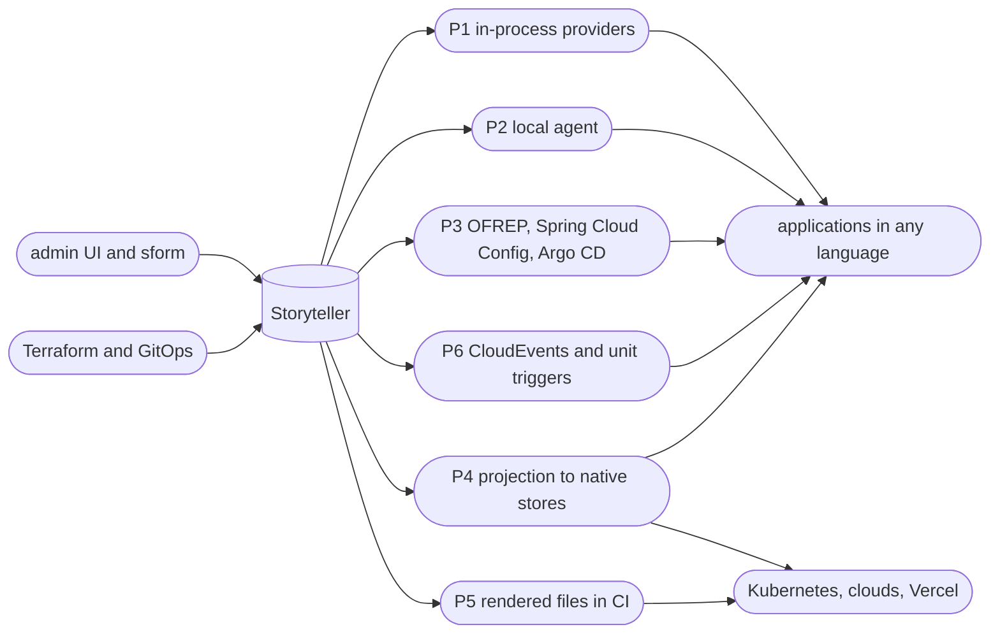
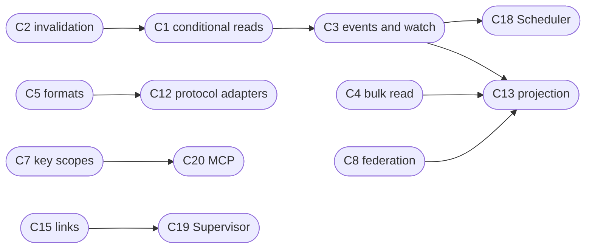

# Study: where and how the 2S Platform can be used

> **Status:** study, written on 2026-10-16. This is not a spec, and nothing in it is decided or implemented. It takes the platform as it is on `main` at commit `908ff981` (platform version `0.9-alpha`, OpenAPI `0.9.15`) and explores where the platform can be integrated next: as the configuration source of applications written in other languages, as the single source of truth for infrastructure, and as a centralized configuration source in the public clouds. Facts about third-party products were checked against their documentation in October 2026; the links are collected in [References](#21-references).

## Contents

1. [Summary](#1-summary)
2. [The platform today](#2-the-platform-today)
3. [One contract for every integration](#3-one-contract-for-every-integration)
4. [Integration patterns](#4-integration-patterns)
5. [.NET, the reference provider](#5-net-the-reference-provider)
6. [Java and the JVM](#6-java-and-the-jvm)
7. [Rust](#7-rust)
8. [JavaScript and TypeScript](#8-javascript-and-typescript)
9. [Python](#9-python)
10. [Go](#10-go)
11. [Cross-language standards worth adopting](#11-cross-language-standards-worth-adopting)
12. [Kubernetes as a consumer of the catalog](#12-kubernetes-as-a-consumer-of-the-catalog)
13. [Vercel and other hosting platforms](#13-vercel-and-other-hosting-platforms)
14. [Infrastructure as code and CI/CD](#14-infrastructure-as-code-and-cicd)
15. [Cloud providers](#15-cloud-providers)
16. [More use cases](#16-more-use-cases)
17. [Positioning against adjacent products](#17-positioning-against-adjacent-products)
18. [Platform capabilities to add](#18-platform-capabilities-to-add)
19. [Suggested roadmap](#19-suggested-roadmap)
20. [Risks and open questions](#20-risks-and-open-questions)
21. [References](#21-references)

## 1. Summary

The 2S Platform has a strong and unusual core: a catalog that says *who uses what, and where*, with inherited, schema-checked, versioned configuration attached to exactly those relations. No product found in this study combines that graph and that merge with validity windows, schedules and, once Supervisor exists, health supervision. What the platform lacks is the last mile to running software:

- there is no configuration provider in any language, not even .NET;
- there is no change signal;
- machines need stored secrets;
- the Supervisor and Scheduler actors are still scaffolding.

The study's findings:

1. **The model reaches far beyond application configuration.** The test for a use case is whether its questions read *"for this one, in that world, with which capability, configured how, and scheduled when?"*. Kubernetes fleets, Vercel estates, multi-tenant SaaS control planes, entitlements, progressive delivery, job catalogs, data pipelines, device fleets, compliance registers (DORA, NIS2, GDPR), cost allocation and AI agents all pass that test ([16](#16-more-use-cases)).
2. **One contract before many SDKs.** The execution key (`@house.main.default.exe.northwind.invoicing.production`) is the identity of a running piece. A shared contract fixes, once, everything the SDKs must agree on:
   - environment variables (`STORYTELLER_*`);
   - flattening rules per framework, and precedence among local sources;
   - refresh, resilience and secret handling;
   - catalog and subscription APIs, unit invocations as CloudEvents, and telemetry attributes;
   - typed configuration generated from the schemas;
   - a conformance suite ([3](#3-one-contract-for-every-integration)).
3. **Start with two small, universal integrations.** Rendering in CI (P5) needs only a non-interactive CLI sign-in and flattened output. A local agent (`run`, `render`, `serve`) gives every language a working, cached, credential-free integration before any native SDK exists ([4](#4-integration-patterns)).
4. **Then native providers, in this order:**
   - .NET as the reference: `IConfigurationSource`, a hosting package with "who am I", subscriptions and unit handlers, and Aspire.
   - Spring Boot's ConfigData API.
   - Node.js and the full-stack frameworks, which have strict server and browser rules.
   - Python's pydantic-settings.
   - Rust's config-rs and figment.
   - Go's koanf ([5](#5-net-the-reference-provider) to [10](#10-go)).
5. **Speak protocols that already have clients.** Each of these turns one server feature into many integrations ([6.2](#62-spring-cloud-config-protocol-zero-code-for-many-clients), [11](#11-cross-language-standards-worth-adopting), [12.5](#125-gitops-argo-cd-flux-and-helm), [14.2](#142-other-infrastructure-tools)):
   - OFREP, for every OpenFeature SDK. flagd's targeting is JSON Logic, which Storyteller already evaluates.
   - The Spring Cloud Config protocol, for Spring, Quarkus, Micronaut and Steeltoe.
   - Argo CD's ApplicationSet plugin generator.
   - Pulumi ESC's external adapter.
   - The External Secrets Operator's webhook provider.
6. **Kubernetes.** An operator modelled on Azure App Configuration's Kubernetes provider, projected service-account tokens instead of stored keys, the Argo CD plugin generator for placement, and units of execution projected as `CronJob`s, with time zone, suspend and validity windows ([12](#12-kubernetes-as-a-consumer-of-the-catalog)).
7. **Vercel.** Environment variables (Config and Secret types) through the REST API, Global Config for runtime flags, a Marketplace native integration for the most native experience, and Vercel's OIDC tokens to pull without secrets ([13](#13-vercel-and-other-hosting-platforms)).
8. **Clouds.** There are three strategies: pull with the cloud's own workload identity, project into the cloud's native stores, or keep secrets there and reference them ([15](#15-cloud-providers)).
   - **Production-critical paths should use projection:** App Configuration and Key Vault, AWS AppConfig with its safe deployments, Parameter Store and Secrets Manager, Google Parameter Manager and Secret Manager.
   - **Accept every cloud's workload tokens, including AWS's new outbound federation, and become an OIDC issuer.** Storyteller can then write into customer accounts without keys.
   - **Copy the proven design of Infisical's syncs and Vault Secrets Sync,** and describe the syncs with the platform's own annotations.
9. **The platform needs a short list of capabilities** ([18](#18-platform-capabilities-to-add)). The most important:
   - conditional reads and change events;
   - bulk reads and flattened formats;
   - key-scoped and federated machine identities;
   - a non-interactive CLI;
   - OFREP;
   - a projection engine;
   - **typed links between responsibilities**. These are the missing "relations between applications" that would let the catalog answer blast-radius questions, and let Supervisor detect architecture drift.
10. **Position the platform as a hub that interoperates through standards.** It should not compete with vaults, flag platforms and developer portals. That market is consolidating: HCP Vault Secrets has reached end of life, and Hypertune has shut down. Standards (OpenFeature, CloudEvents, OpenTelemetry, MCP, JSON Schema) outlive vendors ([17](#17-positioning-against-adjacent-products)).

The study also surfaced five defects or gaps in the code that matter to every future consumer:

- the first configuration write on an ancestor does not invalidate cached descendants (G4);
- the `Hash` of a resolved read ignores bound values (G3);
- a machine's `annotationKey` claim is never enforced (G7);
- the OpenAPI document does not reference its `apiKey` and `mtls` schemes (G10);
- `FullKey.TryParse` rejects unit-of-execution keys (C24).

## 2. The platform today

This section is the baseline. Every later proposal builds on these facts, and most of them were read from the code, not only from the documentation.

### 2.1 What Storyteller keeps

| Area | What exists | Documented in |
| --- | --- | --- |
| Catalog | Seven annotation types: subject, context, responsibility and unit, plus the relations usage (`usg.{subject}.{responsibility}`), execution (`exe.{subject}.{responsibility}.{context}`) and unit of execution. Every record has a title, description, documentation link, labels, free `values`, `isDisabled`, `validFrom`, `expiresAt` and `timeZone`. Reads return active records unless asked otherwise. Deletes are soft for 90 days, and every change is audited. | [annotations](../42for.net/platform/annotations.md), [lifecycle](Storyteller/annotation-lifecycle.md) |
| Configuration | One JSON document per annotation. Reading a key returns the **effective** document: the ancestors merged from responsibility to execution, with type templates. Objects merge, scalars are replaced, arrays are unioned and nulls are ignored. Writes are versioned and diffable, and JSON Schemas per type, per descendant type and per key are checked on write. **Views** are parallel editions of a project that can be diffed before a service is pointed at them. | [configuration](../42for.net/platform/configuration.md), [inheritance](Storyteller/inheritance.md), [schemas](Storyteller/definitions.md), [templates](Storyteller/templating.md) |
| Resolution | The **resolved** document evaluates `@` bindings: key/value pairs (`@db.host`), named sources (`@(db.password, primaryVault)`), `@config`, `@annotation`, interpolation and math. Objects can also be bound with JSON Logic and JSON-e, under evaluation limits. | [binding](Storyteller/binding.md) |
| Key/values | A native store per view with five protection levels: `Public`, `Standard`, `Hsm`, `Byok` and the client-side `Hyok`. References point into the customer's own vault (`kv://…` or Azure App Configuration's Key Vault reference content type). A key/value document can be exported and imported as JSON, flat JSON or `.env`. | [key-values](Storyteller/key-values.md) |
| Transfer | The own documents of a view are exported as a zip of JSON files or as a git repository with one commit per version, and imported back. | [configuration-transfer](Storyteller/configuration-transfer.md) |
| Access | Organizations and projects carry roles. Users sign in through Entra ID or WorkOS AuthKit. Machines authenticate with a structured `2s.` API key, an mTLS certificate, both together, or OAuth client credentials (AuthKit, Entra ID or Keycloak). Machines receive secrets with the `Configuration.Secrets` scope, and by default only over mTLS. | [authentication](Storyteller/authentication.md), [access](Storyteller/access.md) |

The model is generic on purpose. The [examples](../42for.net/platform/examples/index.md) use the same seven types for a B2B SaaS, a consumer finance suite, a distributed platform, a versioned monolith, a physical product and a device fleet. That generality is what makes the use cases in this study possible: what changes between them is the meaning of subject, context and responsibility, not the platform.

### 2.2 How the platform is reached today

| Client | State |
| --- | --- |
| Storyteller API | `Storyteller/Api.Functions` on Azure Functions (isolated worker, .NET 10). It has 126 HTTP operations, one queue trigger for transfers and three timers. The OpenAPI document `open.api.v0.9.15.json` is also served at `/api/openapi/v3.json`. `Api.Web` is a legacy prototype with no configuration endpoints. |
| `sform` | A .NET tool built on the NSwag SDK. It covers the catalog, configuration (including `--resolved`), schemas, templates, key/values, export/import and machines. Its only sign-in is the interactive device code. |
| C# SDK | `42.Platform.Storyteller.Sdk.NSwag`, generated from OpenAPI 0.9.15 and registered with `AddStorytellerSdk`. A token factory sends either `Bearer` or `ApiKey`, and a client certificate is optional. It has no retries and does not expose response headers. `sform` is its only consumer. |
| TypeScript SDK | `@42for.net/2splatform.sdk` 0.9.15, generated by Orval: a fetch client, Vue Query, Zod and MSW. It adds helpers for keys, paging and errors, conversion between `.env`, flat JSON and the key/value document, and WebCrypto HYOK. Authentication is a bearer token from `configureStoryteller`. It is not published. |
| Admin UI | `ui.admin`, Vue 3, built on the TypeScript SDK. |
| Leftovers | `Sdk.Kiota` (OpenAPI 0.8, unused), `src/Platform/Sdk` (RestSharp, 0.8, unused), and `Libraries/Utils/Configuration.Substitute` (an `IConfiguration` wrapper with `@` substitution, unused and unrelated to Storyteller). |

### 2.3 Actors that are still scaffolding

- **Supervisor:** `Supervisor/Abstraction` defines `IReport` and `ReportType` (`Trace`, `Info`, `Warning`, `Error`, `HealthCheck`, `Event`, `Workflow`, `Action`). The Functions host only answers "Hello, World".
- **Scheduler & Initiator:** an empty Functions host. Unit annotations already carry `unitType` (`time`, `message`, `file`, `event`) and `unitDefinition` (a CRON expression, a message template or a file pattern), but nothing interprets them yet.
- **Crumble** is not part of the platform today. It already has `[TimeAction]` with CRON and time zone, plus queue and blob actions on Orleans, but no link to Storyteller.

### 2.4 What a configuration consumer misses today

The catalog and the merge are mature. The part that turns Storyteller into the configuration source of a *running* application is missing. These gaps shape most of the proposals below.

| # | Gap | Evidence | Consequence |
| --- | --- | --- | --- |
| G1 | No configuration provider in any language, .NET included | No `IConfigurationSource` or `IConfigurationProvider` exists in `src/` | Every application writes its own glue |
| G2 | No change signal | No `ETag`, `If-None-Match` or `304`. No long-poll, SSE, webhook or event. A client can only compare the `Hash` of a body it has already downloaded, or list `Hash` and `Version` per key with `GET …/configurations` | Clients can only poll by re-reading |
| G3 | `Hash` describes the effective, unresolved document | `CalculatedContentHash` (MurmurHash3 of the merge). The resolved read returns the same hash | A changed key/value pair, Key Vault secret or annotation `values` changes the resolved output without changing the hash |
| G4 | A first write to an ancestor that had no document does not invalidate cached descendants | The create path of `CosmosConfigurationService.CreateOrUpdateConfigurationAsync` skips `InvalidateConfigurationsAsync`; documented in [inheritance](Storyteller/inheritance.md#cache-and-descendant-freshness) | A provider can serve an outdated effective document until another write clears the cache |
| G5 | No bulk read | One request per resolved key | A process serving many tenants, or a sync job, needs N requests |
| G6 | No flattened form of a configuration | `sform story config` writes the whole `Configuration` model as JSON. Only key/values export as `.env` or flat JSON | Every consumer flattens JSON on its own |
| G7 | Machines are scoped to a project, not to their annotation | `MachineAccess.AnnotationKey` is copied into an `annotationKey` claim that nothing checks | Any machine of a project can read every configuration of that project |
| G8 | No workload identity federation | Machines use static API keys, certificates or client secrets. No Kubernetes service-account tokens, GitHub/Vercel OIDC tokens or bring-your-own managed identities | Every deployment target needs a stored secret ("secret zero") |
| G9 | No non-interactive CLI sign-in | `sform account` only offers the device code | `sform` cannot run in CI/CD |
| G10 | The OpenAPI document under-describes machine auth | The `apiKey` and `mtls` schemes are declared but not referenced by operations | Clients generated in other languages do not know an API key works |
| G11 | mTLS depends on the host's front end | The certificate is read from `X-ARR-ClientCert`, as App Service and Functions forward it, and only when `MachineAuth:IsCertificateHeaderFromClientAllowed` is set | Another hosting shape needs an equivalent proxy |
| G12 | One deployment shape, without delivery artifacts | Functions plus Cosmos DB. The Dockerfile is stale, and there is no IaC, Helm chart or multi-region read path | Cold starts and regional outages land on every application start |
| G13 | Validity does not apply to configuration | By design, an expired or disabled execution still resolves | A consumer that treats the catalog as its subscription state must check the annotation status itself |

## 3. One contract for every integration

Each language and each platform will get its own integration, but they should all behave the same way. This section proposes the shared contract first, so that a Spring Boot service, a Next.js app, a Kubernetes operator and a .NET worker read the same execution key and see the same document. [OpenTelemetry](https://opentelemetry.io/docs/specs/otel/configuration/sdk-environment-variables/) works this way: one set of `OTEL_*` variables and semantics, many SDKs.

### 3.1 The execution key is the identity of a running piece

A running process knows which subject it serves, with which capability, in which world. That triple is an execution, and its full key already carries everything else:

```text
@house.main.default.exe.northwind.invoicing.production
 │     │    │       └─ annotation key: subject northwind, responsibility invoicing, context production
 │     │    └──────── view
 │     └───────────── project
 └─────────────────── organization
```

A job adds the unit and becomes a unit of execution. A process that serves many subjects, such as a multi-tenant worker, holds the responsibility and context and discovers the subjects through the catalog ([3.8](#38-catalog-and-subscriptions)). One caveat: `FullKey.TryParse` accepts five to seven segments today, so the eight segments of a unit-of-execution full key do not parse yet.

Every SDK, the agent, the Kubernetes operator and CI integrations should read the same variables:

| Variable | Meaning | Example |
| --- | --- | --- |
| `STORYTELLER_ENDPOINT` | Base address of the API | `https://storyteller.example.com/api` |
| `STORYTELLER_KEY` | Full key of the execution or unit of execution | `@house.main.default.exe.northwind.invoicing.production` |
| `STORYTELLER_API_KEY` | Structured `2s.` API key | `2s.<base64url(org:project:machine)>.<secret>` |
| `STORYTELLER_CLIENT_CERTIFICATE`, `…_PASSWORD` | Path to a PKCS#12 machine certificate | `/var/run/secrets/storyteller/machine.p12` |
| `STORYTELLER_CLIENT_ID`, `…_CLIENT_SECRET`, `…_TOKEN_URL`, `…_TOKEN_SCOPE` | OAuth client credentials, as printed by `sform account machine create` | |
| `STORYTELLER_TOKEN_FILE` | A federated token on disk: a projected service-account token or a CI OIDC token ([18](#18-platform-capabilities-to-add)) | `/var/run/secrets/tokens/storyteller` |
| `STORYTELLER_MODE` | `resolved` (default) or `effective` | `resolved` |
| `STORYTELLER_REFRESH_INTERVAL` | Polling interval, `0` disables refresh | `30s` |
| `STORYTELLER_OPTIONAL` | Start without the platform when it is unreachable and nothing is cached | `false` |
| `STORYTELLER_CACHE_DIR` | Where the last-known-good document is kept | `/var/cache/storyteller` |

### 3.2 Reads a provider makes

1. **The document.** `GET /v1/{org}/{project}/{view}/configuration/{key}/resolved`. It returns the effective document with bindings evaluated, and with secrets if the caller is allowed to receive them. `…/configuration/{key}` without `/resolved` returns the effective document with the `@` expressions as written, which is useful for diagnostics.
2. **Who am I.** `GET …/annotations/{key}`, plus the ancestors when needed: title, labels, `values`, status and validity of the execution, its subject, context and responsibility. A deleted key answers `404`. An inactive key answers `404 AnnotationInactive`, so the provider can tell a missing subscription from an expired one ([3.8](#38-catalog-and-subscriptions)).
3. **The neighbours**, for processes that serve many subjects. `GET …/executions?responsibilityNameQuery=invoicing&contextNameQuery=production`, or `GET …/annotations/rst.invoicing/executions`, lists the executions of the responsibility.
4. **Change detection.** Today: poll `GET …/configurations?keyPrefix=…` and compare `Hash`, and also re-read the resolved document on a slower cadence, because of G3 and G4. Later: conditional reads and a watch channel ([18](#18-platform-capabilities-to-add)).

### 3.3 From one JSON document to framework keys

Most frameworks do not take a JSON tree; they take flat keys. The flattening must be specified once and tested with shared vectors, because every ecosystem spells it differently. For the document `{"db":{"hosts":["a","b"],"port":5432},"features":["vat"]}`:

| Target | Keys |
| --- | --- |
| .NET `IConfiguration` | `db:hosts:0=a`, `db:hosts:1=b`, `db:port=5432`, `features:0=vat` |
| Spring `Environment`, MicroProfile Config, Quarkus | `db.hosts[0]=a`, `db.hosts[1]=b`, `db.port=5432`, `features[0]=vat` |
| Environment variables, `.env` | `DB__HOSTS__0=a`, `DB__HOSTS__1=b`, `DB__PORT=5432`, `FEATURES__0=vat` (the `__` convention of the key/value `.env` export, readable by .NET, pydantic-settings and config-rs) |
| Go koanf and Viper | `db.hosts` as a list, `db.port`, with `.` as the delimiter |
| Python, Rust, TypeScript | The nested object as it is, deserialized into a typed model |

The rules the vectors should pin down:

- Numbers and booleans become their JSON text in string-only systems.
- Null never appears, because the merge already ignores it.
- An empty array or object produces no key.
- A property name that contains the target's delimiter (`:` for .NET, `.` for Spring) is escaped or rejected.
- Key casing is kept. .NET and Spring compare keys case-insensitively, so two JSON properties that differ only in case are a validation error.

### 3.4 Precedence among local sources

The platform is one configuration layer among the local ones. The recommended default order, from lowest to highest, is:

```text
code defaults  <  packaged files (appsettings.json, application.yml, .env)  <  the platform  <  environment variables  <  command line
```

The platform wins over packaged files because it is the source of truth for shared and per-customer values. Environment variables and the command line stay above it as the local break-glass and for development. A strict mode can put the platform last, so that nothing local can override a governed value.

Spring Boot's `spring.config.import` produces exactly this default order: the imported data overrides the file that imports it, and environment variables and command-line arguments still win. In .NET, a source added at the end of the builder wins over everything. That is how [Azure App Configuration's provider](https://learn.microsoft.com/en-us/azure/azure-app-configuration/reference-dotnet-provider) is usually added, and it corresponds to the strict mode.

### 3.5 Refresh

The Azure App Configuration providers for .NET, Java, Python, JavaScript, Go and Kubernetes have converged on the same semantics, and the platform's providers should copy them:

- **Pull on an interval.** Pull every 30 seconds by default, with jitter so that a fleet does not poll in lockstep.
- **Refresh on activity.** A refresh never blocks a caller and never runs twice at once.
- **Server-advised intervals.** A server-advised interval is better still: AWS AppConfig's data plane returns the next poll interval with every answer.
- **Apply atomically.** Parse, bind and validate the new document locally, then swap. A document that does not bind keeps the previous one, and the failure is logged and counted.
- **Raise one change notification per applied document:**
  - `IOptionsMonitor` and change tokens in .NET;
  - a `RefreshEvent` in Spring Cloud, which re-runs the configuration loaders;
  - a callback or an async iterator elsewhere.
- **Push only says "dirty".** Push notifications carry no data. They tell the clients that something changed, and each client refreshes after a short random delay. This keeps the read path the only path, and a burst of changes does not become a burst of synchronized reads.
- **Secrets have their own schedule.** A rotated Key Vault secret or key/value secret does not change the effective document ([G3](#24-what-a-configuration-consumer-misses-today)), so resolved secrets and references are refreshed on their own, slower interval.
- **Restart-only values.** Some values only take effect after a restart, such as pool sizes and listening ports. A schema extension such as `"x-2s-reload": "restart"` on a property lets a provider log a warning, or the agent restart the process, instead of silently ignoring the change.

### 3.6 Resilience

The platform must not become the single point of failure of every application.

- **Start:** required (fail fast) or optional (`STORYTELLER_OPTIONAL`). An optional provider starts from the cache, or from defaults when nothing is cached.
- **Last known good:** the provider keeps the last applied document on disk. Secret values are either left out of that cache, or encrypted with DPAPI, the Keychain, libsecret or a mounted Kubernetes secret.
- **Calls:** short timeouts (2 s), exponential backoff with jitter, and a circuit breaker.
- **Static stability:** once a process has started, an outage of the platform must not change its behaviour. It keeps serving the last known good document and reports itself degraded.

### 3.7 Secrets

A secret can reach an application in three ways. In order of preference:

1. **A reference, resolved locally.** The value is a `kv://vault/name` reference or an Azure App Configuration Key Vault reference, stored as a public pair. The SDK resolves it with the application's own cloud identity, so the platform never sees the secret. Azure Key Vault comes first; AWS Secrets Manager, Google Secret Manager and HashiCorp Vault use the same resolver interface.
2. **A client-side encrypted value (HYOK).** The SDK decrypts it with the recipient's private key, using `KeyValues.ClientEncryption` in .NET and the `./hyok` subpath in TypeScript. Other languages need a JWE library that supports `RSA-OAEP-256` and `A256GCM`.
3. **A server-side secret in the resolved read.** This needs `Configuration.Secrets`, and mTLS under the default project policy. When the policy withholds secrets, the response carries `X-2S-Secrets-Withheld`, and a provider should fail loudly rather than start with the literal `@` expressions.

Two rules hold in every language:

- Secrets never go into browser bundles. That includes `NEXT_PUBLIC_*`, `VITE_*` and Nuxt's `public` runtime config.
- Logs never show secret values. A provider can only redact what it can identify, so the resolved read should report which JSON paths came from secret sources ([18](#18-platform-capabilities-to-add)).

### 3.8 Catalog and subscriptions

The configuration is only half of what a service gets from Storyteller. The other half is the catalog: the platform's own vocabulary calls it the subscription catalog. Every SDK should offer four small things on top of the configuration:

| Capability | Question it answers | Built from |
| --- | --- | --- |
| Who am I | Which customer, capability and world is this process serving, and what is their title, labels and `values`? | The annotation of the execution and its ancestors |
| Is it active | Is the subscription disabled, scheduled or expired right now? | The status of the usage and of the execution ([lifecycle](Storyteller/annotation-lifecycle.md#active-annotations)) |
| Entitlements | Is this subject allowed to use this feature, and with which plan and seats? | The usage document and its `values` |
| Subscription informer | Which subjects use my responsibility in my context, and who was added, changed or removed? | A list of executions, then refresh. The same list-then-watch shape as a [Kubernetes informer](https://pkg.go.dev/k8s.io/client-go/tools/cache) |

The informer is what lets one worker process serve a hundred customers: it starts, stops and reconfigures per-subject processing as executions appear, change and expire, and the operators never touch the worker.

### 3.9 Units and jobs

The Scheduler & Initiator will fire units. Two shapes fit every language:

- **Invocation.** The Scheduler sends a [CloudEvents 1.0](https://github.com/cloudevents/spec) event for every due unit of execution. Proposed fields:

  ```json
  {
    "specversion": "1.0",
    "type": "net.42for.storyteller.unit.due",
    "source": "/house/main/default",
    "subject": "uxe.northwind.invoicing.production.nightly-export",
    "id": "uxe.northwind.invoicing.production.nightly-export@2026-10-17T02:00:00+02:00",
    "time": "2026-10-17T00:00:03Z",
    "data": { "scheduledAt": "2026-10-17T02:00:00+02:00", "timeZone": "Europe/Oslo", "configurationHash": "3fa2c1d0", "attempt": 1 }
  }
  ```

  - **Delivery:** a signed HTTP call, an Azure Storage queue, Service Bus, SQS, Pub/Sub, a Kubernetes `Job`, or Dapr.
  - **Handlers:** each SDK registers a handler per unit name. The handler receives the resolved configuration of the unit of execution, and uses the `id` (key plus scheduled time) as its idempotency key, because delivery is at least once.
- **Projection.** The Scheduler does not fire the job itself. It writes the schedule into a native scheduler that the team already runs: a Kubernetes `CronJob` ([12.6](#126-units-become-cronjobs)), AWS EventBridge Scheduler, Google Cloud Scheduler, Quartz.NET, Hangfire, or Crumble's `TimeAction`. The unit's `timeZone`, `isDisabled`, `validFrom` and `expiresAt` map almost one-to-one onto these schedulers' time zone, suspend, start and end fields.

### 3.10 Telemetry carries the key

Every SDK should set OpenTelemetry resource attributes from the execution key:

- `service.name` = the responsibility.
- `deployment.environment.name` = the context, when the context is an environment.
- `storyteller.key`, `storyteller.subject`, `storyteller.context`, `storyteller.view`, plus `storyteller.configuration.hash` on configuration spans.

The prefix is `storyteller.` because some telemetry backends do not accept label names that start with a digit, so `2s.*` would be dropped or rewritten.

Logs, traces and metrics then point back into the catalog. An incident starts from an attribute, and the attribute already names the customer, the capability and the world. Supervisor can then build its picture of "what is running" from standard OTLP telemetry instead of a custom SDK in each language ([11](#11-cross-language-standards-worth-adopting)).

### 3.11 Typed configuration from schemas

`GET /v1/{org}/{project}/{view}/configuration-schema/{key}/definition` returns the combined schema that every write of that key must satisfy. Generating types from it gives the service a compile-time contract that matches the write-time contract:

| Language | Generator |
| --- | --- |
| C# | NJsonSchema (already used by Storyteller) or Corvus.JsonSchema |
| Java, Kotlin | jsonschema2pojo |
| TypeScript | json-schema-to-typescript, or json-schema-to-zod for runtime validation |
| Python | datamodel-code-generator, which produces pydantic models |
| Rust | typify |
| Go | go-jsonschema |

The responsibility owns its schema (for example `rst.invoicing` with a descendant schema for `exe`), so the team that owns the code also owns the generated type.

### 3.12 Conformance

A shared conformance suite makes "behaves the same" testable. It is a folder of JSON test vectors with:

- documents and their expected flattened keys per target;
- refresh scenarios (change, error, timeout, withheld secrets);
- error mappings (`401`, `403 MtlsRequired`, `404 AnnotationInactive`, `422 binding.*`, `503`).

Every provider runs the suite in its own CI, the way OpenFeature SDKs share a Gherkin suite.

## 4. Integration patterns

There are six ways to get Storyteller's data to a consumer. They are complementary, and a mature setup uses several of them.

| Pattern | How it works | Freshness | Platform on the critical path | Where secrets end up | Reach | Effort |
| --- | --- | --- | --- | --- | --- | --- |
| **P1 In-process provider** | The framework's configuration extension point calls the API | Seconds (poll), push later | At start, softened by the cache | Process memory | One language per provider | Medium per language |
| **P2 Local agent** | One binary authenticates, caches and refreshes. It serves `localhost`, writes files, or wraps the process and injects environment variables | Seconds | No: the agent caches | The agent holds the credentials | Every language | Medium, once |
| **P3 Protocol endpoints** | Storyteller speaks a protocol that existing clients already use: OFREP, Spring Cloud Config, Argo CD's plugin generator, flagd sync | Per client | Yes, per client | As the API | Every client of that protocol | Small to medium each |
| **P4 Projection** | Storyteller, or a sync worker, pushes documents into native stores: Kubernetes, Azure App Configuration, AWS AppConfig and Parameter Store, Google Parameter Manager, Vercel, GitHub | Sync interval | No | In the target store | Everything that reads that store | Medium per target |
| **P5 Render at build or deploy** | The CLI renders `.env`, JSON, YAML or Helm values in CI or in a GitOps repository | Per deployment | No | In the artifact or deployment secret | Everything | Small |
| **P6 Events and triggers** | Storyteller and the Scheduler emit CloudEvents: configuration changed, unit due | Push | For triggers only | None | Everything that takes CloudEvents | Medium |



How to choose:

- **Start with P5 and P2.** Rendering in CI needs only a non-interactive CLI sign-in (G9) and a flattened output (G6). The agent gives every language a working integration before any native provider exists.
- **Use P1 where the framework has a first-class configuration model and live reload matters:** .NET first, then Spring Boot, Node.js and Python.
- **Use P4 for cloud-native consumers** that cannot call a third-party API, or should not have one on their critical path: App Service settings, Lambda, Cloud Run, Kubernetes manifests, Vercel builds.
- **Use P3 when a protocol has a large installed base.** Implementing it once makes thousands of existing clients work without new code.

### 4.1 The local agent

The agent is the fastest way to make every language a consumer. It implements the contract of section 3 once, in a single static binary (Go or Rust), and hands the result to the application in whatever form the application already understands. [AWS AppConfig Agent](https://docs.aws.amazon.com/appconfig/latest/userguide/appconfig-agent.html) (a cached `localhost:2772` endpoint), `doppler run`, `op run` and `dotenvx run` prove that developers accept this shape.

| Mode | What it does | Good for |
| --- | --- | --- |
| `storyteller-agent run -- node server.js` | Fetches the document, exports it as environment variables (the `__` convention), starts the child process, and restarts it on a change when asked to | Any process, containers, Procfiles, local development |
| `storyteller-agent render --output /config` | Writes `json`, `yaml`, `properties` or `.env` files atomically (write, then rename), once or on every change | Frameworks that watch files: .NET `AddJsonFile(reloadOnChange)` and key-per-file, Spring `configtree:` and `file:` imports, Micronaut `configtree://`; Kubernetes init containers |
| `storyteller-agent serve` | Serves `GET /v1/configuration[/{key}]?format=…` and `GET /v1/whoami` on a fixed localhost port, with `ETag` and `304`, from its cache | Sidecars, DaemonSets, systemd services on VMs and edge devices, and native providers that should not hold credentials |

In every mode the agent:

- holds the credential (API key, certificate or federated token file), so the application never sees it;
- keeps the last known good document;
- backs off when the platform is unavailable;
- emits OpenTelemetry metrics with the `storyteller.*` attributes.

Once watch (C3) exists, the agent gets changes pushed and stops polling. The native providers of sections 5 to 10 can then talk to the agent instead of the API, which keeps credentials and caches in one place per node.

## 5. .NET, the reference provider

.NET is where the platform's own clients live and where the road map promises "a powerful SDK for any .NET application" (version 1.2). The .NET provider should be the reference implementation of the contract in section 3. The other languages follow its behaviour and its conformance suite.

### 5.1 Packages

| Package (proposal) | Contents |
| --- | --- |
| `42.Platform.Storyteller.Configuration` | `IConfigurationBuilder.AddStoryteller(…)`: a `ConfigurationProvider` that loads, flattens, refreshes and caches the document, and resolves `kv://` and Key Vault references locally |
| `42.Platform.Storyteller.Hosting` | `IExecutionContext` (who am I), `ISubscriptionCatalog` (status, entitlements, informer), unit handlers, health publisher, OpenTelemetry resource detector |
| `42.Platform.Storyteller.FeatureManagement` | The bridge to `Microsoft.FeatureManagement` and to OpenFeature |
| `42.Platform.Storyteller.Aspire.Hosting` | An Aspire resource that passes the `STORYTELLER_*` variables to projects |
| `42.Platform.Storyteller.Sdk.NSwag` (exists) | The transport. It needs retries (`Microsoft.Extensions.Http.Resilience`), access to response headers, and a token provider for client credentials and federated tokens |

### 5.2 Shape in `Program.cs`

```csharp
var builder = WebApplication.CreateBuilder(args);

builder.Configuration.AddStoryteller(options =>
{
    options.Key = "@house.main.default.exe.northwind.invoicing.production"; // or STORYTELLER_KEY
    options.Mode = StorytellerReadMode.Resolved;
    options.RefreshInterval = TimeSpan.FromSeconds(30);
    options.Optional = builder.Environment.IsDevelopment();
    options.Credential = StorytellerCredential.FromEnvironment();          // API key, certificate, client credentials, token file
    options.ReferenceResolver = new KeyVaultReferenceResolver(new DefaultAzureCredential());
    options.Placement = SourcePlacement.BeforeEnvironmentVariables;        // appsettings.json < Storyteller < env < command line
});

builder.Services.AddStoryteller()                                         // IExecutionContext, ISubscriptionCatalog, telemetry
    .AddUnitHandler<NightlyExportHandler>("nightly-export");

builder.Services.Configure<InvoicingOptions>(builder.Configuration);      // IOptionsMonitor<InvoicingOptions> follows refreshes
```

`AddStoryteller` inserts its source in front of the unprefixed environment-variables source. That placement is what makes the precedence of [3.4](#34-precedence-among-local-sources) the default. `SourcePlacement.Last` is the strict mode.

Implementation notes:

- **Base class.** The provider derives from `ConfigurationProvider` and fills `Data` with the keys of [3.3](#33-from-one-json-document-to-framework-keys). `Load()` is synchronous, so the first read blocks start once, within a time limit. After that, a background timer refreshes and calls `OnReload()`, which wakes `IOptionsMonitor<T>` and `IChangeToken` consumers. Azure App Configuration's provider works the same way, with an explicit `IConfigurationRefresher` that can also be triggered on demand.
- **Resolved or effective.** `Resolved` is the default for applications. `Effective` serves tooling and tests that want the `@` expressions as written.
- **References.** A pair with the content type `application/vnd.2s.secret-reference` or Azure's Key Vault reference content type stays a reference in the resolved document. The provider resolves it through `ISecretReferenceResolver`. Implementations for Key Vault, AWS Secrets Manager and Google Secret Manager are separate packages.

### 5.3 Many subjects in one process

A worker that serves every customer of `rst.invoicing` should not hold one provider per customer in its `IConfiguration`. It needs:

- `ISubscriptionCatalog.WatchExecutionsAsync("invoicing", context: "production")`: the informer of [3.8](#38-catalog-and-subscriptions).
- `IStorytellerDocuments.GetAsync(executionKey)`: an in-memory cache of resolved documents per key, refreshed with the informer. A [bulk read](#18-platform-capabilities-to-add) would make it one request per page instead of one per key.
- Named options per subject: `IOptionsMonitor<InvoicingOptions>.Get("northwind")`, built by an `IConfigureNamedOptions<T>` that binds the cached document of that subject. Code written for one tenant then works for many.
- An ASP.NET Core middleware that maps the tenant of a request (host name, header or token claim) to its execution key and puts that tenant's options into the request scope.

### 5.4 Azure Functions and Aspire

- **Azure Functions (isolated worker).** The provider works in `Program.cs`, but binding expressions such as `%QueueName%` and timer schedules are resolved by the Functions host from app settings, not from the worker's `IConfiguration`. Values that drive triggers must therefore be projected into app settings ([15.2](#152-azure)) or rendered at deploy time.
- **Aspire, hosting integration.** A [hosting integration](https://aspire.dev/integrations/custom-integrations/hosting-integrations/) adds `builder.AddStoryteller("storyteller")`, a resource that implements `IResourceWithConnectionString`. `WithReference(storyteller)` passes the endpoint and credentials to .NET projects, and as plain environment variables to Node.js, Python or Java projects started by the same AppHost. A small extension (`.WithExecution("exe.northwind.invoicing.dev")`) adds `STORYTELLER_KEY`.
- **Aspire, client integration.** A client integration mirrors `Aspire.Microsoft.Extensions.Configuration.AzureAppConfiguration`: one call that reads the connection string and adds the configuration provider.
- **Running the platform locally.** The repository's own `Aspire.Host` already runs the platform locally: the Cosmos DB emulator, Azurite, Lowkey Vault and the Functions API. A developer can import a view from git (`sform story config import`) and run the real merge on their machine.

### 5.5 Flags, health and jobs

- **Feature flags.** [Microsoft.FeatureManagement](https://learn.microsoft.com/en-us/azure/azure-app-configuration/feature-management-overview) reads its flags from `IConfiguration` (`feature_management`). A `feature_management` section in a responsibility document, overridden per usage or execution and evaluated with JSON Logic when needed, is enough for `IFeatureManager` to work unchanged. OpenFeature is the cross-language alternative ([11](#11-cross-language-standards-worth-adopting)).
- **Health.** An `IHealthCheckPublisher` and an OpenTelemetry exporter give Supervisor its input, with the resource attributes of [3.10](#310-telemetry-carries-the-key).
- **Units.**
  - `IUnitHandler` with three delivery adapters: an HTTP endpoint (`app.MapStorytellerUnits()`, which checks the signature), a queue processor, and a Crumble bridge that registers `[TimeAction]` schedules from the unit definitions.
  - The road map's "core runtime packages for Azure and Durable functions" fit here too: a durable orchestration per unit of execution gives retries and history for long jobs.

## 6. Java and the JVM

The JVM has the richest configuration ecosystem, and a part of it already speaks a remote protocol that Storyteller can implement. There are two complementary routes: a native Spring Boot module, and the Spring Cloud Config protocol, which reaches Spring, Quarkus, Micronaut and even .NET's Steeltoe without new client code.

### 6.1 Spring Boot: the ConfigData API

Spring Boot 4.1 (as 3.x before it) loads external configuration through the [ConfigData API](https://docs.spring.io/spring-boot/api/java/org/springframework/boot/context/config/ConfigDataLoader.html). It is the same extension point Spring Cloud Config (`configserver:`), Spring Cloud AWS (`aws-parameterstore:`), Spring Cloud Azure (`azureAppConfiguration`) and Spring Cloud GCP (`sm@`, `pm@`) use. A Storyteller module registers a resolver and a loader, and an application imports its execution:

```yaml
# application.yml
spring:
  config:
    import: "optional:storyteller:@house.main.default.exe.northwind.invoicing.production"
storyteller:
  endpoint: https://storyteller.example.com/api
```

```java
// META-INF/spring.factories
// org.springframework.boot.context.config.ConfigDataLocationResolver=net._42for.storyteller.spring.StorytellerLocationResolver
// org.springframework.boot.context.config.ConfigDataLoader=net._42for.storyteller.spring.StorytellerDataLoader

public final class StorytellerLocationResolver implements ConfigDataLocationResolver<StorytellerResource> {
    private static final String PREFIX = "storyteller:";

    @Override
    public boolean isResolvable(ConfigDataLocationResolverContext context, ConfigDataLocation location) {
        return location.hasPrefix(PREFIX);
    }

    @Override
    public List<StorytellerResource> resolve(ConfigDataLocationResolverContext context, ConfigDataLocation location) {
        StorytellerSettings settings = context.getBinder()     // endpoint and credential from the importing file or the environment
            .bind("storyteller", StorytellerSettings.class)
            .orElseGet(StorytellerSettings::fromEnvironment);
        return List.of(new StorytellerResource(location.getNonPrefixedValue(PREFIX), settings));
    }
}

public final class StorytellerDataLoader implements ConfigDataLoader<StorytellerResource> {
    @Override
    public ConfigData load(ConfigDataLoaderContext context, StorytellerResource resource) throws IOException {
        JsonNode document = StorytellerClient.of(resource.settings()).resolved(resource.key());
        Map<String, Object> properties = Flattening.spring(document);   // db.hosts[0], db.port, features[0]
        return new ConfigData(List.of(new MapPropertySource("storyteller:" + resource.key(), properties)));
    }
}
```

- **Precedence comes for free.** Imported data overrides the importing `application.yml`. Environment variables, system properties and the command line still win, which is exactly [3.4](#34-precedence-among-local-sources). Without `optional:`, an unreachable platform fails the start.
- **Refresh with Spring Cloud.** A background poller only has to publish a `RefreshEvent`. Spring Cloud's `ConfigDataContextRefresher` then re-runs the configuration loaders, an `EnvironmentChangeEvent` rebinds JavaBean-style `@ConfigurationProperties`, and `@RefreshScope` beans are recreated.
  - Constructor-bound properties and records are not rebound.
  - Refresh is not supported in native images.
- **Prior art.** Spring Cloud AWS 4 polls with `reload.strategy=refresh|restart_context`. Spring Cloud Azure watches sentinel keys.

### 6.2 Spring Cloud Config protocol: zero code for many clients

The [Spring Cloud Config Server](https://docs.spring.io/spring-cloud-config/reference/quickstart.html) contract is small. It is one `GET /{application}/{profile}[/{label}]` that returns an `Environment`: `name`, `profiles`, `label`, `version`, `state` and an ordered list of `propertySources`, each with a flat `source` map. The client gives the **first** property source the highest priority. If Storyteller serves this contract on a route of its own, every existing client works unchanged:

- Spring Boot (`spring.config.import=configserver:`);
- Quarkus' `quarkus-spring-cloud-config-client`;
- Micronaut's `springcloud://` import;
- Steeltoe's `AddConfigServer` for .NET;
- community clients for Node.js, Go and Python.

| Spring Cloud Config | Storyteller |
| --- | --- |
| `application` | The responsibility |
| `profile` | `{subject}.{context}`. Names never contain dots, so the split is unambiguous |
| `label` | The view |
| `version` | The fingerprint of the resolved document (C1) |
| `propertySources[0]` | The resolved document, flattened. It wins over everything below it |
| `propertySources[1…]` | Optional, off by default: the stored document of each level (execution, context, usage, subject, responsibility), so that `/actuator/env` shows where each value came from. They sit below the first source and never override it. Only a key whose type changed between levels (a scalar replaced by an object) could surface from them |

```yaml
spring:
  config:
    import: "configserver:"
  cloud:
    config:
      uri: https://storyteller.example.com/api/spring-cloud-config/house/main
      name: invoicing
      profile: northwind.production
      label: default
      headers:
        Authorization: "ApiKey ${STORYTELLER_API_KEY}"
```

- **Authentication:**
  - The client sends any header, so an API key works today.
  - It supports mTLS through `spring.cloud.config.tls.*`.
  - Native OAuth client-credentials support was merged in October 2026 but is not in release 5.0.5.
- **Limits:** the protocol is pull-only and has flat string values. Change detection stays with the client's own refresh, or with C3 events relayed to Spring Cloud Bus.

### 6.3 Quarkus, Micronaut and MicroProfile

| Framework | Extension point | Notes |
| --- | --- | --- |
| Quarkus 3 | `io.smallrye.config.ConfigSourceFactory`, registered through `META-INF/services` and typed with `ConfigurableConfigSourceFactory`. The same pattern as the Azure App Configuration, Vault and AWS sources in Quarkiverse | Custom sources are skipped during static init unless marked `@StaticInitSafe`. Build-time properties are frozen into the build. `@ConfigMapping` objects are fixed at start, so live values are read through `Config.getValue` or `Provider<T>` from a live cache. The Spring Cloud Config client extension is the zero-code alternative |
| Micronaut 5 | The experimental `micronaut.config.import` with a `PropertySourceImporter`. Imports are re-resolved on refresh, and `@Refreshable` beans are recreated | `springcloud://` uses 6.2. The older `ConfigurationClient` bootstrap is discouraged |
| MicroProfile Config 3.1 (Open Liberty, Payara, Helidon, WildFly) | `ConfigSource` with an ordinal, or `ConfigSourceProvider`, through ServiceLoader | An ordinal of 200 sits between `microprofile-config.properties` (100) and environment variables (300), which is [3.4](#34-precedence-among-local-sources). `Config` does not cache, so a live source works with `Provider<T>` |
| Jakarta Config | Do not target it | Still "under development" in 2026 |

Flags in Java go through the OpenFeature Java SDK and its OFREP provider ([11.1](#111-openfeature-and-ofrep)). A unit handler in Spring is a bean method behind an annotation such as `@StorytellerUnit("nightly-export")`, fed by the CloudEvents of [3.9](#39-units-and-jobs). Java package names cannot start with a digit, so the platform's `_42` convention becomes `net._42for.storyteller`, with Maven coordinates such as `net.42for.platform:storyteller-spring-boot-starter`.

## 7. Rust

Rust has no dominant application framework, but two configuration crates cover almost every service. Both merge sources in order and deserialize into a `serde` struct, so the integration is a source that returns the document.

| Library | Extension point | Notes |
| --- | --- | --- |
| [config-rs](https://docs.rs/config/latest/config/trait.AsyncSource.html) 0.15 | `AsyncSource` (feature `async`), added with `ConfigBuilder::<AsyncState>::add_async_source` | Later sources override earlier ones. No reload: rebuild and swap |
| [figment](https://docs.rs/figment/latest/figment/trait.Provider.html) 0.10 | `Provider` (`metadata`, `data`), synchronous | Fetch first, then `merge`. Rocket 0.5 is built on figment: `rocket::custom(rocket::Config::figment().merge(…))` |
| Axum, Actix Web | None of their own | Typed settings from config-rs or figment, shared through `State` or `web::Data`. Live values sit behind `arc_swap::ArcSwap` or a `tokio::sync::watch` channel fed by a polling task |
| Loco | YAML files rendered through Tera with `get_env` | No remote hook. The agent supplies environment variables ([4.1](#41-the-local-agent)) |

```rust
#[derive(Debug)]
struct Storyteller { client: storyteller::Client, key: String }

#[async_trait::async_trait]
impl config::AsyncSource for Storyteller {
    async fn collect(&self) -> Result<config::Map<String, config::Value>, config::ConfigError> {
        let document = self.client.resolved(&self.key).await
            .map_err(|error| config::ConfigError::Foreign(Box::new(error)))?;
        Ok(storyteller::to_config_map(document))                      // the nested object, keys as they are
    }
}

let settings: InvoicingSettings = config::ConfigBuilder::<config::builder::AsyncState>::default()
    .add_source(config::File::with_name("config/default"))
    .add_async_source(Storyteller::from_env()?)                      // STORYTELLER_KEY, STORYTELLER_API_KEY, …
    .add_source(config::Environment::default().separator("__"))
    .build().await?
    .try_deserialize()?;
```

The crate (for example `storyteller-config`, with features `config-rs`, `figment` and `watch`) would use `reqwest` with rustls, which also presents mTLS identities. The pre-1.0 [`dynamic-config`](https://docs.rs/dynamic-config) crate shows the reload pattern with `ArcSwap` and remote sources. Rust is also a good language for the agent itself, because of the small static binary and the low memory use on edge devices.

## 8. JavaScript and TypeScript

JavaScript runs in three places with different rules: servers (Node.js, Deno, Bun), server-side rendering frameworks that also build browser bundles, and the browser itself. The rule of [3.7](#37-secrets) matters most here: **anything a bundler inlines is public**.

### 8.1 A server package on top of the existing SDK

`@42for.net/2splatform.sdk` already has the generated fetch client, Zod schemas, paging, errors, `.env` and flat JSON helpers, and HYOK. A small server-only package (for example `@42for.net/2splatform.config`) adds the contract:

```ts
import { createConfiguration } from '@42for.net/2splatform.config'
import { invoicingSchema } from './generated/invoicing.zod'        // generated from the responsibility's JSON Schema

export const configuration = await createConfiguration({
  key: process.env.STORYTELLER_KEY!,                             // @house.main.default.exe.northwind.invoicing.production
  schema: invoicingSchema,                                        // invalid documents never replace the current one
  refreshInterval: 30_000,
})

configuration.current.currency                                    // typed, last valid document
configuration.onChange(next => logger.info({ hash: next.hash }, 'configuration changed'))
```

The SDK needs two things for this:

- **First-class machine credentials.** `configureStoryteller` only knows bearer tokens and static headers today. An `ApiKey` and client-credentials token provider should be added.
- **An mTLS transport.** An undici `Agent` with a client certificate, passed through the existing `fetch` hook.

### 8.2 Server frameworks

| Framework | Integration | Watch out for |
| --- | --- | --- |
| NestJS (`@nestjs/config` 4+) | `ConfigModule.forRoot({ load: [async () => (await createConfiguration(…)).current] })`. Async factories are supported | Since 4.0, `load` values win over environment variables, the opposite of [3.4](#34-precedence-among-local-sources). Merge the environment back in, or document the choice |
| Express, Fastify, Hono | A middleware maps the tenant of a request to its execution key and attaches that subject's configuration ([5.3](#53-many-subjects-in-one-process) in TypeScript) | One cache per process, fed by the informer |
| node-config 5, convict | `deferConfig` with `resolveAsyncConfigs`, or `config.load(document)` before validation | node-config freezes after the first `get()`, so it cannot reload |
| Deno 2, Bun | The same fetch-based package | Deno needs `--allow-net --allow-env`. Both read an agent-rendered `.env` (`--env-file`, or Bun's automatic loading) |

### 8.3 Full-stack frameworks

| Framework | Server side | Browser side |
| --- | --- | --- |
| Next.js 16 | Load once per server instance in `instrumentation.ts` (`register()`, guarded by `NEXT_RUNTIME === 'nodejs'`), keep it in a server-only module, and read it from Server Components, Route Handlers and Server Actions. Pages that must not bake values in at build time render dynamically (`await connection()`) | `NEXT_PUBLIC_*` values are inlined at `next build`. Render the public projection in CI, or fetch it at run time |
| Next.js `proxy.ts` and the Edge runtime | `proxy.ts` (formerly middleware) should not rely on shared globals. Edge has no file system and no Node APIs. Read small runtime values from Vercel's Global Config ([13](#13-vercel-and-other-hosting-platforms)), or fetch with an API key or OIDC token | — |
| Nuxt 4 | Private `runtimeConfig` keys are overridden at run time only by `NUXT_*` variables for declared keys. Nitro plugins are synchronous, so a server utility with a memoized promise loads the document | The `public` subtree is serialized into every page payload |
| SvelteKit 3 | Variables declared with `defineEnvVars` in `src/env.ts` are read at run time from `$app/env/private`. `instrumentation.server.js` can load the document first | `$app/env/public`, and `static: true` inlines at build time |
| Astro | `astro:env` fields with `context: 'server'` and `access: 'secret'` are never bundled. The adapter supplies run-time values, through the agent or the host's variables | `astro:env/client` |
| React Router | Loaders and middleware read the configuration. `.server` modules fail the build if they leak into the client graph | Loader data only |

### 8.4 Browser applications and Workers

- **Single-page apps** (Vite 8 with Vue, React or Svelte): `import.meta.env.VITE_*` is replaced at build time. Use either a build-time public projection, or a run-time `/config.json` fetched from a public, CDN-cached projection of the execution (C14). Never secrets.
- **Cloudflare Workers:**
  - Configuration arrives as bindings: variables, secrets, KV, and the Secrets Store, which is in beta. Bindings change only on a deploy, and isolates are short-lived.
  - So either project values into Worker secrets and variables at deploy time ([13.4](#134-other-hosting-platforms-and-ci-systems)), or fetch the document per request behind the Cache API or KV.
  - Workers can present a client certificate through an mTLS certificate binding.

## 9. Python

Python's frameworks agree on one thing: settings are built once, early, and synchronously. The integration loads the document at start, validates it into a typed model, and replaces the whole model on refresh.

### 9.1 pydantic-settings and FastAPI

[pydantic-settings](https://pydantic.dev/docs/validation/latest/concepts/pydantic_settings/) is the de facto settings library, and FastAPI's documentation builds on it. A custom source plugs into `settings_customise_sources`, where the order of the returned tuple is the priority. The library already ships AWS Secrets Manager, AWS Systems Manager, Azure Key Vault and Google Secret Manager sources built the same way.

```python
from typing import Any

from pydantic.fields import FieldInfo
from pydantic_settings import BaseSettings, PydanticBaseSettingsSource

from storyteller_config import Client  # proposed package


class StorytellerSource(PydanticBaseSettingsSource):
    def __init__(self, settings_cls: type[BaseSettings]) -> None:
        super().__init__(settings_cls)
        self._document = Client.from_env().resolved()  # STORYTELLER_KEY, STORYTELLER_API_KEY, ...

    def get_field_value(self, field: FieldInfo, field_name: str) -> tuple[Any, str, bool]:
        return self._document.get(field_name), field_name, False

    def __call__(self) -> dict[str, Any]:
        return {name: value for name, value in self._document.items() if name in self.settings_cls.model_fields}


class InvoicingSettings(BaseSettings):
    currency: str
    retries: int = 3
    features: list[str] = []

    @classmethod
    def settings_customise_sources(cls, settings_cls, init_settings, env_settings, dotenv_settings, file_secret_settings):
        # earlier wins: init > environment > Storyteller > .env > secret files
        return init_settings, env_settings, StorytellerSource(settings_cls), dotenv_settings, file_secret_settings
```

- **FastAPI:** the usual `get_settings()` dependency returns the current instance. A background task builds a new `InvoicingSettings` on change and swaps the reference. Loading is synchronous, so an async application builds it with `asyncio.to_thread`.
- **Generated models:** `datamodel-code-generator` produces the model from the responsibility's schema ([3.11](#311-typed-configuration-from-schemas)).

### 9.2 Django, Flask, Dynaconf and the rest

| Framework | Integration | Notes |
| --- | --- | --- |
| Django 6 | Fetch the document while `settings.py` is imported, with a timeout and a cached fallback | Django's settings are not meant to change at run time. Values that must change live go through [django-constance](https://django-constance.readthedocs.io/), whose pluggable backend can read Storyteller key/values |
| Flask 3 | `app.config.from_mapping(document)` before extensions call `init_app`, or `from_prefixed_env()` over agent-provided variables | — |
| Dynaconf 3 | A custom loader module, `load(obj, env=None, silent=True, key=None, filename=None)`, listed in `LOADERS_FOR_DYNACONF` before the environment loader | `settings.reload()` re-runs it |
| Celery | Beat schedules generated from units, or unit CloudEvents consumed by a task | Time zones come from the unit of execution |
| Airflow | A custom secrets backend (`get_variable`, `get_conn_value`) reads key/values and resolved documents | The same mechanism Airflow uses for Vault, AWS and Google |
| Dagster | Dynamic partitions = the subjects of a responsibility; run configuration = the resolved execution | — |
| Hydra and OmegaConf | An OmegaConf resolver (`${storyteller:db.host}`) or a Hydra `ConfigSource` plugin with its own scheme | For batch and ML jobs, where a view can hold an experiment |

## 10. Go

Go matters less as an application language here, and more because the Kubernetes and infrastructure ecosystem is written in it: an External Secrets Operator provider, a controller-runtime operator, a Terraform provider and Argo CD plugins would all be Go.

| Library | Extension point | Notes |
| --- | --- | --- |
| [koanf](https://github.com/knadh/koanf) v2 | `Provider` with `ReadBytes()` and `Read()`, and an optional `Watch` | Official providers exist for AWS AppConfig, Parameter Store, Vault, Consul and etcd. Reload by building a new instance and swapping it |
| [Viper](https://github.com/spf13/viper) | Its remote providers are a closed list (etcd, Consul, Firestore, NATS) | Load the JSON with `v.SetConfigType("json")` and `v.MergeConfig(reader)`, as Azure's Go provider documents |
| `sethvargo/go-envconfig` | A `Lookuper` that reads the flattened document | Combined with `MultiLookuper` and the OS environment |

```go
type provider struct {
	client *storyteller.Client
	key    string
}

func (p provider) ReadBytes() ([]byte, error) { return p.client.Resolved(context.Background(), p.key) }
func (p provider) Read() (map[string]any, error) { return nil, errors.New("storyteller: use ReadBytes") }

k := koanf.New(".")
_ = k.Load(file.Provider("config.yaml"), yaml.Parser())
_ = k.Load(provider{client, os.Getenv("STORYTELLER_KEY")}, json.Parser())
```

## 11. Cross-language standards worth adopting

A provider per language is the best developer experience, but it is also the most expensive one to maintain. Standards multiply each piece of platform work by every SDK that already implements them.

### 11.1 OpenFeature and OFREP

[OpenFeature](https://openfeature.dev/specification/sections/providers) is the CNCF standard API for feature flags. Its [Remote Evaluation Protocol (OFREP)](https://github.com/open-feature/protocol) is a small HTTP API:

- `POST /ofrep/v1/evaluate/flags/{key}` with a context;
- a bulk `POST /ofrep/v1/evaluate/flags` with `ETag`, `If-None-Match` and an optional SSE event stream.

Generic OFREP providers exist for JavaScript (server and web), Go, Java, .NET, Python, Rust, Ruby and Kotlin, and they accept static headers such as `Authorization: ApiKey …`. According to the project's [mid-2026 update](https://openfeature.dev/blog/openfeature-mid-2026-update), Datadog, Vercel, Cloudflare, Google Cloud, Mixpanel and Octopus Deploy have launched flag services built on OpenFeature. The Vercel Flags SDK also has an OpenFeature adapter.

If Storyteller serves OFREP, every OpenFeature application can use it without platform-specific code:

- **Targeting key:** the subject, or the execution key. `context`, `responsibility` and labels are context attributes.
- **Flag definitions:** live in the configuration documents, inherited like everything else. The responsibility declares the flag and its default; a usage or execution overrides it.
- **Format:** [flagd's flag definition format](https://flagd.dev/reference/flag-definitions/) is a good one to reuse, because its targeting rules are **JSON Logic**, which Storyteller already evaluates.
- **Caveats:** OFREP is still before 1.0, providers differ in their SSE and ETag support, and mTLS and OAuth are outside the protocol (an API key header works everywhere).

### 11.2 flagd

[flagd](https://flagd.dev/concepts/syncs/) evaluates flags locally, close to the application, and syncs flag definitions from a source. It polls HTTP with `ETag`, or it uses the gRPC `flagd.sync.v1.FlagSyncService`. Storyteller can be that source, serving the flag sections of an execution as a flagd document. OpenFeature's in-process providers then evaluate in microseconds and receive pushed updates, while Storyteller stays off the per-request path.

### 11.3 CloudEvents

Configuration changes (C3) and unit invocations ([3.9](#39-units-and-jobs)) should be [CloudEvents](https://github.com/cloudevents/spec). Azure Event Grid, Google Eventarc, Knative and Dapr pub/sub use CloudEvents natively. AWS EventBridge has its own envelope but carries a CloudEvent as the event detail. There are CloudEvents SDKs in every language.

### 11.4 OpenTelemetry and OpAMP

[3.10](#310-telemetry-carries-the-key) makes the execution key a resource attribute. If Supervisor ingests OTLP, every OpenTelemetry SDK becomes a Supervisor client. Supervisor can also manage collector configuration per execution through [OpAMP](https://opentelemetry.io/docs/specs/opamp/).

### 11.5 Dapr

The [Dapr configuration API](https://docs.dapr.io/reference/api/configuration_api/) (get and subscribe) has been stable since Dapr 1.11, and it gives every language one API. There is a catch: Dapr's pluggable components cover state stores, pub/sub, bindings and secret stores, but **not configuration stores**. That leaves two routes:

- Contribute an in-tree configuration store to `components-contrib` (Go). Configuration items are flat strings, so the document would be flattened or stored as one JSON value.
- Ship a pluggable **secret store**, which exposes key/values and secrets through Dapr's secrets API without any upstream change.

### 11.6 SPIFFE and workload identity

The platform already speaks mTLS with its own CA. SPIFFE gives workloads short-lived identities without stored secrets:

- **X.509 SVIDs** from SPIRE authenticate over mTLS once the platform trusts a SPIFFE trust bundle.
- **JWT-SVIDs** fit the federated credential kind (C8).
- **Kubernetes Pod Certificates**, beta since Kubernetes 1.35 but off by default, may later issue machine certificates from Storyteller's CA directly to pods through a signer of its own.

## 12. Kubernetes as a consumer of the catalog

A Kubernetes estate raises the same questions the catalog was built for:

- Which clusters exist, and which add-ons run on each, in which version, with which values?
- Where does tenant Northwind run?
- What is different about this one cluster?
- Which clusters get the new version first?

### 12.1 Modelling clusters and workloads

Choose the subject as the page you open first. Two shapes work, and they can live side by side as two projects:

| | Platform team (project `infra`) | Product team (project `main`) |
| --- | --- | --- |
| Subject | A cluster: `sbt.aks-weu-prod-1`, holding region, Kubernetes version, ingress domain, issuer | A customer or market, as in the [distributed platform](../42for.net/platform/examples/distributed-platform.md) example |
| Context | A namespace or tenant slice of that cluster; `system` for cluster-wide add-ons | A cluster or cell: `cnt.northwind.aks-weu-prod-1` |
| Responsibility | An add-on or workload: `rst.cert-manager`, `rst.ingress`, `rst.invoicing`, with chart defaults | A service |
| Usage | "This cluster runs cert-manager": the version pin | "Northwind uses invoicing": the plan |
| Execution | The values of cert-manager on that cluster: `exe.aks-weu-prod-1.cert-manager.system` | The values of invoicing for Northwind on that cluster |
| Unit | Backups, certificate rotation, clean-up jobs | Exports, reports |

- **Rings.** A label on cluster subjects (`ring-0`, `ring-1`) defines the rollout rings. A view (`cert-manager-1-19`) holds the upgrade, and its diff per execution is the upgrade review.
- **Cross-project references.** The product project often needs a fact of the infrastructure project, such as the ingress domain of a cluster. That is what cross-project references (C17) are for.

### 12.2 Getting documents into pods

| Option | How it works | Good | Watch out for |
| --- | --- | --- | --- |
| External Secrets Operator, webhook provider | A `ClusterSecretStore` calls the resolved read; an `ExternalSecret` writes a Kubernetes `Secret` | Works today, without code | The provider is alpha and supports only static credentials (an API key in a `Secret`). It makes one call per key per refresh. ESO has no out-of-tree providers, so a native one means upstreaming Go code |
| A Storyteller operator | A CRD modelled on the [Azure App Configuration Kubernetes Provider](https://learn.microsoft.com/en-us/azure/azure-app-configuration/reference-kubernetes-provider) writes a `ConfigMap` and a `Secret` per execution and triggers rollouts | Workload identity, hash annotations, units as `CronJob`s, informers | It has to be built and operated: KubeOps keeps it in .NET, controller-runtime in Go |
| Secrets Store CSI provider | A gRPC provider DaemonSet mounts files when the pod starts | Secrets never reach etcd | Files only. Syncing to a `Secret` is alpha and lives only as long as a pod mounts it |
| The agent as a sidecar or init container | [4.1](#41-the-local-agent) inside the pod | Live refresh, no CRDs | A container per pod |
| Rendering in GitOps (P5) | CI renders values into the GitOps repository | Reviewable diffs | Public values only: Argo CD caches generated manifests in plain text |

How a change reaches a running pod also matters:

- environment variables change only on a restart;
- mounted `ConfigMap`s and `Secret`s update eventually, but `subPath` mounts never do;
- a restart can be triggered by [Reloader](https://docs.stakater.com/reloader/) annotations, or by a hash annotation on the pod template.

The webhook route, as a sketch:

```yaml
apiVersion: external-secrets.io/v1
kind: ClusterSecretStore
metadata:
  name: storyteller
spec:
  provider:
    webhook:
      url: "https://storyteller.example.com/api/v1/house/main/default/configuration/{{ .remoteRef.key }}/resolved"
      headers:
        Authorization: "ApiKey {{ .auth.apikey }}"
      result:
        jsonPath: "$.Content"
      secrets:
        - name: auth
          secretRef:
            name: storyteller-machine          # labelled external-secrets.io/type: webhook
            namespace: external-secrets
---
apiVersion: external-secrets.io/v1
kind: ExternalSecret
metadata:
  name: invoicing
  namespace: northwind-production
spec:
  refreshInterval: 5m
  secretStoreRef:
    kind: ClusterSecretStore
    name: storyteller
  target:
    name: invoicing-configuration
  data:
    - secretKey: storyteller.json            # mounted and read with reloadOnChange, configtree: or a file watcher
      remoteRef:
        key: exe.northwind.invoicing.production
```

Verify how the provider writes an object result into a `Secret` key. A plain JSON response from the API, without the `Configuration` envelope (C5), keeps that mapping trivial.

### 12.3 A Storyteller operator

The operator is the Kubernetes form of the contract. It follows the shape Azure's provider has proven: a selection, a refresh interval, a target `ConfigMap` with a format, a target `Secret`, and on-demand refresh.

```yaml
apiVersion: storyteller.42for.net/v1alpha1
kind: StorytellerConfiguration
metadata:
  name: invoicing
  namespace: northwind-production
spec:
  key: "@house.main.default.exe.northwind.invoicing.production"
  endpoint: https://storyteller.example.com/api
  auth:
    serviceAccountToken:                   # federated, no stored secret (C8)
      serviceAccountName: invoicing
      audience: storyteller
  configMap:
    name: invoicing-configuration
    format: json                           # json | yaml | properties | env
  secret:
    name: invoicing-secrets                # only the values that came from secret sources (C6)
  refresh:
    interval: 30s
  rollout:
    restart:
      - kind: Deployment
        name: invoicing
status:
  hash: 3fa2c1d0
  lastSync: "2026-10-16T08:00:00Z"
```

Two more resources complete it:

- **`StorytellerSubscription`** selects every execution of a responsibility in a context, and creates one configuration per subject, for example per tenant namespace. It is the informer of [3.8](#38-catalog-and-subscriptions) as a controller.
- **`StorytellerSchedule`** turns units of execution into `CronJob`s ([12.6](#126-units-become-cronjobs)).

### 12.4 Pods without stored secrets

A projected service-account token with its own audience is the Kubernetes workload identity:

```yaml
volumes:
  - name: storyteller-token                # mounted at /var/run/secrets/storyteller
    projected:
      sources:
        - serviceAccountToken:
            audience: storyteller
            expirationSeconds: 3600
            path: token
```

- **In the application:** `STORYTELLER_TOKEN_FILE=/var/run/secrets/storyteller/token` points every SDK and the agent at it.
- **On the platform:** the federated credential kind (C8) trusts the cluster's OIDC issuer. AKS, EKS and GKE publish one. It maps `system:serviceaccount:northwind-production:invoicing` to a machine scoped to Northwind's invoicing keys (C7).

Vault, Doppler and Infisical authenticate Kubernetes workloads the same way.

### 12.5 GitOps: Argo CD, Flux and Helm

- **Argo CD ApplicationSet plugin generator.** This is the cleanest fleet integration. Argo CD calls `POST {baseUrl}/api/v1/getparams.execute` with a bearer token, and Storyteller answers with one parameter set per execution. Argo CD decides *where* things run from the catalog. The operator or the agent supplies *what* they are configured with, at run time.

  ```yaml
  apiVersion: argoproj.io/v1alpha1
  kind: ApplicationSet
  metadata:
    name: invoicing
    namespace: argocd
  spec:
    goTemplate: true
    generators:
      - plugin:
          configMapRef:
            name: storyteller-generator          # baseUrl and token
          input:
            parameters:
              responsibility: invoicing
              context: production
          requeueAfterSeconds: 300
    template:
      metadata:
        name: "invoicing-{{ .subject }}"
      spec:
        project: default
        source:
          repoURL: https://charts.example.com
          chart: invoicing
          targetRevision: "{{ .chartVersion }}"
        destination:
          server: "{{ .cluster }}"
          namespace: "{{ .namespace }}"
  ```

  `cluster`, `namespace` and `chartVersion` are values of each execution's effective document, set on the context or the usage. The endpoint maps a configured list of JSON paths into parameters.
- **Argo CD Config Management Plugins** can render values during manifest generation, but only public values. Argo CD stores generated manifests in Redis in plain text, and its documentation advises against injecting secrets there.
- **Flux.**
  - `postBuild.substituteFrom` reads a `ConfigMap` that the operator maintains.
  - Since Flux 2.7, the `ExternalArtifact` API lets a third-party source controller serve rendered documents as artifacts to Kustomizations and HelmReleases.
  - A plain `GitRepository` can read Storyteller's git export, but that export holds the own documents of each level, not the merged ones.
- **Helm.** Values are rendered in CI (`sform story config <key> --resolved --format yaml`, after C5), or the chart reads its configuration at run time through the operator. Helm 4's plugin types (`cli`, `getter`, `postrenderer`) do not include a values source.

### 12.6 Units become CronJobs

A unit of execution with `unitType: time` maps onto a `CronJob` almost field by field:

| Unit of execution | `CronJob` |
| --- | --- |
| The unit's CRON definition, or the schedule its unit of execution overrides | `spec.schedule` |
| `timeZone` | `spec.timeZone` (stable since Kubernetes 1.27) |
| `isDisabled` | `spec.suspend` |
| `validFrom`, `expiresAt` | The operator creates and deletes the `CronJob` |
| An overlap policy in the unit's document | `spec.concurrencyPolicy` |
| The full key | `STORYTELLER_KEY` of the job's container, which reads its own resolved document |

```yaml
apiVersion: batch/v1
kind: CronJob
metadata:
  name: invoicing-nightly-export-northwind-production
  annotations:
    storyteller.42for.net/key: uxe.northwind.invoicing.production.nightly-export
spec:
  schedule: "0 2 * * *"
  timeZone: Europe/Oslo
  suspend: false
  concurrencyPolicy: Forbid
  jobTemplate:
    spec:
      template:
        spec:
          restartPolicy: OnFailure
          containers:
            - name: export
              image: registry.example.com/invoicing-export:3.4.1
              env:
                - name: STORYTELLER_KEY
                  value: "@house.main.default.uxe.northwind.invoicing.production.nightly-export"
```

Kubernetes names are limited to 63 characters for many object kinds and to lower case. The full key therefore goes into an annotation, and generated names fall back to a hash when the key is long.

## 13. Vercel and other hosting platforms

Vercel is a good example of infrastructure whose configuration is mostly *values*: projects, environments, environment variables, domains, flags and cron jobs. All of it fits the catalog.

### 13.1 Modelling a Vercel estate

| Annotation | Vercel meaning |
| --- | --- |
| Subject | A brand, site or customer of a white-label product. When there is only one product, the product itself |
| Context | A Vercel environment: `production`, `preview`, `development`, or a custom environment such as `staging`. A pull request can be a context of its own (`cnt.acme.pr-1234`) whose `expiresAt` cleans it up |
| Responsibility | A Vercel project: a Next.js application, an API, a documentation site |
| Execution | That project's environment for that subject: its variables and runtime values |
| Unit | A cron job of the project |

### 13.2 What goes where

| Data | Vercel target | Why |
| --- | --- | --- |
| Public values needed at build time | Environment variables of type *Config*, `NEXT_PUBLIC_*` | Inlined by `next build` |
| Server-side values and secrets | Environment variables of type *Secret* | 64 KB per deployment. Changes apply only to new deployments |
| Runtime flags and small public settings | [Global Config](https://vercel.com/docs/global-config), formerly Edge Config | Sub-millisecond reads without a redeploy. 1 MB per store; writes limited (100 per hour on Pro and Enterprise); propagation within about 10 seconds |
| Per-request flag evaluation | The Flags SDK with its OpenFeature adapter, against OFREP ([11.1](#111-openfeature-and-ofrep)) | A standard client |
| Values that must be live and exact | A server-side read from Storyteller with the function's OIDC token | No stored secret |

### 13.3 Three ways to connect

1. **Projection through the REST API.**
   - Writes: `POST /v10/projects/{idOrName}/env?upsert=true` with `key`, `value`, `type`, `target` or `customEnvironmentIds`, and `gitBranch` for branch-scoped preview values.
   - Changes apply only to new deployments, so the projection calls a deploy hook when the hash of an execution changes, or leaves it to the next deployment, as the connection chooses.
   - Global Config items are written in all-or-nothing batches with `PATCH /v1/global-config/{id}/items`.
2. **A Marketplace native integration.**
   - Storyteller implements Vercel's partner API. An installation's resources are the executions a project consumes, and their secrets become environment variables of the connected projects.
   - This is the most native experience for Vercel users. Listing needs Vercel's approval, and a secret rotation updates the variables without redeploying.
   - Providers in the experimentation category can also push flag data into the user's Global Config.
3. **Pull with Vercel OIDC.**
   - Tokens: functions receive `x-vercel-oidc-token`, and builds receive `VERCEL_OIDC_TOKEN`. The issuer is `https://oidc.vercel.com/<team>`, and `sub` is `owner:<team>:project:<project>:environment:<env>`.
   - With C8, that subject maps to a machine scoped to the project's executions.
   - The custom audience comes from `getVercelOidcToken({ audience })` in `@vercel/oidc`.

For the project setup itself (projects, domains, environments), Vercel's Terraform provider combined with Storyteller's data sources ([14.1](#141-terraform-and-opentofu)) keeps that setup in the same catalog.

### 13.4 Other hosting platforms and CI systems

| Platform | Values are written through | Applied on | Notes |
| --- | --- | --- | --- |
| Netlify | `/api/v1/accounts/{account_id}/env`, per site and deploy context | The next build | Extensions (`@netlify/sdk`) run `onPreBuild` and `createOrUpdateVariables` in every build of a team. 5,000 characters per value |
| Cloudflare Workers | `PUT /accounts/{account_id}/workers/scripts/{script}/secrets`; `wrangler versions secret put` for gradual rollout | A new version | 64 (Free) or 128 (Paid) variables of up to 5 KB. The Secrets Store is in beta. KV propagates in up to about 60 seconds, with one write per second per key |
| Fly.io | `fly secrets set`, or `--stage` and then `fly secrets deploy` | A machine restart | — |
| Render | `PUT /v1/services/{id}/env-vars`, which replaces every variable | A redeploy | Environment groups can be updated per key |
| Railway | GraphQL `variableCollectionUpsert` | A redeploy, unless `skipDeploys` | — |
| GitHub Actions | The secrets API (values encrypted with the repository's public key) and the variables API | The next run | 100 repository and 100 environment secrets of up to 48 KB. Prefer pulling with OIDC ([14.3](#143-cicd)) |
| GitLab CI | `POST /projects/:id/variables` with `masked`, `protected` and `environment_scope` | The next pipeline | `id_tokens` for pulling |

Almost every platform applies values on the next deployment or restart. The projection engine ([15.6](#156-a-projection-engine)) therefore has to know each target's apply semantics: deploy hooks, staged secrets, `skipDeploys`.

## 14. Infrastructure as code and CI/CD

### 14.1 Terraform and OpenTofu

A Terraform provider is the integration with the widest reach in infrastructure:

- Pulumi uses any Terraform provider through [Any Terraform Provider](https://www.pulumi.com/docs/iac/concepts/providers/any-terraform-provider/).
- Crossplane generates providers from Terraform providers with Upjet.
- OpenTofu runs the same provider.

The provider serves two directions:

- **The catalog as code.** Resources for annotations, configuration documents, schemas, templates, views, key/values and machines. Secret values use write-only arguments (Terraform 1.11 and OpenTofu 1.11), so they never reach the state.
- **Infrastructure from the catalog.**
  - Data sources list executions and read effective or resolved public documents, and `for_each` provisions per-tenant infrastructure from them.
  - Secrets come from an *ephemeral resource* (Terraform 1.10, OpenTofu 1.11). It can feed provider configurations and write-only arguments without being stored. The generic `http` data source must not be used for secrets, because the response lands in the state.

```hcl
data "storyteller_executions" "invoicing" {
  project        = "house.main"
  view           = "default"
  responsibility = "invoicing"
  context        = "production"
}

data "storyteller_configuration" "invoicing" {
  for_each = toset(data.storyteller_executions.invoicing.keys)
  project  = "house.main"
  view     = "default"
  key      = each.value
}

module "tenant_database" {
  source   = "./modules/tenant-database"
  for_each = data.storyteller_configuration.invoicing
  name     = each.key
  sku      = jsondecode(each.value.content).database.sku
  region   = jsondecode(each.value.content).region
}
```

### 14.2 Other infrastructure tools

| Tool | Route |
| --- | --- |
| Pulumi ESC | Storyteller hosts an [`fn::open::external`](https://www.pulumi.com/docs/esc/integrations/dynamic-secrets/external/) adapter. ESC POSTs the `request` object with a Pulumi-signed JWT: `iss` is `https://api.pulumi.com/oidc`, `sub` is `pulumi:environments:org:<org>:env:<project>/<env>`, and `body_hash` binds the body. The adapter maps that subject to a machine and answers with the resolved document, which the environment reads as `response`. ESC's own syncs then reach the cloud stores |
| Crossplane v2 | Upjet generates a provider from the Terraform provider. A composition function can read executions to compose per-tenant resources |
| Ansible | A lookup plugin (`LookupBase.run`) in a collection: `lookup('storyteller.platform.configuration', 'exe.northwind.invoicing.production')` |
| Bicep | Generate `.bicepparam` files from documents in CI, or deploy `Microsoft.AppConfiguration/configurationStores/keyValues`. Third-party Bicep extensions exist only in the experimental `local-deploy` mode |
| AWS CDK | Context-provider plugins are experimental. Read projected Parameter Store values instead |
| CDK for Terraform | Archived in December 2025. Not a target |
| OpenTofu state encryption | An `external` key provider can fetch the state-encryption key from a protected key/value |

```yaml
# Pulumi ESC environment
values:
  storyteller:
    fn::open::external:
      url: https://storyteller.example.com/api/pulumi-esc/house/main/default
      request:
        key: exe.northwind.invoicing.production
  pulumiConfig:
    invoicing:currency: ${storyteller.response.currency}
```

### 14.3 CI/CD

A GitHub Action, and its GitLab and Azure DevOps equivalents, covers both directions at once. It plans from the catalog and configures each job, using the runner's OIDC token instead of a stored secret (C8, C9):

```yaml
permissions:
  id-token: write
  contents: read

jobs:
  plan:
    runs-on: ubuntu-latest
    outputs:
      targets: ${{ steps.catalog.outputs.executions }}
    steps:
      - id: catalog
        uses: 42for-net/storyteller-action@v1              # proposed
        with:
          endpoint: https://storyteller.example.com/api
          project: house.main
          list-executions: invoicing/production

  deploy:
    needs: plan
    runs-on: ubuntu-latest
    strategy:
      matrix:
        target: ${{ fromJSON(needs.plan.outputs.targets) }}
    steps:
      - uses: 42for-net/storyteller-action@v1
        with:
          key: ${{ matrix.target.key }}
          export-env: true                                 # flattened variables, secrets masked in the log
      - run: ./deploy.sh
```

- **GitHub tokens:** the issuer is `https://token.actions.githubusercontent.com`. Repositories created after July 2026 get an immutable `sub` that contains the owner and repository ids.
- **GitLab tokens:** `id_tokens` issue RS256 tokens with `project_path`, `ref` and `environment` claims.
- **Azure DevOps:** a workload identity federation service connection gives the pipeline an Entra token. Storyteller already accepts Entra tokens.

## 15. Cloud providers

### 15.1 Three strategies

1. **Pull with the cloud's identity.** Workloads call Storyteller, or the agent, with a token their platform mints for free:
   - an Entra token for Storyteller's application ID URI;
   - an AWS JWT from `sts:GetWebIdentityToken`;
   - a Google ID token with Storyteller as the audience.

   This is simple and live, but it keeps the platform on the path.
2. **Project into the cloud's native stores.**
   - Storyteller writes into App Configuration and Key Vault, AppConfig, Parameter Store and Secrets Manager, Parameter Manager and Secret Manager.
   - Native consumers then work unchanged: App Service references, ECS task secrets, Lambda extensions, the AKS provider, Cloud Run secret mounts, and the cloud SDKs' own configuration providers.
   - The platform is off the path, and the cloud's rollout features (AppConfig deployment strategies, Azure snapshots) become available.
3. **Keep secrets in the cloud and reference them.**
   - A reference (`kv://…`, an App Configuration Key Vault reference, and later `aws-sm://` or `gcp-sm://`) is resolved by the consumer with its own identity ([3.7](#37-secrets)).
   - Alternatively, a binding source (like `KeyVaultBindingSource`) resolves it inside Storyteller for callers that may receive secrets.

| Storyteller | Azure App Configuration | AWS AppConfig | AWS Parameter Store | Google Parameter Manager |
| --- | --- | --- | --- | --- |
| Organization, project, view | A store, plus a label or snapshot per view | An application per project or responsibility | A path prefix `/storyteller/{org}/{project}/{view}` | A parameter name prefix |
| Execution | A label (`exe.northwind.invoicing.production`) or a key prefix | A configuration profile, in an environment named after the context | A path per execution | One JSON parameter per execution |
| Effective or resolved document | Key-values flattened with `:`, or one JSON value | A hosted configuration version | One parameter per flattened key | A parameter version |
| Secret | A Key Vault secret and a Key Vault reference | A Secrets Manager profile | `SecureString`, or Secrets Manager | Secret Manager with a reference that is resolved when the version is rendered |
| A promoted view | A snapshot | A deployment with a strategy | Parameter versions and labels | A version and the `latest` alias |
| Schema | — | A JSON Schema validator | — | — |
| Size limit | 10 KB per key-value | 2 MB by default, up to 4 MB | 4 KB standard, 8 KB advanced | 1 MiB per version |

### 15.2 Azure

- **Delivery through App Configuration.**
  - What is written: documents flattened with `:`, labelled with the execution key or the view, with the JSON content type. Secrets become Key Vault secrets, referenced with the content type Storyteller already understands.
  - Who then reads them natively:
    - the App Configuration providers for .NET, Java, Python, JavaScript and Go;
    - the AKS provider;
    - App Service and Functions references;
    - Container Apps.
  - Limits: 10 KB per key-value. The Standard tier allows 30,000 requests per hour and 60 writes per second; Premium has no request quota.
  - Releases map to snapshots.
  - A zero-code pipeline is also possible. A converter writes a view's documents in App Configuration's `appconfig/kvset` file format, which keeps labels, content types and tags. The `AzureAppConfigurationImport` task or the GitHub action then imports the file in strict mode. This needs effective documents to be exportable (C4, C5).
- **Apply semantics.**
  - App Service's App Configuration references are refetched only on a restart.
  - Key Vault references are refetched within 24 hours, unless the refresh endpoint is called.
  - Container Apps pick up Key Vault secrets within 30 minutes.
  - So the projection calls those hooks.
- **Identity in.**
  - Managed identities and AKS workload identity request tokens for Storyteller's application ID URI, and Storyteller already validates Entra tokens.
  - What is missing is registering an *existing* identity as a machine, instead of creating an application registration per machine (C8).
  - A multi-tenant SaaS also needs a service principal of Storyteller's application in each customer tenant, created through consent as in the BYOK setup.
- **Identity out.**
  - The BYOK feature already reaches customers' vaults without a secret: a multi-tenant application whose federated credential is the Functions' managed identity.
  - The same mechanism lets the projection engine write into customers' App Configuration stores and vaults.
  - Federated identity credentials allow at most 20 per identity and an exact subject match, so each connection needs a stable subject.
- **Events and jobs.**
  - C3 can publish to Event Grid, and App Configuration's own `KeyValueModified` events then drive push refresh in applications.
  - The Durable Task Scheduler (GA in November 2025) is a natural runtime for the Initiator on Azure.

### 15.3 AWS

- **Delivery and rollout through AppConfig.**
  - **What is written:** a hosted configuration version per execution with `CreateHostedConfigurationVersion`, followed by `StartDeployment`.
  - **How it rolls out:** with a deployment strategy (linear or exponential steps, bake time, rollback on a CloudWatch alarm).
  - **Validation:** the combined schema of the key becomes AppConfig's JSON Schema validator.
  - **Who reads it:** the AppConfig Agent (`localhost:2772`) and the Lambda extension serve the applications.
  - **Pull alternative:** an AppConfig extension at `PRE_CREATE_HOSTED_CONFIGURATION_VERSION` pulls from Storyteller.
- **Parameter Store and Secrets Manager.**
  - Paths: `/storyteller/{org}/{project}/{view}/{key}/…`.
  - Rate limit: `PutParameter` allows 3 transactions per second by default, so a projection is rate-limited.
  - Consumers: ECS task secrets (read at container start only), the Lambda extension, CloudFormation dynamic references and CDK, and EKS through the Secrets Store CSI provider with Pod Identity.
- **Identity in.**
  - Once IAM's outbound identity federation is enabled for an account, any AWS principal in it can request a JWT from `sts:GetWebIdentityToken`. The issuer is per account (`https://<id>.tokens.sts.global.api.aws`), and `sub` is the principal ARN. Storyteller verifies it like any OIDC token (C8).
  - The older alternative is a signed `sts:GetCallerIdentity` request, as Vault's AWS method uses.
- **Identity out.** Two keyless routes:
  - Storyteller as an OIDC issuer, trusted by an IAM OIDC provider (`AssumeRoleWithWebIdentity`).
  - IAM Roles Anywhere with Storyteller's CA, for sync workers outside AWS.
- **Jobs.** A unit of execution maps one-to-one onto an [EventBridge Scheduler](https://docs.aws.amazon.com/scheduler/latest/UserGuide/what-is-scheduler.html) schedule:

  | Unit of execution | EventBridge Scheduler |
  | --- | --- |
  | The CRON definition, translated to EventBridge's six-field `cron(…)` syntax | `ScheduleExpression` |
  | `timeZone` | `ScheduleExpressionTimezone` |
  | `validFrom`, `expiresAt` | `StartDate`, `EndDate` |
  | `isDisabled` | `State` |

  Its flexible time windows and universal targets cover the rest.

### 15.4 Google Cloud

- **Delivery through Parameter Manager** (GA in March 2025).
  - One JSON parameter per execution, with 1 MiB per version.
  - Secret references point to Secret Manager and are resolved only when a version is *rendered*, by a caller with the accessor role. That is the closest cloud analog of Storyteller's split between the effective and the resolved read.
  - Spring Cloud GCP reads parameters and secrets natively (`pm@`, `sm@`), and pydantic-settings has a Secret Manager source.
- **Secrets.** Secret Manager. GKE consumes it through the Secret Manager add-on (CSI) and `SecretSync`, GA since April 2026.
- **Mobile and web clients.** Firebase Remote Config takes projected public values: a REST API with `ETag` and `If-Match`, up to 2,000 parameters, and 300 stored versions.
- **Identity in.** Cloud Run, GKE workload identity and Compute Engine obtain ID tokens with a chosen audience from the metadata server. Storyteller verifies them against Google's keys (C8).
- **Identity out.** Storyteller as an OIDC provider in a customer's Workload Identity Federation pool gives keyless writes into their projects. The JWKS can be uploaded for an issuer that is not public.
- **Jobs.** Cloud Scheduler takes units of execution with their time zones.
- **Avoid:** Runtime Configurator is retired and is not a target.

### 15.5 Other clouds and on-premises

- **Cloudflare:** covered as a hosting platform ([13.4](#134-other-hosting-platforms-and-ci-systems)).
- **On premises:**
  - Consul KV (512 KB values, read by `consul-template`) and HashiCorp Vault or OpenBao KV are projection targets.
  - Vault is also a natural binding source (`@(db.password, vault)`) next to the existing Key Vault source.
  - Kubernetes on premises uses section 12 unchanged.
- **Oracle Cloud, IBM Cloud and Alibaba Cloud:** each offers a vault and a configuration service, so the same three strategies apply. They were not researched in depth.

### 15.6 A projection engine

The multi-cloud secret managers have converged on one design, and the platform should copy it rather than invent one. The best references are [Infisical's secret syncs](https://infisical.com/docs/integrations/secret-syncs/overview), [Vault Secrets Sync](https://developer.hashicorp.com/vault/docs/sync) and Doppler's integrations.

| Element | Meaning |
| --- | --- |
| Connection | A target account and a keyless identity: Storyteller as an OIDC issuer, with one stable subject per connection |
| Selection | A view, a key prefix or annotation type, and effective or resolved documents |
| Mapping | A key schema (`{{subject}}/{{responsibility}}/{{path}}`), the flattening style, labels, tags. Keys outside the schema are left alone |
| Initial sync | Overwrite the target, import and prefer Storyteller, or import and prefer the target |
| Deletion | Delete removed keys, or leave them |
| Apply | The target's deploy, restart or refresh hook |
| Rate limits | Per target, for example `PutParameter` at 3 per second, App Configuration Standard at 60 writes per second, Vercel Global Config at 100 writes per hour, Cloudflare KV at 1 write per second per key |
| Drift | A tag on every projected item with its key and hash. A periodic reconciliation reports or reverts manual edits |
| Triggers | Change events (C3), plus the scheduled reconciliation |

The engine can be described with the platform's own model:

- **Target kinds:** each kind of target is a responsibility (`rst.sync-azure-app-configuration`), whose descendant schema defines a valid connection.
- **Connections:** each connection is an execution (`exe.northwind.sync-azure-app-configuration.production`).
- **Reconciliation:** the reconciliation is a unit with a schedule.
- **Previews:** a view previews what a sync change would do.

Sync definitions then get versions, diffs, schemas, audit and RBAC without new code. The platform manages its own integrations the way it manages a product.

## 16. More use cases

The examples on 42for.net model products. The same records can also model the organization that runs those products and the infrastructure underneath them. A use case fits when its everyday questions have this shape: *for this one, in that world, with which capability, configured how, scheduled when, and is it healthy?* The use cases below are grouped by who asks those questions. Each names the meaning of the annotations, what has to be built, and prior art that shows the idea works.

### 16.1 Product and customer operations

**A control plane for multi-tenant SaaS.**

- **Model:**
  - Subject = tenant.
  - Context = deployment stamp, cell, region or legal entity.
  - Responsibility = module.
  - Usage = plan and entitlements.
  - Execution = the tenant's placement and setup in one stamp.
  - Units = onboarding, offboarding and data-export jobs.
- **Onboarding.** Onboarding is the creation of `exe.{tenant}.{module}.{stamp}`; the missing parents appear with it. That creation should emit an event (P6), and a provisioning worker or the Initiator reacts to it: database, DNS, identity tenant, billing customer.
- **Routing.** The application plane reads the execution to route the tenant. This is the "tenant mapping layer" of Azure's [deployment stamps guidance](https://learn.microsoft.com/en-us/azure/architecture/guide/multitenant/approaches/deployment-configuration).
- **Offboarding.** Offboarding is a delete that can be restored for 90 days.
- **Prior art:**
  - The [AWS SaaS Builder Toolkit](https://github.com/awslabs/sbt-aws) separates exactly this control plane (onboarding, tenant management, billing) from the application plane, connected through EventBridge.
  - Google's [App Lifecycle Manager](https://docs.cloud.google.com/app-lifecycle-manager/glossary) models units per tenant with rollouts. Its unit is the closest public analog of an execution, but it exists only on Google Cloud.
- **Needs:** change events (G2), the informer ([3.8](#38-catalog-and-subscriptions)), and the billing module already specified in [Billing and Subscriptions for Annotations](Storyteller/specs/2026-10-01%20Billing%20and%20Subscriptions%20for%20Annotations.md).

**Entitlements.**

- **Model.** A usage is structurally an entitlement record: this subject may use this capability, on these terms, in this validity window.
- **SDK checks.** `IsEntitled(subject, feature)` and plan limits (seats, quotas) read the usage document. Trials and subscription periods are `validFrom` and `expiresAt`.
- **Prior art:** [Stripe Entitlements](https://docs.stripe.com/billing/entitlements), [Stigg](https://docs.stigg.io/documentation/modeling-your-pricing-in-stigg/overview.md) (boolean, config, metered and limit entitlements) and [Schematic](https://docs.schematichq.com/concepts) show the same split between a billing system of record and a runtime entitlement store. Storyteller would be the runtime store, kept in sync from billing.

**Progressive delivery and feature flags.**

- **Model:**
  - Context = ring or cell: `canary`, `early`, `production`.
  - A view = the next edition. The diff of each execution between the two views is the change review.
  - Promotion = pointing one context after another at the new view.
  - Rollback = pointing back at `default`.
- **Supervisor's role:** watch telemetry tagged with `storyteller.view` and `storyteller.configuration.hash`, and stop a promotion that degrades.
- **Prior art:** [AWS AppConfig](https://aws.amazon.com/blogs/aws/safe-deployment-of-application-configuration-settings-with-aws-appconfig) (deployment strategies, bake time, rollback on a CloudWatch alarm), [cell-based architecture](https://docs.aws.amazon.com/wellarchitected/latest/reducing-scope-of-impact-with-cell-based-architecture/reducing-scope-of-impact-with-cell-based-architecture.html), and the OpenFeature ecosystem ([11.1](#111-openfeature-and-ofrep)).

**Customer support and success.**

- "What does Northwind have?" has a complete answer: the usages and executions of `sbt.northwind`, their effective documents, their versions with authors, and, once Supervisor exists, their health.
- **Where to show it:** a support console view, a sidebar app in the helpdesk (Zendesk, Freshdesk), or a sync of subjects and usages into the CRM (Salesforce, HubSpot), so that account managers see the same entitlements the services enforce.

**Licensing, on-premises and offline installations.**

- **Model:** usage = license; `expiresAt` = license expiry; context = release channel pinned to a version (the [versioned monolith](../42for.net/platform/examples/versioned-monolith.md) example).
- **Air-gapped installations** need the effective document as a signed bundle (JWS) that the product verifies offline. This is a new capability ([18](#18-platform-capabilities-to-add)), with prior art in [Replicated's licenses](https://docs.replicated.com/vendor/licenses-about).

**Brands, markets and localization.**

- **Model:** subject = brand or market; a child market or a white-label tenant is a context. The documents hold design tokens (the [W3C DTCG format](https://www.w3.org/community/reports/design-tokens/CG-FINAL-format-20251028/)), currency, locale, tax settings and legal texts per jurisdiction.
- **Reaching clients.** Web front ends receive the public part at build time or from a CDN snapshot. Mobile apps receive it through Firebase Remote Config ([15.4](#154-google-cloud)).

**Business rules and pricing.**

- **Rules:** JSON Logic envelopes per subject or context are already evaluated by the resolved read. The same JSON Logic rule can also be shipped to clients and evaluated there by the JSON Logic libraries that exist for .NET, TypeScript, Java, Python, Go and Rust.
- **Prices:** price lists per market with `validFrom` give scheduled price changes.
- **Prior art:** [JsonLogic](https://jsonlogic.com/) and [GoRules ZEN](https://pypi.org/project/zen-engine).

### 16.2 Engineering and operations

**The system map: relations between applications.**

The stated goal of the platform is to describe the relations in a distributed system. The catalog relates subjects, contexts and responsibilities, but **not responsibilities to each other**: nothing says that `invoicing` calls `payments` or that `portal` consumes the invoicing API. Section [18](#18-platform-capabilities-to-add) proposes typed links (`dependsOn`, `consumesApi`, `publishesTo`).

With links, the catalog answers the questions an architecture diagram cannot keep current:

- What breaks for Northwind when payments is down in production?
- Which subjects are affected by a change to this API?

Supervisor can also compare the **declared** links with the **observed** ones: OpenTelemetry spans between services that both carry `storyteller.key` show which calls really happen. The difference between the two is architecture drift, reported automatically.

**Developer portals.**

- **Backstage.** An [entity provider](https://backstage.io/docs/features/software-catalog/external-integrations) maps the catalog into its [system model](https://backstage.io/docs/features/software-catalog/system-model):
  - responsibilities become `Component` or `System` entities;
  - `documentationLink` becomes a link and labels become tags;
  - executions become `Resource` entities, or annotations on the component.
  
  A "Configuration" tab plugin then shows the effective document per execution and the diff between views. Backstage models software but not customers, so subjects stay in Storyteller and are linked from the portal.
- **Port.** [Port](https://docs.port.io/context-lake/data-model/setup-blueprint/default-blueprints/) can mirror the seven types as blueprints.
- **The general rule:** feed the portals; do not build one.

**Observability and incident response.**

- The attributes of [3.10](#310-telemetry-carries-the-key) put the execution key on every log, span and metric.
- **Alert routing:** the owner comes from the responsibility, and the severity from the subject's tier in `values`.
- **Status pages:** components are responsibilities, and the subscribers of an incident are the subjects that have a usage, so only affected customers are notified.
- **Runbooks:** the runbook is the `documentationLink`.
- **Collector configuration:** the configuration of OpenTelemetry Collectors per execution can be served through an [OpAMP](https://opentelemetry.io/docs/specs/opamp/) server.
- **SLOs:** SLOs per customer tier can be exported as [OpenSLO](https://github.com/OpenSLO/OpenSLO).
- **Prior art:** [incident.io's Catalog](https://incident.io/blog/announcing-catalog) drives routing from customers, teams and services in the same way.

**Ownership and access.**

- **Generation:** generate `CODEOWNERS` files, on-call rotations and directory groups from the owners recorded on responsibilities (prior art: GitHub's [SERVICEOWNERS](https://github.blog/engineering/how-we-organize-and-get-things-done-with-serviceowners/)).
- **Caveat:** keep the caution Backstage gives: catalog ownership is metadata and should not become runtime authorization by accident.

**CI/CD matrices and promotion.**

- **Deployment matrix:** a list of executions, such as "every execution of `rst.invoicing` in the `production` contexts", is a deployment matrix. GitHub Actions takes it directly as `strategy.matrix: ${{ fromJSON(needs.plan.outputs.targets) }}`.
- **Promotion:** contexts are promotion stages. Moving an execution's view from `rollout` to `default` is a promotion that can be reviewed as a diff ([Kargo](https://akuity.io/blog/promotion-made-easy-with-kargo) models promotions in a similar way).

**A catalog of scheduled and event-driven jobs.**

- **Model.** Units of execution answer "what runs for Northwind tonight, in which time zone, and is it disabled?". The Scheduler fires them, or projects them into native schedulers ([3.9](#39-units-and-jobs)).
- **Semantics to adopt** from mature schedulers rather than reinvent ([Temporal schedules](https://docs.temporal.io/schedule), [Trigger.dev](https://trigger.dev/docs/tasks/scheduled)):
  - an overlap policy;
  - backfill of missed runs;
  - pause on failure;
  - jitter or flexible windows;
  - IANA time zones with daylight-saving handling;
  - deduplication keys per subject.

**Data and machine learning.**

- **Model:**
  - Responsibility = pipeline.
  - Subject = customer feed.
  - Unit = sensor. `unitType: file` with a file pattern is an sFTP drop.
  - Context = environment.
- **Pipeline tools:**
  - Dagster's dynamic partitions can be the subjects of a responsibility.
  - Airflow reads variables and connections through a custom [secrets backend](https://airflow.apache.org/docs/apache-airflow/stable/security/secrets/secrets-backend/index.html) that would read Storyteller key/values.
  - dbt takes per-tenant `vars` from the resolved document.
- **Machine learning:** the model variant per market and the prompt version per customer are configuration, and a new version is a view.
- **Lineage:** runs started by the Initiator can emit [OpenLineage](https://openlineage.io/) events.

**AI agents.**

- **An MCP server for Storyteller.** It is the most direct way to "help you understand your setup" in 2026.
  - **Read tools:** search the catalog, get an effective document (never secrets), list the executions of a subject, diff two views, show the history of a key, and find the owner.
  - **Write tools:** limited to a draft view that a person promotes.
  - **Hosting:** MCP's stateless [2026-07-28 revision](https://modelcontextprotocol.io/specification/2026-07-28/changelog) suits the Functions host.
  - **Prior art:** Backstage, Port, OpsLevel and Google's App Lifecycle Manager all expose their catalogs to agents this way.
- **Agent configuration as configuration.** Model, prompt version, tool permissions and token budgets per customer, with views for prompt editions. Prior art: [Azure App Configuration's AI configuration](https://learn.microsoft.com/en-us/azure/azure-app-configuration/concept-ai-configuration) and LaunchDarkly AgentControl.
- **Agents as machines.** An agent that calls Storyteller is a machine with a narrow scope, ideally limited to its own keys (G7).

### 16.3 Governance

**Compliance registers.**

Several EU regulations require an inventory that is complete, current and traceable. Much of that inventory is already in the catalog: who uses which capability, in which legal entity and region, configured how, and changed by whom and when. The registers can then be reports over the catalog:

- The DORA [register of information](https://eur-lex.europa.eu/eli/reg_impl/2024/2956/oj), submitted every year: which legal entity uses which ICT service, from which provider, for which function.
- The NIS2 asset inventory of [Implementing Regulation 2024/2690](https://eur-lex.europa.eu/eli/reg_impl/2024/2690/oj).
- GDPR Article 30 records of processing.
- Data residency. `residency` on the subject or context, a schema that restricts the allowed values, and a Supervisor rule that checks where executions really run.
- Links from responsibility versions to their SBOMs, for the [Cyber Resilience Act](https://eur-lex.europa.eu/eli/reg/2024/2847/oj). Its reporting obligations apply from September 2026 and its essential requirements from December 2027.

Whether an export is legally sufficient needs legal review. The zip and git exports also matter for Storyteller itself as a SaaS, under the EU Data Act's switching rules.

**FinOps.**

- **Tags:** the tags that allocate cloud cost (customer, capability, context, cost centre) can be derived from executions and enforced through IaC or cloud policy, so showback per subject becomes possible.
- **FOCUS:** the [FOCUS](https://focus.finops.org/focus-specification/) specification has allocation columns since version 1.3. Storyteller's own usage meters could be emitted in the same shape for its customers.

### 16.4 Beyond software

The [device fleet](../42for.net/platform/examples/device-fleet.md) and [physical product](../42for.net/platform/examples/physical-product.md) examples already show the model outside software. Three integrations make them operational:

- **Device twins and shadows.**
  - The effective document of an execution becomes the desired state of an [Azure IoT Hub](https://learn.microsoft.com/en-us/azure/iot-hub/iot-hub-automatic-device-management) twin or an AWS IoT shadow.
  - The reported state flows back to Supervisor.
  - IoT Hub's automatic device configurations already layer targeted configurations by priority, which is the same idea as the merge.
- **Stores and edge sites.**
  - The subject is a store or market, and the context is the in-store cluster or the till.
  - Seasonal menus and opening hours are `validFrom`, `expiresAt` and `timeZone`.
  - Large restaurant chains already run a GitOps-managed Kubernetes cluster per site ([Chick-fil-A](https://speedscale.com/blog/kubernetes-gitops-at-scale-from-chick-fil-a/)). The catalog would decide what each site runs.
- **Game live operations.**
  - Events are validity windows.
  - Event editions are views.
  - Markets and platforms are subjects and contexts.
  - Prior art: [Unity's Game Overrides](https://docs.unity.com/ugs/en-us/manual/game-overrides/manual/overview).

### 16.5 Where the platform is the wrong tool

| Need | Better tool | How Storyteller relates |
| --- | --- | --- |
| Per-request or per-user state: sessions, carts | A database or cache | Not at all |
| Values that change many times a minute: rates, counters | A cache or a stream | Holds the thresholds and endpoints |
| Coordination: locks, leader election, health-based service discovery | etcd, Consul, Kubernetes | Holds the static topology |
| Dynamic, leased secrets, such as database credentials minted per lease | HashiCorp Vault, Infisical | Holds a reference to the secret engine |
| Large artifacts: binaries, model weights | Blob storage | Holds the URL and the hash |
| Values above the limits: 24,576 bytes per key/value pair, 2 MB per Cosmos DB item | Blob storage | Holds a reference |

## 17. Positioning against adjacent products

No product found in this study combines all of the following on one graph:

- typed relations (subject × responsibility × context);
- configuration attached to the relation records;
- a deterministic layered merge with schemas per owner;
- validity windows and time zones;
- schedules bound to executions;
- health supervision, once Supervisor exists.

Each adjacent category covers two or three of these. That makes the platform a hub that should interoperate with those categories, not replace them.

| Category | Examples | What they do best | What 2S adds | How to interoperate |
| --- | --- | --- | --- | --- |
| Cloud configuration services | Azure App Configuration, AWS AppConfig, Google Parameter Manager, Spring Cloud Config | Delivery close to the workload, identity integration, safe rollout (AppConfig), snapshots (Azure) | Business axes as entities, an inherited merge, schemas per owner, a catalog | Projection (P4), Spring Cloud Config protocol (P3) |
| Secret managers | HashiCorp Vault, Doppler, Infisical, Pulumi ESC, 1Password | Dynamic and leased secrets, rotation, developer workflows | Secrets in the context of the catalog, HYOK | References and binding sources, sync |
| Feature flags | LaunchDarkly, Unleash, Flagsmith, ConfigCat, Statsig, GrowthBook, Firebase Remote Config | Per-request evaluation, experiments, edge distribution | Flags for persistent relations (this customer, in this context), with versions and views | OpenFeature provider and OFREP (P3) |
| Developer portals | Backstage, Port, Cortex, OpsLevel, Compass | Ownership, scorecards, self-service, documentation | Runtime configuration and the customer side of the map | Entity providers, plugins, MCP |
| CMDBs | ServiceNow CSDM | ITSM processes | Executable configuration, the developer workflow | Export to CSDM |
| SaaS control planes | AWS SBT, Google App Lifecycle Manager, Azure deployment stamps | Provisioning and rollout on one cloud | Cloud-neutral, any product shape | Events (P6), informer |
| Schedulers | Temporal, Quartz.NET, Hangfire, Durable Functions, EventBridge Scheduler, Inngest, Trigger.dev | Reliable execution | Knowing which subject, context and configuration a job belongs to | Projection of units (P4), invocation (P6) |
| Configuration languages | CUE, KCL, Pkl, Jsonnet, Nickel | Authoring and validation as code | A runtime, an API, RBAC, history | Import and authoring formats, git export |

What these products teach, and what the platform could borrow:

- **Provenance.** Show, for every value of an effective document, which annotation and version it came from. Precedence confusion is a recurring support topic for Doppler, Infisical and Pulumi ESC. The backend already assembles the per-level documents (`GetConfigurationHierarchyViewAsync`), but no endpoint exposes them yet. Per-property provenance is the next step after that.
- **Lockable and default values.** Nickel's `default` and `force`, and the priorities of IoT Hub, let an owner prevent an override. The platform's merge can only replace scalars and grow arrays, so there is no way to lock a value against more specific documents, and no way to remove an inherited array item.
- **Immutable releases.** Azure App Configuration's snapshots are immutable, named sets of values for last-known-good and rollback. A frozen view, or a snapshot of a view, would give the same guarantee.
- **Two read permissions.** Google Parameter Manager separates reading a parameter from *rendering* its secret references, and caps the number of references per version. Storyteller already separates the effective and resolved reads. The scope `Configuration.Secrets` could also be granted per key prefix.
- **Cheap distribution.** ConfigCat and Unleash Edge serve snapshots from a CDN and evaluate locally. Public configuration of many clients, mobile apps for example, should not hit Functions on every read.
- **Stay small.** HCP Vault Secrets reached its end of life in July 2026, and Hypertune shut down in August 2026. Narrow configuration SaaS products are fragile, and standards (OpenFeature, MCP, CloudEvents, OpenTelemetry) outlive vendors. Interoperating through standards protects the platform and its users.

## 18. Platform capabilities to add

The integrations in this study need a small number of platform capabilities. Most of them are small, and each one unlocks several integrations at once. Effort is a rough size: **S** is days, **M** is one to three weeks, **L** is more.

| ID | Capability | Closes | Shape | Effort | Unlocks |
| --- | --- | --- | --- | --- | --- |
| C1 | Conditional reads | G2, G3 | `ETag` on the effective and resolved reads, `If-None-Match` answered with `304`. The resolved ETag is a fingerprint of the effective hash plus the versions of every key/value pair, secret and annotation the read bound | S–M | Cheap polling for every provider and the agent |
| C2 | Invalidate descendants on the first write | G4 | Call `InvalidateConfigurationsAsync` on the create path too | S | Correct change detection |
| C3 | Change events and watch | G2 | A Cosmos DB change-feed processor publishes CloudEvents (`…configuration.changed`, `…annotation.created`, `…keyvalue.changed`) for the written key **and** for every descendant the invalidator touched. Delivery: signed webhooks, Azure Event Grid, and a watch endpoint (long-poll or SSE) that resumes from a token, as etcd's watch resumes from a revision | M–L | Push refresh, projection, the informer, Kubernetes, the Scheduler |
| C4 | Bulk resolved read | G5 | `POST …/configurations/resolve` with keys, or a paged `GET …/configurations/resolved?keyPrefix=` | M | Multi-tenant workers, sync engines, Argo CD |
| C5 | Output formats | G6 | `?format=flat\|properties\|env\|yaml` with the delimiters of [3.3](#33-from-one-json-document-to-framework-keys), on the API and in `sform story config --format … --content-only` | S | Rendering in CI, the agent, Spring Cloud Config |
| C6 | Secret paths in resolved output | 3.7 | The resolved read reports which JSON paths came from secret sources | S | Log redaction, splitting a ConfigMap from a Secret |
| C7 | Key-scoped machines | G7 | Enforce the machine's `AnnotationKey`, or a list of key prefixes, on reads and writes | M | Least privilege per execution, agents as machines |
| C8 | Federated machine identity | G8 | A credential kind `Federated`: per project, trusted OIDC issuers and claim rules (`sub`, `aud`, repository, environment, namespace) mapped to a machine. Optionally an [RFC 8693](https://www.rfc-editor.org/rfc/rfc8693) token exchange that returns a short-lived Storyteller token | M–L | Kubernetes, GitHub Actions, Vercel, Azure managed identities, AWS, Google Cloud without stored secrets |
| C9 | Non-interactive CLI sign-in | G9 | `sform` reads `STORYTELLER_API_KEY`, client credentials or `STORYTELLER_TOKEN_FILE` | S | CI/CD, GitOps |
| C10 | Complete OpenAPI security, published SDKs | G10 | Reference the `apiKey` and `mtls` schemes on operations. Publish the NuGet and npm packages. Generate Java, Python, Go and Rust clients in CI | S–M | Every language integration |
| C11 | OFREP endpoint | 11.1 | `POST /ofrep/v1/evaluate/flags[/{key}]` over a flag convention in the documents | M | Every OpenFeature SDK |
| C12 | Protocol adapters | P3 | Spring Cloud Config, the Argo CD plugin generator, flagd sync | S each | Spring, Argo CD, flagd |
| C13 | Projection engine | P4 | Sync targets, modelled with the platform's own annotations (a responsibility per target kind, an execution per target), driven by C3 and reconciled on a unit's schedule | L | Azure, AWS, Google Cloud, Vercel, GitHub |
| C14 | Snapshots and signed bundles | 16.1, 17 | An immutable, named snapshot of a view. A JWS-signed export of an effective document. CDN distribution of public documents | M | Rollback, offline installs, mobile and web clients |
| C15 | Links between responsibilities | 16.2 | Typed edges (`dependsOn`, `consumesApi`, `publishesTo`) between responsibilities, and optionally executions, with their own configuration and schema | M–L | The system map, blast radius, drift detection by Supervisor |
| C16 | Provenance | 17 | The per-level documents and, per property, the annotation and version it came from | S–M | Support, debugging, SDK diagnostics |
| C17 | Cross-project references | 20 | Bindings into another project (`@annotation(…)`, key/values) with access checks | M | Infrastructure and product catalogs that reference each other |
| C18 | Scheduler MVP | 3.9 | Interpret `time` units with time zones, emit unit CloudEvents, project schedules to `CronJob` and EventBridge Scheduler | L | Jobs in every language |
| C19 | Supervisor MVP | 3.10 | OTLP ingestion filtered by `storyteller.*` attributes, heartbeats, rules and notifications | L | Health of the catalog, rollout gates |
| C20 | MCP server | 16.2 | Read tools over the catalog and effective documents, writes limited to a draft view | M | AI assistants and agents |
| C21 | Terraform/OpenTofu provider | 14.1 | Resources for annotations, documents, schemas, key/values and machines; data sources for documents and lists | M | Catalog as code, infrastructure from the catalog |
| C22 | Conformance suite | 3.12 | Shared test vectors and an SDK release pipeline | M | Consistent providers |
| C23 | Hosting beyond one shape | G11, G12 | A container image and Helm chart for self-hosting, IaC for the Azure deployment, mTLS behind any proxy, and a second region for reads | L | Self-hosting, availability |
| C24 | Unit-of-execution full keys | 3.1 | `FullKey.TryParse` accepts eight segments | S | `STORYTELLER_KEY` for jobs |



## 19. Suggested roadmap

The road map on 42for.net already plans version 1.0 (quotas and payments), 1.1 (units and the scheduler), 1.2 (the .NET SDK and serverless toolkit) and 1.3 (the Supervisor stream, anomaly detection, SDKs for every actor). The integration work fits into those versions. It also suggests pulling the configuration provider forward, because every other integration builds on its contract.

| Phase | Goal | Platform | Integrations |
| --- | --- | --- | --- |
| **A. Consumable** (0.9.x) | Any team can render its configuration in CI today | C2, C5, C6, C9, C10, C24 | `sform` in CI; a GitHub Action; the external-secrets webhook recipe ([12.2](#122-getting-documents-into-pods)); Helm values rendered in GitOps |
| **B. Native in .NET, reachable from everything** (1.0) | Applications read Storyteller at run time, without stored secrets | C1, C4, C7, C8 | The .NET provider and hosting packages (5); the local agent (P2); the contract and conformance suite (3, C22) |
| **C. Events and jobs** (1.1) | Changes and units are pushed | C3, C18, C11 | The Kubernetes operator and units as `CronJob`s (12); OFREP; webhooks and Event Grid |
| **D. Every ecosystem** (1.2) | First-class providers in the other languages, and the clouds as delivery planes | C12, C13, C21 | Spring Boot, Node.js (Next.js, NestJS), Python (pydantic-settings), Rust; projection to Azure App Configuration and Key Vault, AWS AppConfig and Parameter Store, Google Parameter Manager and Secret Manager, Vercel; the Terraform provider |
| **E. Understanding the system** (1.3) | The catalog explains the running system | C15, C16, C19, C20, C14 | Supervisor on OTLP; links and drift; the MCP server; the Backstage entity provider; compliance exports |

Phase A is small and needs no new architecture. Phase B is the turning point: after it, "use the platform as the configuration source" is a supported answer for any .NET service and, through the agent, for any process.

## 20. Risks and open questions

**Risks.**

1. **The platform on the critical path.** Every application that reads Storyteller at start depends on Azure Functions' cold start, on one region and on Cosmos DB partitions.
   - Machine calls of one project share the `{project}.access` partition. Configuration documents share a partition per responsibility.
   - Mitigations: the agent's cache (P2), projection to native stores (P4), conditional reads, CDN snapshots for public data, and a read path in more than one region.
2. **The blast radius of a central store.**
   - **Today:** a machine can read every configuration of its project (G7), and the hash cannot prove the integrity of a document.
   - **Mitigations:**
     - key-scoped machines;
     - mTLS for secrets (already the default);
     - HYOK for the most sensitive values;
     - references instead of copies;
     - signed snapshots for offline consumers;
     - audit of every resolved read that contained a secret (already metered as `BindingRead`).
3. **Merge semantics that surprise.**
   - Arrays can only grow.
   - A null never removes a value.
   - In an execution, the context branch re-applies the subject's scalars over the usage ([inheritance](Storyteller/inheritance.md#execution)).
   - Every consumer sees the result of these rules, so they must be visible: provenance per property, conformance vectors, and documentation in every SDK.
4. **Two sources of truth after projection.**
   - A synced Azure App Configuration or Parameter Store can be edited by hand.
   - **Mitigations:** one-way ownership, a tag on every projected item that names its key and hash, and drift detection that reports or reverts.
5. **Scope creep.**
   - Portal, flag platform, vault, scheduler and observability backend are each a product category with strong incumbents.
   - The study's recommendation is to stay the catalog and the configuration core, and to reach every category through standards and integrations.
6. **Cost of polling.** A large fleet polling every 30 seconds is a steady load on Functions and Cosmos DB. Conditional reads, bulk reads, change events and the agent's shared cache reduce it by orders of magnitude.
7. **Naming.**
   - Annotation names cannot contain dots, and keys become file names, environment variables and Kubernetes object names.
   - Kubernetes names allow at most 63 characters for many objects, and no upper case, so a mapping rule (hashing long keys) is needed.

**Open questions for the owner of the platform.**

1. Should Storyteller evaluate flags (OFREP), or only serve documents that flag SDKs evaluate?
2. Should Supervisor ingest OpenTelemetry (OTLP) as its main input, with the custom report abstractions only for what OTLP cannot express?
3. Should the Initiator execute units itself, or project them into schedulers the customer already runs, or both?
4. Is infrastructure a separate project, next to the product's project, with cross-project references? Or does it share the product's project?
5. Is the SaaS offering expected to host machines' reads at scale, which drives the multi-region and CDN work? Or is the main target self-hosted, where the agent and projection matter more?

## 21. References

Third-party documentation was read in October 2026. Version numbers and limits change, so check them again before an implementation starts.

**The platform**

- Public guide: [Introduction](../42for.net/platform/introduction.md), [Annotations](../42for.net/platform/annotations.md), [Configuration](../42for.net/platform/configuration.md), [How to model](../42for.net/platform/modeling.md), [Using the platform](../42for.net/platform/using-the-platform.md), [Examples](../42for.net/platform/examples/index.md), [Road map](../42for.net/platform/road-map.md)
- Storyteller internals: [inheritance](Storyteller/inheritance.md), [binding](Storyteller/binding.md), [key/values](Storyteller/key-values.md), [authentication](Storyteller/authentication.md), [access](Storyteller/access.md), [lifecycle](Storyteller/annotation-lifecycle.md), [schemas](Storyteller/definitions.md), [templates](Storyteller/templating.md), [transfer](Storyteller/configuration-transfer.md)
- Code: `src/Platform/Storyteller/Api.Functions`, `Backend.CosmosDb/src/Configuring/CosmosConfigurationService.cs`, `Sdk.NSwag`, `sdk.typescript`, `src/Platform/Cli`, `src/Platform/Scheduler`, `src/Platform/Supervisor`, `src/Crumble`

**.NET**

- [Custom configuration provider](https://learn.microsoft.com/en-us/dotnet/core/extensions/custom-configuration-provider)
- [Azure App Configuration: .NET provider](https://learn.microsoft.com/en-us/azure/azure-app-configuration/reference-dotnet-provider), [provider overview](https://learn.microsoft.com/en-us/azure/azure-app-configuration/configuration-provider-overview), [push refresh](https://learn.microsoft.com/en-us/azure/azure-app-configuration/enable-dynamic-configuration-dotnet-core-push-refresh), [feature management](https://learn.microsoft.com/en-us/azure/azure-app-configuration/feature-management-overview)
- [Aspire hosting integrations](https://aspire.dev/integrations/custom-integrations/hosting-integrations/)

**Java**

- Spring Boot: [ConfigDataLoader](https://docs.spring.io/spring-boot/api/java/org/springframework/boot/context/config/ConfigDataLoader.html), [externalized configuration](https://docs.spring.io/spring-boot/reference/features/external-config.html)
- Spring Cloud: [refresh scope and environment changes](https://docs.spring.io/spring-cloud-commons/reference/spring-cloud-commons/application-context-services.html), [Config quickstart](https://docs.spring.io/spring-cloud-config/reference/quickstart.html), [Config client](https://docs.spring.io/spring-cloud-config/reference/client.html)
- Other frameworks: [Quarkus: extending configuration](https://quarkus.io/guides/config-extending-support), [Micronaut property source importers](https://github.com/micronaut-projects/micronaut-core/blob/HEAD/src/main/docs/guide/config/propertySource.adoc), [MicroProfile Config 3.1](https://download.eclipse.org/microprofile/microprofile-config-3.1/microprofile-config-spec-3.1.html), [Jakarta Config](https://jakarta.ee/specifications/config/1.0/), [Steeltoe Config Server provider](https://docs.steeltoe.io/api/v4/configuration/config-server-provider.html)

**Rust, JavaScript, Python, Go**

- Rust: [config-rs `AsyncSource`](https://docs.rs/config/latest/config/trait.AsyncSource.html), [figment `Provider`](https://docs.rs/figment/latest/figment/trait.Provider.html), [Rocket configuration](https://rocket.rs/guide/v0.5/configuration/), [Loco configuration](https://loco.rs/docs/reference/configuration/), [dynamic-config](https://docs.rs/dynamic-config)
- JavaScript frameworks: [NestJS config 4.0](https://github.com/nestjs/config/releases/tag/4.0.0), [Next.js environment variables](https://nextjs.org/docs/app/guides/environment-variables), [Next.js instrumentation](https://nextjs.org/docs/app/guides/instrumentation), [Next.js proxy](https://nextjs.org/docs/app/api-reference/file-conventions/proxy), [Nuxt runtime config](https://nuxt.com/docs/4.x/guide/going-further/runtime-config), [SvelteKit environment variables](https://svelte.dev/docs/kit/environment-variables), [Astro environment variables](https://docs.astro.build/en/guides/environment-variables/), [Vite env and mode](https://vite.dev/guide/env-and-mode), [Cloudflare Workers environment variables](https://developers.cloudflare.com/workers/configuration/environment-variables/)
- Python: [pydantic-settings](https://pydantic.dev/docs/validation/latest/concepts/pydantic_settings/), [FastAPI settings](https://fastapi.tiangolo.com/advanced/settings/), [Django settings](https://docs.djangoproject.com/en/stable/topics/settings/), [django-constance](https://django-constance.readthedocs.io/), [Flask configuration](https://flask.palletsprojects.com/en/stable/config/), [Dynaconf loaders](https://www.dynaconf.com/advanced/), [Airflow secrets backends](https://airflow.apache.org/docs/apache-airflow/stable/security/secrets/secrets-backend/index.html)
- Go: [koanf](https://github.com/knadh/koanf), [Viper](https://github.com/spf13/viper), [Azure App Configuration Go provider](https://learn.microsoft.com/en-us/azure/azure-app-configuration/reference-go-provider)

**Standards**

- Feature flags: [OpenFeature providers](https://openfeature.dev/specification/sections/providers), [OFREP](https://github.com/open-feature/protocol), [OpenFeature mid-2026 update](https://openfeature.dev/blog/openfeature-mid-2026-update), [flagd syncs](https://flagd.dev/concepts/syncs/), [flagd flag definitions](https://flagd.dev/reference/flag-definitions/)
- Events and telemetry: [CloudEvents](https://github.com/cloudevents/spec), [OpenTelemetry SDK environment variables](https://opentelemetry.io/docs/specs/otel/configuration/sdk-environment-variables/), [OpenTelemetry resource conventions](https://opentelemetry.io/docs/specs/semconv/resource/), [OpAMP](https://opentelemetry.io/docs/specs/opamp/)
- Other: [Dapr configuration API](https://docs.dapr.io/reference/api/configuration_api/), [MCP 2026-07-28 changelog](https://modelcontextprotocol.io/specification/2026-07-28/changelog), [RFC 8693 token exchange](https://www.rfc-editor.org/rfc/rfc8693)

**Kubernetes and GitOps**

- External Secrets Operator: [webhook provider](https://external-secrets.io/latest/provider/webhook/), [stability and support](https://external-secrets.io/latest/introduction/stability-support/), [out-of-tree providers issue](https://github.com/external-secrets/external-secrets/issues/5218)
- Getting values into pods: [Secrets Store CSI providers](https://secrets-store-csi-driver.sigs.k8s.io/providers), [Azure App Configuration Kubernetes provider](https://learn.microsoft.com/en-us/azure/azure-app-configuration/reference-kubernetes-provider), [ConfigMaps](https://kubernetes.io/docs/concepts/configuration/configmap/), [Reloader](https://docs.stakater.com/reloader/), [informers](https://pkg.go.dev/k8s.io/client-go/tools/cache), [KubeOps](https://dotnetfoundation.org/projects/project-detail/kubeops), [Pod certificates (KEP 4317)](https://www.kubernetes.dev/resources/keps/4317/)
- Argo CD: [ApplicationSet plugin generator](https://argo-cd.readthedocs.io/en/stable/operator-manual/applicationset/Generators-Plugin/), [config management plugins](https://argo-cd.readthedocs.io/en/stable/operator-manual/config-management-plugins/), [secret management](https://argo-cd.readthedocs.io/en/stable/operator-manual/secret-management/)
- Flux and Helm: [Flux ExternalArtifact](https://fluxcd.io/flux/components/source/externalartifacts/), [Flux Kustomization](https://fluxcd.io/flux/components/kustomize/kustomizations/), [Helm 4 plugins](https://helm.sh/docs/plugins/migrate)

**Infrastructure as code and CI/CD**

- Terraform and OpenTofu: [ephemeral resources](https://developer.hashicorp.com/terraform/plugin/framework/ephemeral-resources), [write-only arguments](https://developer.hashicorp.com/terraform/plugin/framework/resources/write-only-arguments), [OpenTofu 1.11](https://opentofu.org/blog/opentofu-1-11-0), [OpenTofu state encryption](https://opentofu.org/docs/language/state/encryption/)
- Other tools: [Pulumi Any Terraform Provider](https://www.pulumi.com/docs/iac/concepts/providers/any-terraform-provider/), [Pulumi ESC external adapter](https://www.pulumi.com/docs/esc/integrations/dynamic-secrets/external/), [Upjet](https://github.com/crossplane/upjet/releases), [Bicep local-deploy](https://github.com/Azure/bicep/blob/main/docs/experimental/local-deploy.md), [CDK for Terraform (archived)](https://github.com/hashicorp/terraform-cdk)
- CI/CD: [GitHub Actions OIDC](https://docs.github.com/en/actions/reference/security/oidc), [GitHub secrets API](https://docs.github.com/en/rest/actions/secrets), [GitLab ID tokens](https://docs.gitlab.com/ci/secrets/id_token_authentication/)

**Hosting platforms**

- Vercel: [environment variables API](https://vercel.com/docs/rest-api/projects/create-one-or-more-environment-variables), [Config and Secret types](https://vercel.com/changelog/environment-variables-now-use-config-and-secret-types), [environment variables](https://vercel.com/docs/environment-variables), [Global Config](https://vercel.com/docs/global-config), [Global Config limits](https://vercel.com/docs/global-config/global-config-limits), [Marketplace flows](https://vercel.com/docs/integrations/create-integration/marketplace-flows), [OIDC](https://vercel.com/docs/oidc), [Flags](https://vercel.com/docs/flags)
- Others: [Netlify environment variables](https://docs.netlify.com/build/environment-variables/overview/), [Netlify SDK](https://developers.netlify.com/sdk/get-started/introduction), [Cloudflare Workers secrets](https://developers.cloudflare.com/workers/configuration/secrets/), [Cloudflare Workers limits](https://developers.cloudflare.com/workers/platform/limits/), [Fly.io secrets](https://fly.io/docs/secrets/), [Railway variables](https://docs.railway.com/integrations/api/manage-variables)

**Cloud providers**

- Azure App Configuration: [limits and FAQ](https://learn.microsoft.com/en-us/azure/azure-app-configuration/faq), [import and export](https://learn.microsoft.com/en-us/azure/azure-app-configuration/howto-import-export-data), [events](https://learn.microsoft.com/en-us/azure/azure-app-configuration/concept-app-configuration-event), [snapshots](https://learn.microsoft.com/en-us/azure/azure-app-configuration/concept-snapshots), [AI configuration](https://learn.microsoft.com/en-us/azure/azure-app-configuration/concept-ai-configuration)
- Azure hosting and identity: [Key Vault references](https://learn.microsoft.com/en-us/azure/app-service/app-service-key-vault-references), [App Configuration references](https://learn.microsoft.com/en-us/azure/app-service/app-service-configuration-references), [Container Apps secrets](https://learn.microsoft.com/en-us/azure/container-apps/manage-secrets), [workload identity federation](https://learn.microsoft.com/en-us/entra/workload-id/workload-identity-federation-considerations)
- AWS AppConfig: [agent](https://docs.aws.amazon.com/appconfig/latest/userguide/appconfig-agent.html), [extensions](https://docs.aws.amazon.com/appconfig/latest/userguide/working-with-appconfig-extensions-about.html), [deployment strategies](https://docs.aws.amazon.com/appconfig/latest/userguide/appconfig-creating-deployment-strategy.html), [quotas](https://docs.aws.amazon.com/general/latest/gr/appconfig.html)
- AWS stores, identity and scheduling: [Parameter Store throughput](https://docs.aws.amazon.com/systems-manager/latest/userguide/parameter-store-throughput.html), [outbound identity federation](https://docs.aws.amazon.com/IAM/latest/UserGuide/id_roles_providers_outbound_getting_started.html), [IAM Roles Anywhere](https://docs.aws.amazon.com/rolesanywhere/latest/userguide/introduction.html), [Vault AWS auth](https://developer.hashicorp.com/vault/docs/auth/aws), [EventBridge Scheduler](https://docs.aws.amazon.com/scheduler/latest/UserGuide/what-is-scheduler.html)
- Google Cloud: [Parameter Manager](https://docs.cloud.google.com/secret-manager/parameter-manager/docs/overview), [secret references in parameters](https://docs.cloud.google.com/secret-manager/parameter-manager/docs/reference-secrets-in-parameter), [GKE SecretSync](https://docs.cloud.google.com/secret-manager/docs/sync-k8-secrets), [Firebase Remote Config REST](https://firebase.google.com/docs/remote-config/automate-rc), [Workload Identity Federation](https://docs.cloud.google.com/iam/docs/workload-identity-federation), [instance identity tokens](https://docs.cloud.google.com/compute/docs/instances/verifying-instance-identity)
- Sync engines: [Infisical secret syncs](https://infisical.com/docs/integrations/secret-syncs/overview), [Vault Secrets Sync](https://developer.hashicorp.com/vault/docs/sync), [Doppler to Parameter Store](https://docs.doppler.com/docs/aws-parameter-store)

**Use cases and the market**

- SaaS control planes and entitlements: [AWS SaaS Builder Toolkit](https://github.com/awslabs/sbt-aws), [Google App Lifecycle Manager](https://docs.cloud.google.com/app-lifecycle-manager/glossary), [Azure deployment stamps](https://learn.microsoft.com/en-us/azure/architecture/guide/multitenant/approaches/deployment-configuration), [Stripe Entitlements](https://docs.stripe.com/billing/entitlements), [Stigg](https://docs.stigg.io/documentation/modeling-your-pricing-in-stigg/overview.md), [Schematic](https://docs.schematichq.com/concepts)
- Delivery and operations: [AWS AppConfig safe deployment](https://aws.amazon.com/blogs/aws/safe-deployment-of-application-configuration-settings-with-aws-appconfig), [cell-based architecture](https://docs.aws.amazon.com/wellarchitected/latest/reducing-scope-of-impact-with-cell-based-architecture/reducing-scope-of-impact-with-cell-based-architecture.html), [Kargo](https://akuity.io/blog/promotion-made-easy-with-kargo), [Temporal schedules](https://docs.temporal.io/schedule), [Trigger.dev schedules](https://trigger.dev/docs/tasks/scheduled), [OpenLineage](https://openlineage.io/)
- Catalogs and incident response: [Backstage system model](https://backstage.io/docs/features/software-catalog/system-model), [Backstage external integrations](https://backstage.io/docs/features/software-catalog/external-integrations), [Port blueprints](https://docs.port.io/context-lake/data-model/setup-blueprint/default-blueprints/), [incident.io Catalog](https://incident.io/blog/announcing-catalog), [OpenSLO](https://github.com/OpenSLO/OpenSLO), [SERVICEOWNERS](https://github.blog/engineering/how-we-organize-and-get-things-done-with-serviceowners/)
- Product, licensing and rules: [Replicated licenses](https://docs.replicated.com/vendor/licenses-about), [DTCG format](https://www.w3.org/community/reports/design-tokens/CG-FINAL-format-20251028/), [JsonLogic](https://jsonlogic.com/), [GoRules ZEN](https://pypi.org/project/zen-engine), [Nickel merging](https://nickel-lang.org/user-manual/merging)
- Regulation and FinOps: [DORA register of information](https://eur-lex.europa.eu/eli/reg_impl/2024/2956/oj), [NIS2 implementing regulation](https://eur-lex.europa.eu/eli/reg_impl/2024/2690/oj), [Cyber Resilience Act](https://eur-lex.europa.eu/eli/reg/2024/2847/oj), [FOCUS](https://focus.finops.org/focus-specification/)
- Devices, edge and games: [IoT Hub automatic device management](https://learn.microsoft.com/en-us/azure/iot-hub/iot-hub-automatic-device-management), [Chick-fil-A edge Kubernetes](https://speedscale.com/blog/kubernetes-gitops-at-scale-from-chick-fil-a/), [Unity Game Overrides](https://docs.unity.com/ugs/en-us/manual/game-overrides/manual/overview)
- Market changes: [HCP Vault Secrets end of sale](https://developer.hashicorp.com/hcp/docs/vault-secrets/end-of-sale-announcement)
